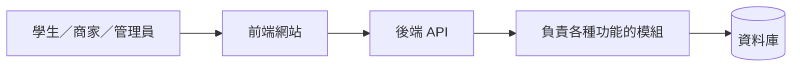

# SAD v0.6：架構與先備知識問答紀錄

整理日期：2026-11-05

本檔依本次對話整理，收錄從「Worker 是什麼」到「圖 11 管理設定的共通更新」共六組使用者提問與 AI 主要回覆。保留說明中的例子、表格、簡化圖及來源連結，未收錄讀檔等工具的原始輸出。

各題的提問時間於 2026-11-05 從本機原始對話紀錄補入，統一換算為台北時間（Asia/Taipei，UTC+08:00），並保留原始 UTC 時間與來源行號。這些是使用者訊息的紀錄時間；不能用來代替人工閱讀時間，也不能單靠相鄰提問的時間差推算 AI 執行時間。

時間來源：[本對話的原始紀錄](C:/Users/User/.codex/sessions/2026/10/27/rollout-2026-10-27T22-42-26-01a17dd0-02e0-71b1-9528-9c94f2e97baf.jsonl)，採各題對應的 `response_item` 使用者訊息時間戳，未使用檔案建立時間或修改時間代填。來源路徑是本機位置，其他成員的電腦不一定能直接開啟。

模型版本與人工閱讀時間仍未另行記錄。內容是依 SAD v0.6 所作的閱讀說明，未執行產品功能測試。

## 1. Worker 是什麼？

提問時間：**2026-11-03 22:08:50.355 +08:00**。

原始 UTC：`2026-11-03T14:08:50.355Z`（使用者訊息紀錄第 1019 行）。

**使用者提問**

> Worker 程序
>
> 通知、恢復、逾時取消與每日庫存 worker 是甚麼>

**AI 回覆**

**Worker 是一支在背景自動執行工作的程式。** 可以把它想成系統的「自動值班程式」：到了指定時間，或發現有待處理工作，就去執行。

你們的 SAD 規劃它負責這四類工作：

| 工作 | 點餐系統中的例子 |
|---|---|
| **通知** | 商家標記餐點備妥後，Worker 根據已保存的事件，產生學生的站內通知。 |
| **恢復** | 送單處理到一半程式當機，Worker 恢復後檢查原操作，繼續處理並避免重複建單。 |
| **逾時取消** | 取餐時段已結束，訂單仍未被商家接單，Worker 執行系統取消與資源釋回。 |
| **每日庫存** | 新營業日開始，依商家設定的每日預設量，建立當日庫存。 |

可以用兩個角色理解它們的分工：

- **API 程序**：接收使用者當下的操作，例如送單、接單、查詢訂單，並回傳結果。
- **Worker 程序**：處理排程或待辦工作，例如檢查到期訂單、補做中斷工作。

例如商家按「餐點備妥」時，API 先保存訂單的新狀態及待通知事件；Worker 接著處理這個事件，建立通知。通知暫時失敗時，可以稍後重試，訂單的備妥狀態仍然成立。

依[目前架構設計](D:/Projects/CampusRestaurantSystem/SAD_v0.6/00_系統架構與模組分工.md:191)，API 與 Worker 共用應用程式碼和 PostgreSQL，分別啟動成兩個程序；它們可以跑在同一台電腦上。

## 2. 本專案需要哪些先備知識？

提問時間：**2026-11-03 22:17:51.700 +08:00**。

原始 UTC：`2026-11-03T14:17:51.700Z`（使用者訊息紀錄第 1045 行）。

**使用者提問**

> 本專案我需要了解那些先備知識?

**AI 回覆**

依目前的 SAD v0.6，你可以先以**「讀得懂設計，能判斷操作結果是否合理」**為學習目標，再逐步補實作工具。三人都要輪流審查，下面這些概念適合先共同理解。

| 先備知識 | 用本專案理解 | 學到什麼程度就能開始參與審查 |
|---|---|---|
| **前端、後端、API、資料庫** | 學生按送單，畫面送出請求，後端檢查規則，再保存訂單 | 能說出一次操作經過哪些地方，以及誰負責檢查 |
| **資料表與關聯** | 一張訂單有多筆明細，每筆明細對應商品 | 看得懂 ID、主鍵、外鍵及一對多關係；理解刪除資料可能影響什麼 |
| **交易與並行操作** | 兩名學生同時搶最後一份餐點；建單失敗時不能只扣庫存 | 理解「全部成功或全部回滾」，以及為什麼同時操作需要額外保護 |
| **訂單狀態與轉換** | 待確認 → 製作中 → 可取餐 → 已完成 | 能判斷某個角色在某個狀態下，可以做哪些操作 |
| **重試與去重** | 學生連按兩次送出，或送出後斷線再試 | 理解為何需要原操作識別，以及重試時如何避免多建一張訂單 |
| **登入與權限** | 登入後才能查自己的訂單；商家只能看本店訂單 | 分得清「你是誰」與「你能做什麼」，並理解 Session、Cookie 和登出 |
| **背景工作與排程** | Worker 自動取消逾時訂單、產生通知及初始化每日庫存 | 理解工作何時執行、失敗後如何重試，以及如何確認有完成 |

其中，**交易、並行、狀態轉換與去重**，是本專案比較需要花時間理解的部分。交易能將多個資料庫異動包成全部成功或全部回滾的操作，但「兩人同時搶最後一份」還需要配合鎖定或條件更新等設計。[PostgreSQL 交易入門](https://www.postgresql.org/docs/current/tutorial-transactions.html)

閱讀文件時，再補上三種圖的基本讀法就很有幫助：

- **類別圖**：有哪些資料或物件，它們怎麼關聯。
- **循序圖**：一次操作中，誰先呼叫誰、回傳什麼。
- **狀態圖**：訂單目前在哪個狀態，下一步允許去哪裡。

進入實作後，依[專案技術選型](D:/Projects/CampusRestaurantSystem/SAD_v0.6/00_系統架構與模組分工.md:221)，再學這些工具：

- **程式基礎**：JavaScript 的函式、陣列、物件、錯誤處理與 `async/await`，接著學 TypeScript。TypeScript 官方也建議沒有 JavaScript 基礎的人先補 JavaScript。[TypeScript Handbook](https://www.typescriptlang.org/docs/handbook/intro.html)
- **前端**：HTML、CSS、React，能做表單、清單、呼叫 API，以及呈現載入和失敗狀態。網頁基礎可從 [MDN 入門](https://developer.mozilla.org/en-US/docs/Learn_web_development/Getting_started)開始。
- **後端與資料庫**：Node.js、NestJS、SQL、PostgreSQL，能寫一個 API，完成驗證、查詢與資料異動。
- **協作與驗證**：Git 的版本、差異與合併；測試的輸入、預期結果與實際結果；部署時的環境設定、日誌及備份還原。

另外，你們研究 Waterfall 與 AI，還需要懂得**把需求對應到設計、程式和測試**，以及記錄修改原因、人工審查和返工時間。這樣才有資料分析 AI 在每個階段做了什麼。

我建議你先拿「學生送出一張訂單」當練習：試著說清楚**畫面送了什麼、後端檢查什麼、資料庫寫了什麼、失敗時怎麼辦**。這條流程走懂後，再看取消、通知和恢復，會比較容易串起整份 SAD。

## 3. 去重是什麼意思？

提問時間：**2026-11-03 22:27:11.768 +08:00**。

原始 UTC：`2026-11-03T14:27:11.768Z`（使用者訊息紀錄第 1074 行）。

**使用者提問**

> 去重 是甚麼意思?

**AI 回覆**

**去重，就是辨認「同一次操作被重複送出」，避免重複產生結果。**

例如小明按「送出訂單」，畫面沒反應，又按了兩次：

- 沒有去重：可能成立三張訂單，庫存也扣三次。
- 有去重：只成立一張訂單、占用一次資源，後面的重送取得原本的結果。

系統怎麼知道是同一次操作？可以替這次送單附上一個識別，例如 `A123`：

1. 第一次收到 `A123`：建立訂單，保存這次操作的結果。
2. 再次收到相同識別與內容：如果已完成，就回覆原結果；如果仍在處理，就告知處理中，避免再建一張。

**同樣的餐點仍然可以再買一次。** 小明之後真的想再下一單，那是新的送單操作，會使用新的識別。

你們專案也需要讓取消和通知具備類似保護：重複收到取消操作，不會退兩次庫存；同一事件重送，也不會產生兩則相同通知。

## 4. 訂單狀態由誰決定？

提問時間：**2026-11-03 22:30:06.174 +08:00**。

原始 UTC：`2026-11-03T14:30:06.174Z`（使用者訊息紀錄第 1086 行）。

**使用者提問**

> 訂單狀態由誰決定?

**AI 回覆**

**訂單狀態由後端的 Orders（訂單模組），依照 SRS 的規則判斷並保存。** 學生、商家或系統發起操作，後端檢查通過後才修改狀態。

依目前專案的設計：

| 誰發起操作 | 做什麼 | 通過檢查後的狀態 |
|---|---|---|
| 學生 | 送出有效訂單 | 待商家確認 |
| 商家 | 接受待確認訂單 | 製作中 |
| 商家 | 確認餐點備妥 | 可取餐 |
| 商家 | 核對取餐碼，並確認已實際交付 | 已完成 |
| 學生 | 取消尚未被接單的本人訂單 | 已取消 |
| 商家 | 拒單，或依規則取消並填寫原因 | 已取消 |
| 商家 | 確認餐點備妥但未交付，且已超過取餐時段 | 未取 |
| 系統 | 待確認訂單到期，或商家被停用 | 已取消 |

例如，商家按下「餐點備妥」時，後端會確認：

- 操作者是否屬於這家商家。
- 訂單目前是否為「製作中」。
- 是否仍在該訂單所屬的營業日。

都符合，才改成「可取餐」。即使前端畫面送出修改要求，後端也會重新檢查。

**管理員可以停用商家，進而觸發系統取消訂單，但不能任意修改訂單狀態或代替商家宣告交付。** 詳細規則在[訂單模組](D:/Projects/CampusRestaurantSystem/SAD_v0.6/06_訂單與交易_Orders.md:65)。

## 5. UML 架構總覽怎麼讀？

提問時間：**2026-11-03 22:34:10.279 +08:00**。

原始 UTC：`2026-11-03T14:34:10.279Z`（使用者訊息紀錄第 1105 行）。

**使用者提問**

> ## UML 架構總覽 看不太懂

**AI 回覆**

這張圖可以先當成一張**「系統有哪些部分、誰會用到誰」的地圖**。它把畫面、業務功能、資料庫與維運工具全部放在一起，第一遍容易失去重點。

先看這個簡化版本：

例如學生送出訂單，大致會這樣進行：

1. **前端網站 React**  
   顯示餐點、數量與價格。學生按下送出後，前端把資料送給後端。

2. **HTTPS 入口與後端 API**  
   HTTPS 入口把請求轉給 API。API 檢查請求格式，並安排執行對應功能。

3. **Identity：確認身分與權限**  
   確認學生有登入、帳號有效，而且正在操作自己的資料。

4. **Orders：負責建立訂單**  
   Orders 會請其他模組協助檢查：

   | 請誰協助 | 要確認的事 |
   |---|---|
   | Merchant | 商家目前能不能接單？ |
   | CartQuote | 學生確認的餐點與價格有沒有改變？ |
   | Resources | 庫存與取餐時段容量是否足夠？ |

5. **DataAccess → PostgreSQL**  
   透過共用的資料存取層，將訂單、庫存保留等資料一起存入資料庫。完成後，前端才能顯示訂單成立。

回到原圖，這三種符號先認得就夠：

| 符號 | 怎麼讀 |
|---|---|
| `Orders` 方塊 | 一個負責訂單功能的模組 |
| `+createOrder()` | 這個模組對外提供「建立訂單」的操作 |
| `Orders ..> Resources` | Orders 會使用 Resources 的功能；虛線箭頭表示依賴，**不表示執行時間順序** |

九個業務模組都屬於同一套後端。它們的方塊是在表達程式的責任分工。

其餘方塊可以第二輪再看：

- **Worker、Outbox**：背景工作，以及保存待處理事件的地方。
- **Email、ImageStorage**：驗證信與商品圖片服務。
- **Monitoring、Backup、DeletionJournal**：監控、備份，以及避免已刪個資在還原後重新出現。

你現在可以先沿著原圖找出 **前端 → API → Identity／Orders → DataAccess → PostgreSQL**，並用「學生送出一張訂單」解釋它們各做了什麼。這條路徑看懂後，其他功能會比較容易接上。[查看原圖](D:/Projects/CampusRestaurantSystem/SAD_v0.6/00_系統架構與模組分工.md:7)

## 6. 圖 11「管理設定的共通更新」是什麼意思？

提問時間：**2026-11-05 15:53:27.764 +08:00**。

原始 UTC：`2026-11-05T07:53:27.764Z`（使用者訊息紀錄第 1133 行）。

**使用者提問**

> ## 圖 11 管理設定的共通更新 是甚麼意思?

**AI 回覆**

**圖 11 在說：使用者修改設定時，後端共同要經過哪些檢查，才能把資料存下來。**「共通」表示修改營業時間、商品或庫存等功能，都會用到類似的處理流程；每次仍只修改使用者選定的功能。

例如，便當店把營業時間從 **11:00～14:00 改成 11:00～15:00**，可以順著圖這樣讀：

1. **送出修改內容**  
   畫面送出新的營業時間，以及目前讀到的設定版本 `expectedVersion`。

2. **確認有權限修改**  
   後端確認操作者是這家店的商家，才能修改本店設定。

3. **確認內容符合規則**  
   檢查時間格式、開始與結束順序，以及是否與其他營業區段重疊。不符合就指出錯誤，不儲存。

4. **開始交易，再檢查一次**  
   圖中的 `BEGIN` 表示開始這一批資料修改。後端取得必要的資料鎖，再確認版本與條件仍然有效，避免檢查後資料又被別人改過。

5. **儲存設定與操作紀錄**  
   條件都符合，就保存新的營業時間及這次異動紀錄。`COMMIT` 表示確認提交；確認成功後，畫面才顯示修改成功。若檢查失敗，就回滾這批修改。

其中，**`expectedVersion` 是用來避免舊畫面覆蓋新資料的**。例如：

> 電腦和平板都讀到第 3 版設定。平板先修改成功，變成第 4 版。電腦之後仍帶著第 3 版送出，後端就會回報衝突，請使用者重新讀取後再決定。

圖中還有一條特殊分支：**停用或恢復商家**。這會連動帳號、登入狀態與訂單，因此轉交專用流程處理，停用時還需要二次確認。

這裡的「管理設定」也包含商家自己的設定畫面，各項操作仍依角色授權；例如商家管理本店商品，管理員管理商家資料。[查看圖 11](D:/Projects/CampusRestaurantSystem/SAD_v0.6/02_商家與營業_Merchant.md:36)
