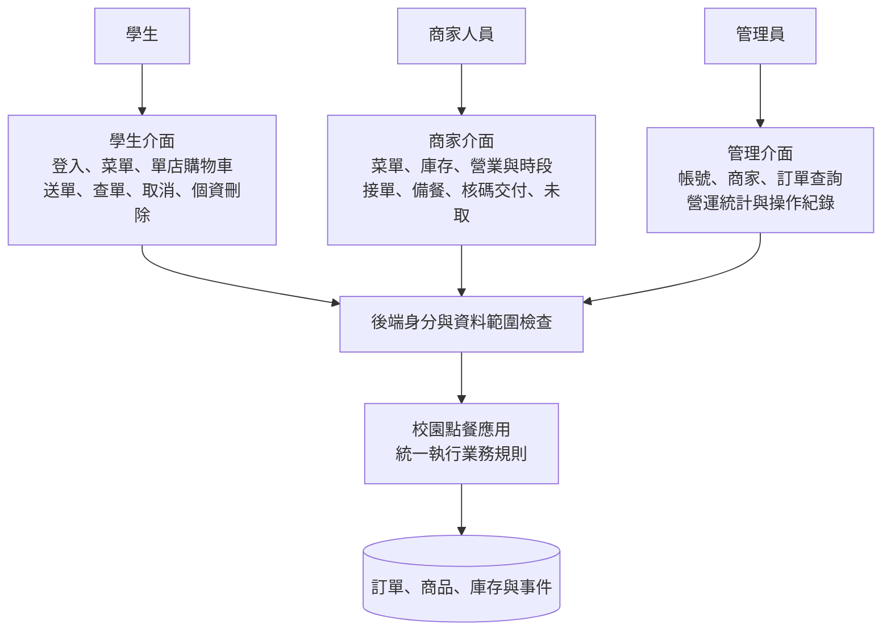
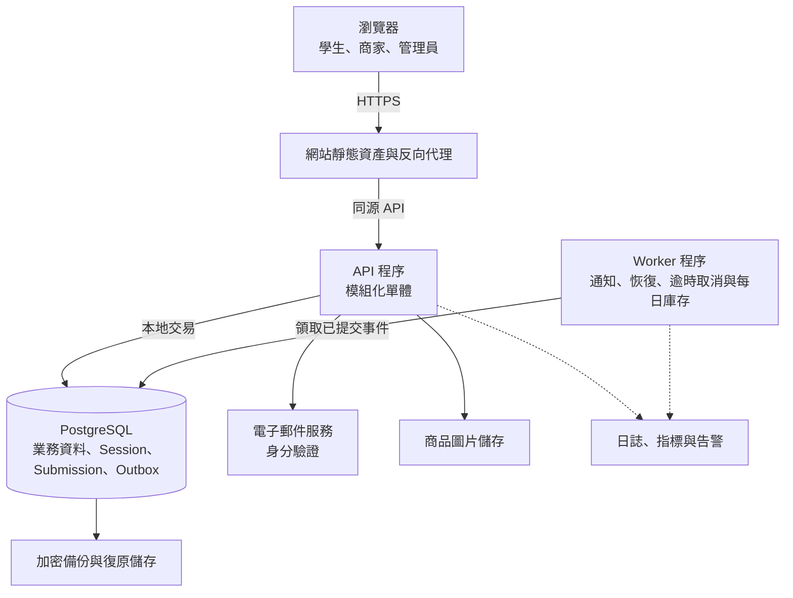
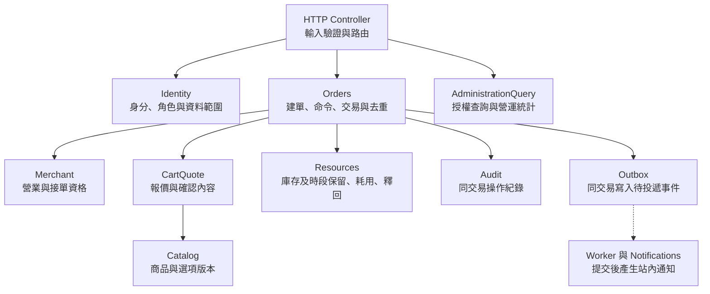

# 校園點餐系統｜系統架構與模組分工

> SAD v0.4｜需求基線 SRS v0.6｜設計審查稿

[回 SAD 索引](../校園點餐系統_SAD_v0.4.md) · [下一份：身分與帳號模組](./01_身分與帳號_Identity.md)

### 文件標記

- 需求：可追溯至 SRS 的既有要求。
- 設計提案 D-xx：本文提出的技術與實作選擇，需設計審查。
- 設計待確認：僅包含技術選型、部署與實作細節；SRS v0.6 已有明文的業務規則不再列為待決議。

### 主要架構驅動因素

| 驅動因素 | 架構回應 |
| --- | --- |
| 不超賣、不超額、同次送單只成立一次 | 訂單、庫存、時段與去重紀錄在同一關聯式資料庫交易中提交 |
| 接單、取消、完成及未取可能同時操作 | 集中狀態機、列鎖、版本檢查與命令去重 |
| 價格異動不能改寫歷史 | 伺服器報價及不可經一般功能修改的訂單快照 |
| 三種角色與商家資料隔離 | 每個受保護請求執行身分、角色及資源範圍檢查 |
| 初期 3000 位學生、500 人在線、30 家商家、每家 100 項商品 | 優先採可水平擴充的模組化單體，經量測調整資源 |
| 正常連線前景頁面，95% 狀態變更於 10 秒內可見 | 前景輪詢、更新時間提示、斷線恢復及通知可靠投遞 |

## 整體架構與技術選型

### 架構決策

**D-01：採模組化單體（Modular Monolith）、單一交易資料庫，以及獨立背景工作程序**。

學生、商家與管理介面共用一套後端業務規則。後端以 Module（模組）組織責任，對外提供明確的 Interface（介面契約）；Controller 不直接更新資料表。訂單 Module 隱藏送單驗證、鎖定、保留、快照、事件及去重的 Implementation（實作），呼叫端只提交完整業務命令。

### 建議技術組合

以下為設計選型，不是現有專案依賴清單；實際版本於開發啟動時鎖定並做相容性驗證。

| 層級 | 建議 | 選擇理由與限制 |
| --- | --- | --- |
| 瀏覽器介面 | React + TypeScript，響應式網站 | 三角色共用表單、清單及狀態呈現；依官方 UI 拆分與狀態設計方式組織畫面。[React 文件](https://react.dev/learn/thinking-in-react) |
| 後端 | Node.js + TypeScript + NestJS | 以 imports／providers／exports 管理 Module 的公開契約與內部實作。[NestJS Modules](https://docs.nestjs.com/modules) |
| 權威資料儲存 | PostgreSQL | 使用交易、列鎖、唯一限制、外鍵與檢查限制保護資料；具體交易流程由本文定義。[鎖定](https://www.postgresql.org/docs/current/explicit-locking.html)、[資料限制](https://www.postgresql.org/docs/current/ddl-constraints.html) |
| 資料存取 | 參數化 SQL、版本化 migration | 涉及鎖與條件更新的語意須可直接檢查；若選 ORM，須證明所有 Module 使用同一交易連線 |
| HTTP 契約 | HTTPS、JSON、REST 風格端點、OpenAPI 規格 | 讓前後端與測試共享欄位、錯誤及授權定義 |
| 背景工作 | 同一程式庫的 Worker 程序 + DB Outbox | 通知與恢復工作不延長訂單交易；初期不增加訊息代理必要相依 |
| 圖片 | 私有上傳區及公開商品圖片儲存區 | 圖片二進位不放訂單資料表；DB 保存資產識別與發布狀態 |
| 電子郵件 | 校方或核定供應商，透過 Email Adapter | 只供驗證；供應商由設計審查選定；驗證碼與寄送限制依 SRS v0.6 FR-001 |
| 部署 | 容器化應用、HTTPS 入口、私有資料庫網路 | 可在校方或雲端環境落地；平台與規格待選定，可用性依 SRS v0.6 NFR-005 |

本版不以 Redis、Kafka、Kubernetes、搜尋引擎或獨立資料倉儲作為必要相依。後續只有在負載與運維證據支持時才加入；不承諾任何硬體規格可直接達成效能目標。

### 角色與功能架構圖



信任邊界位於瀏覽器與後端、應用與資料儲存、應用與外部郵件服務之間。瀏覽器傳入的角色、金額、時間及資料歸屬均不具權威性。

### 部署架構示意圖



API 與 Worker 可分開增加執行個體，但由同一套版本化程式建置。登入狀態、去重結果、Outbox 及工作租約均保存在共用持久儲存，不依賴單一程序記憶體。

## 模組責任與介面契約

### Module 分工

| Module | 公開 Interface 範例 | 隱藏的主要實作 | 需求 |
| --- | --- | --- | --- |
| Identity | `requestEmailVerification`、`verifyEmailAndLogin`、`authorize`、`changeAccountStatus`、`deleteStudentData` | 驗證憑證、Session、角色與帳號有效性 | FR-001～003、028 |
| Merchant | `createMerchant`、`updateMerchant`、`updateBusinessSchedule`、`canAcceptOrders` | 啟停、營業區間、例外日、接單設定 | FR-004、005 |
| Catalog | `createProduct`、`updateProduct`、`configureOptions`、`validateSelections` | 商品版本、選項限制、圖片發布與上下架 | FR-007、008、010 |
| CartQuote | `updateCart`、`quoteOrder`、`calculatePrice`、`validateAcceptedQuote` | 單店購物車、精確計價、版本比較與報價歸屬 | FR-011～013 |
| Resources | `savePickupSlot`、`adjustInventory`；訂單內部使用 `reserve`、`consume`、`release` | 庫存與時段鎖、保留明細、一次性釋回 | FR-006、009、018 |
| Orders | `createOrder`、`getSubmissionResult`、`applyOrderCommand`、`cancelExpiredPendingOrders` | 去重、狀態機、交易協調、不可變快照及事件 | FR-014～021、027 |
| Notifications | `listNotifications`、`loadMerchantOrderBoard`、`createNotificationsFromOrderEvent` | Outbox 去重、投遞進度與授權可見性 | FR-022、023 |
| AdministrationQuery | `searchOrders`、`getOperationalStatistics` | 角色資料範圍、分頁、現有訂單統計與截至時間 | FR-024、025 |
| Audit | `appendAuditEvent`、`searchAuditEvents` | 附加紀錄、敏感欄位排除與查閱權限 | FR-026 |

Module 的 Interface 包含輸入、輸出、不變條件、可重試錯誤及交易規則；不只是函式名稱。可改變實作的位置稱為 Seam，滿足該契約的具體整合稱為 Adapter。Email Adapter 可用正式供應商或測試收件器；Clock 可用正式時間或固定測試時間。庫存並行測試仍須使用真正的 PostgreSQL，不能用記憶體替身宣稱已證明資料庫交易正確。

### 模組依賴圖與依賴規則



- Orders 主導交易，Resources 等內部操作接受同一 `TransactionContext`，不能自行提交。
- Controller 不逐步呼叫「扣庫存、建單、通知」來組合交易；只呼叫完整的 `createOrder`。
- Module 不任意寫入其他 Module 的資料表；跨模組變更透過其交易內 Interface。
- 查詢可使用受控 SQL View 或查詢層連接所需資料，但不可繞過身分與歸屬檢查。
- 通知只能讀取已提交事件，不能反向推進訂單狀態。

### 建議程式目錄

```text
apps/
  web/src/features/          # auth、menu、cart、orders、merchant、admin
  api/src/modules/           # identity、merchant、catalog、cart-quote、resources、orders…
  worker/src/                # outbox 投遞、送單恢復、維護工作
packages/
  contracts/                # HTTP DTO 與產生的前端型別；不匯出內部 Entity
  application/              # API 與 Worker 共用的應用 Module
  infrastructure/           # DB、郵件、圖片、時鐘及觀測整合
database/
  migrations/
  seeds/                    # 合成測試資料
tests/
  integration/              # 真實 DB、交易與並行測試
  e2e/                      # 三角色主要流程
  load/                     # 核定使用情境與容量驗證
docs/
  architecture/
  api/
```

此為後續開發提案，尚未在專案建立上述程式目錄。

## 設計決策摘要

| 決策 | 內容 | 主要取捨 |
| --- | --- | --- |
| D-01 | 模組化單體＋單 DB＋Worker | 簡化一致性；需維護 Module 分工與共同發布 |
| D-02 | 明確識別、時間與精確金額型別 | 避免歧義；整數新台幣與 Asia/Taipei 已依需求定義 |
| D-03 | 保留帳分離、手動只調可用量 | 避免覆寫保留；按營業日保護跨日釋回 |
| D-04 | 列鎖、條件更新與固定鎖順序 | 語意明確；熱門時段需量測鎖等待 |
| D-05 | 版本化 HTTP 契約與 Session | 前後端契約一致；需共用 Session 儲存及 CSRF 防護 |
| D-06 | 前景合併輪詢 | 初期較易運維；增加讀取負載，必須量測延遲 |
| D-07 | DB Outbox 與去重通知 | 可恢復投遞；需要 Worker 監控與人工重投流程 |
| D-08 | 後端 Session 與每次有效性檢查 | 停用立即反映；增加權威資料讀取 |
| D-09 | 版本化發布與相容 migration | 回滾可控；需維持過渡期間相容性 |
| D-10 | 分離權限的備份與演練 | 可驗證復原；須以演練證明既定 RPO／RTO |
| D-11 | 先量測、索引及縮短交易再加基礎設施 | 控制複雜度；不預先保證未測硬體容量 |

上述決策均為本次提案，尚未有核准人或核准日期。設計審查應記錄採納、調整或退回，以及受影響的需求與測試。
