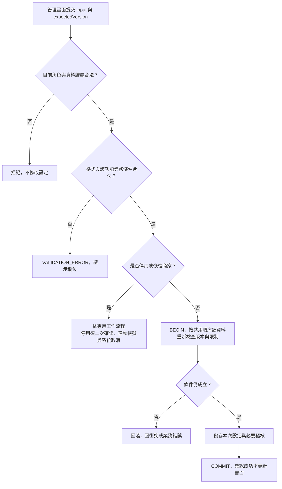

# 校園點餐系統｜商家與營業模組

> SAD v0.4｜需求基線 SRS v0.6｜設計審查稿

[回 SAD 索引](../校園點餐系統_SAD_v0.4.md) · [上一份：身分與帳號模組](./01_身分與帳號_Identity.md) · [下一份：商品與選項模組](./03_商品與選項_Catalog.md)

負責商家資料、營業設定與接單資格。商家停用由本模組發起，委由 Orders 執行系統取消；時段容量的保存與占用由 Resources 負責。

## 模組責任

| Module | 公開 Interface 範例 | 隱藏的主要實作 | 需求 |
| --- | --- | --- | --- |
| Merchant | `createMerchant`、`updateMerchant`、`updateBusinessSchedule`、`canAcceptOrders` | 啟停、營業區間、例外日、接單設定 | FR-004、005 |

完整分工與依賴規則見 [系統架構與模組分工](./00_系統架構與模組分工.md)；資料表見 [共用資料架構](./10_共用資料架構.md)，HTTP 契約見 [共用 API 與錯誤契約](./11_共用API與錯誤契約.md)。

## 商家與營業函式契約

來源：v0.4 FR-004～006、§6.2；停用連動與容量調低依 v0.6 修訂。

| 函式／追溯 | 輸入 | 成功輸出 | 拒絕及一致性處理 |
| --- | --- | --- | --- |
| `createMerchant`、`updateMerchant`／FR-004 | actor、名稱、位置、聯絡與取餐說明；修改帶 expectedVersion | merchant、version | 欄位錯誤、版本衝突；status 變更分派至停用／恢復工作流程，不能用一般欄位更新繞過 [訂單與交易模組](./06_訂單與交易_Orders.md) |
| `previewMerchantDisable`、`disableMerchant`／FR-004、027 | merchantId；確認請求另帶 confirmed、預覽版本與受影響集合摘要 | 預覽 activeOrderCount／confirmationToken；提交後商家與帳號停用、訂單取消結果 | 預覽不鎖定資源；確認時重驗資料，改變則回 `VERSION_CONFLICT` 並要求重新確認；不預設同意 |
| `updateBusinessSchedule`／FR-005 | weeklyHours、closedDates、acceptingOrders、cutoffMinutes、expectedVersion | 設定、effectiveAccepting、unavailableReason、version | 星期、日期、時間錯誤，跨午夜或重疊拒絕；區段採起含迄不含，24:00 僅作當日結束邊界 |
| `canAcceptOrders`／FR-005 | 商家權威設定、serverNow | boolean、reason | 同時檢查商家啟用、接單開關、例外日與營業區間；前端快取不能當送單依據 |

## 時段與停用協作

可預訂截止與時段設定見 [庫存與時段模組](./05_庫存與時段_Resources.md)；二次確認、整店取消及恢復行為見 [訂單模組的自動取消設計](./06_訂單與交易_Orders.md)。

## 管理設定的共通流程圖

來源：v0.4 圖 6-2；追溯：FR-004～009、026。

每次只更新所選功能。時段可調低容量並保留既有占用，但有進行中訂單不能改起迄或刪除；商品、庫存與分類仍各自檢查 [商家與營業模組](./02_商家與營業_Merchant.md)至[商品與選項模組](./03_商品與選項_Catalog.md) 的條件。未知提交結果先重讀。
