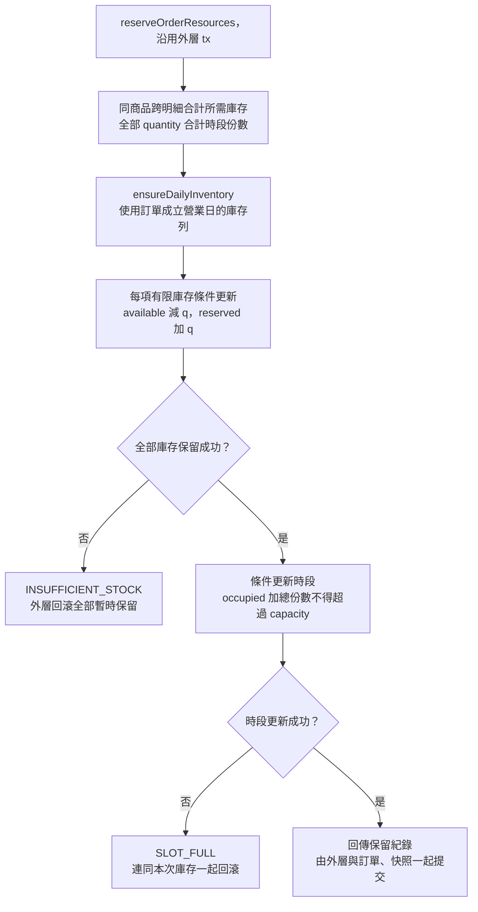
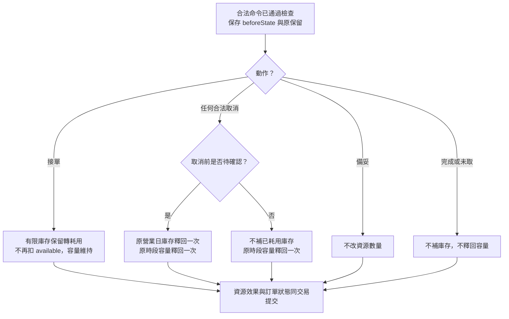

# 校園點餐系統｜庫存與時段模組

> SAD v0.4｜需求基線 SRS v0.6｜設計審查稿

[回 SAD 索引](../校園點餐系統_SAD_v0.4.md) · [上一份：購物車與報價模組](./04_購物車與報價_CartQuote.md) · [下一份：訂單與交易模組](./06_訂單與交易_Orders.md)

負責當日庫存、每日初始化、取餐時段及原保留的耗用與釋回。訂單內部資源操作接受 Orders 提供的同一交易，不自行提交。

## 模組責任

| Module | 公開 Interface 範例 | 隱藏的主要實作 | 需求 |
| --- | --- | --- | --- |
| Resources | `savePickupSlot`、`adjustInventory`；訂單內部使用 `reserve`、`consume`、`release` | 庫存與時段鎖、保留明細、一次性釋回 | FR-006、009、018 |

完整分工與依賴規則見 [系統架構與模組分工](./00_系統架構與模組分工.md)；資料表見 [共用資料架構](./10_共用資料架構.md)，HTTP 契約見 [共用 API 與錯誤契約](./11_共用API與錯誤契約.md)。

## 時段設定與可預訂查詢

來源：v0.4 FR-004～006、§6.2；停用連動與容量調低依 v0.6 修訂。

| 函式／追溯 | 輸入 | 成功輸出 | 拒絕及一致性處理 |
| --- | --- | --- | --- |
| `savePickupSlot`／FR-006 | 日期、起迄、capacity、expectedVersion | slot、occupiedUnits、remaining、version | 至少 10 分鐘、分鐘精度、不重疊且完整落在營業區段；有進行中訂單不能改起迄或刪除，可調低容量 |
| `listBookableSlots`／FR-006 | merchantId、當日 date、requestedUnits | slots{remaining,bookable,reason} | remaining=max(0,capacity−occupied)；需求超過剩餘量標示不足，額滿／截止分開；送單再驗證 |

截止時間為 `startAt - cutoffMinutes`，N 預設 10、範圍 0～120；到該時刻即不可預訂。時段與營業區間重疊檢查先鎖商家再讀寫設定，避免兩筆並行新增各自通過後形成重疊。訂單永遠讀成立時的時段快照。

## 庫存管理與每日初始化

來源：v0.4 FR-007～009；每日庫存及模式切換依 v0.6 修訂。

| 函式／追溯 | 輸入 | 成功輸出 | 拒絕及一致性處理 |
| --- | --- | --- | --- |
| `adjustInventory`／FR-009 | productId、mode、availableQuantity、dailyDefaultQuantity、soldOut、expectedVersion | mode、當日 available／reserved／consumed、version | 數量非負整數；不得直接改保留／耗用；模式切換依 [庫存與時段模組](./05_庫存與時段_Resources.md)，衝突 `INVENTORY_MODE_CHANGE_FORBIDDEN` |
| `ensureDailyInventory`／FR-009 | tx、productId、businessDate | 當日庫存列 | 以唯一鍵建立一次；既有列不可因重試被重設；跨日釋回只更新原列 |
| `checkAvailability`／FR-009 | 已驗證 items、營業日 | 按商品合計需求與供應判斷 | 同商品不同選項先加總；售完 `PRODUCT_UNAVAILABLE`，有限可用量不足 `INSUFFICIENT_STOCK` |

## 交易內資源函式

來源：v0.4 FR-014、015、018、§6.4；三張上限、到期與自動取消依 v0.6 補齊。

| 函式／追溯 | 輸入 | 成功輸出 | 拒絕及一致性處理 |
| --- | --- | --- | --- |
| `reserveOrderResources`／FR-006、009、014 | tx、items、slot、businessDate | 完整 inventoryReservations、slotReservation | 按商品合計庫存，全部 quantity 合計容量；任一失敗回滾全部，沒有公開占資源端點 |
| `applyCancellationResources`／FR-018 | tx、order、beforeState、原 reservations | releasedInventory、releasedSlotUnits、alreadyApplied | 接單前回原營業日庫存與時段；接單後只退時段；缺保留或數量矛盾 `RESOURCE_INTEGRITY_ERROR` 並回滾告警 |

## 資源處理矩陣與營業日

| 事件 | 有限庫存 | 時段容量 | 原子提交內容 |
| --- | --- | --- | --- |
| 成立 | available 減 q，reserved 加 q | occupied 增加全部明細份數合計 | 訂單、快照、兩類保留、成立事件、送單成功 |
| 接單 | reserved 減 q，consumed 加 q，保留改 CONSUMED；不再次扣 available | 保持原占用 | 狀態、耗用、命令結果、事件及必要通知 |
| 接單前取消／拒單／系統取消 | 僅 RESERVED 可轉 RELEASED；原營業日 available 加 q、reserved 減 q | 僅 OCCUPIED 可釋回一次 | 取消與全部釋回一起提交 |
| 接單後取消 | 不補回已耗用庫存 | 釋回原占用一次 | 原狀態、理由、取消、政策處置及事件 |
| 完成／未取 | 不補庫存 | 維持原占用，不釋回 | 終止狀態、時間、政策處置及事件 |

不限量商品仍受上下架、售完、選項及時段容量限制。**D-03**：按營業日分開保留帳；手動調整只改當日可用量，不覆寫保留或耗用。有限轉不限量時，只要有該商品的待確認訂單就拒絕；不限量轉有限須同時提供可用量與每日預設量，既有不限量訂單不事後扣庫存。

容量需求為全部明細 quantity 的合計，選項不另計；供應與營業檢查依 [商家與營業模組](./02_商家與營業_Merchant.md)。容量調低後既有訂單維持，剩餘顯示 max(0, capacity - occupiedUnits)，禁止新增超額占用。

每日 00:00 建立新營業日庫存，以每日預設量初始化；每日預設量為 0 時維持售完，其餘有限商品重設未售完。以唯一鍵與交易內的按日初始化保證排程延遲時，當日第一筆讀寫仍使用當日庫存；重試不得再次重置已被使用的當日數量。昨日取消只回補昨日的保留帳。每日預設量保存生效營業日，修改值自下一營業日起生效；即使初始化排程延誤，也按該營業日生效的設定建立庫存，不使用稍後修改的新值。

## 庫存與容量保留流程圖

來源：v0.4 圖 6-7；追溯：FR-006、009、014、015。

同商品兩行各兩份必須按四份檢查。容量調低至既有占用以下時，此條件更新拒絕新單，既有訂單不變。此函式不能自行提交或供前端直接占資源。

## 資源效果流程圖

來源：v0.4 圖 6-11；追溯：FR-016～020、027。

任何取消包含學生、商家拒單／取消及系統逾時／停用取消。先依原狀態判斷再改 CANCELLED；釋回依原 Reservation，不按目前菜單重算，也不能補到今日庫存。
