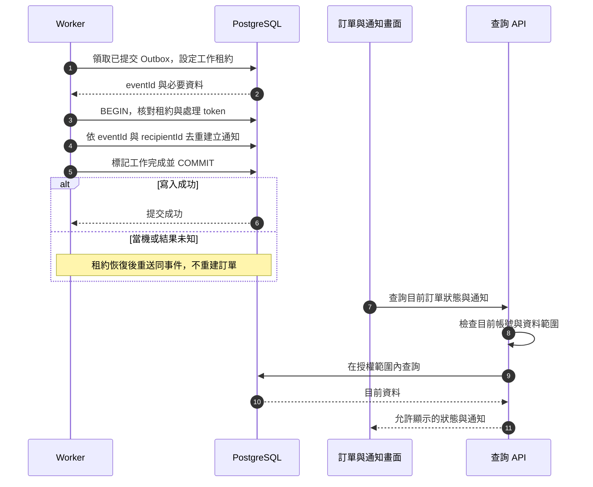

# 校園點餐系統｜通知與工作台模組

> SAD v0.4｜需求基線 SRS v0.6｜設計審查稿

[回 SAD 索引](../校園點餐系統_SAD_v0.4.md) · [上一份：訂單與交易模組](./06_訂單與交易_Orders.md) · [下一份：查詢與統計模組](./08_查詢與統計_AdministrationQuery.md)

負責已提交事件的站內通知、商家待處理提示與背景投遞。排程呼叫 Orders／Resources 的既有介面，不在 Worker 複製業務規則。

## 模組責任

| Module | 公開 Interface 範例 | 隱藏的主要實作 | 需求 |
| --- | --- | --- | --- |
| Notifications | `listNotifications`、`loadMerchantOrderBoard`、`createNotificationsFromOrderEvent` | Outbox 去重、投遞進度與授權可見性 | FR-022、023 |

完整分工與依賴規則見 [系統架構與模組分工](./00_系統架構與模組分工.md)；資料表見 [共用資料架構](./10_共用資料架構.md)，HTTP 契約見 [共用 API 與錯誤契約](./11_共用API與錯誤契約.md)。

## 通知與工作台函式契約

來源：v0.4 FR-021～023、§6.7。

| 函式 | 輸入 | 輸出與處理 |
| --- | --- | --- |
| `createNotificationsFromOrderEvent` | 已提交 eventId、orderId、eventType | 依 [通知與工作台模組](./07_通知與工作台_Notifications.md) 收件規則產生通知；eventId＋recipientId 去重；回滾或已刪訂單事件不得投遞 |
| `listNotifications` | actor、cursor?、limit? | 訂單編號、事件、時間、必要原因及 nextCursor；無 readAt、信箱或取餐碼 |
| `loadMerchantOrderBoard` | 商家 actor、狀態篩選、分頁 | pendingCount、orders、nextCursor、asOf；pendingCount 對全部待確認訂單計數，不只當頁 |
| `refreshOrderBoard` | 最近一次狀態與版本 | 合併輪詢更新；舊 version 不覆蓋新狀態，失敗保留 stale 標示，恢復後完整同步 |

## 提交後通知循序圖

### 圖 6-3 提交後的通知投遞

## Transactional Outbox

**D-07**：訂單交易先把事件及 Outbox 同時寫入 DB，提交後 Worker 再產生站內通知。Outbox 只是投遞工作，不是第二套訂單狀態來源。

1. Worker 以短交易領取待處理資料、設租約與 attempt token，避免長時間持有鎖。
2. 建立通知時以 `(eventId, recipientId)` 去重；寫通知與標記此工作完成放在同一交易。
3. 失敗採有上限的指數退避，超限標為待人工處理並告警；人工重投仍沿用同一 eventId。
4. 當機後回收逾期租約；舊工作者不得用失效 token 確認新租約的工作。
5. 學生收到接單、拒單、備妥、商家或系統取消、未取通知；學生自行取消只通知商家，管理員不收訂單通知。內容為訂單編號、事件時間、類型及必要取消原因，不含信箱或取餐碼；不提供已讀功能，保存 30 天。讀取仍重驗權限。Worker 以事件時間計保存期，過期事件不再補出新通知；已刪除帳號或訂單不得被舊 Outbox 重建。

設計採「可重送投遞＋冪等寫入」，不宣稱傳輸層只送一次。若先完成通知卻在確認前當機，重跑仍只有一筆通知。商家新單清單直接查權威訂單資料，通知延遲不阻止接單。

## 其他背景工作

包含 PROCESSING 送單恢復、失效驗證挑戰清除、孤立圖片清理、核定資料保存清理及一致性巡檢。巡檢發現庫存、保留或容量不符時先告警並限制受影響的新單，不能任意改歷史訂單來消除差異。

增加到期的待確認訂單取消、每日庫存初始化、24 小時操作結果清理與 30 天通知清理；排程須可重試並補行。自動取消依 [訂單與交易模組](./06_訂單與交易_Orders.md)；未取仍僅由所屬商家操作。

## 查詢與前端協作

訂單詳情查詢契約與角色 DTO 見 [訂單與交易模組](./06_訂單與交易_Orders.md)；輪詢、斷線與舊版本合併策略見 [前端架構](./12_前端架構.md)。
