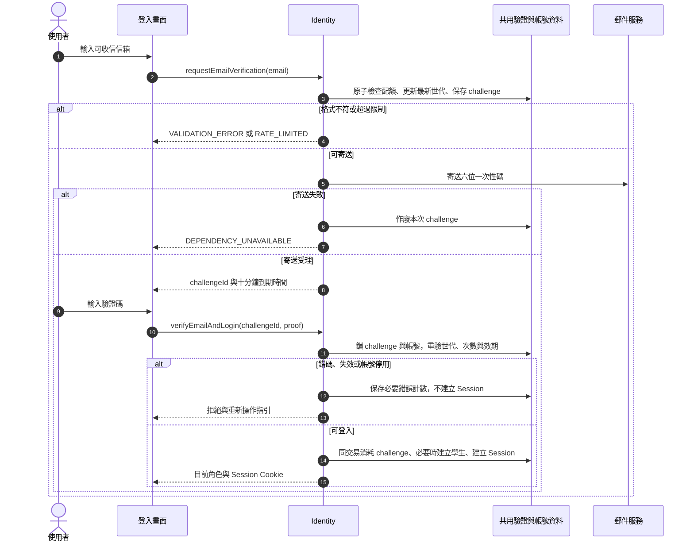

# 校園點餐系統｜身分與帳號模組

> SAD v0.5｜需求基線 SRS v0.6｜設計審查稿

[回 SAD 索引](../校園點餐系統_SAD_v0.5.md) · [上一份：系統架構與模組分工](./00_系統架構與模組分工.md) · [下一份：商家與營業模組](./02_商家與營業_Merchant.md)

負責電子郵件登入、Session、角色授權、帳號停用，以及學生個資刪除。所有模組共用本模組的身分有效性檢查。

## 模組責任

| Module | 公開 Interface 範例 | 隱藏的主要實作 | 需求 |
| --- | --- | --- | --- |
| Identity | `requestEmailVerification`、`verifyEmailAndLogin`、`authorize`、`changeAccountStatus`、`deleteStudentData` | 驗證憑證、Session、角色與帳號有效性 | FR-001～003、028 |

完整分工與依賴規則見 [系統架構與模組分工](./00_系統架構與模組分工.md)；資料表見 [共用資料架構](./10_共用資料架構.md)，HTTP 契約見 [共用 API 與錯誤契約](./11_共用API與錯誤契約.md)。

## 函式契約與身分處理

| 函式／追溯 | 輸入 | 成功輸出 | 拒絕及一致性處理 |
| --- | --- | --- | --- |
| `requestEmailVerification`／FR-001 | email | challengeId、expiresAt、resendAt、泛化寄送提示 | 格式錯誤 `VALIDATION_ERROR`；寄送限制 `RATE_LIMITED`；郵件失敗 `DEPENDENCY_UNAVAILABLE`，不建立登入 |
| `verifyEmailAndLogin`／FR-001 | challengeId、六位字串 proof | user{id,role,status}、Session Cookie | 錯誤 `VERIFICATION_INVALID`；逾期、已用或作廢 `VERIFICATION_EXPIRED_OR_USED`；停用 `ACCOUNT_DISABLED`；消耗 challenge、必要學生註冊與 Session 建立同交易 |
| `createPrivilegedAccount`／FR-002 | actor、email、role、merchantId（商家必填） | account{id,email,role,status,merchantId?} | 僅 ADMIN，可建 MERCHANT／ADMIN；商家第二帳號或重複信箱 `ACCOUNT_CONFLICT`；不接受 permissions、管理範圍或多店歸屬 |
| `authorize`／FR-002 | AuthContext、action、resource | 授權通過或拒絕 | 每次檢查有效帳號；學生限本人，商家限本店，管理員涵蓋全部商家；讀取越界用一致 404 |
| `changeAccountStatus`／FR-003 | actor、accountId、status、expectedVersion | id、status、version | 自己停用、最後管理員停用 `ACCOUNT_STATUS_CHANGE_FORBIDDEN`；商家帳號須走商家連動；狀態、Session 撤銷與稽核同交易 |
| `deleteStudentData`／FR-028 | 本人 AuthContext、confirmed=true | 204，清除登入 Cookie | 有進行中訂單 `ACTIVE_ORDERS_PREVENT_DELETION`；不可接受他人 studentId；刪除與復原抑制依 [身分與帳號模組](./01_身分與帳號_Identity.md) |

Email 正規化僅去首尾空白並規範網域大小寫，不擅自改寫 local-part。寄送限額、最新 challenge 世代與錯誤計數放共用儲存；每信箱序列化核發，重寄使前一世代失效。錯碼更新計數仍須提交，不能與拒絕登入一起回滾。寄信在資料庫交易之外執行；只在供應商接受後回寄送成功，寄送失敗使該 challenge 作廢。

首位管理員由部署程序使用校方指定信箱建立，重跑部署不得重建或提高其他帳號權限。管理員停用先鎖 `admin_guard`，再鎖相關帳號及計算有效管理員數；兩位管理員互相停用時，後取得鎖者必須重新驗證自身仍有效。

## 登入循序圖

追溯：FR-001～003。

申請寄信不是登入。首次成功驗證才建立學生；既有商家與管理員保留原角色。單次消耗與 Session 建立原子執行；配額、世代與錯誤計數使用共用儲存。

## 授權矩陣

| 操作 | 學生 | 商家 | 管理員 |
| --- | --- | --- | --- |
| 建立購物車、報價與訂單 | 本人 | 不提供代下單 | 不提供代下單 |
| 查閱訂單 | 本人 | 所屬商家 | 全部商家 |
| 修改商品、庫存與時段 | 不可 | 所屬商家 | 不因管理身分自動取得商家操作權 |
| 接單、拒單、備妥、交付、未取 | 不可 | 所屬商家且狀態合法 | 不代商家執行 |
| 個資刪除 | 本人且無進行中訂單 | 不可 | 不代學生刪除 |
| 學生取消 | 本人待確認訂單 | 使用商家拒單／取消命令 | 無任意狀態修改權 |
| 帳號與商家管理 | 不可 | 不可跨越管理權限 | 全部管理功能 |
| 操作紀錄、管理統計 | 不可 | 僅本店統計，不可讀操作紀錄 | 全部商家統計與操作紀錄 |

## 安全設計

- **D-08 Session**：採伺服器端 Session，Cookie 設 Secure、HttpOnly 及適當 SameSite；寫入檢查 CSRF token 與來源。每次受保護請求讀取權威帳號有效狀態，不以未到期 token 略過停用檢查。
- 電子郵件 proof 只保存雜湊／加密驗證摘要；低熵驗證碼採帶伺服器秘密的摘要並限制嘗試。成功核對、消耗 challenge 與建立 Session 原子執行；六位數字碼有效 10 分鐘，60 秒內不得重寄，同信箱每小時最多 5 封；重寄使舊碼失效，單組錯誤 5 次作廢。任何信箱網域皆可，首次成功驗證自動建立學生；已存在的商家與管理員沿用原角色。
- 對登入申請與驗證、取餐碼核對、上傳及高成本查詢設頻率限制；多 API 個體共用限流狀態。數值屬安全設定提案，不沿用舊 PRD。
- 取餐碼既須供學生查閱又須核對，因此採加密保存與獨立鍵控摘要；金鑰版本可追蹤與輪替。核對限定已授權商家及指定訂單，不提供匿名短碼查單。
- 查詢在 SQL 條件納入 student_id／merchant_id／管理員角色，輸出欄位採允許清單；商家不取得任何學生識別資訊；取餐碼只回本人學生，管理員亦不可見。跨範圍資源使用一致 404 回應。
- 上傳檢查實際檔案格式、大小及解碼後尺寸，重新編碼後發布；拒絕可執行內容與任意遠端 URL 抓取。依 FR-007 限 JPEG／PNG／WebP、5 MB、各邊 4096 像素，每商品最多一張。
- 註記、品名與原因當純文字處理，輸出編碼；DB 使用參數化查詢。正式錯誤不包含堆疊、SQL、完整驗證碼、Session 或完整取餐碼。
- 一般應用帳號不具 schema 管理權；歷史快照與稽核一般角色不具更新權。migration、備份及核定資料清除使用分離權限。
- 個資不自動到期；本人刪除依 [身分與帳號模組](./01_身分與帳號_Identity.md)。功能性資料到期依 FR-001、015、016、022；恢復舊備份須先重新套用刪除日誌，避免已刪資料重新對外可見。

停用與寫入競爭由帳號列鎖排序：停用已提交後的新授權請求必須拒絕；已先取得有效授權鎖並提交的命令可視為停用前操作。恢復帳號不自動復活已撤銷 Session，需重新登入。

## 學生個資刪除與還原防護

本節依 SRS v0.6 FR-028／NFR-007 設計。deleteStudentData 只接受本人登入與明確確認，無管理員核准步驟；不提供資料匯出或歷史訂單任意修改功能。

1. 依 [訂單與交易模組](./06_訂單與交易_Orders.md) 鎖住學生帳號，重查全部訂單。存在待確認、製作中或可取餐訂單即拒絕，不能只依畫面顯示或過期計數。送單、終止與刪除共用學生鎖，避免查完後新單成立。
2. 無進行中訂單時，記錄不可逆刪除意圖並封鎖該帳號新的受保護請求。刪除意圖必須先持久寫入與業務備份獨立保存的復原刪除日誌；僅留隨機 requestId、用專用秘密計算的識別比對摘要與狀態，不保存信箱、原始帳號／訂單 ID、餐點或自由文字。摘要只供還原時判斷應清除資料，不對任何產品角色提供查詢。
3. 專用刪除交易移除帳號、Session、該信箱驗證資料、購物車、報價、全部訂單與快照、事件、保留明細、取餐秘密、送單／命令結果與墓碑、通知及待投遞資料。清除所有可由該學生識別連回的線上快取；舊 Worker 在同一帳號／訂單生命週期鎖下重驗存在性，不能重建通知。
4. 操作紀錄保留，解除可識別學生或已刪訂單的關聯，對象改為「已刪除的訂單」，保留動作、時間、結果及非個資摘要。資料模型採可解除的參照而非阻止刪除的硬外鍵；稽核沒有信箱、取餐碼或學生備註副本。這是系統的個資處理流程，不開放使用者修改稽核。
5. 刪除歷史資料不等同取消，不加回庫存或容量；已耗用／占用的營運計數仍維持。需巡檢的歷史保留轉成不可連回學生或訂單的「商品／營業日與時段加總」，僅保留資源數量，讓總帳仍可核對。商品備餐統計依現有訂單重算，不能使用這些保護容量的總帳取代 FR-025 統計。
6. 刪除交易提交且日誌可恢復後才回 204 並清 Cookie；未確定完成時不宣告成功，內部恢復工作沿原 requestId 完成。封鎖後當機須可由持久刪除意圖恢復；日誌同步失敗不能回成功。既有備份在 30 天保留期內隔離保存，不能提供查詢或直接恢復至線上。

還原時保持服務關閉，先取得完整且最新的獨立刪除日誌，對還原資料執行相同比對與清除，再驗證所有相關表、通知工作及快取後開放。無法確認日誌完整時維持關閉；不得以較早備份覆蓋日誌。新註冊產生全新帳號 ID，不透過同信箱找回舊訂單。匿名識別分配登記僅防止重用訂單號／當日取餐碼，不保存使用者關聯。

刪除的級聯、資源總帳與獨立日誌仍須經實作及恢復演練驗證；SRS v0.6 的刪除政策不因本設計而放寬為單純軟刪除。
