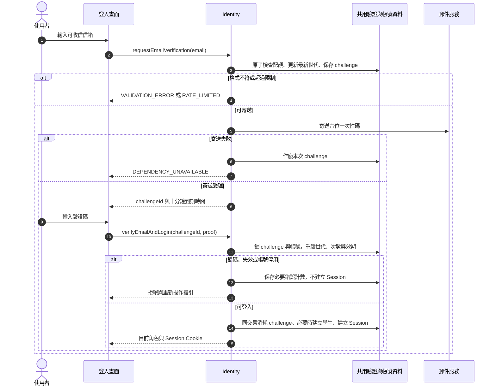

# 校園點餐系統｜身分與帳號模組

> SAD v0.6｜2026-11-02｜需求基線 SRS v0.6｜設計採用版（待實作驗證）

[回 SAD 索引](../校園點餐系統_SAD_v0.6.md) · [上一份：系統架構與模組分工](./00_系統架構與模組分工.md) · [下一份：商家與營業模組](./02_商家與營業_Merchant.md)

負責電子郵件登入、Session、角色授權、帳號停用，以及學生個資刪除。所有模組共用本模組的身分有效性檢查。

## 模組責任

| Module | 公開 Interface 範例 | 隱藏的主要實作 | 需求 |
| --- | --- | --- | --- |
| Identity | `requestEmailVerification`、`verifyEmailAndLogin`、`authorize`、`changeAccountStatus`、`deleteStudentData` | 驗證憑證、Session、角色與帳號有效性 | FR-001～003、028 |

完整分工與依賴規則見 [系統架構與模組分工](./00_系統架構與模組分工.md)；資料表見 [共用資料架構](./10_共用資料架構.md)，HTTP 契約見 [共用 API 與錯誤契約](./11_共用API與錯誤契約.md)。

## 函式契約與身分處理

| 函式／追溯 | 輸入 | 成功輸出 | 拒絕及一致性處理 |
| --- | --- | --- | --- |
| `requestEmailVerification`／FR-001 | email | challengeId、expiresAt、resendAt、泛化寄送提示 | 格式錯誤 `VALIDATION_ERROR`；寄送限制 `RATE_LIMITED`；郵件失敗 `DEPENDENCY_UNAVAILABLE`，不建立登入 |
| `verifyEmailAndLogin`／FR-001 | challengeId、六位字串 proof | user{id,role,status}、Session Cookie | 錯誤 `VERIFICATION_INVALID`；逾期、已用或作廢 `VERIFICATION_EXPIRED_OR_USED`；停用 `ACCOUNT_DISABLED`；消耗 challenge、必要學生註冊與 Session 建立同交易 |
| `createPrivilegedAccount`／FR-002 | actor、email、role、merchantId（商家必填） | account{id,email,role,status,merchantId?} | 僅 ADMIN，可建 MERCHANT／ADMIN；商家第二帳號或重複信箱 `ACCOUNT_CONFLICT`；不接受 permissions、管理範圍或多店歸屬 |
| `authorize`／FR-002 | AuthContext、action、resource | 授權通過或拒絕 | 每次檢查有效帳號；學生限本人，商家限本店，管理員涵蓋全部商家；讀取越界用一致 404 |
| `changeAccountStatus`／FR-003 | actor、accountId、status、expectedVersion | id、status、version | 自己停用、最後管理員停用 `ACCOUNT_STATUS_CHANGE_FORBIDDEN`；商家帳號須走商家連動；狀態、Session 撤銷與稽核同交易 |
| `deleteStudentData`／FR-028 | 本人 AuthContext、confirmed=true | 204，清除登入 Cookie | 有進行中訂單 `ACTIVE_ORDERS_PREVENT_DELETION`；不可接受他人 studentId；刪除與復原抑制依 [本文件「學生個資刪除與還原防護」](#學生個資刪除與還原防護) |

Email 正規化僅去首尾空白並規範網域大小寫，不擅自改寫 local-part。寄送限額、最新 challenge 世代與錯誤計數放共用儲存；每信箱序列化核發，重寄使前一世代失效。錯碼更新計數仍須提交，不能與拒絕登入一起回滾。寄信在資料庫交易之外執行；只在供應商接受後回寄送成功，寄送失敗使該 challenge 作廢。

首位管理員由部署程序使用校方指定信箱建立，重跑部署不得重建或提高其他帳號權限。管理員停用先鎖 `admin_guard`，再鎖相關帳號及計算有效管理員數；兩位管理員互相停用時，後取得鎖者必須重新驗證自身仍有效。

## 圖 10 登入與一次性驗證

追溯：FR-001～003。

申請寄信不是登入。首次成功驗證才建立學生；既有商家與管理員保留原角色。單次消耗與 Session 建立原子執行；配額、世代與錯誤計數使用共用儲存。

## 授權矩陣

| 操作 | 學生 | 商家 | 管理員 |
| --- | --- | --- | --- |
| 建立購物車、報價與訂單 | 本人 | 不提供代下單 | 不提供代下單 |
| 查閱訂單 | 本人 | 所屬商家 | 全部商家 |
| 修改商品、庫存與時段 | 不可 | 所屬商家 | 不因管理身分自動取得商家操作權 |
| 接單、拒單、備妥、交付、未取 | 不可 | 所屬商家且狀態合法 | 不代商家執行 |
| 個資刪除 | 本人且無進行中訂單 | 不可 | 不代學生刪除 |
| 學生取消 | 本人待確認訂單 | 使用商家拒單／取消命令 | 無任意狀態修改權 |
| 帳號與商家管理 | 不可 | 不可跨越管理權限 | 全部管理功能 |
| 操作紀錄、管理統計 | 不可 | 僅本店統計，不可讀操作紀錄 | 全部商家統計與操作紀錄 |

## 安全設計

- **D-08 Session**：採伺服器端 Session，Cookie 設 Secure、HttpOnly 及 SameSite=Lax；寫入檢查 CSRF token 與來源。每次受保護請求讀取權威帳號有效狀態，不以未到期 token 略過停用檢查。
- 電子郵件 proof 只保存雜湊／加密驗證摘要；低熵驗證碼採帶伺服器秘密的摘要並限制嘗試。成功核對、消耗 challenge 與建立 Session 原子執行；六位數字碼有效 10 分鐘，60 秒內不得重寄，同信箱每小時最多 5 封；重寄使舊碼失效，單組錯誤 5 次作廢。任何信箱網域皆可，首次成功驗證自動建立學生；已存在的商家與管理員沿用原角色。
- 對登入申請與驗證、取餐碼核對及高成本查詢設頻率限制；多 API 個體共用限流狀態。數值屬安全設定提案，不沿用舊 PRD。
- 取餐碼既須供學生查閱又須核對，因此採加密保存與獨立鍵控摘要；金鑰版本可追蹤與輪替。核對限定已授權商家及指定訂單，不提供匿名短碼查單。
- 查詢在 SQL 條件納入 student_id／merchant_id／管理員角色，輸出欄位採允許清單；商家不取得任何學生識別資訊；取餐碼只回本人學生，管理員亦不可見。跨範圍資源使用一致 404 回應。
- 註記、品名與原因當純文字處理，輸出編碼；DB 使用參數化查詢。正式錯誤不包含堆疊、SQL、完整驗證碼、Session 或完整取餐碼。
- 一般應用帳號不具 schema 管理權；歷史快照與稽核一般角色不具更新權。migration、備份及核定資料清除使用分離權限。
- 個資不自動到期；本人刪除依 [本文件「學生個資刪除與還原防護」](#學生個資刪除與還原防護)。功能性資料到期依 FR-001、015、016、022；恢復舊備份須先重新套用刪除日誌，避免已刪資料重新對外可見。

停用與寫入競爭由帳號列鎖排序：停用已提交後的新授權請求必須拒絕；已先取得有效授權鎖並提交的命令可視為停用前操作。恢復帳號不自動復活已撤銷 Session，需重新登入。

## Session 效期與多裝置策略

SAD v0.6 採用以下 Session 設計值。數值依 2026-11-02 建議與使用者採用指示納入；屬本版設計選擇，不是 SRS 已明訂的數字，也不是已完成實測的結論。

| 角色 | 最長登入時間（絕對效期） | 無操作自動登出（閒置效期） | 理由 |
| --- | --- | --- | --- |
| 學生 | 24 小時 | 30 分鐘 | 涵蓋當日使用；離開點餐頁後不長時間保留私人訂單與取餐碼的存取權 |
| 商家 | 12 小時 | 60 分鐘 | 涵蓋一個營業班次，容許店員短暫備餐；長時間沒操作的共用裝置仍會登出 |
| 管理員 | 8 小時 | 15 分鐘 | 對應一個工作日，因可管理帳號及查閱學生資料，採較短閒置時間 |

最長登入時間從成功登入時計算，不因操作、輪詢或 Session token 輪替延長；閒置時間從後端最後接受的使用者主動操作時計算，兩者任一先到即失效。6 位驗證碼的 10 分鐘效期只用來登入，與這張表分開。

- 後端以 `issued_at`、`absolute_expires_at`、`last_activity_at`、`idle_timeout_seconds` 及 `revoked_at` 判斷。每次請求先驗證是否已過期，再決定是否更新活動時間；等於到期時間即拒絕，不能用剛抵達的活動把過期 Session 延長。
- 自動輪詢、重試、背景刷新、頁面保持開啟與收到新單，都不算主動操作。按下查詢、切換清單或進行有效授權操作才更新；需讓純閱讀／編輯者維持登入時，畫面提供「繼續使用」按鈕，呼叫受 Session 與 CSRF 保護的 `POST /auth/session/activity`。伺服器使用自己的收到時間，不接受前端提供時間戳；該端點不得由計時器自動呼叫，也不能復活已過期 Session。
- 到期前 2 分鐘提示重新登入或繼續使用。接近絕對效期時，「繼續使用」也不能延長，須重新收碼登入。失效回 `401 SESSION_EXPIRED`，前端清除私人快取與取餐碼；Session 到期不取消訂單、不改庫存。
- 若送單或命令已提交但回應遺失，重新登入同一帳號後先以原 key／commandId 查結果，不自動重送新操作；草稿可恢復後仍須重驗價格、供應與版本。
- 三角色均允許多裝置登入，每次登入建立獨立 Session，不互相延長閒置時間。一般登出只撤銷目前瀏覽器 Session；同瀏覽器分頁共用 Cookie，會一起登出。帳號停用、商家停用或學生刪除則撤銷該帳號全部 Session。商家其他裝置保持登入時，仍只可操作本店。
- 同源部署 Cookie 採 `Secure`、`HttpOnly`、`SameSite=Lax`、`Path=/`，不設定跨子網域 Domain；Cookie 不得比絕對效期更久。寫入仍檢查 CSRF token 與來源；前端計時器只提供提示，真正失效由後端執行。

**實際情境**：學生 11:00 登入，11:20 最後一次主動查看訂單，之後只有自動刷新，11:50 即閒置到期；持續主動操作也最晚於隔日 11:00 到期。商家 08:00 登入，11:30 最後接單後一直備餐而未操作，12:30 需重新登入；若持續操作，20:00 仍到絕對效期。管理員 09:00 登入、09:10 最後操作後離席，09:25 登出；持續操作也最晚 17:00 到期。

實作時驗證各角色的到期前一刻／當下、輪詢不續期、獨立裝置、停用立即失效，以及送單回應遺失後重新登入查原結果。若試用發現商家經常連續備餐超過 60 分鐘，再記錄原因調整閒置值，不以讓背景輪詢永久續期來處理。

參考 [OWASP Session Management Cheat Sheet](https://cheatsheetseries.owasp.org/cheatsheets/Session_Management_Cheat_Sheet.html#automatic-session-expiration) 的閒置／絕對到期及伺服器端執行原則；本專案的角色時間數值與排除自動輪詢的方式為本次設計選擇。

## 學生個資刪除與還原防護

設計方向：依 2026-11-02 指示先採用 [Q1：刪除與復原日誌的一致性](../校園點餐系統_SAD_v0.6_審查與待確認.md#q1) 的建議；實作及驗證仍須完成。

本節依 SRS v0.6 FR-028／NFR-007 設計。deleteStudentData 只接受本人登入與明確確認，無管理員核准步驟；不提供資料匯出或歷史訂單任意修改功能。

1. 依 [訂單與交易模組](./06_訂單與交易_Orders.md) 鎖住學生帳號，重查全部訂單。存在待確認、製作中或可取餐訂單即拒絕，不能只依畫面顯示或過期計數。送單、終止與刪除共用學生鎖，避免查完後新單成立。
2. 在持有學生鎖的短交易中，建立持久 `deletion_request`（requestId、舊帳號 ID、PENDING_JOURNAL、金鑰版本及進度），將帳號生命週期設為 DELETION_PENDING、撤銷 Session 並提交。所有產品角色的讀寫均排除該帳號及其相關資料，登入也不能重建或使用舊帳號；封鎖不是刪除完成。釋放資料庫鎖後，將同一 requestId 的刪除意圖冪等寫入獨立日誌，只保存以舊帳號 ID 計算的鍵控摘要、金鑰版本與狀態，不保存信箱或原始識別。外部寫入失敗保留封鎖與可恢復工作，不能回 204；成功後進入 JOURNALED。
3. 日誌確認持久後，恢復程序按共用鎖順序重驗 requestId 與舊帳號生命週期；專用刪除交易移除帳號、Session、該信箱驗證資料、購物車、報價、全部訂單與快照、事件、保留明細、取餐秘密、送單／命令結果與墓碑、通知及待投遞資料。清除可連結該學生的快取及技術日誌索引；技術日誌若保留識別須納入清理清單。舊 Worker 重驗生命週期後不得重建通知。原信箱在舊帳號完成清除前不另建學生；清除後重註冊使用全新 ID，舊工作不得以 email 定位或清除新帳號。
4. 操作紀錄保留，解除可識別學生或已刪訂單的關聯，對象改為「已刪除的訂單」，保留動作、時間、結果及非個資摘要。資料模型採可解除的參照而非阻止刪除的硬外鍵；稽核沒有信箱、取餐碼或學生備註副本。這是系統的個資處理流程，不開放使用者修改稽核。
5. 刪除歷史資料不等同取消，不加回庫存或容量；已耗用／占用的營運計數仍維持。需巡檢的歷史保留轉成不可連回學生或訂單的「商品／營業日與時段加總」，僅保留資源數量，讓總帳仍可核對。商品備餐統計依現有訂單重算，不能使用這些保護容量的總帳取代 FR-025 統計。
6. 刪除交易提交後，工作記為 CLEANED 並清除工作表中的舊帳號原始識別；僅留 requestId、摘要及非個資進度以完成日誌標記。日誌標記完成後為 COMPLETED；重跑各階段不重建資料或誤釋回資源。所有必要清除完成且日誌可恢復才回 204；中斷時顯示未確認完成，由內部工作沿 requestId 恢復，不能因 Session 已撤銷而放棄。尚未完成的工作資料與線上資料皆受封鎖；既有備份在 30 天內隔離保存，不能直接恢復至線上。

還原時保持服務關閉，先取得完整且最新的獨立刪除日誌，對還原資料執行相同比對與清除，再驗證所有相關表、通知工作及快取後開放。無法確認日誌完整時維持關閉；不得以較早備份覆蓋日誌。新註冊產生全新帳號 ID，不透過同信箱找回舊訂單。匿名識別分配登記僅防止重用訂單號／當日取餐碼，不保存使用者關聯。

復原比對使用日誌記錄的金鑰版本；輪替時保留所有仍可能被備份復原流程使用的舊驗證金鑰。日誌已寫入而線上清除未完成時，恢復仍延續刪除意圖；若只有業務備份中的 PENDING_JOURNAL 工作，開放服務前先恢復日誌寫入與清除。日誌完整性、清理失敗及立即生效的故障情境都須驗證，不能把背景重試當成放寬 FR-028 的理由。

刪除的級聯、資源總帳與獨立日誌仍須經實作及恢復演練驗證；SRS v0.6 的刪除政策不因本設計而放寬為單純軟刪除。
