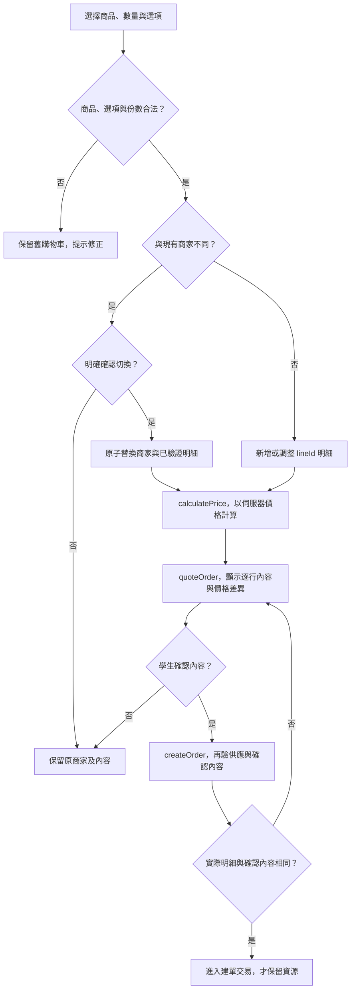

# 校園點餐系統｜購物車與報價模組

> SAD v0.6｜2026-11-02｜需求基線 SRS v0.6｜設計採用版（待實作驗證）

[回 SAD 索引](../校園點餐系統_SAD_v0.6.md) · [上一份：商品與選項模組](./03_商品與選項_Catalog.md) · [下一份：庫存與時段模組](./05_庫存與時段_Resources.md)

負責單店購物車、精確計價、價格差異與確認內容。此階段不保留庫存或容量。

## 模組責任

| Module | 公開 Interface 範例 | 隱藏的主要實作 | 需求 |
| --- | --- | --- | --- |
| CartQuote | `updateCart`、`quoteOrder`、`calculatePrice`、`validateAcceptedQuote` | 單店購物車、精確計價、版本比較與報價歸屬 | FR-011～013 |

完整分工與依賴規則見 [系統架構與模組分工](./00_系統架構與模組分工.md)；資料表見 [共用資料架構](./10_共用資料架構.md)，HTTP 契約見 [共用 API 與錯誤契約](./11_共用API與錯誤契約.md)。

## 購物車與價格確認契約

設計方向：依 2026-11-02 指示先採用 [Q3：報價確認與保留方式](../校園點餐系統_SAD_v0.6_審查與待確認.md#q3) 的建議；實作及驗證仍須完成。

| 函式／追溯 | 輸入 | 成功輸出 | 拒絕及一致性處理 |
| --- | --- | --- | --- |
| `addCartItem`、`updateCartItem`、`removeCartItem`／FR-011 | 本人購物車、lineId、商品、數量、選項、note | cart、lines、version | 每行 1～20、全單最多 50，note 最多 100 字；0 不是刪除的隱式表示；未知行 `CART_LINE_NOT_FOUND` |
| `switchCartMerchant`／FR-011 | targetMerchant、confirmed | 單一新商家購物車 | 未確認 `CART_MERCHANT_CONFLICT`，保留舊內容；先驗證新餐點再原子替換，避免無效新餐點清掉舊草稿 |
| `calculatePrice`／FR-012 | 後端商品價、選項價及數量 | 每行 unitTotal、subtotal、total、currency=TWD | 整數乘加，超範圍拒絕；不得加入折扣、稅費或運費；不採信前端 total |
| `quoteOrder`／FR-013 | 本人、merchantId、items、previousQuoteId? | quoteId、items、total、changes、requiresConfirmation | 不可售回商品錯誤；異動逐行顯示，不能只比總額；報價不占資源 |
| `validateAcceptedQuote`／FR-013 | 本人、acceptedQuoteId、送單內容與當前價格 | 已確認的 ServerQuote | 他人報價 404；缺少明確 acceptedQuoteId／本人確認內容 `QUOTE_CONFIRMATION_REQUIRED`；實際內容不同 `QUOTE_CHANGED`，不建單；相同內容不得只因等待時間或版本增加拒絕 |

本 SAD 選擇伺服器保存購物車與確認內容，前端只快取。報價內容不可變，先保存至本人刪除；產生新報價不撤銷舊報價，也沒有按等待時長失效的排程。未來若新增清理，必須保留仍有效的確認與未完成操作所需內容。lineId 區別同商品不同選項；標準化選項排序可消除無意義排列差異，但不能改變數量、選項、備註或時段語意。

先採「建單時確認」：前端展示後端報價，學生按下確認送單後，以 POST /orders 提交 acceptedQuoteId、items 與 Idempotency-Key；該提交本身代表接受這份報價，不另設確認端點或要求先有 accepted=true。後端重驗本人歸屬、送單內容與當前供應／價格，並在持久 submission 保存 accepted_quote_id、confirmed_content_hash、accepted_at 及恢復所需的請求內容。摘要由後端計算，不採信前端總價。確定結果保存期限仍依 24 小時規則，處理中不清理；本人刪除依 FR-028 一併清除。

## 圖 12 購物車至價格確認

追溯：FR-010～013。

不因報價等待時長或僅版本不同要求重新確認；實際商品、選項、數量、單價與加價不同才提示。圖中的供應拒絕回購物車修正，不把重新確認當作供應保證。

## 與訂單協作

確認後由 [訂單與交易模組](./06_訂單與交易_Orders.md) 呼叫 buildOrderSnapshot 建立不可變快照；送單時仍須重驗實際內容與供應條件。
