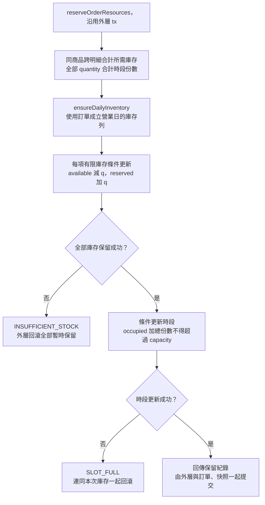
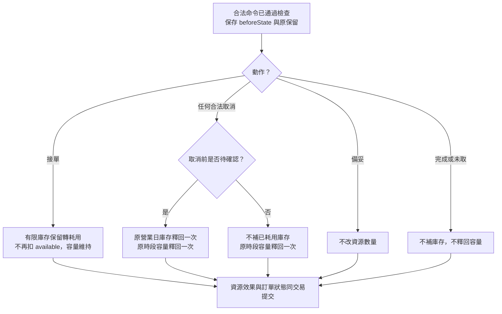

# 校園點餐系統｜庫存與時段模組

> SAD v0.6｜2026-11-02｜需求基線 SRS v0.6｜設計採用版（待實作驗證）

[回 SAD 索引](../校園點餐系統_SAD_v0.6.md) · [上一份：購物車與報價模組](./04_購物車與報價_CartQuote.md) · [下一份：訂單與交易模組](./06_訂單與交易_Orders.md)

負責商品當日可用量、每日預設量、取餐時段及容量。商品上下架由 Catalog 管理，訂單成立與狀態變更由 Orders 協調；Resources 依訂單操作處理庫存保留、耗用與釋回，以及時段容量占用與釋回。

> 現行範圍：所有商品均採有限庫存。每日重置只將當日可用量設為每日預設量，商品上下架狀態維持不變。

## 模組責任

| Module | 公開 Interface 範例 | 隱藏的主要實作 | 需求 |
| --- | --- | --- | --- |
| Resources | `savePickupSlot`、`adjustInventory`；訂單內部使用 `reserve`、`consume`、`release` | 庫存與時段鎖、按營業日初始化、保留明細及一次性釋回 | FR-006、009、018 |

完整分工見 [系統架構與模組分工](./00_系統架構與模組分工.md)；資料表見 [共用資料架構](./10_共用資料架構.md)，HTTP 契約見 [共用 API 與錯誤契約](./11_共用API與錯誤契約.md)。業務用語見 [領域詞彙](../CONTEXT.md)。

## 資源函式契約

### 時段設定與可預訂查詢

| 函式／追溯 | 輸入 | 成功輸出 | 拒絕及一致性處理 |
| --- | --- | --- | --- |
| `savePickupSlot`／FR-006 | 日期、起迄、capacity、expectedVersion | slot、occupiedUnits、remaining、version | 檢查長度、營業區段、重疊及既有訂單限制；詳見 [時段更新設計](#時段更新設計) |
| `listBookableSlots`／FR-006 | merchantId、當日 date、requestedUnits | slots{remaining,bookable,reason} | 依剩餘容量及截止時間判斷，額滿、容量不足與已截止分開表示；送單仍重新檢查 |
| `deletePickupSlot`／FR-006 | actor、slotId、expectedVersion | 未使用時段已刪除 | 已使用或有任何引用者拒絕；只有從未使用且無引用者可刪除 |

### 庫存管理與每日初始化

| 函式／追溯 | 輸入 | 成功輸出 | 拒絕及一致性處理 |
| --- | --- | --- | --- |
| `adjustInventory`／FR-009 | productId、availableQuantity、dailyDefaultQuantity、expectedVersion | 當日 available／reserved／consumed、dailyDefaultQuantity、version | 可用量與每日預設量為非負整數；首次設定必填，部分更新不清除舊值；詳見 [庫存更新設計](#庫存更新設計) |
| `ensureDailyInventory`／FR-009 | tx、productId、businessDate | 當日庫存列 | 依該營業日生效的每日預設量建立一次；既有列不因重試重設，缺漏設定時不得略過檢查 |
| `checkAvailability`／FR-009 | 已驗證 items、營業日 | 按商品合計需求與供應判斷 | 同商品跨明細先加總；可用量不足回 `INSUFFICIENT_STOCK` |

### 交易內資源函式

| 函式／追溯 | 輸入 | 成功輸出 | 拒絕及一致性處理 |
| --- | --- | --- | --- |
| `reserveOrderResources`／FR-006、009、014 | tx、items、slot、businessDate | 完整 inventoryReservations、slotReservation | 按商品合計庫存、按全部明細份數合計容量；任一失敗回滾全部 |
| `applyCancellationResources`／FR-018 | tx、order、beforeState、原 reservations | releasedInventory、releasedSlotUnits、alreadyApplied | 依取消前狀態處理原保留；保留缺漏或數量矛盾回 `RESOURCE_INTEGRITY_ERROR`，回滾並告警 |

上述交易內函式只供 Orders 協作使用，不提供前端直接占用資源的端點。

## 名詞與欄位對照

| 概念 | API／函式欄位 | 資料庫欄位 | 定義 |
| --- | --- | --- | --- |
| 營業日 | businessDate；查詢日期 date | business_date | 庫存所屬的校園業務日期；訂單保留與釋回均歸屬訂單成立當日 |
| 當日可用量 | availableQuantity；計算示意 available | available_quantity | 當日尚可被新訂單保留的商品份數 |
| 每日預設量 | dailyDefaultQuantity | daily_default_quantity | 每個營業日開始時，用來初始化當日可用量的份數 |
| 已保留量 | reservedQuantity；計算示意 reserved | reserved_quantity | 已成立、尚未接單的訂單所保留的商品份數 |
| 已耗用量 | consumedQuantity；計算示意 consumed | consumed_quantity | 商家接單後已視為使用的商品份數 |
| 時段容量 | capacity | capacity | 該取餐時段可接受的餐點總份數 |
| 已占用份數 | occupiedUnits；計算示意 occupied | occupied_units | 訂單已占用的時段份數，依全部餐點明細數量加總 |
| 剩餘容量 | remaining | 由容量與占用量計算 | capacity − occupiedUnits；容量不得低於已占用份數，結果不得為負 |
| 首次使用時間 | firstUsedAt（唯讀） | first_used_at | 首次成功建單時由後端保存，用於判斷時段是否曾使用；不隨取消或個資刪除清除 |
| 本次需求份數 | requestedUnits | 查詢時計算，不另保存 | 用於判斷購物車總份數是否能放入某個時段 |
| 資料版本 | version；修改時帶 expectedVersion | 各資料列的 version | 庫存與時段各自的修改版本，用於防止過期更新覆寫 |

庫存相關份數與時段容量均以整數表示。可用量與每日預設量不得為負或空值；時段容量為 0 表示不開放新訂單。

## 庫存更新設計

### 可更新欄位

商家可設定所屬商品的 `availableQuantity` 與 `dailyDefaultQuantity`，修改時帶 `expectedVersion`。首次設定須填妥兩項，後續部分更新未提供的欄位維持原值，不接受空值。

手動調整只改當日可用量，不改每日預設量，也不影響既有訂單已保留或已耗用的數量。已保留量與已耗用量供商家查看，由訂單流程更新，不能由管理請求直接覆寫。

### 並行修改與版本檢查

庫存修改沿用 [管理設定的共通更新](./02_商家與營業_Merchant.md#圖-11-管理設定的共通更新)，在交易中依共用鎖順序取得資料，再檢查商家歸屬、版本與數量限制。版本不符時回覆 `VERSION_CONFLICT`，避免舊畫面的庫存設定覆寫後續變動。

手動調整與送單競爭時，可用量不得為負，既有保留不得被覆寫。各項商品需求先跨明細合計，例如同商品兩行各 2 份，必須按 4 份檢查與保留。

### 每日可用量重置

每個營業日開始（00:00:00）時，系統自動將當日可用量重置為每日預設量，商品上下架狀態維持不變。每日預設量為 0 時，當日初始可用量為 0；原本下架的商品即使重置後有可用量，仍維持下架。庫存釋回與手動調整也不改變商品上下架狀態。

每日預設量的修改自下一營業日起生效。當日臨時增加或減少供應時，商家調整當日可用量。

### 每日初始化與跨日資料

實作上，每日建立新營業日的庫存列，以該營業日生效的每日預設量初始化可用量。以唯一鍵與交易內的按日初始化保證只建立一次；排程延遲時，當日第一筆讀寫仍使用當日庫存，重試不得再次重置已被使用的數量。

每日預設量保存生效營業日。即使初始化排程延誤，也依當日生效的設定建立庫存，不使用稍後修改的新值。缺少設定或無法取得當日庫存時，不得略過檢查或保留。

**D-03**：庫存保留與耗用按營業日分開。昨日訂單於今日取消時，只釋回昨日庫存列，不加回今日可用量。

## 時段更新設計

### 可設定內容與限制

商家設定取餐時段的日期、起迄時間及容量。時段以分鐘為精度、長度至少 10 分鐘，同店時段不得重疊，且須完整落在某一營業區段內。

時段容量以餐點份數計，不按訂單張數計算。每張訂單占用其全部明細數量的總和；同時保留商品庫存與時段容量後，訂單才可成立。

### 並行修改與既有訂單保護

時段新增與修改先鎖商家，再讀寫時段及營業設定，避免兩筆並行新增各自通過檢查後形成重疊。修改使用 `expectedVersion` 檢查版本，並遵守 [共用鎖順序](./06_訂單與交易_Orders.md#共用鎖順序與競爭處理)。

已有進行中訂單的時段不能修改起迄時間。容量可調整，但必須大於或等於已占用份數；低於時拒絕本次修改，原容量與既有訂單維持不變。已占用份數大於 0 時，容量不能設為 0。容量修改與送單在同一時段資料列鎖下重驗，資料庫亦以 `CHECK (occupied_units <= capacity)` 保護此限制。訂單顯示及時間判斷仍使用成立時保存的時段快照。

### 預訂截止與可選性

預訂截止時間固定為 `startAt - 10 分鐘`；到達該時刻起，該時段不可預訂。商家沒有截止分鐘數設定，Merchant 不保存或接受此欄位。此時間只限制新訂單預訂；商家接單截止仍為訂單保存的取餐時段結束時間。

查詢時分別表示額滿、容量不足及已截止。剩餘容量為 `capacity - occupiedUnits`，並與 `requestedUnits` 比較；送單時仍須重新檢查時段資格與剩餘容量。

### 刪除限制

依 2026-11-05 的精簡決議，已使用時段禁止刪除，不提供封存操作；此規則取代 [Q4 的原封存方案](./校園點餐系統_SAD_v0.6_審查與待確認.md#q4)。

刪除入口 `deletePickupSlot` 在同一交易內，依共用鎖順序鎖住時段並檢查：

- `first_used_at` 有值，或仍有訂單、保留帳、匿名資源總帳等引用時，拒絕刪除並告知原因，原設定與歷史資料維持不變。
- 只有從未成功供訂單使用，且無任何引用的時段，才可實體刪除。舊購物車引用已刪除時段時，送單須拒絕。

`first_used_at` 在首次成功建單時與容量占用、訂單及保留一併提交，之後不清空。取消或學生刪除個資後仍保留此使用事實；欄位不含帳號或訂單識別。失敗建單的交易回滾，不留下首次使用時間。

## 資源處理矩陣與營業日

### 訂單操作的資源效果

| 事件 | 商品庫存 | 時段容量 |
| --- | --- | --- |
| 訂單成立 | 可用量減少，轉為保留 | 占用全部明細份數合計 |
| 商家接單 | 保留轉為耗用，不再次扣減可用量 | 維持原占用 |
| 接單前取消、拒單或系統取消 | 釋回原營業日的保留，加回可用量 | 釋回原占用 |
| 接單後取消 | 不自動補回已耗用庫存 | 釋回原占用 |
| 訂單完成或標記未取 | 不自動補回已耗用庫存 | 維持原占用，不釋回 |

所有商品均為有限庫存，每張訂單的每項商品都須有庫存保留。庫存足夠仍須通過 Catalog 的上架檢查，以及 Merchant 的營業與接單條件；下單資格由 Orders 彙整判斷。

### 交易一致性與一次性釋回

Orders 持有外層交易，Resources 使用傳入的同一個 `tx` 執行，不自行提交。庫存、容量、訂單與操作結果須一致成立；任何一項保留失敗時，回滾本次全部變動。

| 事件 | 同一交易提交的內容 |
| --- | --- |
| 訂單成立 | 訂單、快照、兩類保留、時段首次使用時間、成立事件與送單成功結果 |
| 商家接單 | 狀態、庫存耗用、命令結果、事件及必要通知資料 |
| 接單前取消 | 取消與原營業日庫存、原時段容量的全部釋回 |
| 接單後取消 | 原狀態、理由、取消、容量釋回、政策處置及事件 |
| 完成或未取 | 終止狀態、時間、政策處置及事件 |

接單時，庫存列的 `reserved` 減少、`consumed` 增加，保留紀錄由 `RESERVED` 轉為 `CONSUMED`。接單前取消時，只有 `RESERVED` 可轉為 `RELEASED`，並將數量加回原營業日的 `available`；時段只有 `OCCUPIED` 可轉為 `RELEASED`。同一份資源只能釋回一次。

取消前先保存 `beforeState` 與原保留，再依原狀態處理資源，不能改為 `CANCELLED` 後才判斷。保留缺漏或數量矛盾時回覆 `RESOURCE_INTEGRITY_ERROR`，回滾並告警，不得略過該商品或按目前菜單重算。

## 圖 13 庫存與容量的一次保留

追溯：FR-006、009、014、015。

同商品兩行各兩份必須按四份檢查。新增占用與容量修改均須維持已占用份數不超過容量，任何新增占用失敗都回滾本次全部庫存保留。此函式不能自行提交或供前端直接占資源。

## 圖 15 依原狀態處理資源

追溯：FR-016～020、027。

任何取消包含學生、商家拒單／取消及系統逾時／停用取消。先依原狀態判斷再改 CANCELLED；釋回依原 Reservation，不按目前菜單重算，也不能補到今日庫存。
