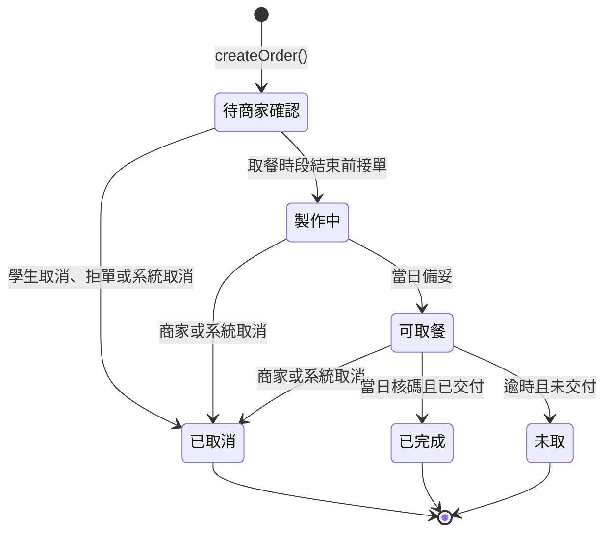
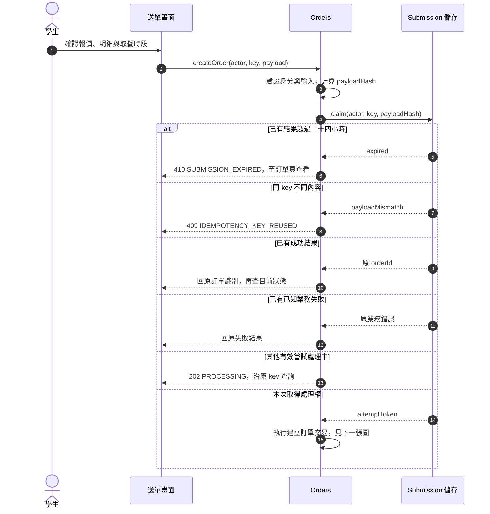
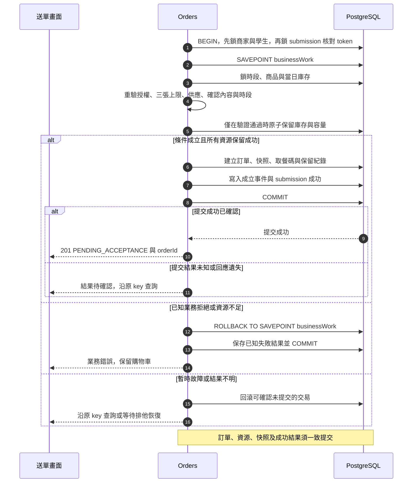
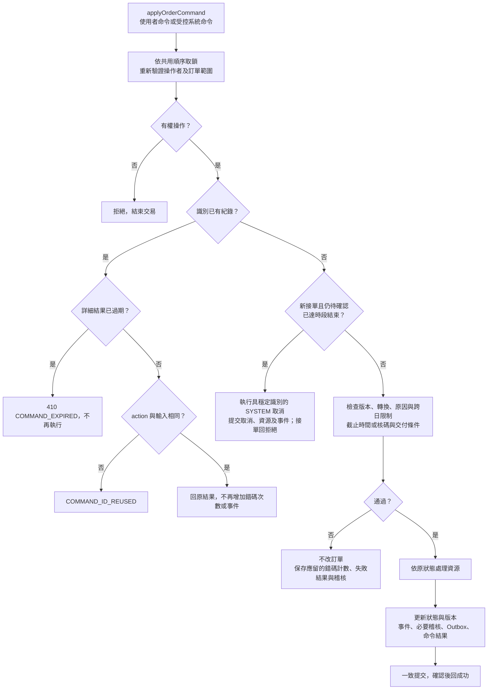
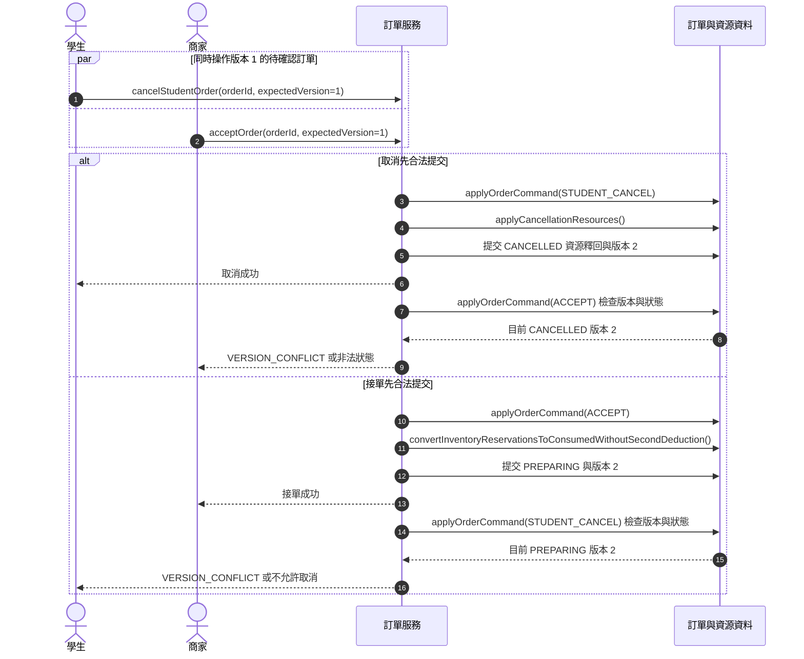
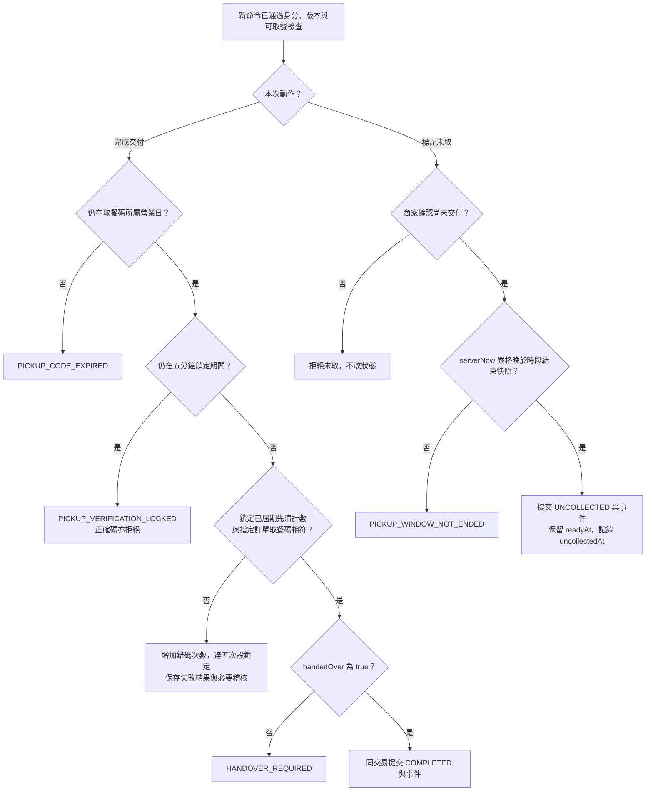

# 校園點餐系統｜訂單與交易模組

> SAD v0.6｜2026-11-02｜需求基線 SRS v0.6｜設計採用版（待實作驗證）

[回 SAD 索引](../校園點餐系統_SAD_v0.6.md) · [上一份：庫存與時段模組](./05_庫存與時段_Resources.md) · [下一份：通知與工作台模組](./07_通知與工作台_Notifications.md)

負責建單、快照、冪等識別、訂單狀態、系統取消與交易協調。庫存與容量的內部操作委由 Resources 在同一交易執行。

## 模組責任

| Module | 公開 Interface 範例 | 隱藏的主要實作 | 需求 |
| --- | --- | --- | --- |
| Orders | `createOrder`、`getSubmissionResult`、`applyOrderCommand`、`cancelExpiredPendingOrders` | 去重、狀態機、交易協調、不可變快照及事件 | FR-014～021、027 |

完整分工與依賴規則見 [系統架構與模組分工](./00_系統架構與模組分工.md)；資料表見 [共用資料架構](./10_共用資料架構.md)，HTTP 契約見 [共用 API 與錯誤契約](./11_共用API與錯誤契約.md)。

## 圖 6 訂單狀態圖



`PROCESSING/SUCCEEDED/FAILED` 是送單請求處理狀態，不是訂單狀態。管理員沒有任意修改訂單狀態或代替商家宣告交付的權限；停用商家觸發 FR-027，由系統身分執行取消。未取後的線下協調不產生系統補領轉換。

圖中「取餐時段結束前接單」指尚未達商家接單截止時間，亦即訂單保存的取餐時段結束時間；「逾時且未交付」須由商家確認尚未交付，且系統時間嚴格晚於時段結束，不能自動標記未取。詳細條件見下方 [狀態命令、交付與未取](#狀態命令交付與未取)。

## 自動取消與商家停用協作

逾時取消只適用待確認訂單：系統時間達到訂單時段結束快照即具取消資格；商家停用則取消該商家全部進行中訂單。兩者共用 applyOrderCommand 的狀態與資源規則，操作者為 SYSTEM，使用可重現的內部命令識別（原因、訂單、觸發版本），避免重複事件及通知。原因分別固定為「商家未在取餐時段結束前接單」與「商家停用」。

商家停用由應用層 MerchantLifecycle 協調，先顯示受影響數並取得二次確認；確認交易依共用順序鎖住必要帳號、商家及全部受影響訂單，連動帳號失效、Session 撤銷、取消與資源釋回後一起提交。確認 token 綁商家版本與各受影響訂單 ID／version；任一變更時回衝突並顯示最新數量，重新確認。大批交易須量測鎖時間，但不得先回成功再留下未取消訂單。恢復保留設定、設為暫停接單、不復活舊 Session 或已取消訂單。

逾時 Worker 掃描到期的待確認訂單並逐筆呼叫系統命令，恢復後補掃漏執行項。接單入口也在交易內檢查商家接單截止時間，已達時先落實逾時取消，防止 Worker 延遲讓逾時訂單被接單。與其他命令的競爭依最新狀態與版本處理；系統不自動標記未取。

## 送單與恢復函式契約

| 函式／追溯 | 輸入 | 成功輸出 | 拒絕及一致性處理 |
| --- | --- | --- | --- |
| `createOrder`／FR-014 | 本人、Idempotency-Key、merchantId、pickupSlotId、acceptedQuoteId、items | 201：orderId、狀態、快照、合計、時段、本人可見取餐碼、version | 混店／空陣列／非法數量拒絕；進行中達三張、商家停用、供應不足、截止、容量或價格失敗均整單回滾 |
| `executeIdempotently`／FR-015 | actor、key、payloadHash、operation | 保存結果、PROCESSING 或執行權 attemptToken | 同 key 不同內容 409；原結果 24 小時內重播，到期 410；未知結果沿原 key 查核，不新建操作 |
| `executeOrderCreationTransaction`／FR-014、015 | claim、actor、input | 與訂單一起提交的成功結果，或已知業務拒絕 | 遵守 [本文件「共用鎖順序與競爭處理」](#共用鎖順序與競爭處理) 鎖順序；技術故障不誤標為確定失敗；外部服務不在交易內 |
| `cancelExpiredPendingOrders`／FR-027 | Worker 的 SYSTEM 身分、serverNow | 各訂單取消／跳過／可重試結果 | 只處理到期仍待確認者；固定原因與穩定系統 commandId；與接單競爭時重讀，不二次釋回 |

建單格式見本文件的 [建單請求範例](#建單請求範例) 與 [建單回應範例](#建單回應範例)；送單識別及交易提交分別見 [圖 7：送單識別與重播循序圖](#圖-7-送單識別與重播循序圖)、[圖 8：建立訂單交易循序圖](#圖-8-建立訂單交易循序圖)，提交後通知見 [圖 9：通知投遞循序圖](./07_通知與工作台_Notifications.md#圖-9-通知投遞循序圖)。狀態命令的輸入與結果定義見 [狀態命令、交付與未取](#狀態命令交付與未取)。

## 訂單快照建立

| 函式／追溯 | 輸入 | 成功輸出 | 拒絕及一致性處理 |
| --- | --- | --- | --- |
| `buildOrderSnapshot`／FR-010 | tx、validatedQuote、validatedItems、pickupSlot | 不可一般修改的明細與時段快照 | 名稱與價格來自重新驗證的後端資料；小計不符則拒絕；無獨立修改快照 API |

## 狀態命令、交付與未取

所有使用者狀態命令共用 `orderId, commandId, expectedVersion`；commandId 綁定 action 與正規化輸入。已登入且有權才可重播；先處理既有結果與 24 小時到期，再檢查新命令的版本。使用者命令被拒絕時，本身不變更訂單狀態，核碼錯誤計數及 FR-026 必要失敗紀錄仍須保存。逾時接單觸發的取消則是另一個 SYSTEM 命令：保存系統取消事件與資源結果，接單命令回覆拒絕，不得把該次系統取消一起回滾。

| 命令／追溯 | 額外輸入與合法條件 | 成功輸出 | 特有錯誤／資源效果 |
| --- | --- | --- | --- |
| `acceptOrder`／FR-016 | 所屬商家、待確認、尚未達時段結束 | PREPARING、acceptedAt、version | 保留轉耗用，不再次扣可用量；已到期由系統取消 |
| `markOrderReady`／FR-016 | 所屬商家、製作中且備妥、仍在訂單成立營業日 | READY_FOR_PICKUP、readyAt、version | 跨日拒絕 `ORDER_BUSINESS_DAY_ENDED`；不新增資源占用 |
| `cancelStudentOrder`／FR-017 | 本人、待確認 | CANCELLED、cancelledAt、version | 接單後 `CANCELLATION_NOT_ALLOWED`；退原庫存與容量 |
| `rejectOrCancelMerchantOrder`／FR-017 | 所屬商家；reason 去空白後 1～200 字；REJECT 限待確認，MERCHANT_CANCEL 限製作中／可取餐 | CANCELLED、reason、version | 依 beforeState 退原資源；reason 不可為空 |
| `completePickup`／FR-019 | 所屬商家、可取餐、四位字串 pickupCode、handedOver=true、營業日未結束且未鎖碼 | COMPLETED、completedAt、version | `PICKUP_CODE_MISMATCH`、`HANDOVER_REQUIRED`、`PICKUP_CODE_EXPIRED`、`PICKUP_VERIFICATION_LOCKED`；無付款欄位 |
| `markUncollected`／FR-020 | 所屬商家、可取餐、商家確認尚未交付、now 嚴格大於時段結束快照 | UNCOLLECTED、原 readyAt、uncollectedAt、version | 相等亦拒絕 `PICKUP_WINDOW_NOT_ENDED`；不補庫存、不退容量 |
| `applyOrderCommand`／FR-016～020、027 | tx／交易入口、actor 或受控 SYSTEM、action、input | 原結果或原子提交的新狀態與事件 | 不接受任意目標狀態；狀態、資源、事件、必要稽核、Outbox、命令結果一致提交 |

依 SRS FR-019，營業日結束後，商家對未終止訂單只可取消；已可取餐且尚未交付者另可標記未取。製作中不得跨日再標記備妥，待確認逾時仍由 FR-027 系統取消。

商家先選訂單再輸入碼，回應不提示正確碼任何部分；前導零不得轉成數字遺失。核碼錯誤計數與該訂單綁定，連錯五次鎖五分鐘，鎖定期間正確碼也拒絕，期滿再試先清計數。同 commandId 重播錯碼結果不再次增加計數；修改輸入再核對是新的命令。鎖定、錯誤結果與稽核以交易保存，不能因業務拒絕一起回滾。

## 訂單查詢

| 函式 | 輸入 | 輸出與處理 |
| --- | --- | --- |
| `listMyOrders`、`getOrderDetail` | actor、status?、cursor?、limit?／orderId | items、nextCursor／快照與當前狀態、allowedActions；allowedActions 只是畫面提示，命令重新驗權 |

頁量提案為預設 20、上限 100；cursor 綁定查詢篩選與穩定排序，非法游標回 `VALIDATION_ERROR`。商家 DTO 不包含 studentId、email、取餐碼；管理員可讀學生帳號與 email，但仍不能讀碼。私人結果用私有快取策略，登出／切帳號清除舊快取；查詢失敗不可替換成空列表。

## 送單識別、交易與一致性

### 圖 7 送單識別與重播循序圖



### 圖 8 建立訂單交易循序圖



通知投遞循序圖見 [圖 9：通知投遞循序圖](./07_通知與工作台_Notifications.md#圖-9-通知投遞循序圖)。通知失敗不重跑建單，提交結果未知時沿原 key 查詢；恢復者先取得排他處理權。

**D-04：採 `READ COMMITTED`、明確列鎖與條件更新**。購物車與報價階段不保留資源。實際送單步驟如下：

1. 驗證帳號與請求形狀，伺服器將商家、時段、報價、明細、備註標準化並計算 payload hash；不得刪除會影響語意的差異。
2. 以短交易按共用鎖順序驗證帳號並建立或取得 submission，保存 acceptedQuoteId、後端確認內容摘要、接受時間與恢復所需請求，再配置 attempt token 與處理租約；帳號外鍵及生命週期鎖避免刪除後重建操作紀錄。唯一鍵競爭者讀取同一紀錄，不另建單。
3. 主交易依 [本文件「共用鎖順序與競爭處理」](#共用鎖順序與競爭處理) 先鎖商家、學生，再鎖 submission，確認 token 仍屬本次嘗試，建立業務 savepoint；持有學生鎖時檢查三張進行中上限。
4. 依固定順序取得身分、商家、時段、商品與庫存權威資料；重新檢查有效狀態及實際確認內容；版本用於並行控制，不以版本不同單獨否定內容相同的確認。相同商品跨多明細先加總數量。
5. 以條件更新保留所有庫存與容量；任何一筆未更新成功即整筆業務回滾。
6. 建立訂單、快照、取餐碼、保留明細與成立事件，將 submission 改為成功並提交。依 FR-026，送單以訂單本身代表，不另記成功操作紀錄；新單提示讀商家清單，不建立 FR-022 站內通知。
7. 已知業務拒絕才將 submission 標為 FAILED；基礎設施故障或提交結果未知維持可恢復狀態。回應只在提交結果明確後宣告成功。

有限庫存與容量的概念 SQL：

```sql
UPDATE inventory
SET available_quantity = available_quantity - :q,
    reserved_quantity = reserved_quantity + :q,
    version = version + 1
WHERE product_id = :product_id
  AND business_date = :order_business_date
  AND available_quantity >= :q;
-- 所有商品均為有限庫存，每個商品須影響一列；任一庫存列缺漏或可用量不足，整筆業務交易回滾。
-- 商品 listed=true 已在同一交易鎖住商品後驗證；此處只處理庫存，不另檢查售完旗標。

UPDATE pickup_slot
SET occupied_units = occupied_units + :units,
    first_used_at = COALESCE(first_used_at, :server_now),
    version = version + 1
WHERE id = :slot_id
  AND merchant_id = :merchant_id
  AND occupied_units + :units <= capacity;
-- 必須先在同交易驗證固定提前 10 分鐘的預訂截止及其他時段資格，再更新占用。
-- 首次使用時間與訂單同交易提交；更新或後續建單失敗則回滾庫存、占用及本次首次使用標記。
```

SQL 為契約示例，不是已建立的 migration；所有參數皆由後端驗證並繫結，不能串接使用者文字。

## 共用鎖順序與競爭處理

所有相關寫入遵循：**管理員保護鎖（僅管理員停用）→ 商家帳號（依 ID）→ 商家（依 ID）→ 學生與其他帳號（依 ID）→ 操作識別紀錄 → 既有訂單（依 ID）→ 時段（依 ID）→ 商品（依 ID）→ 按營業日庫存 → 保留與事件**。不需要的節點可略過，但不得反向取鎖。需先查得鎖定對象者只作識別定位，取得鎖後重驗；商家停用、刪除及 Worker 也須採同一順序。claim 的短交易與主交易分開，主交易在取得帳號等前置鎖後才鎖 submission。

- 送單對商家採共享列鎖、對學生帳號採更新鎖；同學生跨商家的送單序列化後，才計算進行中訂單是否少於三張。狀態終止與個資刪除也取得學生鎖，避免額度與刪除競爭。停用與設定更新採互斥鎖；不同學生不因同商家送單而全程互斥。
- 商品修改必須先鎖商品，並更新商品資料版本；送單依相同規則保護報價檢查，避免商品更新繞過鎖定。
- 庫存、時段、既有訂單使用更新鎖或等效條件更新。所有管理修改也必須遵守相同規則。
- 狀態命令依上述順序先取得命令識別紀錄，再鎖訂單並重驗授權；已有成功或失敗結果都先處理到期與重播，再檢查新命令的 expectedVersion 與狀態。錯碼失敗重播不得再次增加計數。
- 接單與學生取消競爭，只能有一方通過原狀態與版本檢查；完成與未取同理。
- 死鎖或可重試交易失敗時，回滾整筆交易並以同 key／commandId 有上限地重試；不只補做最後一條 SQL。超限回傳可辨識錯誤並提供原操作查詢。

時段列仍可能成為尖峰熱門資源；交易不得包含郵件或外部 HTTP 呼叫。以鎖等待時間及熱門時段壓測決定是否需進一步優化。

## 不確定結果與當機恢復

| 情境 | 必須採取的行為 |
| --- | --- |
| 同 key、同 payload | 結果保存期內重播原成功／失敗；處理中回 202；到期回 410 |
| 同 key、不同 payload | 409 `IDEMPOTENCY_KEY_REUSED`；不覆寫原請求 |
| 主交易已提交但 HTTP 回應遺失 | 以原 key 查得原 orderId；不再保留資源 |
| claim 成功後程序當機 | Worker 租約到期後仍按共用順序先取得必要商家及帳號鎖，再鎖 submission，核對持久結果及唯一訂單關聯，取得新 token 才恢復；不可持有 submission 再反向鎖帳號 |
| 原工作者仍執行、恢復者到達 | submission 列鎖及 token 檢查阻止雙重處理；租約過期本身不代表可直接重建 |
| 已確定業務失敗後修改內容 | 重新取得報價與確認，再使用新 key，形成新操作 |
| key 詳細結果保存期限到期 | 保存最小 key 墓碑並回 410 `SUBMISSION_EXPIRED`；不得把舊 key 當新送單 |

送單與狀態命令結果自 resolved_at 起保存 24 小時；處理中不開始計時。到期刪除詳細輸入、回應與 hash，只保留拒絕舊識別所需的 actor／operation／key_digest／到期狀態；原 key 永不當新請求。個資刪除時一併移除該學生及其訂單的結果與墓碑，舊 Session 同時失效，新註冊帳號使用全新 ID。讀取任何重播結果前仍須重新驗證帳號與資料存取權。

## 圖 14 狀態命令檢查與提交

追溯：FR-016～020、027。



這是邏輯檢查圖，取鎖順序以 [本文件「共用鎖順序與競爭處理」](#共用鎖順序與競爭處理) 為準。已有結果先處理，避免成功重播被舊 expectedVersion 擋住。資源寫入或提交結果未知時沿原 commandId 恢復，不另發新命令。

## 圖 16 接單與學生取消的競爭

追溯：FR-016～018。



本圖的版本 1、2 是交易範例而非關聯數量標示。實際程式須帶 commandId 並遵守 [本文件的狀態命令契約](#狀態命令交付與未取)；接單同時還須檢查 v0.6 的截止條件。圖內 DB 箭頭表示應用讀寫，不表示資料庫直接執行應用函式。

## 圖 17 交付核碼與未取的分流

追溯：FR-019、020。



僅新命令走此圖，同 commandId 重播先依 [圖 14：狀態命令檢查與提交](#圖-14-狀態命令檢查與提交) 處理。取餐碼不在商家或管理員回應顯示；錯誤計數不能隨拒絕回滾。完成與未取皆不釋回容量。

## 建單請求範例

以下為測試格式示例，ID 不對應正式資料。金額由後端讀取報價及重新驗證，不由此請求指定。

```http
POST /api/v1/orders
Content-Type: application/json
Idempotency-Key: submit-demo-001
X-CSRF-Token: <session-bound-token>

{
  "merchantId": "merchant-demo-01",
  "pickupSlotId": "slot-demo-01",
  "acceptedQuoteId": "quote-demo-01",
  "items": [
    {
      "productId": "product-demo-01",
      "quantity": 2,
      "note": "不要香菜"
    }
  ]
}
```

成立回應包含原 orderId、`PENDING_ACCEPTANCE`、快照、價格合計、取餐時段、取餐碼及 version。相同 key 重播的建立結果可能早於目前訂單狀態；前端取得 orderId 後再讀取最新詳情。

## 建單回應範例

下列均為合成示例，對應上方 [建單請求範例](#建單請求範例) 的兩份單價 80 元的餐點，不是已執行 API 結果。正式取餐碼改為 v0.6 規定的四位數字，金額改為整數。

```json
{
  "data": {
    "id": "order-demo-01",
    "orderNumber": "20261024-K7M4R2",
    "status": "PENDING_ACCEPTANCE",
    "total": 160,
    "currency": "TWD",
    "pickupCode": "0472",
    "version": 1,
    "createdAt": "2026-10-24T11:30:00+08:00"
  },
  "requestId": "req-demo-001"
}
```

以上節錄僅可回本人學生。商家／管理員回應不包含 pickupCode。完整成立回應另含明細與時段快照。

```json
{
  "error": {
    "code": "VALIDATION_ERROR",
    "message": "每筆餐點數量須為 1 至 20 的整數。",
    "fields": [{"path": "items[0].quantity", "reason": "integer from 1 to 20 required"}],
    "retryable": false
  },
  "requestId": "req-demo-002"
}
```

非法數量範例代表新草稿；不得重用已成功的 key 改送內容，否則得到識別重用衝突。超過 24 小時的舊操作回 410，不以此要求學生重新建立同一張訂單。

## 取餐碼空間限制

每商家每營業日的四位數字取餐碼共 10000 組；當日已用碼不重用。用盡時整單拒絕，不擴碼或取消唯一限制。這是已知規格限制，不是待確認的技術事項。
