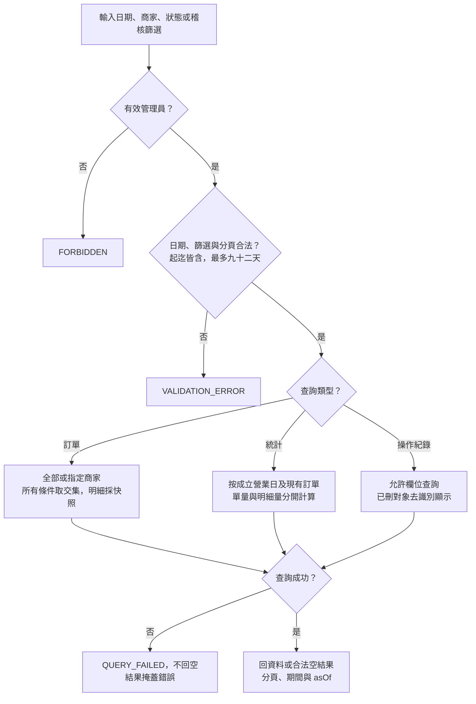

# 校園點餐系統｜查詢與統計模組

> SAD v0.6｜2026-11-02｜需求基線 SRS v0.6｜設計採用版（待實作驗證）

[回 SAD 索引](../校園點餐系統_SAD_v0.6.md) · [上一份：通知與工作台模組](./07_通知與工作台_Notifications.md) · [下一份：操作紀錄模組](./09_操作紀錄_Audit.md)

負責管理訂單查詢與營運統計；依角色套用可讀範圍，無匯出及財務功能。

## 模組責任

| Module | 公開 Interface 範例 | 隱藏的主要實作 | 需求 |
| --- | --- | --- | --- |
| AdministrationQuery | `searchOrders`、`getOperationalStatistics` | 角色資料範圍、分頁、現有訂單統計與截至時間 | FR-024、025 |

完整分工與依賴規則見 [系統架構與模組分工](./00_系統架構與模組分工.md)；資料表見 [共用資料架構](./10_共用資料架構.md)，HTTP 契約見 [共用 API 與錯誤契約](./11_共用API與錯誤契約.md)。

## 管理查詢與統計契約

| 函式 | 輸入 | 輸出與限制 |
| --- | --- | --- |
| `searchOrders` | ADMIN、merchantId?、fromDate、toDate、status?、cursor、limit | items、appliedFilters、nextCursor；管理員涵蓋全部商家，所有篩選取交集，無匯出 |
| `getOperationalStatistics` | ADMIN 或 MERCHANT、期間、商家條件 | orderCount、cancelledCount 及四種原因分類、uncollectedCount、completedCount、activeCount、preparationQuantities、period、definitionVersion、asOf |

日期使用營業日，起迄皆含且最多 92 天；SQL 轉為起日 00:00 含、迄日次日 00:00 不含的 Asia/Taipei 時間點，避免漏掉末日。統計預設當日；商家條件由其帳號強制套用，管理員可篩全部或單店。

計單量先按 orders 主檔計數，商品備餐量另按快照 quantity 加總，不以 join 後明細行數計單。備餐量只含 PREPARING、READY_FOR_PICKUP、COMPLETED、UNCOLLECTED，按 sourceProductId 合併同商品的各筆明細；取消分類保存 STUDENT／MERCHANT_REJECT／MERCHANT_CANCEL／SYSTEM。各計數與備餐量在同一查詢快照計算，確保 `orderCount = completedCount + cancelledCount + uncollectedCount + activeCount`。個資刪除後重新按現有訂單計算，不以永久彙總保留被刪訂單貢獻。

## 圖 18 管理查詢、統計與稽核查閱

追溯：FR-024～026。

本圖為管理員路徑；商家只可使用固定本店範圍的統計端點，不能讀管理訂單或稽核。無匯出及財務功能。查詢成功不新增重要異動紀錄。

## 與操作紀錄協作

操作紀錄的寫入、保存與查閱契約見 [操作紀錄](./09_操作紀錄_Audit.md)；本文件的管理查詢流程僅表達共通的授權、篩選與錯誤處理。
