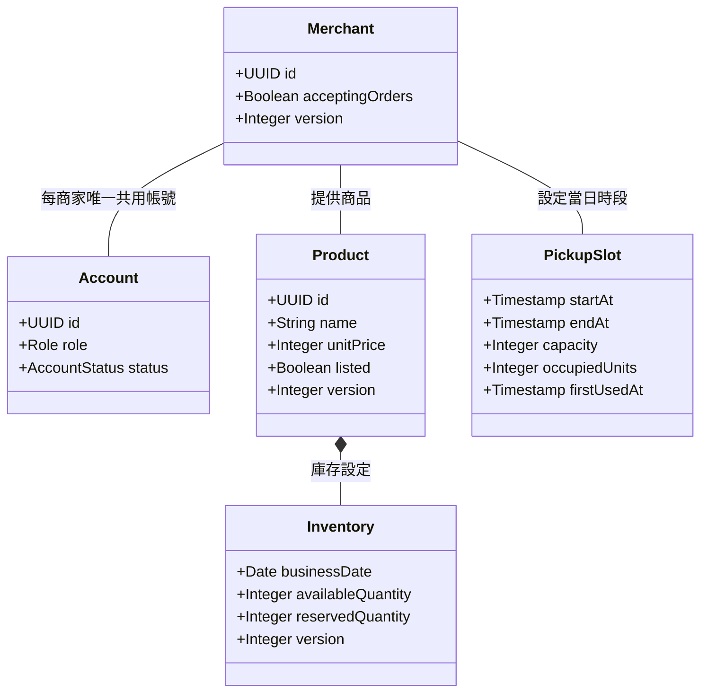
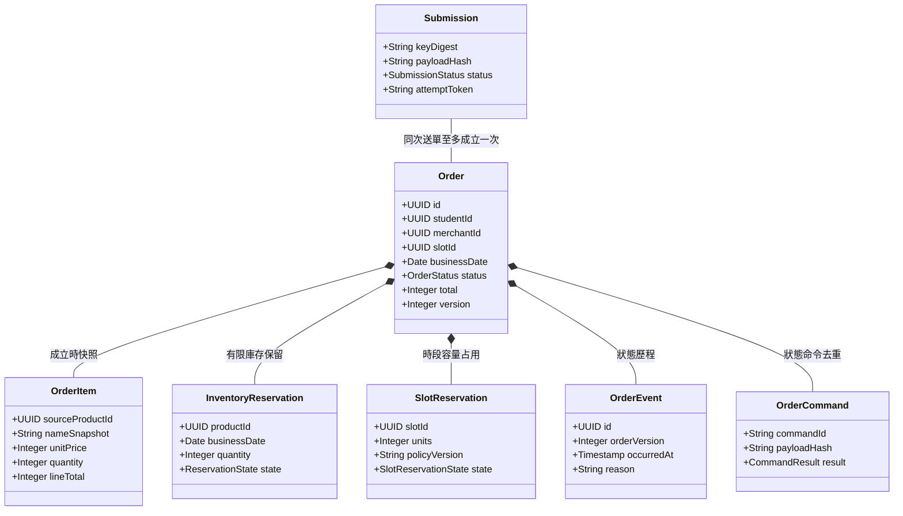

# 校園點餐系統｜共用資料架構

> SAD v0.6｜2026-11-02｜需求基線 SRS v0.6｜設計採用版（待實作驗證）

[回 SAD 索引](../校園點餐系統_SAD_v0.6.md) · [上一份：操作紀錄模組](./09_操作紀錄_Audit.md) · [下一份：共用 API 與錯誤契約](./11_共用API與錯誤契約.md)

## 資料架構

### UML 領域類別圖

#### 圖 4 帳號、菜單與資源類別圖

**圖解說明**：商品具有庫存設定；商家提供商品與當日取餐時段。商家與其唯一共用帳號對應；庫存按營業日分開，所有商品均為有限庫存，可用量與每日預設量為非負整數且不得為空值。新增占用與容量修改均不得使占用超過容量；曾使用的時段禁止刪除。

#### 圖 5 訂單、快照與保留類別圖

**圖解說明**：同一 Submission 至多建立一張訂單；訂單組合明細快照、保留、狀態事件與命令結果。圖中的組合關係表示邏輯歸屬；一般操作不得刪除歷史資料，FR-028 的本人個資刪除依 [身分與帳號模組](./01_身分與帳號_Identity.md) 專用流程處理。購物車、報價及通知等輔助資料仍依 [下方「主要資料表與欄位」](#主要資料表與欄位)。

本圖以 UML 類別、屬性、關聯及組合表示核心領域模型，依閱讀需求省略關聯數量標示；不是 ER 資料表圖。各類別的儲存對應及輔助資料表見 [下方「主要資料表與欄位」](#主要資料表與欄位)。Order 保存 Quote 的引用與確認摘要，歷史顯示以 OrderItem 快照為準；實際資料清除依 SRS v0.6 FR-028、NFR-007 與 [身分與帳號模組](./01_身分與帳號_Identity.md)。

### 主要資料表與欄位

| 表／集合 | 主要欄位 | 限制與責任 |
| --- | --- | --- |
| `account` | id、email、role、status、deletion_state、merchant_id、version | 刪除封鎖狀態與一般停用區分；商家帳號的 merchant_id 唯一；管理員單一角色涵蓋全部商家，不設 permissions 或管理範圍配置 |
| `auth_challenge`、`session` | challenge_id、proof_digest、expires_at、consumed_at、failed_attempts、generation；token_digest、account_id、issued_at、absolute_expires_at、last_activity_at、idle_timeout_seconds、revoked_at | proof 原子消耗；Session 依角色套用最長／閒置效期，背景輪詢不續期；不存明文 token |
| `merchant`、`business_schedule`、`closed_date` | status、accepting_orders、timezone、weekly_hours、date、version | 每次送單檢查有效設定；營業判定集中處理 |
| `product` | id、merchant_id、name、unit_price、listed、version | 商品名稱、商品單價、上架／下架；名稱、單價或 listed 變更遞增同一商品資料版本，沒有獨立價格版本 |
| `inventory_policy`、`inventory` | product_id、daily_default_quantity、effective_from_date；product_id、business_date、available_quantity、reserved_quantity、consumed_quantity、version | 所有商品有限庫存，無模式欄位；每日預設量與可用量為 NOT NULL 非負整數；每日預設設定與按日數量分開，每商品每營業日唯一，重試不覆寫已初始化數量；不改變商品狀態，無獨立售完旗標 |
| `pickup_slot` | merchant_id、start_at、end_at、capacity、occupied_units、first_used_at、policy_version、version | capacity 與 occupied_units 非負且 occupied_units <= capacity；first_used_at 初始為 NULL，首次成功建單同交易填入且不再清空，已使用或有引用者禁止刪除；無封存狀態；預訂截止固定為開始前 10 分鐘，不另存商家設定；歷史取餐時間取快照 |
| `cart`、`cart_item` | student_id、merchant_id、product_id、quantity、note、version | 每位學生一個活動購物車；不保留資源 |
| `quote` | id、student_id、merchant_id、input_hash、product_versions、total、currency、policy_version | 不可變且綁定本人及確認內容；新報價不使舊報價失效；不設報價效期，送單比較實際內容與價格；報價不是資源保證；product_versions 為各商品資料版本的參考，不以版本差異單獨否定確認 |
| `quote_item` | quote_id、product_id、name_snapshot、unit_price、quantity、note、line_total | 保存商品識別、商品名稱、商品單價與數量供確認內容比對；合計相同但實際明細不同仍須重新確認 |
| `submission` | actor_id、operation_type、key_digest、payload_hash、accepted_quote_id、confirmed_content_hash、accepted_at、request_payload、status、attempt_token、lease_until、order_id、result、resolved_at、result_expires_at | 結果確定後保存 24 小時；到期清掉詳細結果，留最小 key 墓碑以拒絕晚到重試 |
| `orders` | id、order_number、submission_id、student_id、merchant_id、slot_id、status、total、currency、version、pickup_start/end_snapshot、business_date、cancellation_kind、policy_version | 六種狀態；唯一 submission；沒有付款欄位 |
| `order_pickup_secret` | order_id、code_ciphertext、code_lookup_digest、key_version、scope_date、failed_attempts、locked_until | 僅本人學生可解密顯示；商家只比對指定訂單；碼的分配登記另表保存 |
| `order_item` | source_product_id、name_snapshot、unit_price、quantity、note、line_total | 保存成立快照；單價使用精確金額型別 |
| `inventory_reservation` | order_id、product_id、business_date、quantity、state、version | 每張訂單的每項商品均須保留，每單每商品唯一；釋回原營業日；`RESERVED/CONSUMED/RELEASED` |
| `slot_reservation` | order_id、slot_id、units、state、policy_version | 每單唯一；`OCCUPIED/RELEASED`；所有取消釋回容量，完成與未取維持占用 |
| `order_command` | actor_id、order_id、command_id、payload_hash、result、resolved_at、result_expires_at | 結果保存 24 小時，之後留墓碑；同命令不再次變更訂單 |
| `order_event` | order_id、order_version、from_state、to_state、action、actor_type、actor_id、occurred_at、reason | 每個訂單版本的狀態事件唯一；保留原因與時間 |
| `outbox_event` | event_id、event_type、aggregate_id、payload、status、attempts、next_attempt_at、lease_until、attempt_token | 只存投遞所需資訊；與業務交易一起寫入 |
| `notification` | event_id、recipient_id、order_id、created_at | `(event_id, recipient_id)` 唯一；保存 30 天，不設已讀功能 |
| `audit_event` | actor_type、actor_id、action、target_type/id、result、change_summary、request_id、occurred_at | 依 FR-026 清單寫入；不含電子郵件、秘密或學生個資；不開放使用者更新及刪除 |
| `identifier_registry` | kind、scope、digest | 訂單編號永久唯一；取餐碼於同店同營業日不重用；登記不含帳號或訂單關聯，個資刪除後仍維持已用識別保護 |
| `admin_guard` | singleton_id | 管理員停用的共同鎖，防止並行操作使有效管理員歸零 |
| `deletion_request` | request_id、待清除舊 account_id、state、key_version、journal_digest、progress | 可恢復工作；PENDING_JOURNAL／JOURNALED／CLEANED／COMPLETED；清除提交後移除舊帳號原始識別，保留必要非個資進度 |
| `deletion_journal` | request_id、舊帳號識別的鍵控摘要、key_version、commit_marker | 隔離權限的復原刪除日誌；不保存信箱、訂單內容或原始識別，詳 [身分與帳號模組](./01_身分與帳號_Identity.md) |

商品名稱、商品單價與上架／下架的欄位對照見 [商品模組](./03_商品_Catalog.md#名詞與欄位對照)。quote_item 與 order_item 的 unit_price 分別保存報價當下與訂單成立當下的商品單價，歷史查詢不讀取最新商品單價取代快照。

### 型別、快照及索引

**D-02 型別提案**：內部識別使用 UUID；數量與容量使用整數。時間點採帶時區資料型別、以 ISO 8601 傳輸，營業日使用 `DATE` 並依 `Asia/Taipei` 計算。金額採整數新台幣元，DB 使用 `BIGINT`，JSON 以整數輸出；應用層檢查安全整數與乘加範圍，不接受小數或隱式進位。商品單價 1～9999、每行 1～20 份、全單最多 50 份，依 SRS v0.6 FR-007、011、012。

每筆訂單保存商品、單價、合計、時段起迄與適用政策版本。歷史查詢不得以最新菜單取代快照。金額核對公式為 `sum(quantity × unitPrice)`，不得自行加入目前 SRS 沒有的折扣或費用。

資料庫最後防線包含：

- `UNIQUE(actor_id, operation_type, key_digest)` 與 `UNIQUE(orders.submission_id)`，阻止重複建單。
- `UNIQUE(actor_id, order_id, command_id)`、`UNIQUE(order_id, order_version)`，阻止重複命令結果及事件。
- 數量正整數、所有商品的可用量與每日預設量 NOT NULL 且非負、容量及占用各自非負、時段結束晚於開始的檢查。建立 `CHECK (occupied_units <= capacity)`；容量修改先鎖定時段並檢查目前占用，新增占用也以條件更新檢查上限。
- 商家與時段、商品的複合外鍵或等效交易檢查，阻止跨店引用。
- 取餐碼為四位數字，以 `(merchant_id, business_date, code_lookup_digest)` 建立分配唯一限制及碰撞重試；當日已終止或已刪除訂單的碼不重用。訂單編號另以全系統永久唯一登記保護；碰撞重試有上限，號碼空間耗盡時整單失敗，不降低唯一性。

建議索引：學生訂單 `(student_id, created_at DESC, id DESC)`；商家工作清單 `(merchant_id, status, created_at, id)`；管理查詢 `(merchant_id, created_at, id)`；通知 `(recipient_id, created_at DESC, id DESC)`；待投遞工作 `(status, next_attempt_at)`；恢復工作 `(status, lease_until)`。依查詢計畫調整，不為每一欄建立索引。

跨資料列的不變條件，例如訂單總額等於全部明細小計、保留及占用總量等於各原始紀錄與 [身分與帳號模組](./01_身分與帳號_Identity.md) 刪除後匿名資源總帳的加總，由交易內驗證及一致性巡檢守住，不假設單列 CHECK 能涵蓋跨表加總。
