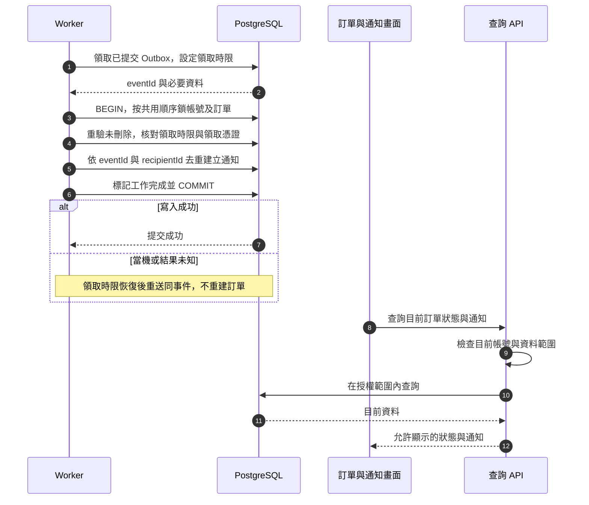

# 校園點餐系統｜通知與工作台模組

> SAD v0.6｜2026-11-02｜最後修訂 2026-11-27｜需求基線 SRS v0.6｜設計採用版（待實作驗證）

[回 SAD 索引](../SAD.md) · [上一份：訂單與交易模組](./06_訂單與交易_Orders.md) · [下一份：查詢與統計模組](./08_查詢與統計_AdministrationQuery.md)

負責已提交事件的站內通知、商家的待商家確認訂單提示與背景投遞。排程呼叫 Orders／Resources 的既有介面，不在 Worker 複製業務規則。

完整分工與依賴規則見 [系統架構與模組分工](./00_系統架構與模組分工.md)；資料表見 [共用資料架構](./10_共用資料架構.md)，HTTP 契約見 [共用 API 與錯誤契約](./11_共用API與錯誤契約.md)。

## 通知與工作台函式契約

| 函式 | 輸入 | 輸出與處理 |
| --- | --- | --- |
| `createNotificationsFromOrderEvent` | 已提交 eventId、orderId、eventType | 依 [下方 Transactional Outbox 第 5 點](#transactional-outbox) 收件規則產生通知；eventId＋recipientId 去重；回滾或已刪訂單事件不得投遞 |
| `listNotifications` | actor、cursor?、limit? | 訂單編號、事件、時間、必要原因及 nextCursor；無 readAt、信箱或取餐碼 |
| `loadMerchantOrderBoard` | 商家 actor、狀態篩選、分頁 | pendingCount、orders、nextCursor、asOf；pendingCount 對全部待商家確認訂單計數，不只當頁 |
| `refreshOrderBoard` | 最近一次狀態與版本 | 合併輪詢更新；舊 version 不覆蓋新狀態，失敗保留 stale 標示，恢復後完整同步 |

## 提交後通知循序圖

### 圖 9 通知投遞循序圖

## Transactional Outbox

**D-07**：訂單交易先把事件及 Outbox 同時寫入 DB，提交後 Worker 再產生站內通知。Outbox 只是投遞工作，不是第二套訂單狀態來源。

1. Worker 以短交易領取待投遞通知、設領取時限與領取憑證，避免長時間持有鎖。
2. claim 短交易先提交；通知交易按 Orders 的共用順序取得所需帳號與訂單生命週期鎖，再鎖事件／Outbox，重驗帳號與訂單存在、未進入刪除及領取憑證有效。以 `(eventId, recipientId)` 去重；寫通知與標記完成同交易，禁止先持有 Outbox 再反向鎖帳號。
3. 失敗採有上限的指數退避，超限標為待人工處理並告警；人工重投仍沿用同一 eventId。
4. 當機後回收逾時未完成的領取；舊工作者不得用失效的領取憑證確認新領取的工作。
5. 學生收到接單、拒單、備妥、商家或系統取消、未取通知；學生自行取消只通知商家，管理員不收訂單通知。內容為訂單編號、事件時間、類型及必要取消原因，不含信箱或取餐碼；不提供已讀功能，保存 30 天。讀取仍重驗權限。Worker 以事件時間計保存期，過期事件不再補出新通知；已刪除帳號或訂單不得被舊 Outbox 重建。

設計採「可重送投遞＋冪等寫入」，不宣稱傳輸層只送一次。若先完成通知卻在確認前當機，重跑仍只有一筆通知。商家新單清單直接查權威訂單資料，通知延遲不阻止接單。

## 其他背景工作

包含 PROCESSING 送單恢復、到期的待商家確認訂單取消、每日庫存初始化、失效驗證挑戰清除、24 小時操作結果清理、30 天通知清理及一致性巡檢；排程須可重試並補行。自動取消依 [訂單與交易模組](./06_訂單與交易_Orders.md)；未取仍僅由所屬商家操作。巡檢發現庫存、保留或容量不符時先告警並限制受影響的新單，不能任意改已成立訂單來消除差異。

## 查詢與前端協作

訂單詳情查詢契約與角色 DTO 見 [訂單與交易模組](./06_訂單與交易_Orders.md)；輪詢、斷線與舊版本合併策略見 [前端架構](./12_前端架構.md)。

## 到期處理與恢復方向

依 Q7 決議（2026-11-26 定案）：以週期掃描加補掃處理逾時訂單，搭配延遲監測及入口校正，全部使用同一可重試系統取消操作。接單入口的補取消不能取代全域掃描。送單與接單入口需要校正過期訂單時，應呼叫具共同鎖序的取消服務並重新取得權威結果，不可只在畫面假裝取消或持有後序鎖再逆向取鎖；查詢不觸發取消。

下列為 SAD 設計值，適用逾時取消、Outbox 投遞與 PROCESSING 送單恢復三類背景工作：

| 參數 | 設計值 | 說明 |
| --- | --- | --- |
| 掃描間隔 | 30 秒 | 正常情況下到期工作最慢 30 秒內被領取 |
| 領取時限 | 60 秒，不延長 | Worker 領取工作後須在時限內完成；逾時由其他 Worker 以新的領取憑證接手，舊憑證失效 |
| 重試 | 最多 5 次，指數退避，約 10 秒起、上限 5 分鐘 | 超過上限標為待人工處理並告警維運聯絡人（SRS A-05）；人工重投沿用原 eventId／commandId |
| 逾時取消驗收界線 | 時段結束後 2 分鐘內完成；Worker 中斷恢復後 5 分鐘內補完 | 依 SRS FR-027 |
| 逾時取消延遲告警 | 最舊一筆到期未取消訂單超過 2 分鐘 | 監控見 [部署維運與驗證](./13_部署維運與驗證.md#監控與告警) |
| PROCESSING 送單告警 | 停留超過 2 分鐘 | 學生以原送單識別查詢時顯示結果待確認 |
| Outbox 延遲告警 | 最舊一筆待投遞通知超過 5 分鐘 | 通知延遲不阻止接單 |
