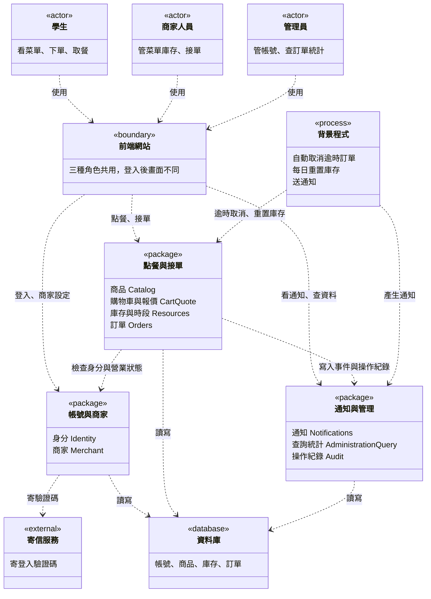

# 校園點餐系統｜UML 系統架構圖

> 2026-11-11｜依據 SAD v0.6｜設計方案，程式尚未開始寫

這張圖用 UML 類別圖的表示法畫出系統的主要部分，以及它們之間誰依賴誰。後端三組用 `<<package>>` 表示，組內列出包含的模組。只畫到「有哪幾塊、誰依賴誰」這一層；模組內部的函式與資料，見 SAD v0.6 的〈系統架構與模組分工〉圖 0。

## 怎麼讀

- **虛線箭頭**（`..>`）是 UML 的「依賴」：A 指向 B，表示 A 要用到 B。例如「點餐與接單」指向「帳號與商家」，是因為成立訂單前要先確認學生身分、商家有在營業。
- **`<< >>` 裡的字**是 UML 的「構造型」（stereotype），標示這個方塊是哪一類東西：

| 構造型 | 意思 |
| --- | --- |
| `<<actor>>` | 使用系統的人 |
| `<<boundary>>` | 使用者直接接觸的介面 |
| `<<package>>` | 一組模組，方塊內列出包含哪些模組 |
| `<<process>>` | 獨立執行的程式 |
| `<<database>>` | 資料庫 |
| `<<external>>` | 系統外部的服務 |

## 後端三組

| 組 | 包含的模組 | 負責什麼 |
| --- | --- | --- |
| 帳號與商家 | 身分、商家 | 登入、確認你能做什麼，以及商家的營業設定 |
| 點餐與接單 | 商品、購物車與報價、庫存與時段、訂單 | 從看菜單、算價格、扣庫存、成立訂單，到商家確認訂單和交付餐點 |
| 通知與管理 | 通知、查詢統計、操作紀錄 | 通知學生和商家、讓管理員查資料、記下誰做了什麼 |

**技術**：前端 React、後端 NestJS、資料庫 PostgreSQL。
