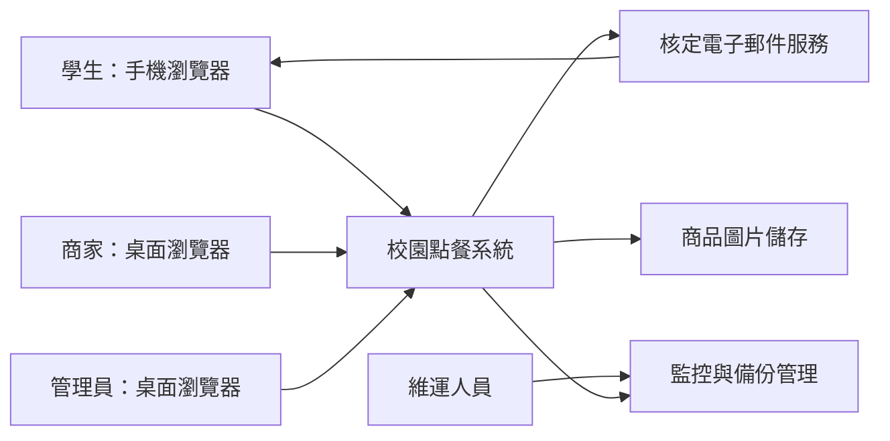
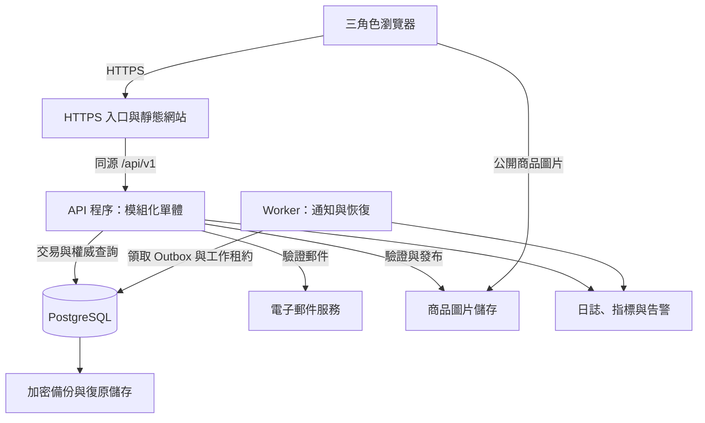
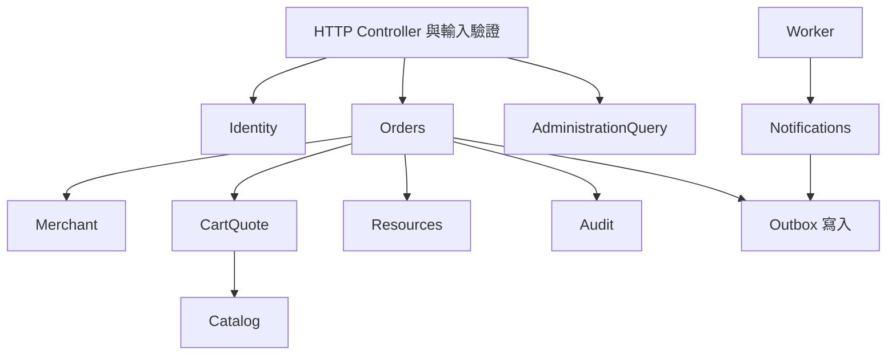
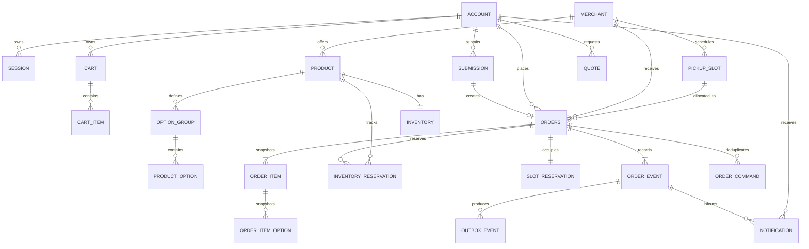
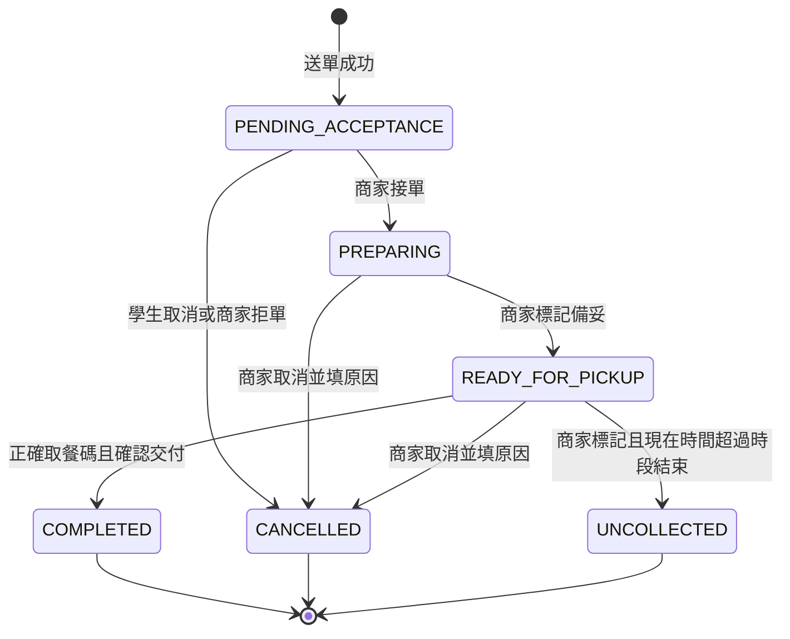
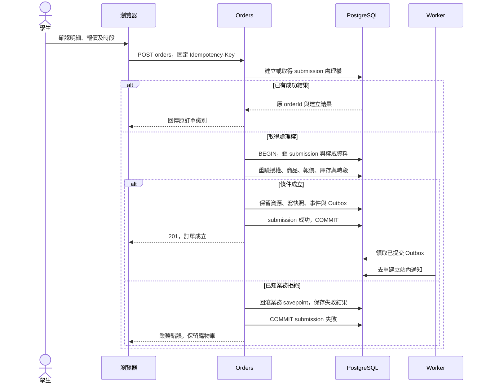

# 校園點餐系統｜系統架構設計文件

> Software Architecture Design（SAD）｜v0.1｜2026-10-24｜設計審查稿

## 1. 設計依據與適用範圍

### 1.1 文件標記

- **需求：**可追溯至 SRS 的既有要求。
- **設計提案 D-xx：**本文提出的技術與實作選擇，需設計審查。
- **待決議 B-xx：**沿用 SRS 的業務或品質決議；本文不把示例數字當作正式驗收標準。

### 1.2 主要架構驅動因素

| 驅動因素 | 架構回應 |
| --- | --- |
| 不超賣、不超額、同次送單只成立一次 | 訂單、庫存、時段與去重紀錄在同一關聯式資料庫交易中提交 |
| 接單、取消、完成及未取可能同時操作 | 集中狀態機、列鎖、版本檢查與命令去重 |
| 價格異動不能改寫歷史 | 伺服器報價及不可經一般功能修改的訂單快照 |
| 三種角色與商家資料隔離 | 每個受保護請求執行身分、角色及資源範圍檢查 |
| 初期 3000 位學生、500 人在線、30 家商家、每家 100 項商品 | 優先採可水平擴充的模組化單體，經量測調整資源 |
| 狀態更新暫定 10 秒內可見 | 前景輪詢、更新時間提示、斷線恢復及通知可靠投遞 |

## 2. 整體架構與技術選型

### 2.1 架構決策

**D-01：採模組化單體（Modular Monolith）、單一交易資料庫，以及獨立背景工作程序。**

學生、商家與管理介面共用一套後端業務規則。後端以 Module（模組）組織責任，對外提供明確的 Interface（介面契約）；Controller 不直接更新資料表。訂單 Module 隱藏送單驗證、鎖定、保留、快照、事件及去重的 Implementation（實作），呼叫端只提交完整業務命令。

### 2.2 建議技術組合

以下為設計選型，不是現有專案依賴清單；實際版本於開發啟動時鎖定並做相容性驗證。

| 層級 | 建議 | 選擇理由與限制 |
| --- | --- | --- |
| 瀏覽器介面 | React + TypeScript，響應式網站 | 三角色共用表單、清單及狀態呈現；依官方 UI 拆分與狀態設計方式組織畫面。[React 文件](https://react.dev/learn/thinking-in-react) |
| 後端 | Node.js + TypeScript + NestJS | 以 imports／providers／exports 管理 Module 的公開契約與內部實作。[NestJS Modules](https://docs.nestjs.com/modules) |
| 權威資料儲存 | PostgreSQL | 使用交易、列鎖、唯一限制、外鍵與檢查限制保護資料；具體交易流程由本文定義。[鎖定](https://www.postgresql.org/docs/current/explicit-locking.html)、[資料限制](https://www.postgresql.org/docs/current/ddl-constraints.html) |
| 資料存取 | 參數化 SQL、版本化 migration | 涉及鎖與條件更新的語意須可直接檢查；若選 ORM，須證明所有 Module 使用同一交易連線 |
| HTTP 契約 | HTTPS、JSON、REST 風格端點、OpenAPI 規格 | 讓前後端與測試共享欄位、錯誤及授權定義 |
| 背景工作 | 同一程式庫的 Worker 程序 + DB Outbox | 通知與恢復工作不延長訂單交易；初期不增加訊息代理必要相依 |
| 圖片 | 私有上傳區及公開商品圖片儲存區 | 圖片二進位不放訂單資料表；DB 保存資產識別與發布狀態 |
| 電子郵件 | 校方或核定供應商，透過 Email Adapter | 只供驗證；供應商與寄送政策依 B-01 |
| 部署 | 容器化應用、HTTPS 入口、私有資料庫網路 | 可在校方或雲端環境落地；平台、規格及可用性須依 B-15 決定 |

本版不以 Redis、Kafka、Kubernetes、搜尋引擎或獨立資料倉儲作為必要相依。後續只有在負載與運維證據支持時才加入；不承諾任何硬體規格可直接達成效能目標。

### 2.3 系統情境圖



信任邊界位於瀏覽器與後端、應用與資料儲存、應用與外部郵件服務之間。瀏覽器傳入的角色、金額、時間及資料歸屬均不具權威性。

### 2.4 執行與部署圖



API 與 Worker 可分開增加執行個體，但由同一套版本化程式建置。登入狀態、去重結果、Outbox 及工作租約均保存在共用持久儲存，不依賴單一程序記憶體。

## 3. 模組責任與介面契約

### 3.1 Module 分工

| Module | 公開 Interface 範例 | 隱藏的主要實作 | 需求 |
| --- | --- | --- | --- |
| Identity | `requestChallenge`、`verifyAndLogin`、`authorize`、`changeAccountStatus` | 驗證憑證、Session、角色與帳號有效性 | FR-001～003 |
| Merchant | `manageMerchant`、`saveBusinessSettings`、`validateAccepting` | 啟停、營業區間、例外日、接單設定 | FR-004、005 |
| Catalog | `saveProduct`、`saveOptions`、`readPurchasableItems` | 商品版本、選項限制、圖片發布與上下架 | FR-007、008、010 |
| CartQuote | `updateCart`、`createQuote`、`validateAcceptedQuote` | 單店購物車、精確計價、版本比較與報價歸屬 | FR-011～013 |
| Resources | `saveSlot`、`adjustInventory`；訂單內部使用 `reserve`、`consume`、`release` | 庫存與時段鎖、保留明細、一次性釋回 | FR-006、009、018 |
| Orders | `createOrder`、`getSubmissionResult`、`applyCommand` | 去重、狀態機、交易協調、不可變快照及事件 | FR-014～021 |
| Notifications | `listNotifications`、`getMerchantOverview`、`materializeEvent` | Outbox 去重、投遞進度與授權可見性 | FR-022、023 |
| AdministrationQuery | `searchOrders`、`getOperationalStatistics` | 範圍限制、分頁、統計定義與截至時間 | FR-024、025 |
| Audit | `appendAuditEvent`、`searchAuditEvents` | 附加紀錄、敏感欄位排除與查閱權限 | FR-026 |

Module 的 Interface 包含輸入、輸出、不變條件、可重試錯誤及交易規則；不只是函式名稱。可改變實作的位置稱為 Seam，滿足該契約的具體整合稱為 Adapter。Email Adapter 可用正式供應商或測試收件器；Clock 可用正式時間或固定測試時間。庫存並行測試仍須使用真正的 PostgreSQL，不能用記憶體替身宣稱已證明資料庫交易正確。

### 3.2 依賴規則



- Orders 主導交易，Resources 等內部操作接受同一 `TransactionContext`，不能自行提交。
- Controller 不逐步呼叫「扣庫存、建單、通知」來組合交易；只呼叫完整的 `createOrder`。
- Module 不任意寫入其他 Module 的資料表；跨模組變更透過其交易內 Interface。
- 查詢可使用受控 SQL View 或查詢層連接所需資料，但不可繞過身分與歸屬檢查。
- 通知只能讀取已提交事件，不能反向推進訂單狀態。

### 3.3 建議程式目錄

```text
apps/
  web/src/features/          # auth、menu、cart、orders、merchant、admin
  api/src/modules/           # identity、merchant、catalog、cart-quote、resources、orders…
  worker/src/                # outbox 投遞、送單恢復、維護工作
packages/
  contracts/                # HTTP DTO 與產生的前端型別；不匯出內部 Entity
  application/              # API 與 Worker 共用的應用 Module
  infrastructure/           # DB、郵件、圖片、時鐘及觀測整合
database/
  migrations/
  seeds/                    # 合成測試資料
tests/
  integration/              # 真實 DB、交易與並行測試
  e2e/                      # 三角色主要流程
  load/                     # 核定使用情境與容量驗證
docs/
  architecture/
  api/
```

此為後續開發提案，尚未在專案建立上述程式目錄。

## 4. 資料架構

### 4.1 核心 ER 圖



圖中聚焦訂單路徑；帳號權限、商家營業設定、圖片及稽核表詳見下表。`QUOTE` 在訂單中保存引用與確認摘要，歷史顯示仍以 `ORDER_ITEM` 快照為準。

### 4.2 主要資料表與欄位

| 表／集合 | 主要欄位 | 限制與責任 |
| --- | --- | --- |
| `account`、`account_permission` | id、email、role、status、merchant_id、version、permissions | 商家帳號歸屬及管理範圍依 B-02；身份來自後端 |
| `auth_challenge`、`session` | challenge_id、proof_digest、expires_at、consumed_at；token_digest、account_id、expires_at、revoked_at | proof 原子消耗；不可儲存明文 Session token |
| `merchant`、`business_schedule`、`closed_date` | status、accepting_orders、timezone、weekly_hours、date、version | 每次送單檢查有效設定；營業判定集中處理 |
| `product`、`option_group`、`product_option` | merchant_id、name、category、asset_id、price、price_version、published、selection_min/max、extra_price | 選項隸屬正確商品；所有影響購買的修改更新商品版本 |
| `image_asset` | owner_merchant_id、object_key、media_type、size、state | `PENDING/READY/REJECTED`；只可引用已驗證發布的圖片 |
| `inventory` | product_id、mode、available_quantity、reserved_quantity、sold_out、version | 有限庫存不可負；不限量以明確模式處理，不以巨大數量代替 |
| `pickup_slot` | merchant_id、start_at、end_at、capacity、occupied_units、policy_version、version | `0 <= occupied_units <= capacity`；已有訂單的時間不直接改寫 |
| `cart`、`cart_item` | student_id、merchant_id、product_id、quantity、selected_options、note、version | 每位學生一個活動購物車；不保留資源 |
| `quote`、`quote_item` | student_id、merchant_id、input_hash、price_versions、total、currency、expires_at、policy_version | 綁定本人及送單內容；報價不是資源保證 |
| `submission` | actor_id、operation_type、key_digest、payload_hash、status、attempt_token、lease_until、order_id、result | 去重與當機恢復；成功及已知失敗結果持久化 |
| `orders` | id、order_number、submission_id、student_id、merchant_id、slot_id、status、total、currency、version、pickup_start/end_snapshot、policy_version | 六種狀態；唯一 submission；沒有付款欄位 |
| `order_pickup_secret` | order_id、code_ciphertext、code_lookup_digest、key_version、scope_date | 授權學生可解密顯示；唯一範圍依 B-07；不得記錄於一般日誌 |
| `order_item`、`order_item_option` | source_product_id、name_snapshot、base_price、quantity、note、line_total、option_name、extra_price | 保存成立快照；單價與加價使用精確金額型別 |
| `inventory_reservation` | order_id、product_id、quantity、state、version | 每單每商品唯一；`RESERVED/CONSUMED/RELEASED` |
| `slot_reservation` | order_id、slot_id、units、state、policy_version | 每單唯一；`OCCUPIED/RELEASED`；接單後處置依 B-09 |
| `order_command` | actor_id、order_id、command_id、payload_hash、result | 同命令重播不再次變更訂單 |
| `order_event` | order_id、order_version、from_state、to_state、action、actor_id、occurred_at、reason | 每個訂單版本的狀態事件唯一；保留原因與時間 |
| `outbox_event` | event_id、event_type、aggregate_id、payload、status、attempts、next_attempt_at、lease_until | 只存投遞所需資訊；與業務交易一起寫入 |
| `notification` | event_id、recipient_id、order_id、created_at | `(event_id, recipient_id)` 唯一；已讀欄位是否加入依 B-10 |
| `audit_event` | actor_id、action、target_type/id、result、change_summary、request_id、occurred_at | 成功異動同交易寫入；不開放一般更新及刪除 |

### 4.3 型別、快照及索引

**D-02 型別提案：**內部識別使用 UUID；數量與容量使用整數；時間使用可表示時間點的欄位並以 ISO 8601 傳輸。業務日期由校園時區計算，提案使用 `Asia/Taipei`，仍須隨 B-04 核定。金額使用精確 `NUMERIC` 並以十進位字串傳輸；precision、scale、幣別及零元規則依 B-06 定版，禁止 JavaScript 浮點加總直接成為權威金額。

每筆訂單保存商品、選項、單價、合計、時段起迄與適用政策版本。歷史查詢不得以最新菜單取代快照。金額核對公式為 `sum(quantity × (basePrice + sum(optionExtraPrice)))`，不得自行加入目前 SRS 沒有的折扣或費用。

資料庫最後防線包含：

- `UNIQUE(actor_id, operation_type, key_digest)` 與 `UNIQUE(orders.submission_id)`，阻止重複建單。
- `UNIQUE(actor_id, order_id, command_id)`、`UNIQUE(order_id, order_version)`，阻止重複命令結果及事件。
- 數量正整數、有限庫存非負、容量不超額、時段結束晚於開始的檢查。
- 商家與時段、商品的複合外鍵或等效交易檢查，阻止跨店引用。
- 取餐碼以 B-07 核定範圍建立唯一限制與碰撞重試；不預設全系統永久唯一。

建議索引：學生訂單 `(student_id, created_at DESC, id DESC)`；商家工作清單 `(merchant_id, status, created_at, id)`；管理查詢 `(merchant_id, created_at, id)`；通知 `(recipient_id, created_at DESC, id DESC)`；待投遞工作 `(status, next_attempt_at)`；恢復工作 `(status, lease_until)`。依查詢計畫調整，不為每一欄建立索引。

跨資料列的不變條件，例如訂單總額等於全部明細小計、保留總量等於各活動保留紀錄加總，由交易內驗證及一致性巡檢守住，不假設單列 CHECK 能涵蓋跨表加總。

## 5. 訂單生命週期與資源規則

### 5.1 狀態圖



`PROCESSING/SUCCEEDED/FAILED` 是送單請求處理狀態，不是訂單狀態。管理員沒有任意修改訂單狀態或代替商家宣告交付的權限。未取後的線下協調不產生系統補領轉換。

### 5.2 資源處理矩陣

| 事件 | 有限庫存 | 時段容量 | 原子提交內容 |
| --- | --- | --- | --- |
| 成立 | available 減 q，reserved 加 q | occupied 增加核定 units | 訂單、快照、兩類保留、事件、稽核、Outbox、送單成功 |
| 接單 | reserved 減 q，保留改 CONSUMED；不再次扣 available | 保持原占用 | 狀態、耗用、命令結果、事件及必要通知 |
| 接單前取消／拒單 | 僅 RESERVED 可轉 RELEASED；available 加 q、reserved 減 q | 僅 OCCUPIED 可釋回一次 | 取消與全部釋回一起提交 |
| 接單後取消 | 不補回已耗用庫存 | 依 B-09 核定政策 | 原狀態、理由、取消、政策處置及事件 |
| 完成／未取 | 不補庫存 | 依 B-09；不得再次占用或重複釋回 | 終止狀態、時間、政策處置及事件 |

不限量商品不扣有限庫存計數，但仍受上下架、售完、選項及時段容量限制。手動庫存調整採「更新可用量、不覆寫保留量」作為 D-03 提案，有活動保留時禁止切換模式；需依 B-05 核定。

容量使用 `capacityUnits(order, policyVersion)` 計算，避免把待決議的一單一單位或依餐點份數直接寫死。容量及接單後釋回政策沒有核定前，可進行測試情境設計，但不得聲稱相關業務驗收已完成。

## 6. 交易、鎖定與冪等設計

### 6.1 建立訂單流程



**D-04：採 `READ COMMITTED`、明確列鎖與條件更新。**購物車與報價階段不保留資源。實際送單步驟如下：

1. 驗證帳號與請求形狀，伺服器將商家、時段、報價、明細、選項、備註標準化並計算 payload hash；不得刪除會影響語意的差異。
2. 以短交易建立或取得 submission，配置 attempt token 與處理租約。唯一鍵競爭者讀取同一紀錄，不另建單。
3. 主交易鎖住 submission，確認 token 仍屬本次嘗試，再建立業務 savepoint。
4. 依固定順序取得身分、商家、時段、商品與庫存權威資料；重新檢查有效狀態及最新價格版本。相同商品跨多明細先加總數量。
5. 以條件更新保留所有庫存與容量；任何一筆未更新成功即整筆業務回滾。
6. 建立訂單、快照、取餐碼、保留明細、訂單事件、必要稽核與 Outbox，將 submission 改為成功並提交。
7. 已知業務拒絕才將 submission 標為 FAILED；基礎設施故障或提交結果未知維持可恢復狀態。回應只在提交結果明確後宣告成功。

有限庫存與容量的概念 SQL：

```sql
UPDATE inventory
SET available_quantity = available_quantity - :q,
    reserved_quantity = reserved_quantity + :q,
    version = version + 1
WHERE product_id = :product_id
  AND mode = 'FINITE'
  AND sold_out = false
  AND available_quantity >= :q;
-- 每個有限商品須影響一列；否則整筆業務交易回滾。

UPDATE pickup_slot
SET occupied_units = occupied_units + :units,
    version = version + 1
WHERE id = :slot_id
  AND merchant_id = :merchant_id
  AND occupied_units + :units <= capacity;
-- 必須先在同交易驗證時段資格及鎖定；更新失敗則回滾庫存保留。
```

SQL 為契約示例，不是已建立的 migration；所有參數皆由後端驗證並繫結，不能串接使用者文字。

### 6.2 共用鎖順序與競爭處理

所有相關寫入遵循：**操作識別紀錄 → 相關帳號（依 ID）→ 商家 → 既有訂單 → 時段 → 商品（依 ID）→ 庫存（依商品 ID）→ 保留與事件。**不需要的節點可略過，但不得反向取鎖。

- 送單對帳號與商家採共享列鎖，停用／角色及營業設定變更採與其衝突的更新鎖，避免將同商家所有送單不必要地完全序列化。
- 商品及選項修改必須先鎖父商品，並更新共同商品版本；送單依相同規則保護報價檢查，避免選項更新繞過商品鎖。
- 庫存、時段、既有訂單使用更新鎖或等效條件更新。所有管理修改也必須遵守相同規則。
- 狀態命令鎖訂單後，先檢查同 commandId 是否已成功，再檢查 expectedVersion 與狀態，讓成功重播不被舊版本誤擋。
- 接單與學生取消競爭，只能有一方通過原狀態與版本檢查；完成與未取同理。
- 死鎖或可重試交易失敗時，回滾整筆交易並以同 key／commandId 有上限地重試；不只補做最後一條 SQL。超限回傳可辨識錯誤並提供原操作查詢。

時段列仍可能成為尖峰熱門資源；交易不得包含郵件、圖片處理或外部 HTTP 呼叫。以鎖等待時間及熱門時段壓測決定是否需進一步優化。

### 6.3 不確定結果與當機恢復

| 情境 | 必須採取的行為 |
| --- | --- |
| 同 key、同 payload | 原成功結果直接重播；處理中回 202；已知失敗回原錯誤 |
| 同 key、不同 payload | 409 `IDEMPOTENCY_KEY_REUSED`；不覆寫原請求 |
| 主交易已提交但 HTTP 回應遺失 | 以原 key 查得原 orderId；不再保留資源 |
| claim 成功後程序當機 | Worker 在租約到期後鎖 submission，核對持久結果及唯一訂單關聯，取得新 token 才恢復 |
| 原工作者仍執行、恢復者到達 | submission 列鎖及 token 檢查阻止雙重處理；租約過期本身不代表可直接重建 |
| 已確定業務失敗後修改內容 | 重新取得報價與確認，再使用新 key，形成新操作 |
| key 詳細結果保存期限到期 | 依 B-08 保存最小去重墓碑或回 `SUBMISSION_EXPIRED`；不得把舊 key 當新送單 |

建議成功 submission 與訂單關聯保留至核定訂單保存期限；個資清除、失敗 key 保存與墓碑清除需由 B-08／B-12 共同決定。讀取任何重播結果前仍須重新驗證帳號與資料存取權。

## 7. HTTP 介面設計

### 7.1 共通契約

**D-05：**路徑前綴 `/api/v1`，Cookie Session 驗證；寫入請求具 CSRF 防護。`actorId`、`studentId` 及商家操作身分由伺服器建立。需並行保護的修改使用 `expectedVersion`；狀態命令使用 `commandId`。

成功回應為 `{data, requestId}`；列表為 `{data:{items,nextCursor},requestId}`。採穩定排序與 cursor，含同時間資料的 ID 次序。`requestId` 用於除錯，`Idempotency-Key` 用於同次送單去重，`commandId` 用於同次狀態命令去重，三者不可混用。

| 類型 | HTTP | 代表 code／行為 |
| --- | --- | --- |
| JSON 格式錯誤／欄位非法 | 400／422 | `VALIDATION_ERROR`，保留可修正內容 |
| 未登入／帳號停用／越權 | 401／403 | `UNAUTHENTICATED`、`ACCOUNT_DISABLED`、`FORBIDDEN` |
| 無資源或不在可見範圍 | 404 | `RESOURCE_NOT_FOUND`，不揭露他人資料是否存在 |
| 條件或版本衝突 | 409 | `QUOTE_CHANGED`、`SLOT_FULL`、`INSUFFICIENT_STOCK`、`VERSION_CONFLICT` |
| 狀態或取消不合法 | 409 | `INVALID_ORDER_TRANSITION`、`CANCELLATION_NOT_ALLOWED` |
| 核碼或交付確認失敗 | 422 | `PICKUP_CODE_MISMATCH`、`HANDOVER_REQUIRED` |
| 尚在處理 | 202 | `PROCESSING`，回傳原操作查詢路徑 |
| 超過請求頻率 | 429 | `RATE_LIMITED`，提供稍後重試資訊 |
| 暫時不可用／非預期錯誤 | 503／500 | 結果可能未知時沿用原 key 查詢，不宣告已回滾 |

### 7.2 端點摘要

表中省略 `/api/v1`。完整欄位與 OpenAPI 檔待實作階段產製；不得僅因知道路徑而跳過資源授權。

| 領域 | 端點 | 存取與重點 |
| --- | --- | --- |
| 登入 | `POST /auth/email/challenges`、`POST /auth/email/verify`、`POST /auth/logout`、`GET /me` | 受限申請頻率、一次性驗證；登出撤銷 Session |
| 公開菜單 | `GET /merchants`、`GET /merchants/{id}/menu`、`GET /merchants/{id}/pickup-slots` | 僅已公開資料；瀏覽不保證送單可用 |
| 購物車 | `GET/PUT /cart`、`DELETE /cart` | 本人；跨店替換必須確認；以版本防止舊畫面覆寫 |
| 報價與送單 | `POST /quotes`、`POST /orders`、`GET /order-submissions/{key}` | 本人；後端計價；建立訂單須 Idempotency-Key |
| 學生訂單 | `GET /orders`、`GET /orders/{id}`、`POST /orders/{id}/cancel` | 本人；只可取消待確認訂單 |
| 商家設定 | `PUT /merchant/business-settings`、`POST /merchant/pickup-slots`、`PATCH /merchant/pickup-slots/{id}` | 所屬商家；具版本與容量保護 |
| 商品與圖片 | `POST /merchant/products`、`PATCH /merchant/products/{id}`、`PUT /merchant/products/{id}/options`、`POST /merchant/images` | 所屬商家；選項更新同步商品版本 |
| 庫存 | `PATCH /merchant/products/{id}/inventory` | 不能覆寫保留數量；遵循共用鎖規則 |
| 接單清單 | `GET /merchant/orders`、`GET /merchant/overview` | 所屬商家；待確認數量與狀態清單 |
| 商家命令 | `POST /merchant/orders/{id}/accept`、`/ready`、`/reject`、`/cancel`、`/complete`、`/uncollected` | 每次帶 commandId、expectedVersion；拒單／取消需原因 |
| 站內通知 | `GET /notifications` | 目前有權限的本人通知；訂單詳細內容另行驗權 |
| 帳號／商家管理 | `POST /admin/accounts`、`PATCH /admin/accounts/{id}/status`、`POST /admin/merchants`、`PATCH /admin/merchants/{id}` | 依管理權限與範圍 |
| 管理查詢 | `GET /admin/orders`、`GET /admin/statistics`、`GET /admin/audit-events` | 受控查詢；統計只含訂單量、取消量、未取量與備餐數量 |

### 7.3 建單請求範例

以下為測試格式示例，ID 不對應正式資料。金額由後端讀取報價及重新驗證，不由此請求指定。

```http
POST /api/v1/orders
Content-Type: application/json
Idempotency-Key: submit-demo-001
X-CSRF-Token: <session-bound-token>

{
  "merchantId": "merchant-demo-01",
  "pickupSlotId": "slot-demo-01",
  "acceptedQuoteId": "quote-demo-01",
  "items": [
    {
      "productId": "product-demo-01",
      "quantity": 2,
      "selectedOptionIds": ["option-demo-egg"],
      "note": "不要香菜"
    }
  ]
}
```

成立回應包含原 orderId、`PENDING_ACCEPTANCE`、快照、價格合計、取餐時段、取餐碼及 version。相同 key 重播的建立結果可能早於目前訂單狀態；前端取得 orderId 後再讀取最新詳情。

## 8. 前端架構與畫面狀態

前端按 `auth`、`menu`、`cart`、`student-orders`、`merchant-console`、`admin` 分區，共用 HTTP client、錯誤翻譯、表單驗證及設計元件。前端快取用於顯示；商品可售、價格及訂單狀態由後端定案。

| 畫面 | 狀態與必要行為 |
| --- | --- |
| 登入 | 寄送中、已寄送、過期、驗證失敗、停用；不可因郵件請求成功就視為登入 |
| 菜單 | 載入中、無品項、失敗、停售；顯示最新更新時間 |
| 購物車 | 編輯中、報價改變、無效選項、庫存不足、時段額滿；跨店更換明確確認 |
| 送單 | 草稿、送出中、結果待確認、已成立、已知拒絕；送出中固定 key，不重新產生 |
| 訂單詳情 | 顯示六狀態、不可變明細、時段及允許命令；衝突後刷新，不樂觀宣告完成 |
| 商家交付 | 輸入取餐碼及「已實際交付」確認；錯碼或版本衝突保持原狀態 |
| 商家工作台 | 待確認、製作中、可取餐分列；斷線及過期資料有明顯提示 |
| 管理查詢 | 空資料與載入失敗不同；統計顯示口徑版本與截至時間 |

**D-06：正常連線且頁面在前景時，以約 5 秒為起始輪詢間隔並加入小幅抖動。**單一頁面合併讀取必要的狀態摘要，避免每張訂單各發一個輪詢。切回前景及網路恢復時立即刷新；背景頁面可降低頻率，須標示最後更新時間。10 秒可見性測試應明確限定正常連線與核定瀏覽器前景情境，依 B-14 確認。

輪詢間隔、API 時間與畫面處理加總才是端到端延遲，不以「5 秒輪詢」直接宣稱達成 10 秒要求。離線期間不提供自動排隊送單；恢復後先查詢原操作結果。

## 9. 通知與背景工作

### 9.1 Transactional Outbox

**D-07：**訂單交易先把事件及 Outbox 同時寫入 DB，提交後 Worker 再產生站內通知。Outbox 只是投遞工作，不是第二套訂單狀態來源。

1. Worker 以短交易領取待處理資料、設租約與 attempt token，避免長時間持有鎖。
2. 建立通知時以 `(eventId, recipientId)` 去重；寫通知與標記此工作完成放在同一交易。
3. 失敗採有上限的指數退避，超限標為待人工處理並告警；人工重投仍沿用同一 eventId。
4. 當機後回收逾期租約；舊工作者不得用失效 token 確認新租約的工作。
5. 通知收件角色與內容依 B-10；讀取通知時仍檢查目前權限及資料範圍，撤銷商家歸屬後不能從舊通知讀到訂單內容。

設計採「可重送投遞＋冪等寫入」，不宣稱傳輸層只送一次。若先完成通知卻在確認前當機，重跑仍只有一筆通知。商家新單清單直接查權威訂單資料，通知延遲不阻止接單。

### 9.2 其他背景工作

包含 PROCESSING 送單恢復、失效驗證挑戰清除、孤立圖片清理、核定資料保存清理及一致性巡檢。巡檢發現庫存、保留或容量不符時先告警並限制受影響的新單，不能任意改歷史訂單來消除差異。

本版不安排排程自動取消待確認訂單，也不自動標記未取；FR-020 指定由所屬商家操作。

## 10. 身分、授權與資料保護

### 10.1 授權矩陣

| 操作 | 學生 | 商家 | 管理員 |
| --- | --- | --- | --- |
| 建立購物車、報價與訂單 | 本人 | 不提供代下單 | 不提供代下單 |
| 查閱訂單 | 本人 | 所屬商家 | 核定管理範圍 |
| 修改商品、庫存與時段 | 不可 | 所屬商家 | 不因管理身分自動取得商家操作權 |
| 接單、拒單、備妥、交付、未取 | 不可 | 所屬商家且狀態合法 | 不代商家執行 |
| 學生取消 | 本人待確認訂單 | 使用商家拒單／取消命令 | 無任意狀態修改權 |
| 帳號與商家管理 | 不可 | 不可跨越管理權限 | 依 B-02 核定權限 |
| 操作紀錄、管理統計 | 不可 | 僅核定範圍；商家統計畫面另決議 | 核定權限與範圍 |

### 10.2 安全設計

- **D-08 Session：**採伺服器端 Session，Cookie 設 Secure、HttpOnly 及適當 SameSite；寫入檢查 CSRF token 與來源。每次受保護請求讀取權威帳號有效狀態，不以未到期 token 略過停用檢查。
- 電子郵件 proof 只保存雜湊／加密驗證摘要；低熵驗證碼採帶伺服器秘密的摘要並限制嘗試。成功核對、消耗 challenge 與建立 Session 原子執行；效期、重寄及帳號註冊政策依 B-01。
- 對登入申請與驗證、取餐碼核對、上傳及高成本查詢設頻率限制；多 API 個體共用限流狀態。數值屬安全設定提案，不沿用舊 PRD。
- 取餐碼既須供學生查閱又須核對，因此採加密保存與獨立鍵控摘要；金鑰版本可追蹤與輪替。核對限定已授權商家及指定訂單，不提供匿名短碼查單。
- 查詢在 SQL 條件納入 student_id／merchant_id／管理範圍，輸出欄位採允許清單；商家不取得非必要學生個資。跨範圍資源使用一致 404 回應。
- 上傳檢查實際檔案格式、大小及解碼後尺寸，重新編碼後發布；拒絕可執行內容與任意遠端 URL 抓取。限制依 B-06 定版。
- 註記、品名與原因當純文字處理，輸出編碼；DB 使用參數化查詢。正式錯誤不包含堆疊、SQL、完整驗證碼、Session 或完整取餐碼。
- 一般應用帳號不具 schema 管理權；歷史快照與稽核一般角色不具更新權。migration、備份及核定資料清除使用分離權限。
- 個資保存、去識別、備份保留及到期清除依 B-12／B-15；恢復舊備份時須重新套用清除清單，避免已清除個資重新對外可見。

停用與寫入競爭由帳號列鎖排序：停用已提交後的新授權請求必須拒絕；已先取得有效授權鎖並提交的命令可視為停用前操作。恢復帳號不自動復活已撤銷 Session，需重新登入。

## 11. 部署、維運與故障恢復

### 11.1 環境與發布

開發、測試／預備及正式環境分離 DB、儲存空間、郵件設定與秘密。測試環境使用合成帳號及餐點資料，不複製未去識別正式訂單。

**D-09 發布流程：**型別與靜態檢查 → 規則測試 → 真實 DB 整合測試 → 三角色端到端測試 → migration 相容性驗證 → 預備環境驗收 → 正式發布與冒煙檢查。正式環境使用版本化映像與 migration，不手動修改 schema。

資料庫變更採先擴充欄位、相容讀寫、回填核對、最後移除的方式。應用回滾只在資料結構仍相容時執行；已寫入的新資料不能用盲目反向 migration 刪除。API 與 Worker 混合版本期間，Outbox payload 須有 schema version 且消費端相容。

最小環境可先有一個 API 與一個 Worker；正式可用性要求若需避免單程序停機，增加 API 副本及健康檢查入口。單 DB 故障仍會使核心寫入停止；是否使用自動故障切換與備援部署須由 B-15 核定，不把單副本描述為高可用。

### 11.2 監控與告警

| 類別 | 指標與觀測 | 失效時行動 |
| --- | --- | --- |
| HTTP | 錯誤率、端到端延遲、授權拒絕、429 | 區分業務衝突與系統故障，依 requestId 追查 |
| DB | 連線池、鎖等待、死鎖、慢查詢、儲存量 | 限制過量請求，調查熱門資源與查詢計畫 |
| 業務一致性 | 負庫存／超額檢查、保留加總差異、唯一鍵異常 | 告警；停止受影響範圍的新單，保存證據 |
| 背景工作 | 最舊 Outbox 年齡、重試數、逾期租約、PROCESSING 停滯 | 恢復工作或人工處理，不重跑業務事件 |
| 使用者可見性 | 訂單提交至畫面更新延遲、輪詢失敗率 | 檢查 API、前端輪詢與網路，顯示過期資料 |
| 外部依賴 | 郵件寄送失敗、圖片發布失敗 | 暫停受影響功能，保留既有有效資料 |
| 復原能力 | 備份成功時間、備份可讀性、最近演練結果 | 追查失敗備份與未達復原目標 |

日誌串聯 requestId、submission 識別摘要、orderId、commandId、eventId；不記錄完整個資、proof 或 Cookie。告警門檻與值班責任依 B-15 指定。

### 11.3 備份與復原

**D-10：**設計資料庫全量備份及可選的時間點復原機制，另備份圖片、設定及必要金鑰材料；備份副本與線上服務採不同權限。頻率、保留、RPO（可容許資料遺失）與 RTO（恢復時間）由 B-15 核定，不在此宣稱特定分鐘數。

復原順序：停止寫入及 Worker → 選擇一致復原時間點 → 還原 DB 與對應資產、金鑰 → 套用核定清除清單 → 檢查訂單、庫存、容量、submission、通知及 Outbox → 核對可能遺失時段的人工交付 → 受控恢復服務。

若復原點早於現場已交付時間，可能出現資料與實體交付不一致；須依已保存的事件與商家紀錄人工確認，不得批次將訂單假設為完成或重新出餐。復原演練應記錄實際耗時與資料差距，作為 B-15 的驗收證據。

### 11.4 降級策略

| 故障 | 對使用者的行為 | 一致性處理 |
| --- | --- | --- |
| DB 無法連線 | 受保護查詢及寫入回暫時不可用 | 不依快取承諾建單成功；恢復後查原 key |
| Worker 停止 | 訂單詳情與商家清單仍可查；通知可能延遲 | Outbox 留存，恢復後去重投遞 |
| 郵件服務故障 | 新驗證無法完成；既有有效 Session 仍可用 | 不繞過驗證、不建立未驗證登入 |
| 圖片儲存故障 | 顯示替代圖；新圖片發布失敗 | 不改寫既有訂單快照，避免引用未發布資產 |
| 用戶端斷網 | 顯示連線中斷及最後更新時間 | 不自動換 key 或離線宣告送單成功 |

## 12. 容量與效能驗證設計

SRS 暫定基準為約 3000 位學生、500 人同時在線、30 家商家、每家 100 項商品；一般頁面與操作回應 3 秒內，狀態更新 10 秒內。B-14 尚待核定統計口徑、網路、測試時間及操作比例，不把「同時在線」等同「每秒送單」。

以 D-06 的 5 秒輪詢為估算，若 500 位前景使用者各有一個合併輪詢，平均約為 `500 / 5 = 100 次讀取／秒`，尚未包含瀏覽、建單、命令及同使用者多頁籤。此為容量估算，不是效能實測結果。

**D-11 優化順序：**先建立查詢索引與分頁、限制欄位及日期範圍、縮短交易、調整連線池，再量測是否需額外快取或推送。公開圖片與靜態網站可快取；庫存與容量快取只作提示，送單仍讀權威 DB。私人訂單回應不可進入公開共用快取。

壓測應包含均勻分散與單一熱門商家／時段兩種流量；使用核定學生、商家與管理員操作比例及思考時間。除延遲分布外，同時核對訂單唯一性、庫存、容量、狀態事件及通知一致性。正式通過門檻需以 B-14 決議記錄為準。

## 13. 驗證策略與關鍵情境

本節為待執行測試設計，沒有應用程式或測試環境可供本次執行。可沿用 SRS TC-001～TC-021，再展開部署及通知故障情境。

| 測試類別 | 重點情境 | 必須證明的結果 |
| --- | --- | --- |
| 規則測試 | 選項最少／最多、數量、精確計價、時段邊界、六狀態轉換 | 非法輸入與非法轉換拒絕，金額可重算 |
| 真實 DB 整合 | 第二項保留失敗、快照寫入失敗、稽核失敗 | 整單回滾，無殘留資源或成功結果 |
| 並行資源競爭 | 最後一份庫存／最後一單位容量、手動調整同時送單 | 最多符合資源數量的訂單成功，無負值 |
| 去重與恢復 | 同 key 並行 10 次、回應遺失、claim 後當機、租約到期 | 只一張訂單及一次資源占用，可查回結果 |
| 狀態競爭 | 接單對取消、完成對未取、同 commandId 重播 | 一個合法結果；相同命令不重複事件 |
| 價格及快照 | 報價後改選項、總價剛好相同但明細不同、成立後改名改價 | 送單前重新確認，成立後快照不變 |
| 取餐 | 錯碼、未確認交付、非商家、時段結束前／當下／之後 | 只有合法交付完成；未取需嚴格超過結束時間 |
| 通知 | Worker 寫入後當機、重複事件、權限撤銷後讀舊通知 | 一收件者一事件最多一筆通知，無越權內容 |
| 授權 | 換學生／商家 ID、停用後持舊 Session、角色變更 | 受保護請求拒絕，重播也不繞過授權 |
| 端到端與介面 | 三角色主流程、載入／空／失敗／斷線、手機必要按鈕 | 使用者可理解結果並沿原操作恢復 |
| 負載與復原 | 核定 500 人情境、熱門時段、備份還原 | 效能與一致性同時符合核定目標 |
| 範圍回歸 | API、schema、畫面及報表掃描 | 無付款、退款、收款狀態與財務對帳功能 |

驗收紀錄須包含環境、資料集、版本、操作步驟、預期與實際結果、缺陷及核准人；架構設計完成不等於功能驗收通過。

## 14. 需求追溯表

以下編號全部指向 SRS v0.2，不與工作區舊 PRD v0.2 的同名 FR 編號混用。

| SRS 需求 | 設計位置 | 主要驗證 |
| --- | --- | --- |
| FR-001 電子郵件驗證 | §3 Identity、§7 登入、§10 Session | proof 錯誤／過期／並行兌換 |
| FR-002 角色授權 | §3 Identity、§10 授權矩陣 | 直接呼叫及角色提升拒絕 |
| FR-003 帳號停用 | §6 鎖順序、§10 帳號有效性 | 舊 Session 下一受保護請求拒絕 |
| FR-004 商家管理 | §3 Merchant、§4 商家資料、§7 管理端點 | 停用與送單競爭 |
| FR-005 營業控制 | §3 Merchant、§6 重驗、§15 B-04 | 休息日、暫停、時間邊界 |
| FR-006 時段容量 | §4 pickup_slot、§5 資源、§6 條件更新 | 最後容量競爭及跨日拒絕 |
| FR-007 商品維護 | §3 Catalog、§4 商品、§7 商品端點 | 上下架及欄位驗證 |
| FR-008 客製化 | §3 Catalog、§4 選項、§6 商品版本 | 選項合法性與變更競爭 |
| FR-009 庫存 | §4 inventory、§5 保留、§6 交易 | 最後庫存與模式切換 |
| FR-010 歷史快照 | §4.3、§6 建單 | 成立後改名改價不影響明細 |
| FR-011 單店購物車 | §3 CartQuote、§7、§8 | 跨店確認及版本衝突 |
| FR-012 價格合計 | §4.3 精確金額 | 明細重算及選項加價 |
| FR-013 價格再確認 | §6 重驗、§8 變價提示 | 同總額不同明細仍需確認 |
| FR-014 整單建立 | §6.1 | 部分失敗完整回滾 |
| FR-015 重複與並行 | §6.2～6.3 | 同 key、回應遺失及當機恢復 |
| FR-016 備餐推進 | §5 狀態機、§7 商家命令 | 合法路徑及非法跳轉 |
| FR-017 取消與拒單 | §5、§6.2、§10 | 原因必填與接單取消競爭 |
| FR-018 資源處置 | §5.2、§6 | 只釋回一次、接單不二次扣庫存 |
| FR-019 交付 | §5、§7、§8、§10 取餐碼 | 正確碼及實際交付確認 |
| FR-020 未取 | §5、§9.2 | 嚴格時間條件及終止不可回改 |
| FR-021 訂單查詢 | §4 索引、§7、§10 | 本人／所屬商家範圍與快照 |
| FR-022 站內通知 | §9.1 | 投遞失敗、重送與可查詢性 |
| FR-023 商家提示 | §8 工作台、§9.1 | 清單更新、斷線提示及提示數量 |
| FR-024 管理訂單查詢 | §3 AdministrationQuery、§7、§10 | 篩選與管理範圍 |
| FR-025 基本統計 | §7、§15 B-11 | 計數手算一致，無財務輸出 |
| FR-026 操作紀錄 | §4 audit_event、§6、§10 | 重要異動與紀錄一致提交 |
| NFR-001 安全 | §7、§10 | HTTPS、CSRF、角色與資料隔離 |
| NFR-002 一致性 | §4～6、§13 | 真實 DB 並行及故障測試 |
| NFR-003 更新 | §8、§9、§12 | 提交至前景畫面更新時間 |
| NFR-004 相容性 | §8、§13、§15 B-13 | 核定瀏覽器／裝置矩陣 |
| NFR-005 可用性 | §11 | 告警與備份復原演練 |
| NFR-006 易用性 | §8、§13 | 載入、空、錯誤、斷線與確認流程 |
| NFR-007 隱私 | §10、§11.3、§15 B-12 | 欄位可見性、清除及復原後不復活 |
| CAP-001～CAP-005 | §12 | 核定資料規模、混合負載與延遲 |

## 15. 未決事項、風險與設計審查

### 15.1 待決議清單

| 項目 | 本設計處置／待確認內容 | 影響 |
| --- | --- | --- |
| 需求來源 | 取得 SRS 所引用的 PRD v0.5，核對並確認以 SRS v0.2 為本次基線 | 防止把舊金流需求或錯誤 FR 編號帶入 |
| B-01 | 郵件服務、允許網域、註冊流程、驗證方式、效期、重寄 | 身分驗證與部署設定 |
| B-02 | 商家歸屬與管理權限、特權帳號登入、最後管理員保護 | 授權模型及後台驗收 |
| B-03 | 停用商家後，既有訂單的後續合法操作 | 商家停用不能直接刪單或自動給管理員代操作權 |
| B-04 | 校園時區、營業半開區間提案、跨午夜、時段長度、提前量、容量單位與修改限制 | 預訂資格與資料模型定版；提案營業區間為 `[start,end)` |
| B-05 | 可用／保留／耗用、手動調整與模式切換 | D-03 需核定後成為驗收規則 |
| B-06 | 欄位長度、數量上限、金額精度、零元及圖片限制 | schema、DTO 與輸入驗證 |
| B-07 | 訂單號與取餐碼格式、唯一範圍 | 取餐安全、唯一索引及碰撞策略 |
| B-08 | 報價期限、送單／命令識別保存、墓碑及晚到重試 | 防重保證與結果可查詢期限 |
| B-09 | 接單後取消、完成及未取的容量釋回 | slot_reservation 終止處置；不可自行假設釋回 |
| B-10 | 各事件的通知收件者、保存及已讀需求 | 通知內容、投遞與清除 |
| B-11 | 計數日期、期間、拒單與備餐狀態口徑 | 統計 definitionVersion；僅用核定定義發布正式結果 |
| B-12 | 稽核清單、個資、快照與識別資料保存／清除 | 權限、去識別及備份復原 |
| B-13 | 瀏覽器、OS、裝置與最低尺寸 | UI 及端到端測試矩陣 |
| B-14 | 使用者比例、測試時長、網路、3 秒統計口徑及 10 秒範圍 | 壓測與更新時間的正式通過標準 |
| B-15 | 部署地點、值班責任、可用率、備份、RPO／RTO、告警門檻 | 正式環境成本與復原驗收 |

### 15.2 設計決策摘要

| 決策 | 內容 | 主要取捨 |
| --- | --- | --- |
| D-01 | 模組化單體＋單 DB＋Worker | 簡化一致性；需維護 Module 分工與共同發布 |
| D-02 | 明確識別、時間與精確金額型別 | 避免歧義；精度與時區仍待核定 |
| D-03 | 保留帳分離、手動只調可用量 | 避免覆寫保留；需業務確認 |
| D-04 | 列鎖、條件更新與固定鎖順序 | 語意明確；熱門時段需量測鎖等待 |
| D-05 | 版本化 HTTP 契約與 Session | 前後端契約一致；需共用 Session 儲存及 CSRF 防護 |
| D-06 | 前景合併輪詢 | 初期較易運維；增加讀取負載，必須量測延遲 |
| D-07 | DB Outbox 與去重通知 | 可恢復投遞；需要 Worker 監控與人工重投流程 |
| D-08 | 後端 Session 與每次有效性檢查 | 停用立即反映；增加權威資料讀取 |
| D-09 | 版本化發布與相容 migration | 回滾可控；需維持過渡期間相容性 |
| D-10 | 分離權限的備份與演練 | 可驗證復原；頻率與成本待 B-15 |
| D-11 | 先量測、索引及縮短交易再加基礎設施 | 控制複雜度；不預先保證未測硬體容量 |

上述決策均為本次提案，尚未有核准人或核准日期。設計審查應記錄採納、調整或退回，以及受影響的需求與測試。

## 16. 實作順序與交付條件

| 階段 | 主要產出 | 完成條件 |
| --- | --- | --- |
| 1. 基線確認 | PRD v0.5 核對、B 決議、設計審查紀錄 | 核心狀態、容量、資源釋回、權限及欄位有可測試定義 |
| 2. 技術骨架 | Module 結構、DB migration、Session、授權、觀測 | 三角色可驗證，停用及越權測試通過 |
| 3. 訂單核心 | 菜單、購物車、報價、保留、送單去重及快照 | 真實 DB 並行、回滾及未知結果恢復通過 |
| 4. 營運流程 | 狀態命令、取餐、未取、站內通知、後台與統計 | 三角色端到端與事件／資源核對通過 |
| 5. 上線驗證 | 負載、裝置、備份復原、告警及操作手冊 | 全部 Must 與核定 NFR 有實際測試證據及驗收核准 |

下一份可直接銜接的工程交付物為：核定版 OpenAPI、實體資料庫 migration、各 Module 的實作任務與驗收測試清單。本文件完成架構提案，尚未建立上述程式交付物。
