# 校園點餐系統｜系統架構設計文件

> Software Architecture Design（SAD）｜v0.3｜2026-10-24｜設計審查稿

## 圖表索引

類別圖拆成「帳號與菜單資源」及「訂單與保留」；送單循序圖拆成「請求識別」「核心交易」「通知投遞」。完整規則仍在各章文字與資料表中。

| 圖號 | 圖名 | 圖型 | 對應章節 |
| --- | --- | --- | --- |
| 1 | 角色與功能架構圖 | 架構示意 | §2.3 |
| 2 | 部署架構圖 | 架構示意 | §2.4 |
| 3 | 模組依賴圖 | 架構示意 | §3.2 |
| 4 | 帳號、菜單與資源類別圖 | UML 類別圖 | §4.1 |
| 5 | 訂單、快照與保留類別圖 | UML 類別圖 | §4.1 |
| 6 | 訂單狀態圖 | UML 狀態圖 | §5.1 |
| 7 | 送單識別與重播循序圖 | UML 循序圖 | §6.1 |
| 8 | 建立訂單交易循序圖 | UML 循序圖 | §6.1 |
| 9 | 通知投遞循序圖 | UML 循序圖 | §6.1 |
| 10 | 登入與一次性驗證 | UML 循序圖 | §18.1 |
| 11 | 管理設定的共通更新 | 函式流程圖 | §18.2 |
| 12 | 購物車至價格確認 | 函式流程圖 | §18.3 |
| 13 | 庫存與容量的一次保留 | 函式流程圖 | §18.4 |
| 14 | 狀態命令檢查與提交 | 函式流程圖 | §18.5 |
| 15 | 依原狀態處理資源 | 函式流程圖 | §18.6 |
| 16 | 接單與學生取消的競爭 | UML 循序圖 | §18.7 |
| 17 | 交付核碼與未取的分流 | 函式流程圖 | §18.8 |
| 18 | 管理查詢、統計與稽核查閱 | 函式流程圖 | §18.9 |

各圖另保存為 `SAD_v0.3_diagrams` 中的 `.mmd` 原始檔；本文件內已包含全部圖形定義。

## 1. 設計依據與適用範圍

本次以 [SRS v0.6](./校園點餐系統_SRS_v0.6.md) 為需求基線，將 [SRS v0.4](./校園點餐系統_SRS_v0.4.md) 中移出的函式契約、內部流程與資料設計整併至本文件，本次更新為 SAD v0.3。v0.4 僅作為設計來源；衝突處依 v0.6 修訂，不恢復已被取代的業務政策。v0.6 標記〔新〕的需求仍保留其待審查性質，本設計不代表核准。

### 1.1 文件標記

- 需求：可追溯至 SRS 的既有要求。
- 設計提案 D-xx：本文提出的技術與實作選擇，需設計審查。
- 設計待確認：僅包含技術選型、部署與實作細節；SRS v0.6 已有明文的業務規則不再列為待決議。

### 1.2 主要架構驅動因素

| 驅動因素 | 架構回應 |
| --- | --- |
| 不超賣、不超額、同次送單只成立一次 | 訂單、庫存、時段與去重紀錄在同一關聯式資料庫交易中提交 |
| 接單、取消、完成及未取可能同時操作 | 集中狀態機、列鎖、版本檢查與命令去重 |
| 價格異動不能改寫歷史 | 伺服器報價及不可經一般功能修改的訂單快照 |
| 三種角色與商家資料隔離 | 每個受保護請求執行身分、角色及資源範圍檢查 |
| 初期 3000 位學生、500 人在線、30 家商家、每家 100 項商品 | 優先採可水平擴充的模組化單體，經量測調整資源 |
| 正常連線前景頁面，95% 狀態變更於 10 秒內可見 | 前景輪詢、更新時間提示、斷線恢復及通知可靠投遞 |

### 1.3 設計內容移入紀錄

下表記錄 v0.4 有、v0.6 未保留的設計材料及本次處置。已在 SAD 的內容採整併，避免同一規則存在兩套版本；詳細驗收步驟不搬入架構文件。

| v0.4 來源 | v0.6 狀態 | SAD 落點／處置 |
| --- | --- | --- |
| 各 FR 的函式輸入、輸出、合法／非法案例與實作方向 | 移出，FR 改為需求與條件 | §17 按八類整理全部 FR-001～026，另補 v0.6 FR-027、028 必要設計 |
| §6 圖 6-1、6-2、6-4 | 登入、設定與購物車內部流程移出 | §18.1～18.3，依新帳號、欄位與報價政策修訂 |
| §6 圖 6-3、6-8 | 資料類別圖移出 | 合併至 §4.1～4.3 的現有類別圖、輔助表與關聯；不重複新增或恢復數量標示 |
| §6 圖 6-5、6-6 | 送單識別與交易細節移出 | 合併至 §6.1～6.3，補三張上限、按日庫存與 24 小時結果 |
| §6 圖 6-7、6-10～6-13 | 資源與狀態命令流程移出 | §18.4～18.8，補新取消、容量釋回及核碼鎖定 |
| §6 圖 6-9 | v0.6 仍保留業務狀態圖，更新系統取消 | §5.1 配合需求更新，不視為遺失需求搬回 |
| §6 圖 6-14、6-15 | 通知協作與管理查詢內部流程移出 | 通知整併 §6.1／§9；管理查詢補 §18.9 |
| §7.1～7.2、§7.6 | 型別、錯誤與 API 範例移出 | §7、§17.9～17.10；統一端點與金額表示 |
| §7.3～7.4 | 模組責任、資料限制與索引移出 | §3～4、§17；保留既有架構並改正與 v0.6 衝突的限制 |
| §7.5 TC-001～021 | 測試案例移至測試文件責任範圍 | §13 保留架構驗證重點及來源；逐步案例／資料集留待測試文件，不混入 SAD |
| 舊附錄 B 的未決政策 | v0.6 已併入各需求 | 更新 §4～12、§15；不搬回過時的待決議表 |

舊版「報價會過期」「管理員分範圍」「時段容量不能調低至占用以下」「不自動取消」均不沿用。來源中的函式與圖形只作設計材料，不提升為新的業務需求。

## 2. 整體架構與技術選型

### 2.1 架構決策

**D-01：採模組化單體（Modular Monolith）、單一交易資料庫，以及獨立背景工作程序**。

學生、商家與管理介面共用一套後端業務規則。後端以 Module（模組）組織責任，對外提供明確的 Interface（介面契約）；Controller 不直接更新資料表。訂單 Module 隱藏送單驗證、鎖定、保留、快照、事件及去重的 Implementation（實作），呼叫端只提交完整業務命令。

### 2.2 建議技術組合

以下為設計選型，不是現有專案依賴清單；實際版本於開發啟動時鎖定並做相容性驗證。

| 層級 | 建議 | 選擇理由與限制 |
| --- | --- | --- |
| 瀏覽器介面 | React + TypeScript，響應式網站 | 三角色共用表單、清單及狀態呈現；依官方 UI 拆分與狀態設計方式組織畫面。[React 文件](https://react.dev/learn/thinking-in-react) |
| 後端 | Node.js + TypeScript + NestJS | 以 imports／providers／exports 管理 Module 的公開契約與內部實作。[NestJS Modules](https://docs.nestjs.com/modules) |
| 權威資料儲存 | PostgreSQL | 使用交易、列鎖、唯一限制、外鍵與檢查限制保護資料；具體交易流程由本文定義。[鎖定](https://www.postgresql.org/docs/current/explicit-locking.html)、[資料限制](https://www.postgresql.org/docs/current/ddl-constraints.html) |
| 資料存取 | 參數化 SQL、版本化 migration | 涉及鎖與條件更新的語意須可直接檢查；若選 ORM，須證明所有 Module 使用同一交易連線 |
| HTTP 契約 | HTTPS、JSON、REST 風格端點、OpenAPI 規格 | 讓前後端與測試共享欄位、錯誤及授權定義 |
| 背景工作 | 同一程式庫的 Worker 程序 + DB Outbox | 通知與恢復工作不延長訂單交易；初期不增加訊息代理必要相依 |
| 圖片 | 私有上傳區及公開商品圖片儲存區 | 圖片二進位不放訂單資料表；DB 保存資產識別與發布狀態 |
| 電子郵件 | 校方或核定供應商，透過 Email Adapter | 只供驗證；供應商由設計審查選定；驗證碼與寄送限制依 SRS v0.6 FR-001 |
| 部署 | 容器化應用、HTTPS 入口、私有資料庫網路 | 可在校方或雲端環境落地；平台與規格待選定，可用性依 SRS v0.6 NFR-005 |

本版不以 Redis、Kafka、Kubernetes、搜尋引擎或獨立資料倉儲作為必要相依。後續只有在負載與運維證據支持時才加入；不承諾任何硬體規格可直接達成效能目標。

### 2.3 角色與功能架構圖

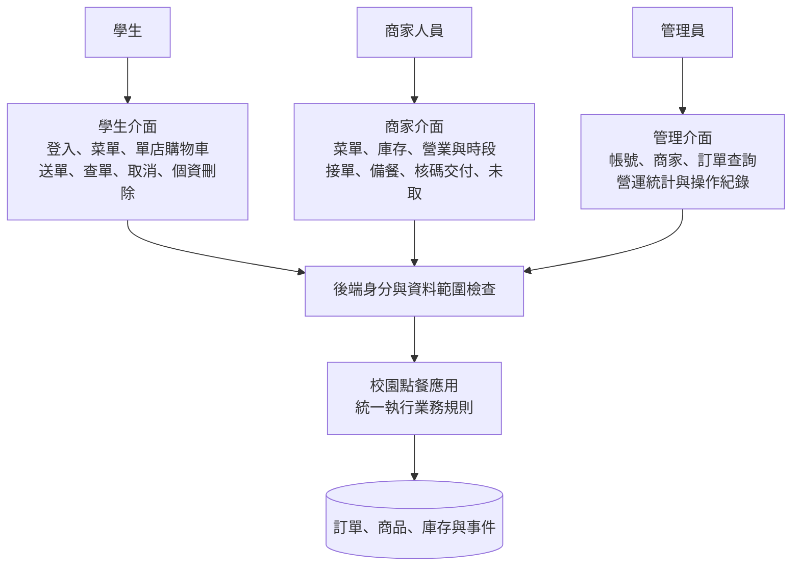

信任邊界位於瀏覽器與後端、應用與資料儲存、應用與外部郵件服務之間。瀏覽器傳入的角色、金額、時間及資料歸屬均不具權威性。

### 2.4 部署架構示意圖

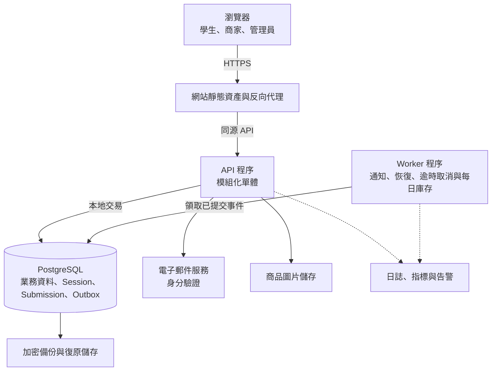

API 與 Worker 可分開增加執行個體，但由同一套版本化程式建置。登入狀態、去重結果、Outbox 及工作租約均保存在共用持久儲存，不依賴單一程序記憶體。

## 3. 模組責任與介面契約

### 3.1 Module 分工

| Module | 公開 Interface 範例 | 隱藏的主要實作 | 需求 |
| --- | --- | --- | --- |
| Identity | `requestEmailVerification`、`verifyEmailAndLogin`、`authorize`、`changeAccountStatus`、`deleteStudentData` | 驗證憑證、Session、角色與帳號有效性 | FR-001～003、028 |
| Merchant | `createMerchant`、`updateMerchant`、`updateBusinessSchedule`、`canAcceptOrders` | 啟停、營業區間、例外日、接單設定 | FR-004、005 |
| Catalog | `createProduct`、`updateProduct`、`configureOptions`、`validateSelections` | 商品版本、選項限制、圖片發布與上下架 | FR-007、008、010 |
| CartQuote | `updateCart`、`quoteOrder`、`calculatePrice`、`validateAcceptedQuote` | 單店購物車、精確計價、版本比較與報價歸屬 | FR-011～013 |
| Resources | `savePickupSlot`、`adjustInventory`；訂單內部使用 `reserve`、`consume`、`release` | 庫存與時段鎖、保留明細、一次性釋回 | FR-006、009、018 |
| Orders | `createOrder`、`getSubmissionResult`、`applyOrderCommand`、`cancelExpiredPendingOrders` | 去重、狀態機、交易協調、不可變快照及事件 | FR-014～021、027 |
| Notifications | `listNotifications`、`loadMerchantOrderBoard`、`createNotificationsFromOrderEvent` | Outbox 去重、投遞進度與授權可見性 | FR-022、023 |
| AdministrationQuery | `searchOrders`、`getOperationalStatistics` | 角色資料範圍、分頁、現有訂單統計與截至時間 | FR-024、025 |
| Audit | `appendAuditEvent`、`searchAuditEvents` | 附加紀錄、敏感欄位排除與查閱權限 | FR-026 |

Module 的 Interface 包含輸入、輸出、不變條件、可重試錯誤及交易規則；不只是函式名稱。可改變實作的位置稱為 Seam，滿足該契約的具體整合稱為 Adapter。Email Adapter 可用正式供應商或測試收件器；Clock 可用正式時間或固定測試時間。庫存並行測試仍須使用真正的 PostgreSQL，不能用記憶體替身宣稱已證明資料庫交易正確。

### 3.2 模組依賴圖與依賴規則

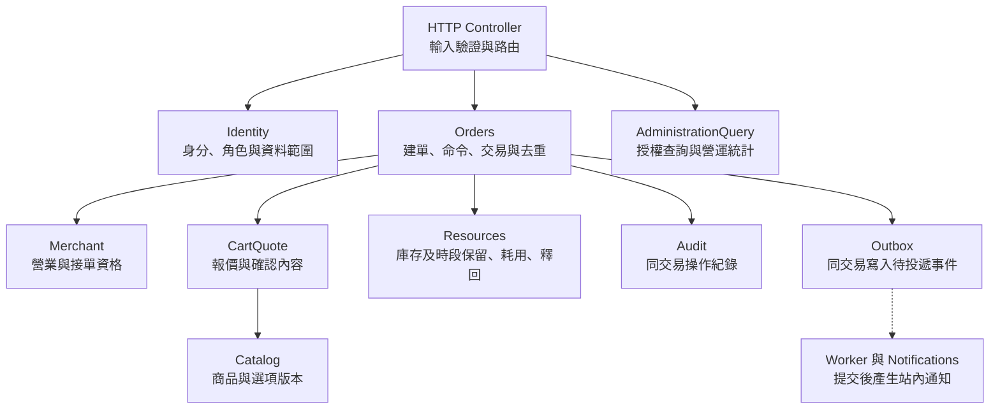

- Orders 主導交易，Resources 等內部操作接受同一 `TransactionContext`，不能自行提交。
- Controller 不逐步呼叫「扣庫存、建單、通知」來組合交易；只呼叫完整的 `createOrder`。
- Module 不任意寫入其他 Module 的資料表；跨模組變更透過其交易內 Interface。
- 查詢可使用受控 SQL View 或查詢層連接所需資料，但不可繞過身分與歸屬檢查。
- 通知只能讀取已提交事件，不能反向推進訂單狀態。

### 3.3 建議程式目錄

```text
apps/
  web/src/features/          # auth、menu、cart、orders、merchant、admin
  api/src/modules/           # identity、merchant、catalog、cart-quote、resources、orders…
  worker/src/                # outbox 投遞、送單恢復、維護工作
packages/
  contracts/                # HTTP DTO 與產生的前端型別；不匯出內部 Entity
  application/              # API 與 Worker 共用的應用 Module
  infrastructure/           # DB、郵件、圖片、時鐘及觀測整合
database/
  migrations/
  seeds/                    # 合成測試資料
tests/
  integration/              # 真實 DB、交易與並行測試
  e2e/                      # 三角色主要流程
  load/                     # 核定使用情境與容量驗證
docs/
  architecture/
  api/
```

此為後續開發提案，尚未在專案建立上述程式目錄。

## 4. 資料架構

### 4.1 UML 領域類別圖

#### 圖 4-1 帳號、菜單與資源

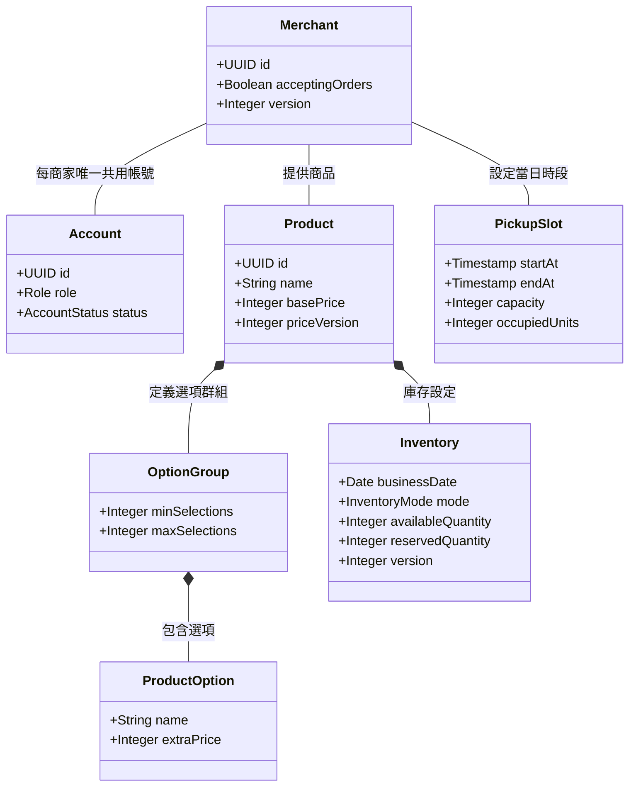

**圖解說明**：商品擁有選項群組與庫存設定；商家提供商品與當日取餐時段。商家與其唯一共用帳號對應；庫存按營業日分開，不限量可用量為空值，有限庫存不可為負。新單不得使占用超額；管理調低容量可保留既有占用並停止新單。

#### 圖 4-2 訂單、快照與資源保留

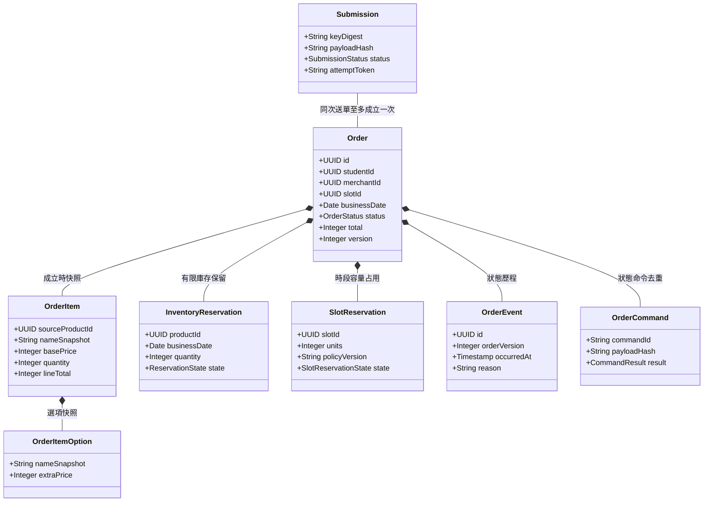

**圖解說明**：同一 Submission 至多建立一張訂單；訂單組合明細快照、保留、狀態事件與命令結果。圖中的組合關係表示邏輯歸屬；一般操作不得刪除歷史資料，FR-028 的本人個資刪除依 §10.3 專用流程處理。購物車、報價及通知等輔助資料仍依 §4.2。

本圖以 UML 類別、屬性、關聯及組合表示核心領域模型，依閱讀需求省略關聯數量標示；不是 ER 資料表圖。各類別的儲存對應及輔助資料表見 §4.2。Order 保存 Quote 的引用與確認摘要，歷史顯示以 OrderItem 快照為準；實際資料清除依 SRS v0.6 FR-028、NFR-007 與 §10.3。

### 4.2 主要資料表與欄位

| 表／集合 | 主要欄位 | 限制與責任 |
| --- | --- | --- |
| `account` | id、email、role、status、merchant_id、version | 商家帳號的 merchant_id 唯一；管理員單一角色涵蓋全部商家，不設 permissions 或管理範圍配置 |
| `auth_challenge`、`session` | challenge_id、proof_digest、expires_at、consumed_at、failed_attempts、generation；token_digest、account_id、expires_at、revoked_at | proof 原子消耗；不可儲存明文 Session token |
| `merchant`、`business_schedule`、`closed_date` | status、accepting_orders、timezone、weekly_hours、date、cutoff_minutes、version | 每次送單檢查有效設定；營業判定集中處理 |
| `product`、`option_group`、`product_option` | merchant_id、name、category、asset_id、price、price_version、published、selection_min/max、extra_price | 選項隸屬正確商品；所有影響購買的修改更新商品版本 |
| `image_asset` | owner_merchant_id、object_key、media_type、size、state | `PENDING/READY/REJECTED`；只可引用已驗證發布的圖片 |
| `inventory_policy`、`inventory` | product_id、mode、daily_default_quantity、effective_from_date；product_id、business_date、available_quantity、reserved_quantity、consumed_quantity、sold_out、version | 每商品每營業日唯一；每日新建當日庫存，不覆寫昨日保留；模式設定與每日數量分開 |
| `pickup_slot` | merchant_id、start_at、end_at、capacity、occupied_units、policy_version、version | capacity 與 occupied_units 各自非負；新單條件更新檢查上限，允許容量調低後保留既有占用；歷史取餐時間取快照 |
| `cart`、`cart_item` | student_id、merchant_id、product_id、quantity、selected_options、note、version | 每位學生一個活動購物車；不保留資源 |
| `quote`、`quote_item` | student_id、merchant_id、input_hash、price_versions、total、currency、policy_version | 綁定本人及確認內容；不設報價效期，送單比較實際內容與價格；報價不是資源保證 |
| `submission` | actor_id、operation_type、key_digest、payload_hash、status、attempt_token、lease_until、order_id、result、resolved_at、result_expires_at | 結果確定後保存 24 小時；到期清掉詳細結果，留最小 key 墓碑以拒絕晚到重試 |
| `orders` | id、order_number、submission_id、student_id、merchant_id、slot_id、status、total、currency、version、pickup_start/end_snapshot、business_date、cancellation_kind、policy_version | 六種狀態；唯一 submission；沒有付款欄位 |
| `order_pickup_secret` | order_id、code_ciphertext、code_lookup_digest、key_version、scope_date、failed_attempts、locked_until | 僅本人學生可解密顯示；商家只比對指定訂單；碼的分配登記另表保存 |
| `order_item`、`order_item_option` | source_product_id、name_snapshot、base_price、quantity、note、line_total、option_name、extra_price | 保存成立快照；單價與加價使用精確金額型別 |
| `inventory_reservation` | order_id、product_id、business_date、quantity、state、version | 每單每商品唯一；釋回原營業日；`RESERVED/CONSUMED/RELEASED` |
| `slot_reservation` | order_id、slot_id、units、state、policy_version | 每單唯一；`OCCUPIED/RELEASED`；所有取消釋回容量，完成與未取維持占用 |
| `order_command` | actor_id、order_id、command_id、payload_hash、result、resolved_at、result_expires_at | 結果保存 24 小時，之後留墓碑；同命令不再次變更訂單 |
| `order_event` | order_id、order_version、from_state、to_state、action、actor_type、actor_id、occurred_at、reason | 每個訂單版本的狀態事件唯一；保留原因與時間 |
| `outbox_event` | event_id、event_type、aggregate_id、payload、status、attempts、next_attempt_at、lease_until、attempt_token | 只存投遞所需資訊；與業務交易一起寫入 |
| `notification` | event_id、recipient_id、order_id、created_at | `(event_id, recipient_id)` 唯一；保存 30 天，不設已讀功能 |
| `audit_event` | actor_type、actor_id、action、target_type/id、result、change_summary、request_id、occurred_at | 依 FR-026 清單寫入；不含電子郵件、秘密或學生個資；不開放使用者更新及刪除 |
| `identifier_registry` | kind、scope、digest | 訂單編號永久唯一；取餐碼於同店同營業日不重用；登記不含帳號或訂單關聯，個資刪除後仍維持已用識別保護 |
| `admin_guard` | singleton_id | 管理員停用的共同鎖，防止並行操作使有效管理員歸零 |
| `deletion_journal` | request_id、不可逆刪除比對摘要、commit_marker | 隔離權限的復原刪除日誌；不保存信箱、訂單內容或原始識別，詳 §10.3 |

### 4.3 型別、快照及索引

**D-02 型別提案**：內部識別使用 UUID；數量與容量使用整數。時間點採帶時區資料型別、以 ISO 8601 傳輸，營業日使用 `DATE` 並依 `Asia/Taipei` 計算。金額採整數新台幣元，DB 使用 `BIGINT`，JSON 以整數輸出；應用層檢查安全整數與乘加範圍，不接受小數或隱式進位。商品單價 1～9999、選項加價 0～999、每行 1～20 份、全單最多 50 份，依 SRS v0.6 FR-007～012。

每筆訂單保存商品、選項、單價、合計、時段起迄與適用政策版本。歷史查詢不得以最新菜單取代快照。金額核對公式為 `sum(quantity × (basePrice + sum(optionExtraPrice)))`，不得自行加入目前 SRS 沒有的折扣或費用。

資料庫最後防線包含：

- `UNIQUE(actor_id, operation_type, key_digest)` 與 `UNIQUE(orders.submission_id)`，阻止重複建單。
- `UNIQUE(actor_id, order_id, command_id)`、`UNIQUE(order_id, order_version)`，阻止重複命令結果及事件。
- 數量正整數、有限庫存非負、容量及占用各自非負、時段結束晚於開始的檢查。容量調低可使占用大於新容量，因此不建立 `occupied_units <= capacity` 的全域 CHECK；只在新增占用的條件更新檢查。
- 商家與時段、商品的複合外鍵或等效交易檢查，阻止跨店引用。
- 取餐碼為四位數字，以 `(merchant_id, business_date, code_lookup_digest)` 建立分配唯一限制及碰撞重試；當日已終止或已刪除訂單的碼不重用。訂單編號另以全系統永久唯一登記保護；碰撞重試有上限，號碼空間耗盡時整單失敗，不降低唯一性。

建議索引：學生訂單 `(student_id, created_at DESC, id DESC)`；商家工作清單 `(merchant_id, status, created_at, id)`；管理查詢 `(merchant_id, created_at, id)`；通知 `(recipient_id, created_at DESC, id DESC)`；待投遞工作 `(status, next_attempt_at)`；恢復工作 `(status, lease_until)`。依查詢計畫調整，不為每一欄建立索引。

跨資料列的不變條件，例如訂單總額等於全部明細小計、保留及占用總量等於各原始紀錄與 §10.3 刪除後匿名資源總帳的加總，由交易內驗證及一致性巡檢守住，不假設單列 CHECK 能涵蓋跨表加總。

## 5. 訂單生命週期與資源規則

### 5.1 UML 訂單狀態圖

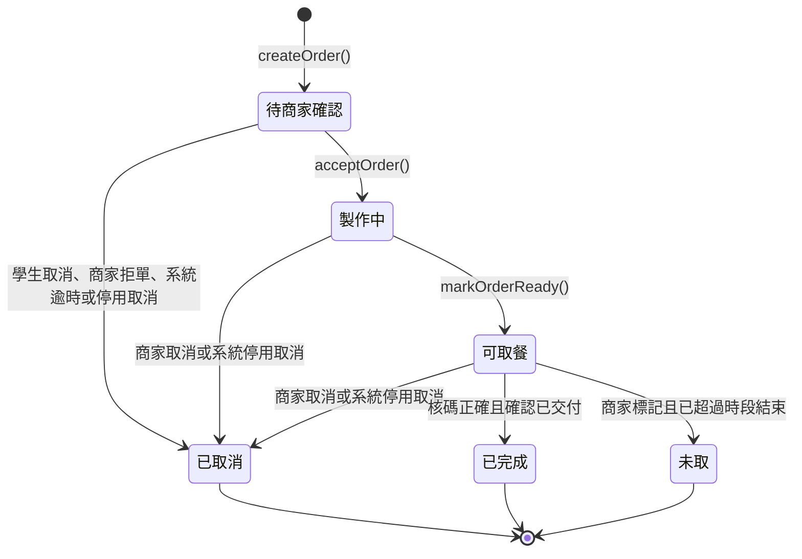

`PROCESSING/SUCCEEDED/FAILED` 是送單請求處理狀態，不是訂單狀態。管理員沒有任意修改訂單狀態或代替商家宣告交付的權限；停用商家觸發 FR-027，由系統身分執行取消。未取後的線下協調不產生系統補領轉換。

### 5.2 資源處理矩陣

| 事件 | 有限庫存 | 時段容量 | 原子提交內容 |
| --- | --- | --- | --- |
| 成立 | available 減 q，reserved 加 q | occupied 增加全部明細份數合計 | 訂單、快照、兩類保留、成立事件、送單成功 |
| 接單 | reserved 減 q，consumed 加 q，保留改 CONSUMED；不再次扣 available | 保持原占用 | 狀態、耗用、命令結果、事件及必要通知 |
| 接單前取消／拒單／系統取消 | 僅 RESERVED 可轉 RELEASED；原營業日 available 加 q、reserved 減 q | 僅 OCCUPIED 可釋回一次 | 取消與全部釋回一起提交 |
| 接單後取消 | 不補回已耗用庫存 | 釋回原占用一次 | 原狀態、理由、取消、政策處置及事件 |
| 完成／未取 | 不補庫存 | 維持原占用，不釋回 | 終止狀態、時間、政策處置及事件 |

不限量商品仍受上下架、售完、選項及時段容量限制。**D-03**：按營業日分開保留帳；手動調整只改當日可用量，不覆寫保留或耗用。有限轉不限量時，只要有該商品的待確認訂單就拒絕；不限量轉有限須同時提供可用量與每日預設量，既有不限量訂單不事後扣庫存。

容量需求為全部明細 quantity 的合計，選項不另計；供應與營業檢查依 §17.2。容量調低後既有訂單維持，剩餘顯示 max(0, capacity - occupiedUnits)，禁止新增超額占用。

每日 00:00 建立新營業日庫存，以每日預設量初始化；每日預設量為 0 時維持售完，其餘有限商品重設未售完。以唯一鍵與交易內的按日初始化保證排程延遲時，當日第一筆讀寫仍使用當日庫存；重試不得再次重置已被使用的當日數量。昨日取消只回補昨日的保留帳。每日預設量保存生效營業日，修改值自下一營業日起生效；即使初始化排程延誤，也按該營業日生效的設定建立庫存，不使用稍後修改的新值。

### 5.3 自動取消與系統命令

逾時取消只適用待確認訂單：系統時間達到訂單時段結束快照即具取消資格；商家停用則取消該商家全部進行中訂單。兩者共用 applyOrderCommand 的狀態與資源規則，操作者為 SYSTEM，使用可重現的內部命令識別（原因、訂單、觸發版本），避免重複事件及通知。原因分別固定為「商家未在取餐時段結束前接單」與「商家停用」。

商家停用先顯示受影響數並取得二次確認；確認交易鎖住商家、其帳號及全部受影響訂單，連動帳號失效、Session 撤銷、取消與資源釋回後一起提交。確認所依版本或訂單集合已變更時回衝突並重新確認。大批交易須量測鎖時間，但不得先回成功再留下未取消訂單。恢復保留設定、設為暫停接單、不復活舊 Session 或已取消訂單。

逾時 Worker 掃描到期的待確認訂單並逐筆呼叫系統命令，恢復後補掃漏執行項。接單入口也在交易內檢查截止時間，已達截止時先落實逾時取消，防止 Worker 延遲讓逾時訂單被接單。與其他命令的競爭依最新狀態與版本處理；系統不自動標記未取。

## 6. 交易、鎖定與冪等設計

### 6.1 UML 送單與通知循序圖

#### 圖 6-1 同一次送單的識別與結果重播

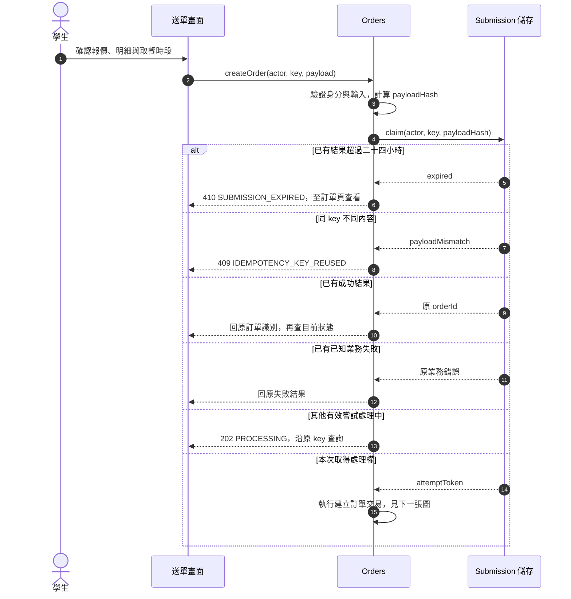

#### 圖 6-2 訂單與資源的一致提交

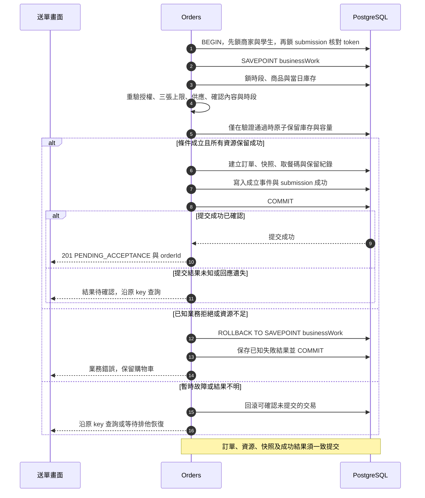

#### 圖 6-3 提交後的通知投遞

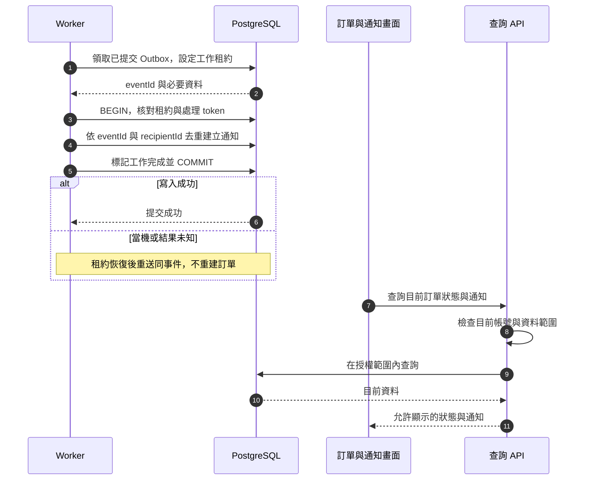

**圖解說明**：三張圖分別表示請求去重、核心交易與後續通知。通知失敗不重跑建單；提交結果未知時沿用原 key 查詢，恢復者先取得排他處理權。

**D-04：採 `READ COMMITTED`、明確列鎖與條件更新**。購物車與報價階段不保留資源。實際送單步驟如下：

1. 驗證帳號與請求形狀，伺服器將商家、時段、報價、明細、選項、備註標準化並計算 payload hash；不得刪除會影響語意的差異。
2. 以短交易按共用鎖順序驗證帳號並建立或取得 submission，配置 attempt token 與處理租約；帳號外鍵及生命週期鎖避免刪除後重建操作紀錄。唯一鍵競爭者讀取同一紀錄，不另建單。
3. 主交易依 §6.2 先鎖商家、學生，再鎖 submission，確認 token 仍屬本次嘗試，建立業務 savepoint；持有學生鎖時檢查三張進行中上限。
4. 依固定順序取得身分、商家、時段、商品與庫存權威資料；重新檢查有效狀態及實際確認內容；版本用於並行控制，不以版本不同單獨否定內容相同的確認。相同商品跨多明細先加總數量。
5. 以條件更新保留所有庫存與容量；任何一筆未更新成功即整筆業務回滾。
6. 建立訂單、快照、取餐碼、保留明細與成立事件，將 submission 改為成功並提交。依 FR-026，送單以訂單本身代表，不另記成功操作紀錄；新單提示讀商家清單，不建立 FR-022 站內通知。
7. 已知業務拒絕才將 submission 標為 FAILED；基礎設施故障或提交結果未知維持可恢復狀態。回應只在提交結果明確後宣告成功。

有限庫存與容量的概念 SQL：

```sql
UPDATE inventory
SET available_quantity = available_quantity - :q,
    reserved_quantity = reserved_quantity + :q,
    version = version + 1
WHERE product_id = :product_id
  AND business_date = :order_business_date
  AND EXISTS (SELECT 1 FROM inventory_policy p
              WHERE p.product_id = inventory.product_id AND p.mode = 'FINITE')
  AND sold_out = false
  AND available_quantity >= :q;
-- 每個有限商品須影響一列；否則整筆業務交易回滾。

UPDATE pickup_slot
SET occupied_units = occupied_units + :units,
    version = version + 1
WHERE id = :slot_id
  AND merchant_id = :merchant_id
  AND occupied_units + :units <= capacity;
-- 必須先在同交易驗證時段資格及鎖定；更新失敗則回滾庫存保留。
```

SQL 為契約示例，不是已建立的 migration；所有參數皆由後端驗證並繫結，不能串接使用者文字。

### 6.2 共用鎖順序與競爭處理

所有相關寫入遵循：**管理員保護鎖（僅管理員停用）→ 商家帳號（依 ID）→ 商家（依 ID）→ 學生與其他帳號（依 ID）→ 操作識別紀錄 → 既有訂單（依 ID）→ 時段（依 ID）→ 商品（依 ID）→ 按營業日庫存 → 保留與事件**。不需要的節點可略過，但不得反向取鎖。需先查得鎖定對象者只作識別定位，取得鎖後重驗；商家停用、刪除及 Worker 也須採同一順序。claim 的短交易與主交易分開，主交易在取得帳號等前置鎖後才鎖 submission。

- 送單對商家採共享列鎖、對學生帳號採更新鎖；同學生跨商家的送單序列化後，才計算進行中訂單是否少於三張。狀態終止與個資刪除也取得學生鎖，避免額度與刪除競爭。停用與設定更新採互斥鎖；不同學生不因同商家送單而全程互斥。
- 商品及選項修改必須先鎖父商品，並更新共同商品版本；送單依相同規則保護報價檢查，避免選項更新繞過商品鎖。
- 庫存、時段、既有訂單使用更新鎖或等效條件更新。所有管理修改也必須遵守相同規則。
- 狀態命令鎖訂單後，先檢查同 commandId 是否已成功，再檢查 expectedVersion 與狀態，讓成功重播不被舊版本誤擋。
- 接單與學生取消競爭，只能有一方通過原狀態與版本檢查；完成與未取同理。
- 死鎖或可重試交易失敗時，回滾整筆交易並以同 key／commandId 有上限地重試；不只補做最後一條 SQL。超限回傳可辨識錯誤並提供原操作查詢。

時段列仍可能成為尖峰熱門資源；交易不得包含郵件、圖片處理或外部 HTTP 呼叫。以鎖等待時間及熱門時段壓測決定是否需進一步優化。

### 6.3 不確定結果與當機恢復

| 情境 | 必須採取的行為 |
| --- | --- |
| 同 key、同 payload | 結果保存期內重播原成功／失敗；處理中回 202；到期回 410 |
| 同 key、不同 payload | 409 `IDEMPOTENCY_KEY_REUSED`；不覆寫原請求 |
| 主交易已提交但 HTTP 回應遺失 | 以原 key 查得原 orderId；不再保留資源 |
| claim 成功後程序當機 | Worker 在租約到期後鎖 submission，核對持久結果及唯一訂單關聯，取得新 token 才恢復 |
| 原工作者仍執行、恢復者到達 | submission 列鎖及 token 檢查阻止雙重處理；租約過期本身不代表可直接重建 |
| 已確定業務失敗後修改內容 | 重新取得報價與確認，再使用新 key，形成新操作 |
| key 詳細結果保存期限到期 | 保存最小 key 墓碑並回 410 `SUBMISSION_EXPIRED`；不得把舊 key 當新送單 |

送單與狀態命令結果自 resolved_at 起保存 24 小時；處理中不開始計時。到期刪除詳細輸入、回應與 hash，只保留拒絕舊識別所需的 actor／operation／key_digest／到期狀態；原 key 永不當新請求。個資刪除時一併移除該學生及其訂單的結果與墓碑，舊 Session 同時失效，新註冊帳號使用全新 ID。讀取任何重播結果前仍須重新驗證帳號與資料存取權。

## 7. HTTP 介面設計

### 7.1 共通契約

**D-05**：路徑前綴 `/api/v1`，Cookie Session 驗證；寫入請求具 CSRF 防護。`actorId`、`studentId` 及商家操作身分由伺服器建立。需並行保護的修改使用 `expectedVersion`；狀態命令使用 `commandId`。

成功回應為 `{data, requestId}`；列表為 `{data:{items,nextCursor},requestId}`。採穩定排序與 cursor，含同時間資料的 ID 次序。`requestId` 用於除錯，`Idempotency-Key` 用於同次送單去重，`commandId` 用於同次狀態命令去重，三者不可混用。

| 類型 | HTTP | 代表 code／行為 |
| --- | --- | --- |
| JSON 格式錯誤／欄位非法 | 400／422 | `VALIDATION_ERROR`，保留可修正內容 |
| 未登入／帳號停用／越權 | 401／403 | `UNAUTHENTICATED`、`ACCOUNT_DISABLED`、`FORBIDDEN` |
| 無資源或不在可見範圍 | 404 | `RESOURCE_NOT_FOUND`，不揭露他人資料是否存在 |
| 條件或版本衝突 | 409 | `QUOTE_CHANGED`、`SLOT_FULL`、`INSUFFICIENT_STOCK`、`VERSION_CONFLICT` |
| 狀態或取消不合法 | 409 | `INVALID_ORDER_TRANSITION`、`CANCELLATION_NOT_ALLOWED` |
| 核碼或交付確認失敗 | 422 | `PICKUP_CODE_MISMATCH`、`HANDOVER_REQUIRED` |
| 尚在處理 | 202 | `PROCESSING`，回傳原操作查詢路徑 |
| 超過請求頻率 | 429 | `RATE_LIMITED`，提供稍後重試資訊 |
| 已過期操作 | 410 | `SUBMISSION_EXPIRED`、`COMMAND_EXPIRED`，查看現有訂單，不重跑舊操作 |
| 進行中訂單達上限 | 409 | `ACTIVE_ORDER_LIMIT_REACHED`，引導訂單頁 |
| 取餐碼核對鎖定 | 429 | `PICKUP_VERIFICATION_LOCKED`，提供 retryAfter，不暴露碼 |
| 暫時不可用／非預期錯誤 | 503／500 | 結果可能未知時沿用原 key 查詢，不宣告已回滾 |

### 7.2 端點摘要

表中省略 `/api/v1`。完整欄位與 OpenAPI 檔待實作階段產製；不得僅因知道路徑而跳過資源授權。

| 領域 | 端點 | 存取與重點 |
| --- | --- | --- |
| 登入 | `POST /auth/email/challenges`、`POST /auth/email/verify`、`POST /auth/logout`、`GET /me` | 受限申請頻率、一次性驗證；登出撤銷 Session |
| 公開菜單 | `GET /merchants`、`GET /merchants/{id}/menu`、`GET /merchants/{id}/pickup-slots` | 僅已公開資料；瀏覽不保證送單可用 |
| 購物車 | `GET/PUT /cart`、`DELETE /cart` | 本人；跨店替換必須確認；以版本防止舊畫面覆寫 |
| 報價與送單 | `POST /quotes`、`POST /orders`、`GET /order-submissions/{key}` | 本人；後端計價；建立訂單須 Idempotency-Key |
| 個資刪除 | `DELETE /me`，body 含 `confirmed:true` | 本人學生，全部訂單終止才可執行；見 §10.3 |
| 命令結果 | `GET /orders/{id}/commands/{commandId}` | 原命令操作者且目前仍可讀該訂單；逾期回 410 |
| 學生訂單 | `GET /orders`、`GET /orders/{id}`、`POST /orders/{id}/cancel` | 本人；只可取消待確認訂單 |
| 商家設定 | `PUT /merchant/business-settings`、`POST /merchant/pickup-slots`、`PATCH /merchant/pickup-slots/{id}` | 所屬商家；具版本與容量保護 |
| 商品與圖片 | `POST /merchant/products`、`PATCH /merchant/products/{id}`、`PUT /merchant/products/{id}/options`、`POST /merchant/images` | 所屬商家；選項更新同步商品版本 |
| 庫存 | `PATCH /merchant/products/{id}/inventory` | 不能覆寫保留數量；遵循共用鎖規則 |
| 接單清單 | `GET /merchant/orders`、`GET /merchant/overview` | 所屬商家；待確認數量與狀態清單 |
| 商家命令 | `POST /merchant/orders/{id}/accept`、`/ready`、`/reject`、`/cancel`、`/complete`、`/uncollected` | 每次帶 commandId、expectedVersion；拒單／取消需原因 |
| 站內通知 | `GET /notifications` | 目前有權限的本人通知；訂單詳細內容另行驗權 |
| 商家停用預覽 | `GET /admin/merchants/{id}/disable-preview` | 回受影響數與確認 token；不產生異動 |
| 帳號／商家管理 | `POST /admin/accounts`、`PATCH /admin/accounts/{id}/status`、`POST /admin/merchants`、`PATCH /admin/merchants/{id}` | 管理員；商家停用須二次確認並連動帳號與系統取消 |
| 管理查詢 | `GET /admin/orders`、`GET /admin/statistics`、`GET /admin/audit-events` | 受控查詢；統計含訂單、取消四類、未取、完成、進行中及商品備餐數量 |

商家統計使用 `GET /merchant/statistics`，後端固定所屬商家；管理員查詢可涵蓋全部商家。API 統一採 `/quotes`、`/merchant/products/{id}/options`、`/merchant/overview`，不另保留 v0.4 的 `/order-quotes`、`/option-groups`、`/order-board` 別名。

### 7.3 建單請求範例

以下為測試格式示例，ID 不對應正式資料。金額由後端讀取報價及重新驗證，不由此請求指定。

```http
POST /api/v1/orders
Content-Type: application/json
Idempotency-Key: submit-demo-001
X-CSRF-Token: <session-bound-token>

{
  "merchantId": "merchant-demo-01",
  "pickupSlotId": "slot-demo-01",
  "acceptedQuoteId": "quote-demo-01",
  "items": [
    {
      "productId": "product-demo-01",
      "quantity": 2,
      "selectedOptionIds": ["option-demo-egg"],
      "note": "不要香菜"
    }
  ]
}
```

成立回應包含原 orderId、`PENDING_ACCEPTANCE`、快照、價格合計、取餐時段、取餐碼及 version。相同 key 重播的建立結果可能早於目前訂單狀態；前端取得 orderId 後再讀取最新詳情。

## 8. 前端架構與畫面狀態

前端按 `auth`、`menu`、`cart`、`student-orders`、`merchant-console`、`admin` 分區，共用 HTTP client、錯誤翻譯、表單驗證及設計元件。前端快取用於顯示；商品可售、價格及訂單狀態由後端定案。

| 畫面 | 狀態與必要行為 |
| --- | --- |
| 登入 | 寄送中、已寄送、過期、驗證失敗、停用；不可因郵件請求成功就視為登入 |
| 菜單 | 載入中、無品項、失敗、停售；顯示最新更新時間 |
| 購物車 | 編輯中、報價改變、無效選項、庫存不足、時段額滿；跨店更換明確確認 |
| 送單 | 草稿、送出中、結果待確認、已成立、已知拒絕；送出中固定 key，不重新產生 |
| 訂單詳情 | 顯示六狀態、不可變明細、時段及允許命令；衝突後刷新，不樂觀宣告完成 |
| 商家交付 | 輸入取餐碼及「已實際交付」確認；錯碼或版本衝突保持原狀態 |
| 商家工作台 | 待確認、製作中、可取餐分列；斷線及過期資料有明顯提示 |
| 管理查詢 | 空資料與載入失敗不同；統計顯示口徑版本與截至時間 |

**D-06：正常連線且頁面在前景時，以約 5 秒為起始輪詢間隔並加入小幅抖動**。單一頁面合併讀取必要的狀態摘要，避免每張訂單各發一個輪詢。切回前景及網路恢復時立即刷新；背景頁面可降低頻率，須標示最後更新時間。10 秒可見性測試應明確限定正常連線與核定瀏覽器前景情境，依 SRS v0.6 NFR-003 量測 95% 的狀態變更。

輪詢間隔、API 時間與畫面處理加總才是端到端延遲，不以「5 秒輪詢」直接宣稱達成 10 秒要求。離線期間不提供自動排隊送單；恢復後先查詢原操作結果。

## 9. 通知與背景工作

### 9.1 Transactional Outbox

**D-07**：訂單交易先把事件及 Outbox 同時寫入 DB，提交後 Worker 再產生站內通知。Outbox 只是投遞工作，不是第二套訂單狀態來源。

1. Worker 以短交易領取待處理資料、設租約與 attempt token，避免長時間持有鎖。
2. 建立通知時以 `(eventId, recipientId)` 去重；寫通知與標記此工作完成放在同一交易。
3. 失敗採有上限的指數退避，超限標為待人工處理並告警；人工重投仍沿用同一 eventId。
4. 當機後回收逾期租約；舊工作者不得用失效 token 確認新租約的工作。
5. 學生收到接單、拒單、備妥、商家或系統取消、未取通知；學生自行取消只通知商家，管理員不收訂單通知。內容為訂單編號、事件時間、類型及必要取消原因，不含信箱或取餐碼；不提供已讀功能，保存 30 天。讀取仍重驗權限。Worker 以事件時間計保存期，過期事件不再補出新通知；已刪除帳號或訂單不得被舊 Outbox 重建。

設計採「可重送投遞＋冪等寫入」，不宣稱傳輸層只送一次。若先完成通知卻在確認前當機，重跑仍只有一筆通知。商家新單清單直接查權威訂單資料，通知延遲不阻止接單。

### 9.2 其他背景工作

包含 PROCESSING 送單恢復、失效驗證挑戰清除、孤立圖片清理、核定資料保存清理及一致性巡檢。巡檢發現庫存、保留或容量不符時先告警並限制受影響的新單，不能任意改歷史訂單來消除差異。

增加到期的待確認訂單取消、每日庫存初始化、24 小時操作結果清理與 30 天通知清理；排程須可重試並補行。自動取消依 §5.3；未取仍僅由所屬商家操作。

## 10. 身分、授權與資料保護

### 10.1 授權矩陣

| 操作 | 學生 | 商家 | 管理員 |
| --- | --- | --- | --- |
| 建立購物車、報價與訂單 | 本人 | 不提供代下單 | 不提供代下單 |
| 查閱訂單 | 本人 | 所屬商家 | 全部商家 |
| 修改商品、庫存與時段 | 不可 | 所屬商家 | 不因管理身分自動取得商家操作權 |
| 接單、拒單、備妥、交付、未取 | 不可 | 所屬商家且狀態合法 | 不代商家執行 |
| 個資刪除 | 本人且無進行中訂單 | 不可 | 不代學生刪除 |
| 學生取消 | 本人待確認訂單 | 使用商家拒單／取消命令 | 無任意狀態修改權 |
| 帳號與商家管理 | 不可 | 不可跨越管理權限 | 全部管理功能 |
| 操作紀錄、管理統計 | 不可 | 僅本店統計，不可讀操作紀錄 | 全部商家統計與操作紀錄 |

### 10.2 安全設計

- **D-08 Session**：採伺服器端 Session，Cookie 設 Secure、HttpOnly 及適當 SameSite；寫入檢查 CSRF token 與來源。每次受保護請求讀取權威帳號有效狀態，不以未到期 token 略過停用檢查。
- 電子郵件 proof 只保存雜湊／加密驗證摘要；低熵驗證碼採帶伺服器秘密的摘要並限制嘗試。成功核對、消耗 challenge 與建立 Session 原子執行；六位數字碼有效 10 分鐘，60 秒內不得重寄，同信箱每小時最多 5 封；重寄使舊碼失效，單組錯誤 5 次作廢。任何信箱網域皆可，首次成功驗證自動建立學生；已存在的商家與管理員沿用原角色。
- 對登入申請與驗證、取餐碼核對、上傳及高成本查詢設頻率限制；多 API 個體共用限流狀態。數值屬安全設定提案，不沿用舊 PRD。
- 取餐碼既須供學生查閱又須核對，因此採加密保存與獨立鍵控摘要；金鑰版本可追蹤與輪替。核對限定已授權商家及指定訂單，不提供匿名短碼查單。
- 查詢在 SQL 條件納入 student_id／merchant_id／管理員角色，輸出欄位採允許清單；商家不取得任何學生識別資訊；取餐碼只回本人學生，管理員亦不可見。跨範圍資源使用一致 404 回應。
- 上傳檢查實際檔案格式、大小及解碼後尺寸，重新編碼後發布；拒絕可執行內容與任意遠端 URL 抓取。依 FR-007 限 JPEG／PNG／WebP、5 MB、各邊 4096 像素，每商品最多一張。
- 註記、品名與原因當純文字處理，輸出編碼；DB 使用參數化查詢。正式錯誤不包含堆疊、SQL、完整驗證碼、Session 或完整取餐碼。
- 一般應用帳號不具 schema 管理權；歷史快照與稽核一般角色不具更新權。migration、備份及核定資料清除使用分離權限。
- 個資不自動到期；本人刪除依 §10.3。功能性資料到期依 FR-001、015、016、022；恢復舊備份須先重新套用刪除日誌，避免已刪資料重新對外可見。

停用與寫入競爭由帳號列鎖排序：停用已提交後的新授權請求必須拒絕；已先取得有效授權鎖並提交的命令可視為停用前操作。恢復帳號不自動復活已撤銷 Session，需重新登入。

### 10.3 學生個資刪除與還原防護

本節是配合 v0.6 FR-028／NFR-007 新增的設計，不是從 v0.4 搬回的舊規則。deleteStudentData 只接受本人登入與明確確認，無管理員核准步驟；不提供資料匯出或歷史訂單任意修改功能。

1. 依 §6.2 鎖住學生帳號，重查全部訂單。存在待確認、製作中或可取餐訂單即拒絕，不能只依畫面顯示或過期計數。送單、終止與刪除共用學生鎖，避免查完後新單成立。
2. 無進行中訂單時，記錄不可逆刪除意圖並封鎖該帳號新的受保護請求。刪除意圖必須先持久寫入與業務備份獨立保存的復原刪除日誌；僅留隨機 requestId、用專用秘密計算的識別比對摘要與狀態，不保存信箱、原始帳號／訂單 ID、餐點或自由文字。摘要只供還原時判斷應清除資料，不對任何產品角色提供查詢。
3. 專用刪除交易移除帳號、Session、該信箱驗證資料、購物車、報價、全部訂單與快照、事件、保留明細、取餐秘密、送單／命令結果與墓碑、通知及待投遞資料。清除所有可由該學生識別連回的線上快取；舊 Worker 在同一帳號／訂單生命週期鎖下重驗存在性，不能重建通知。
4. 操作紀錄保留，解除可識別學生或已刪訂單的關聯，對象改為「已刪除的訂單」，保留動作、時間、結果及非個資摘要。資料模型採可解除的參照而非阻止刪除的硬外鍵；稽核沒有信箱、取餐碼或學生備註副本。這是系統的個資處理流程，不開放使用者修改稽核。
5. 刪除歷史資料不等同取消，不加回庫存或容量；已耗用／占用的營運計數仍維持。需巡檢的歷史保留轉成不可連回學生或訂單的「商品／營業日與時段加總」，僅保留資源數量，讓總帳仍可核對。商品備餐統計依現有訂單重算，不能使用這些保護容量的總帳取代 FR-025 統計。
6. 刪除交易提交且日誌可恢復後才回 204 並清 Cookie；未確定完成時不宣告成功，內部恢復工作沿原 requestId 完成。封鎖後當機須可由持久刪除意圖恢復；日誌同步失敗不能回成功。既有備份在 30 天保留期內隔離保存，不能提供查詢或直接恢復至線上。

還原時保持服務關閉，先取得完整且最新的獨立刪除日誌，對還原資料執行相同比對與清除，再驗證所有相關表、通知工作及快取後開放。無法確認日誌完整時維持關閉；不得以較早備份覆蓋日誌。新註冊產生全新帳號 ID，不透過同信箱找回舊訂單。匿名識別分配登記僅防止重用訂單號／當日取餐碼，不保存使用者關聯。

刪除的級聯、資源總帳與獨立日誌仍須經實作及恢復演練驗證；SRS v0.6 的刪除政策不因本設計而放寬為單純軟刪除。

## 11. 部署、維運與故障恢復

### 11.1 環境與發布

開發、測試／預備及正式環境分離 DB、儲存空間、郵件設定與秘密。測試環境使用合成帳號及餐點資料，不複製未去識別正式訂單。

**D-09 發布流程**：型別與靜態檢查 → 規則測試 → 真實 DB 整合測試 → 三角色端到端測試 → migration 相容性驗證 → 預備環境驗收 → 正式發布與冒煙檢查。正式環境使用版本化映像與 migration，不手動修改 schema。

資料庫變更採先擴充欄位、相容讀寫、回填核對、最後移除的方式。應用回滾只在資料結構仍相容時執行；已寫入的新資料不能用盲目反向 migration 刪除。API 與 Worker 混合版本期間，Outbox payload 須有 schema version 且消費端相容。

最小環境可先有一個 API 與一個 Worker；正式可用性要求若需避免單程序停機，增加 API 副本及健康檢查入口。單 DB 故障仍會使核心寫入停止；是否使用自動故障切換與備援部署須經成本與 NFR-005 達標評估，不把單副本描述為高可用。

### 11.2 監控與告警

| 類別 | 指標與觀測 | 失效時行動 |
| --- | --- | --- |
| HTTP | 錯誤率、端到端延遲、授權拒絕、429 | 區分業務衝突與系統故障，依 requestId 追查 |
| DB | 連線池、鎖等待、死鎖、慢查詢、儲存量 | 限制過量請求，調查熱門資源與查詢計畫 |
| 業務一致性 | 負庫存／超額檢查、保留加總差異、唯一鍵異常 | 告警；停止受影響範圍的新單，保存證據 |
| 背景工作 | 最舊 Outbox 年齡、重試數、逾期租約、PROCESSING 停滯 | 恢復工作或人工處理，不重跑業務事件 |
| 使用者可見性 | 訂單提交至畫面更新延遲、輪詢失敗率 | 檢查 API、前端輪詢與網路，顯示過期資料 |
| 外部依賴 | 郵件寄送失敗、圖片發布失敗 | 暫停受影響功能，保留既有有效資料 |
| 復原能力 | 備份成功時間、備份可讀性、最近演練結果 | 追查失敗備份與未達復原目標 |

日誌串聯 requestId、submission 識別摘要、orderId、commandId、eventId；不記錄完整個資、proof 或 Cookie。告警門檻由部署設計定版，上線前依 SRS A-05 指定維運聯絡人。

### 11.3 備份與復原

**D-10**：資料庫每日全量備份並持續歸檔變更紀錄，支援 RPO 15 分鐘；圖片與設定每日備份，日備份保存 30 天，採分離權限與加密保存。RTO 為 4 小時，每月營業時段可用率目標 99.0%；計畫維護安排於所有商家營業時間之外。上線前至少完整還原一次，之後每六個月演練一次；數值來自 SRS v0.6 NFR-005，尚無達標實測。

復原順序：停止寫入及 Worker → 選擇一致復原時間點 → 還原 DB 與對應資產、金鑰 → 套用核定清除清單 → 檢查訂單、庫存、容量、submission、通知及 Outbox → 核對可能遺失時段的人工交付 → 受控恢復服務。

若復原點早於現場已交付時間，可能出現資料與實體交付不一致；須依已保存的事件與商家紀錄人工確認，不得批次將訂單假設為完成或重新出餐。復原演練應記錄實際耗時與資料差距，作為 NFR-005 的驗收證據，包含已刪個資未重新出現的檢查。

### 11.4 降級策略

| 故障 | 對使用者的行為 | 一致性處理 |
| --- | --- | --- |
| DB 無法連線 | 受保護查詢及寫入回暫時不可用 | 不依快取承諾建單成功；恢復後查原 key |
| Worker 停止 | 訂單詳情與商家清單仍可查；通知可能延遲 | Outbox 留存，恢復後去重投遞 |
| 郵件服務故障 | 新驗證無法完成；既有有效 Session 仍可用 | 不繞過驗證、不建立未驗證登入 |
| 圖片儲存故障 | 顯示替代圖；新圖片發布失敗 | 不改寫既有訂單快照，避免引用未發布資產 |
| 用戶端斷網 | 顯示連線中斷及最後更新時間 | 不自動換 key 或離線宣告送單成功 |

## 12. 容量與效能驗證設計

SRS v0.6 CAP-001～005 基準為約 3000 個學生帳號、500 人在線、30 家商家、每家 100 項商品。學生 470 人、商家 30 人；學生操作比例為瀏覽 55%、購物車與確認 20%、送單 10%、查單 15%。升載 5 分鐘後維持 30 分鐘，均勻流量與單一熱門商家／時段各測一次。學生端模擬 4G（單向約 50 ms、約 10 Mbps），商家端採一般校園有線網路；預備環境規格與正式相同。

CAP-003 指定的主要頁面與一般操作 p95 不超過 3 秒、錯誤率低於 1%；管理後台查詢與統計不列入 3 秒門檻但不得逾時失敗。正常前景狀態更新 95% 在 10 秒內。負載工具、思考時間及系統故障／預期業務拒絕的統計分類由測試文件列明並分別報告，不以平均值或每秒 500 筆送單替代要求。

以 D-06 的 5 秒輪詢為估算，若 500 位前景使用者各有一個合併輪詢，平均約為 `500 / 5 = 100 次讀取／秒`，尚未包含瀏覽、建單、命令及同使用者多頁籤。此為容量估算，不是效能實測結果。

**D-11 優化順序**：先建立查詢索引與分頁、限制欄位及日期範圍、縮短交易、調整連線池，再量測是否需額外快取或推送。公開圖片與靜態網站可快取；庫存與容量快取只作提示，送單仍讀權威 DB。私人訂單回應不可進入公開共用快取。

壓測應包含均勻分散與單一熱門商家／時段兩種流量；主情境採 SRS v0.6 的學生／商家比例，思考時間另在測試方案記錄；管理查詢負載另測，不改主情境組成。除延遲分布外，同時核對訂單唯一性、庫存、容量、狀態事件及通知一致性。正式通過門檻依 SRS v0.6 §3.4。

## 13. 驗證策略與關鍵情境

本節為待執行測試設計，沒有應用程式或測試環境可供本次執行。v0.4 §7.5 的 TC-001～TC-021 為歷史測試設計來源；本次不搬入完整測試案例，詳細步驟與測試資料由獨立測試文件依 v0.6 AC-001～AC-028 展開。

| 測試類別 | 重點情境 | 必須證明的結果 |
| --- | --- | --- |
| 規則測試 | 選項最少／最多、數量、精確計價、時段邊界、六狀態轉換 | 非法輸入與非法轉換拒絕，金額可重算 |
| 真實 DB 整合 | 建單第二項保留／快照失敗；狀態命令必要稽核失敗 | 整單回滾，無殘留資源或成功結果 |
| 並行資源競爭 | 最後一份庫存／最後一單位容量、手動調整同時送單 | 最多符合資源數量的訂單成功，無負值 |
| 去重與恢復 | 同 key 並行 10 次、回應遺失、claim 後當機、租約到期 | 只一張訂單及一次資源占用，可查回結果 |
| 狀態競爭 | 接單對取消、完成對未取、同 commandId 重播 | 一個合法結果；相同命令不重複事件 |
| 價格及快照 | 報價後改選項、總價剛好相同但明細不同、成立後改名改價 | 送單前重新確認，成立後快照不變 |
| 取餐 | 錯碼、未確認交付、非商家、時段結束前／當下／之後 | 只有合法交付完成；未取需嚴格超過結束時間 |
| 通知 | Worker 寫入後當機、重複事件、權限撤銷後讀舊通知 | 一收件者一事件最多一筆通知，無越權內容 |
| 授權 | 換學生／商家 ID、停用後持舊 Session、角色變更 | 受保護請求拒絕，重播也不繞過授權 |
| 端到端與介面 | 三角色主流程、載入／空／失敗／斷線、手機必要按鈕 | 使用者可理解結果並沿原操作恢復 |
| 負載與復原 | 核定 500 人情境、熱門時段、備份還原 | 效能與一致性同時符合核定目標 |
| 新基線競爭 | 同學生跨店並行送單、整店停用與接單、逾時取消重試、昨日釋回 | 三張上限、系統取消一次、當日庫存不被昨日釋回增加 |
| 個資刪除與復原 | 刪除與送單競爭、通知重投、刪除途中當機、還原舊備份 | 無進行中才刪、不可重建已刪資料、統計重算、歷史資源不誤補回 |
| 新政策邊界 | 容量調低、無效期價格確認、操作結果二十四小時、五次錯碼 | 既有單不變且拒絕新占用、內容相同仍有效、舊操作不重跑、鎖定可跨程序生效 |
| 範圍回歸 | API、schema、畫面及報表掃描 | 無付款、退款、收款狀態與財務對帳功能 |

驗收紀錄須包含環境、資料集、版本、操作步驟、預期與實際結果、缺陷及核准人；架構設計完成不等於功能驗收通過。

## 14. 需求追溯表

以下編號全部指向 SRS v0.6，不與工作區舊 PRD v0.2 的同名 FR 編號混用。

| SRS 需求 | 設計位置 | 主要驗證 |
| --- | --- | --- |
| FR-001 電子郵件驗證 |§3 Identity、§7 登入、§10 Session、§17.1 | proof 錯誤／過期／並行兌換 |
| FR-002 角色授權 |§3 Identity、§10 授權矩陣、§17.1 | 直接呼叫及角色提升拒絕 |
| FR-003 帳號停用 |§6 鎖順序、§10 帳號有效性、§17.1 | 舊 Session 下一受保護請求拒絕 |
| FR-004 商家管理 |§3 Merchant、§4 商家資料、§7 管理端點、§17.2 | 停用與送單競爭 |
| FR-005 營業控制 |§3 Merchant、§6 重驗、§17.2、§17.2 | 休息日、暫停、時間邊界 |
| FR-006 時段容量 |§4 pickup_slot、§5 資源、§6 條件更新、§17.2 | 最後容量競爭及跨日拒絕 |
| FR-007 商品維護 |§3 Catalog、§4 商品、§7 商品端點、§17.3 | 上下架及欄位驗證 |
| FR-008 客製化 |§3 Catalog、§4 選項、§6 商品版本、§17.3 | 選項合法性與變更競爭 |
| FR-009 庫存 |§4 inventory、§5 保留、§6 交易、§17.3 | 最後庫存與模式切換 |
| FR-010 歷史快照 |§4.3、§6 建單、§17.4 | 成立後改名改價不影響明細 |
| FR-011 單店購物車 |§3 CartQuote、§7、§8、§17.4 | 跨店確認及版本衝突 |
| FR-012 價格合計 |§4.3 精確金額、§17.4 | 明細重算及選項加價 |
| FR-013 價格再確認 |§6 重驗、§8 變價提示、§17.4 | 同總額不同明細仍需確認 |
| FR-014 整單建立 |§6.1、§17.5 | 部分失敗完整回滾 |
| FR-015 重複與並行 |§6.2～6.3、§17.5 | 同 key、回應遺失及當機恢復 |
| FR-016 備餐推進 |§5 狀態機、§7 商家命令、§17.6 | 合法路徑及非法跳轉 |
| FR-017 取消與拒單 |§5、§6.2、§10、§17.6 | 原因必填與接單取消競爭 |
| FR-018 資源處置 |§5.2、§6、§17.6 | 只釋回一次、接單不二次扣庫存 |
| FR-019 交付 |§5、§7、§8、§10 取餐碼、§17.6 | 正確碼及實際交付確認 |
| FR-020 未取 |§5、§9.2、§17.6 | 嚴格時間條件及終止不可回改 |
| FR-021 訂單查詢 |§4 索引、§7、§10、§17.7 | 本人／所屬商家範圍與快照 |
| FR-022 站內通知 |§9.1、§17.7 | 投遞失敗、重送與可查詢性 |
| FR-023 商家提示 |§8 工作台、§9.1、§17.7 | 清單更新、斷線提示及提示數量 |
| FR-024 管理訂單查詢 |§3 AdministrationQuery、§7、§10、§17.8 | 全部商家可查、日期與組合篩選 |
| FR-025 基本統計 |§7、§17.8、§17.8 | 計數手算一致，無財務輸出 |
| FR-026 操作紀錄 |§4 audit_event、§6、§10、§17.8 | 重要異動與紀錄一致提交 |
| FR-027 系統自動取消 | §5.3、§9.2、§17.5 | 到期與停用取消、重複觸發、恢復補行 |
| FR-028 個資刪除 | §10.3、§17.1 | 進行中拒絕、終止可刪、重註冊、還原不重現 |
| NFR-001 安全 | §7、§10 | HTTPS、CSRF、角色與資料隔離 |
| NFR-002 一致性 | §4～6、§13 | 真實 DB 並行及故障測試 |
| NFR-003 更新 | §8、§9、§12 | 提交至前景畫面更新時間 |
| NFR-004 相容性 | §8、§13、SRS NFR-004 | 核定瀏覽器／裝置矩陣 |
| NFR-005 可用性 | §11 | 告警與備份復原演練 |
| NFR-006 易用性 | §8、§13 | 載入、空、錯誤、斷線與確認流程 |
| NFR-007 隱私 | §10、§11.3、§10.3 | 欄位可見性、清除及復原後不復活 |
| CAP-001～CAP-005 | §12 | 核定資料規模、混合負載與延遲 |
| EI-001～004 | §7～10、§17 | 繁中介面、結果待確認、郵件驗證及 HTTPS |
| DR-001～003 | §4～6、§10.3 | 整數金額、時區、歷史保留與本人刪除例外 |
| DC-001、002 | §1～2、§13 | 單一校園，無金流與財務功能 |
| MNT-001 | §1.3、§14、§17～18 | 來源、需求、設計與後續驗證可追溯 |

## 15. 設計待確認事項與風險

### 15.1 待確認的技術事項

SRS v0.6 已將舊 B-01～B-15 等政策併入正文，本文件不再列它們為未決業務規則。工作區未找到其提及的獨立「SRS_決議紀錄.md」及 PRD v0.5，本次依可取得的 v0.6 正文設計，未聲稱核對缺少的來源。

| 項目 | 後續設計／審查工作 | 影響 |
| --- | --- | --- |
| 郵件與部署供應商 | 選定核定供應商、執行環境、容量與成本 | 不改變 FR-001 驗證規則及 NFR-005 目標 |
| 資料刪除復原日誌 | 驗證跨備份存續、權限隔離、不可逆摘要與故障恢復 | 未完成前不得宣稱 FR-028／NFR-007 已可上線 |
| 熱門資源與整店停用 | 壓測時段鎖、學生額度鎖、整店取消交易 | 證明效能及一致性，而非跳過必要鎖 |
| 取餐碼容量 | 每店每日四位數字碼共 10000 組；用盡時拒絕整單 | 不能重用當日已用碼或自行擴碼規格 |
| 審查狀態 | v0.6 的〔新〕需求及本文件 D-xx 仍需依其審查程序核准 | 設計完成不代表需求或上線核准 |
| 可觀測性 | 指標門檻、值班人、通知通道及處置手冊 | 屬技術與營運設定，不能把已訂 RPO／RTO 改回待決議 |

### 15.2 設計決策摘要

| 決策 | 內容 | 主要取捨 |
| --- | --- | --- |
| D-01 | 模組化單體＋單 DB＋Worker | 簡化一致性；需維護 Module 分工與共同發布 |
| D-02 | 明確識別、時間與精確金額型別 | 避免歧義；整數新台幣與 Asia/Taipei 已依需求定義 |
| D-03 | 保留帳分離、手動只調可用量 | 避免覆寫保留；按營業日保護跨日釋回 |
| D-04 | 列鎖、條件更新與固定鎖順序 | 語意明確；熱門時段需量測鎖等待 |
| D-05 | 版本化 HTTP 契約與 Session | 前後端契約一致；需共用 Session 儲存及 CSRF 防護 |
| D-06 | 前景合併輪詢 | 初期較易運維；增加讀取負載，必須量測延遲 |
| D-07 | DB Outbox 與去重通知 | 可恢復投遞；需要 Worker 監控與人工重投流程 |
| D-08 | 後端 Session 與每次有效性檢查 | 停用立即反映；增加權威資料讀取 |
| D-09 | 版本化發布與相容 migration | 回滾可控；需維持過渡期間相容性 |
| D-10 | 分離權限的備份與演練 | 可驗證復原；須以演練證明既定 RPO／RTO |
| D-11 | 先量測、索引及縮短交易再加基礎設施 | 控制複雜度；不預先保證未測硬體容量 |

上述決策均為本次提案，尚未有核准人或核准日期。設計審查應記錄採納、調整或退回，以及受影響的需求與測試。

## 16. 實作順序與交付條件

| 階段 | 主要產出 | 完成條件 |
| --- | --- | --- |
| 1. 基線確認 | SRS v0.6 追溯、缺少來源補齊、設計審查紀錄 | 核心狀態、容量、資源釋回、權限及欄位有可測試定義 |
| 2. 技術骨架 | Module 結構、DB migration、Session、授權、觀測 | 三角色可驗證，停用及越權測試通過 |
| 3. 訂單核心 | 菜單、購物車、報價、保留、送單去重及快照 | 真實 DB 並行、回滾及未知結果恢復通過 |
| 4. 營運流程 | 狀態命令、自動取消、取餐、未取、通知、後台、統計與個資刪除 | 三角色端到端與事件／資源核對通過 |
| 5. 上線驗證 | 負載、裝置、備份復原、告警及操作手冊 | 全部 Must 與核定 NFR 有實際測試證據及驗收核准 |

下一份可直接銜接的工程交付物為：核定版 OpenAPI、實體資料庫 migration、各 Module 的實作任務與驗收測試清單。本文件完成架構提案，尚未建立上述程式交付物。


## 17. 依功能分類的函式契約

本章整理自 SRS v0.4 各 FR 的「函式規格與實作方向」與 §7.1～7.4、§7.6；以 SRS v0.6 的欄位限制與政策修訂。函式為設計契約，不代表已有程式實作。主要入口對應 §7 的 API，內部協作函式不另開公開端點。actor 與 now 由後端提供；tx 表示呼叫端持有的同一資料庫交易，內部函式不得自行提交。

### 17.1 身分、帳號與刪除

來源：v0.4 FR-001～003、§6.1；FR-028 是因 v0.6 新增而補充的設計。

| 函式／追溯 | 輸入 | 成功輸出 | 拒絕及一致性處理 |
| --- | --- | --- | --- |
| `requestEmailVerification`／FR-001 | email | challengeId、expiresAt、resendAt、泛化寄送提示 | 格式錯誤 `VALIDATION_ERROR`；寄送限制 `RATE_LIMITED`；郵件失敗 `DEPENDENCY_UNAVAILABLE`，不建立登入 |
| `verifyEmailAndLogin`／FR-001 | challengeId、六位字串 proof | user{id,role,status}、Session Cookie | 錯誤 `VERIFICATION_INVALID`；逾期、已用或作廢 `VERIFICATION_EXPIRED_OR_USED`；停用 `ACCOUNT_DISABLED`；消耗 challenge、必要學生註冊與 Session 建立同交易 |
| `createPrivilegedAccount`／FR-002 | actor、email、role、merchantId（商家必填） | account{id,email,role,status,merchantId?} | 僅 ADMIN，可建 MERCHANT／ADMIN；商家第二帳號或重複信箱 `ACCOUNT_CONFLICT`；不接受 permissions、管理範圍或多店歸屬 |
| `authorize`／FR-002 | AuthContext、action、resource | 授權通過或拒絕 | 每次檢查有效帳號；學生限本人，商家限本店，管理員涵蓋全部商家；讀取越界用一致 404 |
| `changeAccountStatus`／FR-003 | actor、accountId、status、expectedVersion | id、status、version | 自己停用、最後管理員停用 `ACCOUNT_STATUS_CHANGE_FORBIDDEN`；商家帳號須走商家連動；狀態、Session 撤銷與稽核同交易 |
| `deleteStudentData`／FR-028 | 本人 AuthContext、confirmed=true | 204，清除登入 Cookie | 有進行中訂單 `ACTIVE_ORDERS_PREVENT_DELETION`；不可接受他人 studentId；刪除與復原抑制依 §10.3 |

Email 正規化僅去首尾空白並規範網域大小寫，不擅自改寫 local-part。寄送限額、最新 challenge 世代與錯誤計數放共用儲存；每信箱序列化核發，重寄使前一世代失效。錯碼更新計數仍須提交，不能與拒絕登入一起回滾。寄信在資料庫交易之外執行；只在供應商接受後回寄送成功，寄送失敗使該 challenge 作廢。

首位管理員由部署程序使用校方指定信箱建立，重跑部署不得重建或提高其他帳號權限。管理員停用先鎖 `admin_guard`，再鎖相關帳號及計算有效管理員數；兩位管理員互相停用時，後取得鎖者必須重新驗證自身仍有效。

### 17.2 商家、營業與時段

來源：v0.4 FR-004～006、§6.2；停用連動與容量調低依 v0.6 修訂。

| 函式／追溯 | 輸入 | 成功輸出 | 拒絕及一致性處理 |
| --- | --- | --- | --- |
| `createMerchant`、`updateMerchant`／FR-004 | actor、名稱、位置、聯絡與取餐說明；修改帶 expectedVersion | merchant、version | 欄位錯誤、版本衝突；status 變更分派至停用／恢復工作流程，不能用一般欄位更新繞過 §5.3 |
| `previewMerchantDisable`、`disableMerchant`／FR-004、027 | merchantId；確認請求另帶 confirmed、預覽版本與受影響集合摘要 | 預覽 activeOrderCount／confirmationToken；提交後商家與帳號停用、訂單取消結果 | 預覽不鎖定資源；確認時重驗資料，改變則回 `VERSION_CONFLICT` 並要求重新確認；不預設同意 |
| `updateBusinessSchedule`／FR-005 | weeklyHours、closedDates、acceptingOrders、cutoffMinutes、expectedVersion | 設定、effectiveAccepting、unavailableReason、version | 星期、日期、時間錯誤，跨午夜或重疊拒絕；區段採起含迄不含，24:00 僅作當日結束邊界 |
| `canAcceptOrders`／FR-005 | 商家權威設定、serverNow | boolean、reason | 同時檢查商家啟用、接單開關、例外日與營業區間；前端快取不能當送單依據 |
| `savePickupSlot`／FR-006 | 日期、起迄、capacity、expectedVersion | slot、occupiedUnits、remaining、version | 至少 10 分鐘、分鐘精度、不重疊且完整落在營業區段；有進行中訂單不能改起迄或刪除，可調低容量 |
| `listBookableSlots`／FR-006 | merchantId、當日 date、requestedUnits | slots{remaining,bookable,reason} | remaining=max(0,capacity−occupied)；需求超過剩餘量標示不足，額滿／截止分開；送單再驗證 |

截止時間為 `startAt - cutoffMinutes`，N 預設 10、範圍 0～120；到該時刻即不可預訂。時段與營業區間重疊檢查先鎖商家再讀寫設定，避免兩筆並行新增各自通過後形成重疊。訂單永遠讀成立時的時段快照。

### 17.3 商品、選項與庫存

來源：v0.4 FR-007～009；每日庫存及模式切換依 v0.6 修訂。

| 函式／追溯 | 輸入 | 成功輸出 | 拒絕及一致性處理 |
| --- | --- | --- | --- |
| `createProduct`、`updateProduct`／FR-007 | 名稱、category 文字、basePrice、imageAssetId?、listed、expectedVersion | product、priceVersion、version | 名稱 1～50 字、分類 1～20 字且每店最多 20 類、售價 1～9999 整數；越界資產 404，圖片無效 `IMAGE_INVALID` |
| `configureOptions`／FR-008 | productId、groups、選項、minSelections、maxSelections、expectedVersion | 新版群組及商品版本 | 每商品最多 10 群組、每組 20 選項，名稱 1～30 字，加價 0～999；須符合 min/max 及選項數限制 |
| `validateSelections`／FR-008 | 商品權威設定、selectedOptionIds | normalizedSelections、optionExtra | 不存在、跨商品、重複、下架、未達最少或超過最多 → `OPTION_RULE_VIOLATION`；下架使可選數不足最少時，商品不可加入購物車 |
| `adjustInventory`／FR-009 | productId、mode、availableQuantity、dailyDefaultQuantity、soldOut、expectedVersion | mode、當日 available／reserved／consumed、version | 數量非負整數；不得直接改保留／耗用；模式切換依 §5.2，衝突 `INVENTORY_MODE_CHANGE_FORBIDDEN` |
| `ensureDailyInventory`／FR-009 | tx、productId、businessDate | 當日庫存列 | 以唯一鍵建立一次；既有列不可因重試被重設；跨日釋回只更新原列 |
| `checkAvailability`／FR-009 | 已驗證 items、營業日 | 按商品合計需求與供應判斷 | 同商品不同選項先加總；售完 `PRODUCT_UNAVAILABLE`，有限可用量不足 `INSUFFICIENT_STOCK` |

管理修改採欄位允許清單；不能以 body 覆寫 merchantId、reservedQuantity 或歷史快照。分類為商家自訂文字，可在儲存層正規化為表；不恢復 v0.4 的對外 categoryId 契約。任何商品／選項修改先鎖父商品，再更新版本。圖片先驗證實際內容並重新編碼，成功發布才可綁定商品；後端不抓任意輸入 URL。

### 17.4 購物車、計價與確認

來源：v0.4 FR-010～013、§6.3；報價不設到期時間，改依 v0.6 FR-013 比較確認內容。

| 函式／追溯 | 輸入 | 成功輸出 | 拒絕及一致性處理 |
| --- | --- | --- | --- |
| `addCartItem`、`updateCartItem`、`removeCartItem`／FR-011 | 本人購物車、lineId、商品、數量、選項、note | cart、lines、version | 每行 1～20、全單最多 50，note 最多 100 字；0 不是刪除的隱式表示；未知行 `CART_LINE_NOT_FOUND` |
| `switchCartMerchant`／FR-011 | targetMerchant、confirmed | 單一新商家購物車 | 未確認 `CART_MERCHANT_CONFLICT`，保留舊內容；先驗證新餐點再原子替換，避免無效新餐點清掉舊草稿 |
| `calculatePrice`／FR-012 | 後端商品價、選項價及數量 | 每行 unitTotal、subtotal、total、currency=TWD | 整數乘加，超範圍拒絕；不得加入折扣、稅費或運費；不採信前端 total |
| `quoteOrder`／FR-013 | 本人、merchantId、items、previousQuoteId? | quoteId、items、total、changes、requiresConfirmation | 不可售回商品錯誤；異動逐行顯示，不能只比總額；報價不占資源 |
| `validateAcceptedQuote`／FR-013 | 本人、acceptedQuoteId、送單內容與當前價格 | 已確認的 ServerQuote | 他人報價 404；未確認 `QUOTE_CONFIRMATION_REQUIRED`；實際內容不同 `QUOTE_CHANGED`，不建單；相同內容不得只因等待時間或版本增加拒絕 |
| `buildOrderSnapshot`／FR-010 | tx、validatedQuote、validatedItems、pickupSlot | 不可一般修改的明細與時段快照 | 名稱與價格來自重新驗證的後端資料；小計不符則拒絕；無獨立修改快照 API |

本 SAD 選擇伺服器保存購物車與確認內容，前端只快取。報價保存至明確取代或本人刪除；沒有按等待時長失效的排程。lineId 區別同商品不同選項；標準化選項排序可消除無意義排列差異，但不能改變數量、選項、備註或時段語意。

### 17.5 送單、去重與資源協作

來源：v0.4 FR-014、015、018、§6.4；三張上限、到期與自動取消依 v0.6 補齊。

| 函式／追溯 | 輸入 | 成功輸出 | 拒絕及一致性處理 |
| --- | --- | --- | --- |
| `createOrder`／FR-014 | 本人、Idempotency-Key、merchantId、pickupSlotId、acceptedQuoteId、items | 201：orderId、狀態、快照、合計、時段、本人可見取餐碼、version | 混店／空陣列／非法數量拒絕；進行中達三張、商家停用、供應不足、截止、容量或價格失敗均整單回滾 |
| `executeIdempotently`／FR-015 | actor、key、payloadHash、operation | 保存結果、PROCESSING 或執行權 attemptToken | 同 key 不同內容 409；原結果 24 小時內重播，到期 410；未知結果沿原 key 查核，不新建操作 |
| `executeOrderCreationTransaction`／FR-014、015 | claim、actor、input | 與訂單一起提交的成功結果，或已知業務拒絕 | 遵守 §6 鎖順序；技術故障不誤標為確定失敗；外部服務不在交易內 |
| `reserveOrderResources`／FR-006、009、014 | tx、items、slot、businessDate | 完整 inventoryReservations、slotReservation | 按商品合計庫存，全部 quantity 合計容量；任一失敗回滾全部，沒有公開占資源端點 |
| `applyCancellationResources`／FR-018 | tx、order、beforeState、原 reservations | releasedInventory、releasedSlotUnits、alreadyApplied | 接單前回原營業日庫存與時段；接單後只退時段；缺保留或數量矛盾 `RESOURCE_INTEGRITY_ERROR` 並回滾告警 |
| `cancelExpiredPendingOrders`／FR-027 | Worker 的 SYSTEM 身分、serverNow | 各訂單取消／跳過／可重試結果 | 只處理到期仍待確認者；固定原因與穩定系統 commandId；與接單競爭時重讀，不二次釋回 |

建立與命令結果範例見 §7.3、§17.10；送單三階段圖沿用 §6.1，避免重複搬入 v0.4 圖 6-5、6-6。

### 17.6 訂單命令、交付與未取

來源：v0.4 FR-016～020、§6.5～6.6。

所有使用者狀態命令共用 `orderId, commandId, expectedVersion`；commandId 綁定 action 與正規化輸入。已登入且有權才可重播；先處理既有結果與 24 小時到期，再檢查新命令的版本。任何拒絕不改訂單狀態，核碼錯誤計數及 FR-026 必要失敗紀錄仍須保存。

| 命令／追溯 | 額外輸入與合法條件 | 成功輸出 | 特有錯誤／資源效果 |
| --- | --- | --- | --- |
| `acceptOrder`／FR-016 | 所屬商家、待確認、尚未達時段結束 | PREPARING、acceptedAt、version | 保留轉耗用，不再次扣可用量；已到期由系統取消 |
| `markOrderReady`／FR-016 | 所屬商家、製作中且備妥 | READY_FOR_PICKUP、readyAt、version | 不新增資源占用 |
| `cancelStudentOrder`／FR-017 | 本人、待確認 | CANCELLED、cancelledAt、version | 接單後 `CANCELLATION_NOT_ALLOWED`；退原庫存與容量 |
| `rejectOrCancelMerchantOrder`／FR-017 | 所屬商家；reason 去空白後 1～200 字；REJECT 限待確認，MERCHANT_CANCEL 限製作中／可取餐 | CANCELLED、reason、version | 依 beforeState 退原資源；reason 不可為空 |
| `completePickup`／FR-019 | 所屬商家、可取餐、四位字串 pickupCode、handedOver=true、營業日未結束且未鎖碼 | COMPLETED、completedAt、version | `PICKUP_CODE_MISMATCH`、`HANDOVER_REQUIRED`、`PICKUP_CODE_EXPIRED`、`PICKUP_VERIFICATION_LOCKED`；無付款欄位 |
| `markUncollected`／FR-020 | 所屬商家、可取餐、now 嚴格大於時段結束快照 | UNCOLLECTED、原 readyAt、uncollectedAt、version | 相等亦拒絕 `PICKUP_WINDOW_NOT_ENDED`；不補庫存、不退容量 |
| `applyOrderCommand`／FR-016～020、027 | tx／交易入口、actor 或受控 SYSTEM、action、input | 原結果或原子提交的新狀態與事件 | 不接受任意目標狀態；狀態、資源、事件、必要稽核、Outbox、命令結果一致提交 |

商家先選訂單再輸入碼，回應不提示正確碼任何部分；前導零不得轉成數字遺失。核碼錯誤計數與該訂單綁定，連錯五次鎖五分鐘，鎖定期間正確碼也拒絕，期滿再試先清計數。同 commandId 重播錯碼結果不再次增加計數；修改輸入再核對是新的命令。鎖定、錯誤結果與稽核以交易保存，不能因業務拒絕一起回滾。

### 17.7 查詢、通知與商家工作台

來源：v0.4 FR-021～023、§6.7。

| 函式 | 輸入 | 輸出與處理 |
| --- | --- | --- |
| `listMyOrders`、`getOrderDetail` | actor、status?、cursor?、limit?／orderId | items、nextCursor／快照與當前狀態、allowedActions；allowedActions 只是畫面提示，命令重新驗權 |
| `createNotificationsFromOrderEvent` | 已提交 eventId、orderId、eventType | 依 §9.1 收件規則產生通知；eventId＋recipientId 去重；回滾或已刪訂單事件不得投遞 |
| `listNotifications` | actor、cursor?、limit? | 訂單編號、事件、時間、必要原因及 nextCursor；無 readAt、信箱或取餐碼 |
| `loadMerchantOrderBoard` | 商家 actor、狀態篩選、分頁 | pendingCount、orders、nextCursor、asOf；pendingCount 對全部待確認訂單計數，不只當頁 |
| `refreshOrderBoard` | 最近一次狀態與版本 | 合併輪詢更新；舊 version 不覆蓋新狀態，失敗保留 stale 標示，恢復後完整同步 |

頁量提案為預設 20、上限 100；cursor 綁定查詢篩選與穩定排序，非法游標回 `VALIDATION_ERROR`。商家 DTO 不包含 studentId、email、取餐碼；管理員可讀學生帳號與 email，但仍不能讀碼。私人結果用私有快取策略，登出／切帳號清除舊快取；查詢失敗不可替換成空列表。

### 17.8 管理查詢、統計與稽核

來源：v0.4 FR-024～026、§6.8；統計與稽核清單以 v0.6 定義取代待決議項。

| 函式 | 輸入 | 輸出與限制 |
| --- | --- | --- |
| `searchOrders` | ADMIN、merchantId?、fromDate、toDate、status?、cursor、limit | items、appliedFilters、nextCursor；管理員涵蓋全部商家，所有篩選取交集，無匯出 |
| `getOperationalStatistics` | ADMIN 或 MERCHANT、期間、商家條件 | orderCount、cancelledCount 及四種原因分類、uncollectedCount、completedCount、activeCount、preparationQuantities、period、definitionVersion、asOf |
| `appendAuditEvent` | 後端辨識 actor、action、target、result、前後摘要 | auditEventId；只由內部呼叫，成功必要異動同交易寫入，失敗紀錄不能冒充成功 |
| `searchAuditEvents` | ADMIN、操作者／對象／動作／日期篩選、分頁 | items、nextCursor；無秘密或學生個資，被刪訂單顯示「已刪除的訂單」 |

日期使用營業日，起迄皆含且最多 92 天；SQL 轉為起日 00:00 含、迄日次日 00:00 不含的 Asia/Taipei 時間點，避免漏掉末日。統計預設當日；商家條件由其帳號強制套用，管理員可篩全部或單店。

計單量先按 orders 主檔計數，商品備餐量另按快照 quantity 加總，不以 join 後明細行數計單。備餐量只含 PREPARING、READY_FOR_PICKUP、COMPLETED、UNCOLLECTED，按 sourceProductId 合併不同選項；取消分類保存 STUDENT／MERCHANT_REJECT／MERCHANT_CANCEL／SYSTEM。各計數與備餐量在同一查詢快照計算，確保 `orderCount = completedCount + cancelledCount + uncollectedCount + activeCount`。個資刪除後重新按現有訂單計算，不以永久彙總保留被刪訂單貢獻。

稽核依 FR-026 記錄帳號、商家、營業、時段、商品、選項、庫存的重要成功異動及每次訂單狀態變更、核碼鎖定。送單成功以訂單本身代表；瀏覽、購物車、登入成功、學生查詢不寫操作紀錄。失敗與衝突只記訂單狀態／核碼相關者；其他欄位驗證失敗不寫入。必要失敗紀錄在回滾後獨立保存，或以命令失敗結果的交易保存，均標示實際結果。稽核不直接複製可能含個資的備註或自由文字原因，保留結果分類及對應事件關聯，個資刪除時解除可識別學生的關聯。

### 17.9 共通輸入與錯誤契約

來源：v0.4 §7.1～7.2；與 §7.1 的 HTTP 對應共用。

| 型別 | 契約 |
| --- | --- |
| ID | 伺服器核發、不透明識別；格式正確不代表有權讀取 |
| String | 逐欄定義必填與長度；必填文字 trim 後非空；字數提案按 Unicode 碼點計，前後端使用同一函式 |
| Integer／Money | 嚴格整數及範圍檢查，不把字串、小數或溢位值隱式轉成有效輸入；Money 為 TWD 整數元 |
| Boolean | 只接受 JSON true／false，不接受 0、1 或字串替代 |
| Date／Time／Timestamp | 真實存在的日期與時間，時間點帶偏移；營業判斷使用伺服器時鐘與 Asia/Taipei |
| Enum／Array | 未知列舉拒絕；陣列逐項驗證，檢查空集合、重複、混店及整單總份數 |
| PATCH | 缺漏代表不修改；null 只有明確可清除的選填欄位可用，不可清除必填資料；拒絕未定義欄位 |
| AuthContext | 由 Session 解析；不接受 body 提供的 role、studentId、permissions 作授權依據 |

錯誤回應使用 `{error:{code,message,fields?,retryable},requestId}`；fields 只含可修正欄位路徑與理由，不含其他人資料、SQL 或堆疊。`retryable` 只表示同一次操作是否可安全重試，不能解讀為自動產生新 key。未知結果先查原識別；資料變更後須重新確認，才建立新操作。

除 §7.1 外補充代碼：`OPTION_RULE_VIOLATION`／422、`CART_MERCHANT_CONFLICT`／409、`PRODUCT_UNAVAILABLE`／409、`MERCHANT_UNAVAILABLE`／409、`SLOT_UNAVAILABLE`／409、`PICKUP_WINDOW_NOT_ENDED`／409、`COMMAND_ID_REUSED`／409、`QUERY_FAILED`／500。畫面保留可修正輸入；409 提示重讀與確認，500 不以空資料或「已回滾」掩蓋未知結果。

限流的非業務固定值採設計起始值：每 IP 登入申請 30 次／分鐘、驗證 60 次／分鐘；每商家帳號圖片上傳 10 次／分鐘；管理查詢每帳號 60 次／分鐘、同時最多 3 個高成本查詢。共用持久計數器、回 429 與 Retry-After，依負載與濫用測試調整；不得放寬 FR-001 的信箱配額或 FR-019 的逐訂單錯碼鎖定。

### 17.10 回應範例

承接 v0.4 §7.6；下列均為合成示例，對應 §7.3 的兩份 80 元加蛋 10 元餐點，不是已執行 API 結果。正式取餐碼改為 v0.6 規定的四位數字，金額改為整數。

```json
{
  "data": {
    "id": "order-demo-01",
    "orderNumber": "20261024-K7M4R2",
    "status": "PENDING_ACCEPTANCE",
    "total": 180,
    "currency": "TWD",
    "pickupCode": "0472",
    "version": 1,
    "createdAt": "2026-10-24T11:30:00+08:00"
  },
  "requestId": "req-demo-001"
}
```

以上節錄僅可回本人學生。商家／管理員回應不包含 pickupCode。完整成立回應另含明細與時段快照。

```json
{
  "error": {
    "code": "VALIDATION_ERROR",
    "message": "每筆餐點數量須為 1 至 20 的整數。",
    "fields": [{"path": "items[0].quantity", "reason": "integer from 1 to 20 required"}],
    "retryable": false
  },
  "requestId": "req-demo-002"
}
```

非法數量範例代表新草稿；不得重用已成功的 key 改送內容，否則得到識別重用衝突。超過 24 小時的舊操作回 410，不以此要求學生重新建立同一張訂單。

## 18. 移入的內部協作流程圖

本章補入現有 SAD 未涵蓋的 v0.4 流程圖，按 v0.6 改寫；既有類別、送單、狀態及通知圖已整併於前文，不重複放置。所有新圖仍採內嵌 Mermaid，不使用關聯數量標示。

### 18.1 登入與一次性驗證

來源：v0.4 圖 6-1；追溯：FR-001～003。

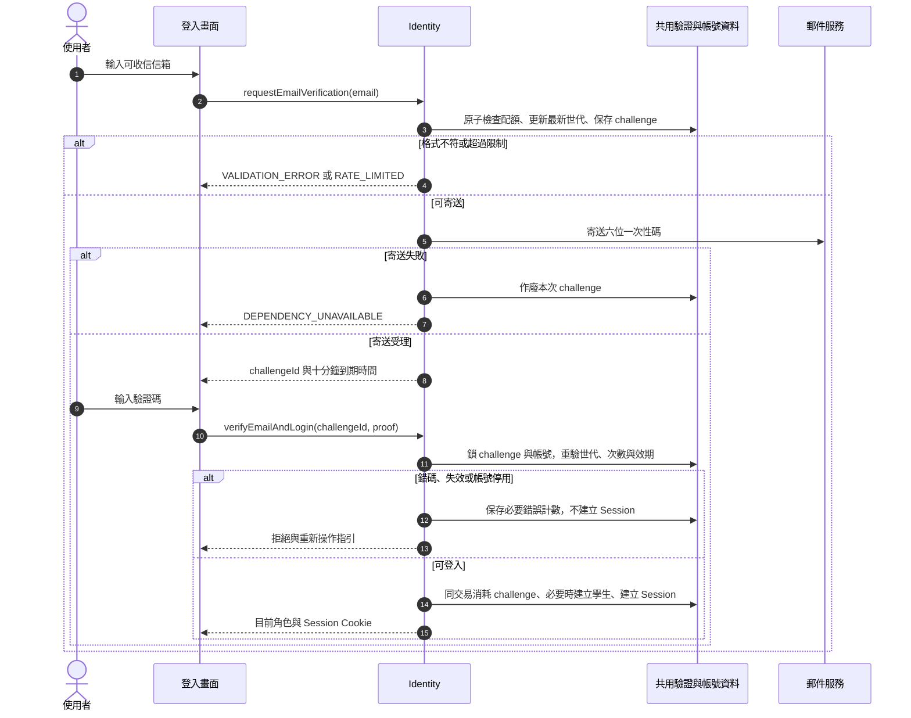

申請寄信不是登入。首次成功驗證才建立學生；既有商家與管理員保留原角色。單次消耗與 Session 建立原子執行；配額、世代與錯誤計數使用共用儲存。

### 18.2 管理設定的共通更新

來源：v0.4 圖 6-2；追溯：FR-004～009、026。

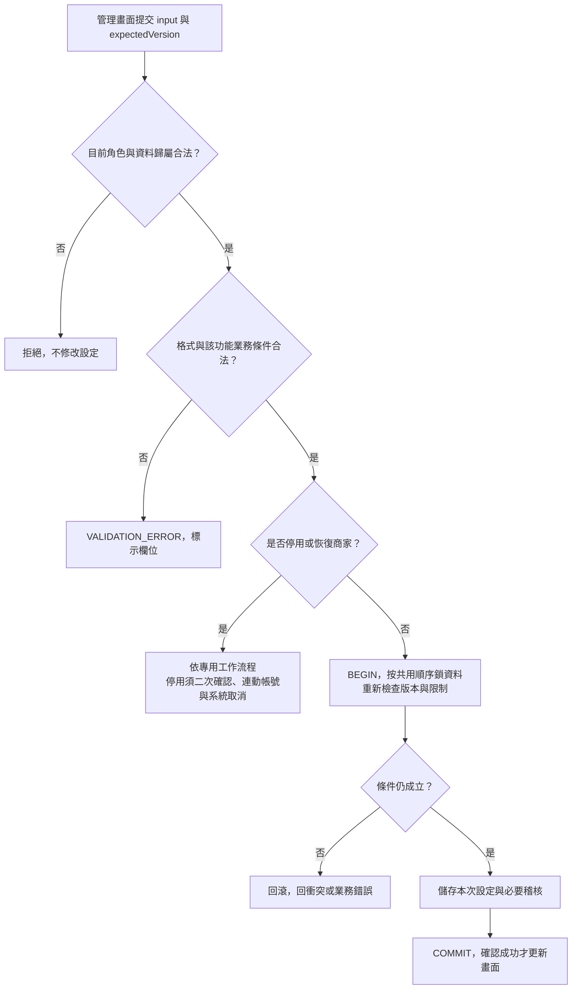

每次只更新所選功能。時段可調低容量並保留既有占用，但有進行中訂單不能改起迄或刪除；商品、庫存與分類仍各自檢查 §17.2～17.3 的條件。未知提交結果先重讀。

### 18.3 購物車至價格確認

來源：v0.4 圖 6-4；追溯：FR-010～013。

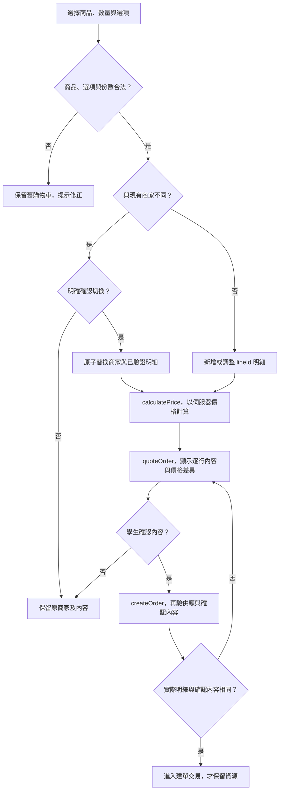

不因報價等待時長或僅版本不同要求重新確認；實際商品、選項、數量、單價與加價不同才提示。圖中的供應拒絕回購物車修正，不把重新確認當作供應保證。

### 18.4 庫存與容量的一次保留

來源：v0.4 圖 6-7；追溯：FR-006、009、014、015。

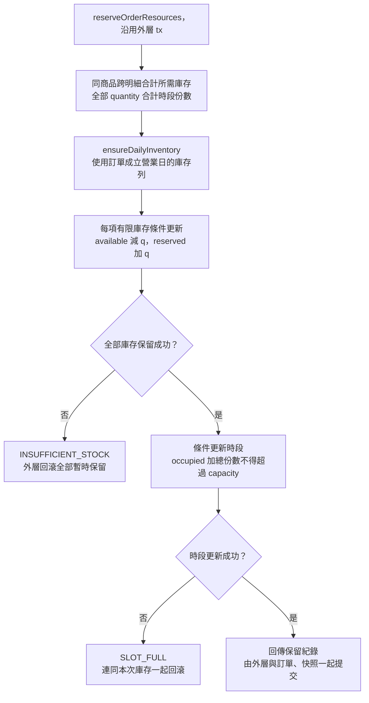

同商品兩行各兩份必須按四份檢查。容量調低至既有占用以下時，此條件更新拒絕新單，既有訂單不變。此函式不能自行提交或供前端直接占資源。

### 18.5 狀態命令檢查與提交

來源：v0.4 圖 6-10；追溯：FR-016～020、027。

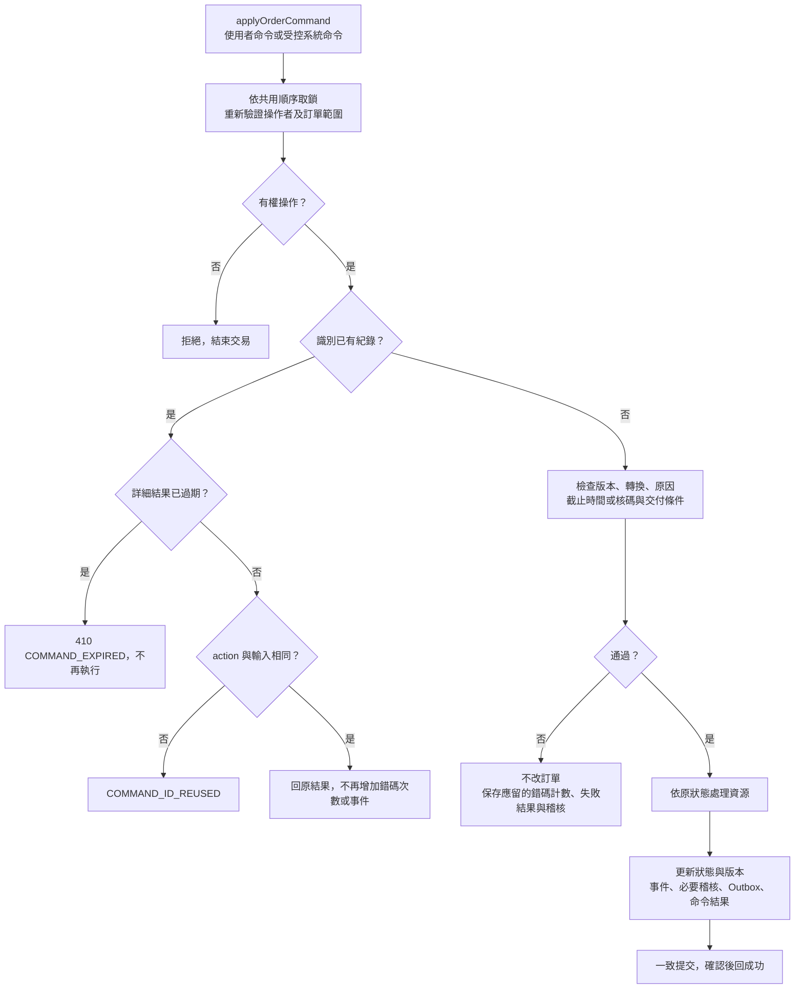

這是邏輯檢查圖，取鎖順序以 §6.2 為準。已有結果先處理，避免成功重播被舊 expectedVersion 擋住。資源寫入或提交結果未知時沿原 commandId 恢復，不另發新命令。

### 18.6 依原狀態處理資源

來源：v0.4 圖 6-11；追溯：FR-016～020、027。

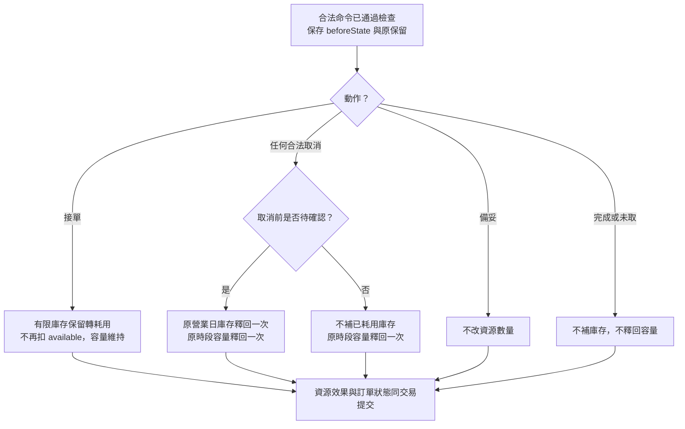

任何取消包含學生、商家拒單／取消及系統逾時／停用取消。先依原狀態判斷再改 CANCELLED；釋回依原 Reservation，不按目前菜單重算，也不能補到今日庫存。

### 18.7 接單與學生取消的競爭

來源：v0.4 圖 6-12；追溯：FR-016～018。

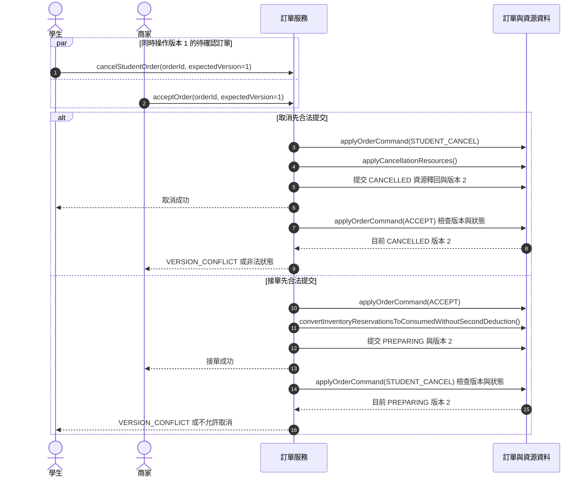

沿用 v0.4 的競爭示例，版本 1、2 是交易範例而非關聯數量標示。實際程式須帶 commandId 並遵守 §6.2；接單同時還須檢查 v0.6 的截止條件。圖內 DB 箭頭表示應用讀寫，不表示資料庫直接執行應用函式。

### 18.8 交付核碼與未取的分流

來源：v0.4 圖 6-13；追溯：FR-019、020。

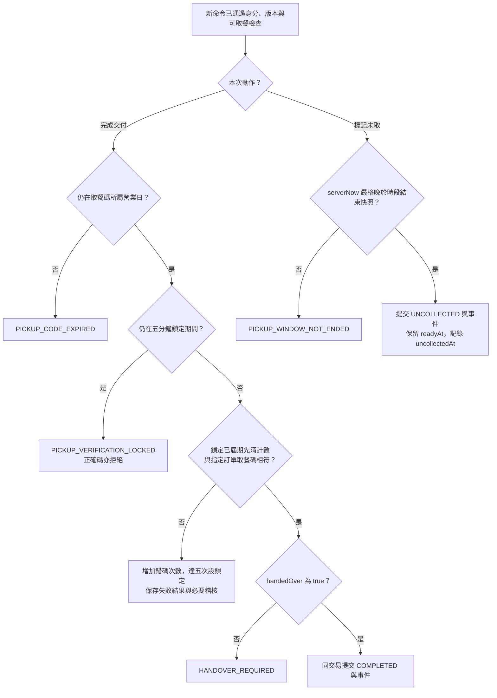

僅新命令走此圖，同 commandId 重播先依 §18.5 處理。取餐碼不在商家或管理員回應顯示；錯誤計數不能隨拒絕回滾。完成與未取皆不釋回容量。

### 18.9 管理查詢、統計與稽核查閱

來源：v0.4 圖 6-15；追溯：FR-024～026。

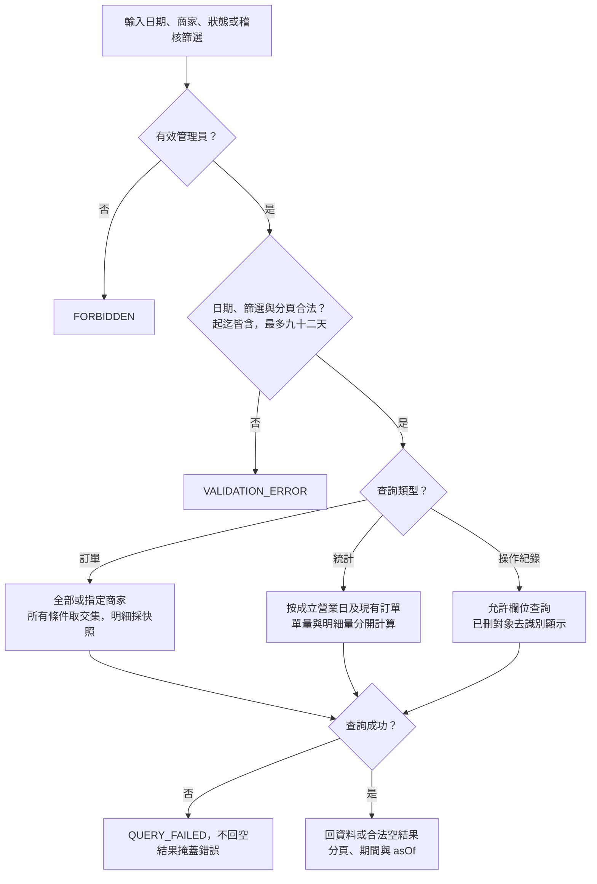

本圖為管理員路徑；商家只可使用固定本店範圍的統計端點，不能讀管理訂單或稽核。無匯出及財務功能。查詢成功不新增重要異動紀錄。
