# 校園點餐系統軟體需求規格書

Software Requirements Specification

專案名稱：校園點餐系統 MVP

文件版本：v0.4　　文件日期：2026-10-24　　文件狀態：待審查

需求依據：校園點餐系統 Waterfall PRD v0.5（2026-10-23）

本文件定義校園點餐系統首版應提供的功能、介面、資料規則與品質要求，供需求審查、系統設計、開發、測試及驗收共同使用。首版涵蓋線上預訂至現場取餐的流程；付款由學生於取餐時在現場辦理，系統不處理付款與退款。

## 文件修訂紀錄

| 版本 | 日期 | 修訂內容 |
| --- | --- | --- |
| v0.1 | 2026-10-23 | 依 PRD v0.5 建立 SRS 初稿，細化功能、狀態、介面及驗證條件 |
| v0.2 | 2026-10-24 | 加入 5 張 UML 圖、26 項函式輸入輸出與合法非法條件、介面契約、交易偽程式碼及邊界測試設計 |
| v0.3 | 2026-10-24 | 保留人工修改；依八類功能整理 function 索引及 15 張圖；將送單、資源與狀態命令的偽程式碼改為附說明的函式流程圖 |
| v0.4 | 2026-10-24 | 附錄 A 改為直接敘述驗證方式與通過條件；附錄 B 移除預設確認窗口，改列待決議事項對驗收的影響 |


---
# 目錄

1　簡介

1.1 產品範圍　1.2 產品特色　1.3 預期讀者與使用者　1.4 預期用途　1.5 整體描述

2　功能需求

2.0 功能分類與 function 索引　2.1 帳號與商家管理　2.2 菜單與庫存　2.3 購物車與價格　2.4 訂單與取餐　2.5 通知與管理　2.6 訂單狀態　2.7 資料需求

3　外部介面需求

3.1 使用者介面　3.2 硬體介面　3.3 軟體介面　3.4 通訊介面

4　非功能需求

4.1 安全與隱私　4.2 容量與效能　4.3 相容性　4.4 可靠性　4.5 擴充性　4.6 可維護性　4.7 易用性　4.8 其他品質要求

5　名詞與縮寫

6　依功能分類的 UML 與流程圖解

6.1 帳號登入與權限　6.2 商家營業與菜單　6.3 購物車與價格確認　6.4 送單去重與資源保留

6.5 接單備餐與取消　6.6 取餐與未取　6.7 訂單查詢與通知　6.8 管理查詢統計與稽核

7　函式契約與實作設計建議

7.1 共通輸入輸出　7.2 錯誤分類　7.3 模組責任　7.4 資料限制　7.5 邊界與競爭測試　7.6 請求回應範例

附錄 A　功能與品質驗收

附錄 B　需求審查決議清單

---
# 1 簡介

## 1.1 產品範圍

本系統為單一校園使用的繁體中文響應式網站，提供學生、商家及管理員三種操作介面。MVP 包含電子郵件驗證登入、帳號與商家管理、菜單與庫存、單商家購物車、當日取餐時段、訂單處理、站內通知、基本統計及操作紀錄。

學生透過網站預訂餐點，商家依訂單備餐並於現場核對取餐碼交付。付款屬線下作業；系統不得提供付款、退款、收款狀態、財務對帳或財務報表。訂單金額僅表示餐點價格合計，完成訂單不代表已付款。

## 1.2 產品特色

學生可在到店前確認商品、價格、供應情況與取餐時間，減少現場點餐及等待程序。商家可集中處理訂單、庫存與備餐進度，減少資訊分散造成的錯誤。校方或管理單位可依權限查詢訂單與基本營運狀況。

## 1.3 預期讀者與使用者

文件讀者包含專案負責人、需求與設計人員、開發人員、測試人員、參與商家及驗收窗口。需求確認後，設計與測試文件應引用本文件編號追溯實作及驗收結果。

| 使用者角色 | 可執行事項 | 資料存取邊界 |
| --- | --- | --- |
| 學生 | 瀏覽菜單、維護購物車、送單、查詢訂單、接單前取消 | 僅本人受保護資料及訂單 |
| 商家 | 維護所屬商家菜單、庫存、營業與時段；接單、拒單、取消、備妥、交付及標記未取 | 僅所屬商家的非公開資料及訂單 |
| 管理員 | 管理帳號與商家、查詢訂單、統計及操作紀錄、協助處理異常 | 依核定管理權限；不得改寫歷史品項及價格 |

## 1.4 預期用途

學生流程為電子郵件驗證登入、瀏覽菜單、編輯單店購物車、選擇當日時段、送單、查詢進度及出示取餐碼。商家流程為接單或拒單、製作、標記可取餐、核對取餐碼並實際交付，或依條件取消及標記未取。

管理員以後台維護帳號與商家，並以商家、日期及狀態查詢訂單，檢視基本統計與操作紀錄。停用帳號後，該帳號不得繼續使用受保護功能。

## 1.5 整體描述

系統邏輯邊界包括瀏覽器使用介面、執行驗證與業務規則的伺服器端，以及保存商家、商品、訂單和紀錄的資料儲存功能。這是責任劃分，不指定程式語言、框架、資料庫產品或部署平台。

外部相依為可用的網路、支援瀏覽器，以及支援電子郵件驗證的服務。校方應核定個資保存與清除政策、管理權限及正式服務品質目標。特定供應商、驗證流程與運維數值，待設計及需求審查決議。

---
# 2 功能需求

各功能均須在伺服器端驗證身分、資料存取權限及適用條件。失敗操作不得顯示為成功；對訂單、庫存及容量的變更須遵循第 2.6 節。以下驗證情境編號 AC-001 至 AC-026 與相同尾碼的 FR 一對一對應。

每項 FR 新增函式與介面提案、輸入欄位與合法值、成功輸出、非法輸入與業務例外，以及實作方向。英文函式、欄位、路徑、HTTP 狀態與資料結構為設計建議；待核定的政策不因出現在範例或 UML 中就視為定案。共通型別、錯誤處理與交易原則見第 7 章。

## 2.0 功能分類與 function 索引

為方便按功能閱讀，以下將現有 26 項需求分成八類；FR 編號與原功能敘述保留。第 2.1 至 2.5 節仍提供完整輸入輸出與錯誤規格，第 6 章使用相同八類編排圖解。跨功能共用的 function 可在多張圖出現，不代表要重複實作。

| 功能分類 | 對應需求 | 主要 function | 圖解位置 |
| --- | --- | --- | --- |
| A 帳號登入與權限 | FR-001～FR-003 | `requestEmailVerification()`、`verifyEmailAndLogin()`、`createPrivilegedAccount()`、`authorize()`、`changeAccountStatus()` | 6.1 圖 6 1 |
| B 商家營業與菜單 | FR-004～FR-009 | `createMerchant()`、`updateMerchant()`、`updateBusinessSchedule()`、`canAcceptOrders()`、`savePickupSlot()`、`listBookableSlots()`、`createProduct()`、`updateProduct()`、`configureOptions()`、`validateSelections()`、`adjustInventory()`、`checkAvailability()` | 6.2 圖 6 2 至 6 3 |
| C 購物車與價格確認 | FR-010～FR-013 | `addCartItem()`、`updateCartItem()`、`removeCartItem()`、`switchCartMerchant()`、`calculatePrice()`、`quoteOrder()`、`validateAcceptedQuote()`、`buildOrderSnapshot()` | 6.3 圖 6 4 |
| D 送單去重與資源保留 | FR-014～FR-015；共用 FR-018 | `createOrder()`、`executeIdempotently()`、`applyCancellationResources()` | 6.4 圖 6 5 至 6 8 |
| E 接單備餐與取消 | FR-016～FR-018 | `acceptOrder()`、`markOrderReady()`、`cancelStudentOrder()`、`rejectOrCancelMerchantOrder()`、`applyCancellationResources()`；共用內部 `applyOrderCommand()` | 6.5 圖 6 9 至 6 12 |
| F 取餐與未取 | FR-019～FR-020 | `completePickup()`、`markUncollected()` | 6.6 圖 6 13 |
| G 訂單查詢與通知 | FR-021～FR-023 | `listMyOrders()`、`getOrderDetail()`、`createNotificationsFromOrderEvent()`、`listNotifications()`、`loadMerchantOrderBoard()`、`refreshOrderBoard()` | 6.7 圖 6 14 |
| H 管理查詢統計與稽核 | FR-024～FR-026 | `searchOrders()`、`getOperationalStatistics()`、`appendAuditEvent()`、`searchAuditEvents()` | 6.8 圖 6 15 |

## 2.1 帳號與商家管理

### FR-001 學生電子郵件驗證與登入

需求：學生須能以電子郵件完成驗證並登入；未完成必要驗證者不得以已登入身分執行受保護操作。驗證失敗須顯示可理解的原因或重新操作指引，不得建立有效登入狀態。

輸入與結果：輸入電子郵件及所選驗證流程要求的資料；成功後取得學生身分及對應權限。驗證碼或連結、效期、信箱網域限制與帳號註冊方式待決議 B-01。

驗證 AC-001：有效驗證可登入；錯誤或未完成驗證無法送單或查詢私人訂單。

#### 函式規格與實作方向

**建議函式與介面：**`requestEmailVerification(input)`、`verifyEmailAndLogin(input)`；`POST /auth/email/challenges`、`POST /auth/email/verify`。使用一次性驗證碼或連結的實際選擇仍依 B-01，以下以 challenge 與 proof 統一描述。

| 輸入 | 型別與必要性 | 合法條件與驗證 |
| --- | --- | --- |
| email | String，申請驗證必填 | 合法電子郵件格式；去除前後空白；網域限制如有須經 B-01 核定，不任意變更信箱 local-part |
| challengeId | ID，驗證必填 | 對應已核發、尚未消耗且未失效的驗證挑戰 |
| proof | String，驗證必填 | 符合該挑戰的驗證碼或連結憑證；不得出現在 URL 存取紀錄或一般日誌 |

**輸出：**申請成功回傳 `challengeId`、`expiresAt` 與泛化的寄送提示；驗證成功回傳 `user{id,role,status}` 並建立登入工作階段。`expiresAt` 依核定效期計算，不在 SRS 任填分鐘數。

**合法案例：**有效信箱收到驗證資料，未逾期且未使用的 proof 核對成功，可存取學生受保護功能。

**非法與例外：**空信箱或格式錯誤 → `VALIDATION_ERROR`；錯誤 proof → `VERIFICATION_INVALID`；過期或已使用 → `VERIFICATION_EXPIRED_OR_USED`；帳號停用 → `ACCOUNT_DISABLED`；寄送服務失敗 → `DEPENDENCY_UNAVAILABLE`，不可建立登入。未註冊信箱如何轉為帳號待 B-01，不預設可直接註冊。

**實作方向：**驗證憑證雜湊保存，成功核對與標記已使用須具原子性，避免並行重複兌換；設定嘗試及寄送限制，數值由安全設計核定。Cookie 工作階段應設定 Secure、HttpOnly 與適當 SameSite；Cookie 驗證的寫入介面另設 CSRF 防護。登入後仍須在每次受保護請求檢查停用狀態。

### FR-002 帳號建立與角色授權

需求：僅授權人員可建立商家及管理員帳號，並指定角色與商家歸屬或管理範圍。一般學生不得透過介面或直接請求建立高權限帳號或提升權限。

例外：未登入、角色不符或資料不屬於其授權範圍時，系統須拒絕操作且不回傳受保護資料。授權人員名單及管理權限細分待決議 B-02。

驗證 AC-002：分別以學生、商家及管理員操作，確認允許範圍正確；修改請求中的使用者或商家識別不得突破授權。

#### 函式規格與實作方向

**建議函式與介面：**`createPrivilegedAccount(actor,input)`、`authorize(actor,action,resource)`；`POST /admin/accounts`。`actor` 由伺服器驗證後建立，不接受用戶端自稱身分。

| 輸入 | 型別與必要性 | 合法條件與驗證 |
| --- | --- | --- |
| email | String，必填 | 合法格式；是否已存在須按帳號唯一性政策檢查 |
| role | Enum，必填 | 此介面僅接受 `MERCHANT` 或 `ADMIN`，且建立者有該角色授予權限 |
| merchantId | ID，商家角色必填 | 商家存在且建立者有管理權；管理員角色不以此冒充管理範圍 |
| permissions | String[]，管理員依政策填寫 | 不得超出建立者可授予的權限集合；細目依 B-02 |

**輸出：**`account{id,email,role,status,merchantId?,permissions}`；不得回傳驗證憑證或密碼。初始啟用流程依 B-01／B-02。

**合法案例：**具有商家帳號建立權的管理人員，為其管理範圍內商家建立商家帳號。

**非法與例外：**學生呼叫 → `FORBIDDEN`；角色未知、商家角色缺少歸屬 → `VALIDATION_ERROR`；商家不存在或不在範圍 → `RESOURCE_NOT_FOUND`；帳號識別重複 → `ACCOUNT_CONFLICT`；試圖授予自身無權授予的權限 → `FORBIDDEN`。

**實作方向：**集中授權檢查，採角色加資源範圍的政策；帳號、角色關聯與操作紀錄一致儲存。校方如需多商家歸屬，應先核定模型，不以逗號字串儲存多個商家。權限判斷不可僅存在於導覽選單。

### FR-003 帳號停用與恢復

需求：管理員可停用及恢復帳號。停用生效後，包含已登入的使用者在內，後續受保護請求均須被拒絕；恢復後依原核定權限重新允許存取。

結果：保留帳號與既有訂單關聯及異動紀錄。停用帳號不得被當作刪除歷史訂單的理由。

驗證 AC-003：帳號保持登入時被停用，下一次受保護操作即失敗；恢復後可依權限操作。

#### 函式規格與實作方向

**建議函式與介面：**`changeAccountStatus(actor,accountId,input)`；`PATCH /admin/accounts/{accountId}/status`。

| 輸入 | 型別與必要性 | 合法條件與驗證 |
| --- | --- | --- |
| accountId | ID，路徑必填 | 帳號存在且在操作者管理範圍 |
| status | Enum，必填 | `ACTIVE` 或 `DISABLED` |
| expectedVersion | Integer，建議必填 | 與讀取時帳號版本一致，防止舊畫面覆寫 |

**輸出：**`accountId,status,version,updatedAt`；相同狀態重送可回傳現況且不產生第二次實質異動。

**合法案例：**停用後，該帳號既有登入工作階段的下一次受保護請求即被拒絕；恢復後依核定登入流程取得原有權限。

**非法與例外：**未授權管理員 → `FORBIDDEN`；未知狀態 → `VALIDATION_ERROR`；版本落後 → `VERSION_CONFLICT`；不存在或越界帳號 → `RESOURCE_NOT_FOUND`。是否禁止停用自己或最後一位管理員是新增保護建議，須審查後才成為規則。

**實作方向：**更新帳號狀態及身分版本，撤銷或使舊登入快取失效；若使用有期限的 token，不可只等 token 自然到期。保留帳號 ID 與歷史關聯；恢復不應使已撤銷的舊憑證重新有效。

### FR-004 商家基本資料管理

需求：管理員可建立、編輯及停用商家，維護名稱、位置、聯絡方式及取餐說明。停用商家不得接受新訂單。

例外：必要欄位缺漏或格式不符時，不儲存無效資料並指出需修正欄位。停用時既有未完成訂單的後續處理政策待決議 B-03；不得直接刪除或改寫歷史訂單。

驗證 AC-004：建立及編輯後可讀到正確資料；停用後新送單遭拒，原訂單紀錄仍存在。

#### 函式規格與實作方向

**建議函式與介面：**`createMerchant(actor,input)`、`updateMerchant(actor,id,input)`；`POST /admin/merchants`、`PATCH /admin/merchants/{merchantId}`。

| 輸入 | 型別與必要性 | 合法條件與驗證 |
| --- | --- | --- |
| name, location | String，必填 | 去除前後空白後不得為空；長度依核定限制 |
| contact, pickupInstructions | String，必填性待核定 | 聯絡方式依採用欄位驗證；取餐說明以純文字處理 |
| status | Enum，停用／恢復時必填 | `ACTIVE` 或 `DISABLED`；不得作為直接取消既有訂單的命令 |
| expectedVersion | Integer，修改時建議必填 | 與當前商家版本一致 |

**輸出：**`merchant{id,name,location,contact,pickupInstructions,status,version}`。

**合法案例：**授權管理員修改位置後，後續商家頁顯示新位置；停用後新的送單驗證失敗。

**非法與例外：**空白店名 → `VALIDATION_ERROR`；非授權商家自行建立其他商家 → `FORBIDDEN`；失效版本 → `VERSION_CONFLICT`；操作不存在或越界商家 → `RESOURCE_NOT_FOUND`。店名重複是否允許未經核定，不以顯示名稱代替唯一 ID。

**實作方向：**使用穩定 merchant ID、軟停用及版本控制；訂單建立時再次讀取有效商家狀態。停用與新送單的競爭須以交易順序決定，停用提交後的新單不得成立；既有未完成訂單的操作政策仍待 B-03。

### FR-005 營業時間與接單控制

需求：商家可設定營業時間、暫停接單及例外休息日。建立訂單時，系統須以當時有效設定判斷可否接單；非接單時間、休息日或暫停期間不得成立新訂單。

例外：即使學生先前已開啟菜單或購物車，送單時仍須重新檢查；失敗須告知商家目前不可接單。

驗證 AC-005：在正常營業、非營業、例外休息與暫停接單情境分別送單，確認僅符合接單條件者成功。

#### 函式規格與實作方向

**建議函式與介面：**`updateBusinessSchedule(actor,merchantId,input)`、`canAcceptOrders(merchant,now)`；`PUT /merchant/business-settings`。

| 輸入 | 型別與必要性 | 合法條件與驗證 |
| --- | --- | --- |
| weeklyHours | Array，更新營業表時必填 | 每項為星期、開始時間、結束時間；不能接受無效星期或時間值 |
| closedDates | Date[]，選填 | 校園業務時區中的有效日曆日期 |
| acceptingOrders | Boolean，必填 | 僅表示商家接單開關，不可覆蓋停用或休息日限制 |
| expectedVersion | Integer，建議必填 | 與最新設定版本一致 |

**輸出：**儲存後設定及 `effectiveAccepting,unavailableReason,version`；effectiveAccepting 由啟停狀態、例外日、時間表及開關共同計算。

**合法案例：**營業中且未休息、未停用及開關開啟時可接單；即使開關開啟，例外休息日仍不可送單。

**非法與例外：**不存在日期、時間格式錯誤 → `VALIDATION_ERROR`；設定版本衝突 → `VERSION_CONFLICT`；送單時商家已暫停 → `MERCHANT_UNAVAILABLE`。跨午夜營業與重疊區段的合法性待 B-04，不由時間字串大小推斷。

**實作方向：**封裝營業時間判斷並使用伺服器時間及核定時區；可注入時鐘供邊界測試。快取只供瀏覽，送單仍檢查權威狀態；設計文件需明定結束時刻是否採半開區間。

### FR-006 當日取餐時段及容量

需求：商家可設定當日取餐時段與各時段可接單容量。學生只能選擇當日可預訂時段；已額滿或不可預訂時段不得用於建立新訂單。

例外：提交時重新驗證時段資格及剩餘容量；並行送單不得超額。時段長度、截止時間、容量單位及已占用時段修改規則待決議 B-04。

驗證 AC-006：可用時段可選；跨日、額滿及失效時段送單失敗；兩筆請求爭用最後一份容量時不得同時取得。

#### 函式規格與實作方向

**建議函式與介面：**`savePickupSlot(actor,input)`、`listBookableSlots(merchantId,date)`；`POST /merchant/pickup-slots`、`PATCH /merchant/pickup-slots/{slotId}`、`GET /merchants/{merchantId}/pickup-slots`。

| 輸入 | 型別與必要性 | 合法條件與驗證 |
| --- | --- | --- |
| date, startTime, endTime | Date、Time，必填 | 有效日期時間；結束晚於開始；可預訂日期須是校園當日 |
| capacity | Integer，必填 | 非負；0 代表無剩餘接單容量的建議設定，須隨 B-04 核定 |
| expectedVersion | Integer，修改時建議必填 | 防止並行編輯覆蓋已占用量或最新設定 |

**輸出：**`slot{id,startAt,endAt,capacity,used,remaining,bookable,version}`；`remaining` 不得小於 0，欄位皆使用同一核定容量單位。

**合法案例：**當日可預訂時段尚有容量，送單時成功占用；單一容量剩餘供兩個請求競爭時只允許符合容量的請求成功。

**非法與例外：**負容量或結束早於開始 → `VALIDATION_ERROR`；跨日或不符合截止政策 → `SLOT_UNAVAILABLE`；額滿 → `SLOT_FULL`；將容量改得低於已占用量 → 建議 `CAPACITY_BELOW_OCCUPIED`，政策依 B-04 確認。

**實作方向：**以 slot ID 關聯訂單，計算需求量採 `capacityUnits(order,approvedPolicy)`，不先寫死一單一份。用交易內條件更新或列鎖保證 `used + requested <= capacity`；已被訂單引用的時段不得被編輯成不同取餐時間而默默改動既有承諾。

## 2.2 菜單與庫存

### FR-007 商品維護與上下架

需求：商家可新增、編輯、上架及下架所屬商品，管理名稱、分類、圖片、售價及供應狀態。下架或不可供應的商品不得出現在可成功送單的品項中。

例外：系統須驗證必要欄位及資料格式；資料不符時不儲存該次無效更新。圖片格式、大小、欄位長度及價格範圍待決議 B-06。

驗證 AC-007：完成商品新增與修改；下架後，以舊購物車提交該商品仍須被拒絕；不可修改其他商家的商品。

#### 函式規格與實作方向

**建議函式與介面：**`createProduct(actor,input)`、`updateProduct(actor,id,input)`；`POST /merchant/products`、`PATCH /merchant/products/{productId}`。

| 輸入 | 型別與必要性 | 合法條件與驗證 |
| --- | --- | --- |
| name, categoryId | String、ID，必填性依 B-06 | 名稱不可空白；分類存在且屬所屬商家或核定共用分類 |
| basePrice | Money，必填 | 使用固定精度十進位值；非負為本版建議，零元是否可售仍待 B-06 |
| imageAssetId | ID，選填 | 已驗證可用的圖片資產；類型、尺寸與大小依 B-06 |
| listed, supplyStatus | Boolean、Enum，必填 | 上下架與供應狀態分開；供應狀態僅允許核定列舉 |
| expectedVersion | Integer，修改時建議必填 | 與商品版本一致 |

**輸出：**`product{id,merchantId,name,categoryId,basePrice,imageUrl?,listed,supplyStatus,version}`。

**合法案例：**所屬商家新增商品並上架；下架後可保留後台紀錄，但不可新送單。

**非法與例外：**名稱空白、非數值價格、價格精度過高 → `VALIDATION_ERROR`；未授權圖片或分類 → `RESOURCE_NOT_FOUND`；偽裝副檔名的檔案 → `IMAGE_INVALID`；跨商家修改 → `RESOURCE_NOT_FOUND`；舊版本覆寫 → `VERSION_CONFLICT`。

**實作方向：**採欄位白名單避免 mass assignment 改動 merchantId。圖片驗證檔案內容與大小，使用受控資產識別，避免後端任意抓取用戶端 URL；商品編輯與訂單快照分開保存，不硬刪被歷史訂單引用的資料。

### FR-008 客製化選項及加價

需求：商品可設定客製化選項、加價及必選／可選規則。學生加入購物車及送單時，選項組合均須符合當時有效規則，並顯示選項加價。

例外：漏選必選項或提交不存在、已失效或不符合規則的選項時，須拒絕並提示修正。多選數量上下限等進一步模型待決議 B-06。

驗證 AC-008：必選未填不可加入；合法選項可加入並正確計價；送單前選項規則變更時重新驗證。

#### 函式規格與實作方向

**建議函式與介面：**`configureOptions(actor,productId,input)`、`validateSelections(product,selectionIds)`；`PUT /merchant/products/{productId}/option-groups`。

| 輸入 | 型別與必要性 | 合法條件與驗證 |
| --- | --- | --- |
| groups | Array，必填 | 每組含名稱、必選／可選規則及可用選項 |
| options | Array，依群組必填 | 選項 ID、名稱、加價；ID 不重複且屬該商品群組 |
| selectedOptionIds | ID[]，選餐時必填，可為空陣列 | 必選群組須滿足規則；可選可不選；不得重複同一選項 |
| minSelections, maxSelections | Integer，選用模型欄位 | 只有 B-06 核定多選模型後採用；須符合最小值不大於最大值 |

**輸出：**管理端得到新版選項設定；驗證函式回傳 `normalizedSelections,optionExtra,optionVersion` 或逐群組錯誤。

**合法案例：**必選一種主食並選擇可選加蛋，規則通過且合計包含加蛋價。

**非法與例外：**漏必選、重複選項、超過核定選擇上限或提交其他商品選項 → `OPTION_RULE_VIOLATION`；送單前選項失效 → `PRODUCT_CHANGED`，須重新選擇；加價格式不符 → `VALIDATION_ERROR`。

**實作方向：**前端與後端共用規則定義但由後端裁決；不能只驗證選項存在，還須驗證其商品、群組及可用性。計價只讀取伺服器價格，成立時複製選項名稱與價格，不以日後的選項表重算歷史訂單。

### FR-009 庫存模式與供應控制

需求：商家可設定有限庫存、不限量及售完狀態。有限庫存依成立訂單數量保留；不限量商品仍須符合上架及可售條件。售完或可用庫存不足時不得建立新訂單。

例外：同一商品在訂單內有不同選項明細時，須合併檢查其所需庫存量，避免分列繞過限制。庫存調整不得產生負值；已保留庫存與手動調整的計算規則待決議 B-05。

驗證 AC-009：有限庫存不足被拒；不限量可在其他條件符合時送單；售完不可送單；並行送單及管理調整後仍無負庫存。

#### 函式規格與實作方向

**建議函式與介面：**`adjustInventory(actor,productId,input)`、`checkAvailability(items)`；`PATCH /merchant/products/{productId}/inventory`。

| 輸入 | 型別與必要性 | 合法條件與驗證 |
| --- | --- | --- |
| inventoryMode | Enum，必填 | `FINITE` 或 `UNLIMITED`；售完為獨立供應狀態 |
| availableQuantity | Integer，有限庫存必填 | 非負；不得將 null、負值或小數當作有效庫存 |
| soldOut | Boolean，必填 | true 時即使不限量也不可新送單 |
| expectedVersion | Integer，修改時建議必填 | 與最新庫存版本一致 |

**輸出：**`productId,inventoryMode,availableQuantity?,reservedQuantity?,soldOut,version`；不限量的 availableQuantity 使用 null，不以任意巨大數代替。

**合法案例：**有限可用量 5，提交數量 3 後可用量為 2、保留量增加 3；不限量且未售完時通過商品庫存檢查。

**非法與例外：**數量負值或小數 → `VALIDATION_ERROR`；需求大於可用量 → `INSUFFICIENT_STOCK`；已售完 → `PRODUCT_UNAVAILABLE`；舊版本調整 → `VERSION_CONFLICT`。有保留時切換模式的規則依 B-05，建議先禁止有活動保留的模式切換。

**實作方向：**同一商品跨多行選項先彙總需求，再以條件更新扣除可用量。建議區分可用、保留及已耗用，於接單將保留轉為已耗用，避免再扣一次可用量；手動調整與送單共用版本／鎖策略。範例數字為測試資料，非容量要求。

### FR-010 訂單商品與價格快照

需求：訂單成立時須保存商品名稱、商品單價、選項與加價、數量及價格明細。後續菜單改名、改價、修改選項或上下架，不得改寫既有訂單內容。

結果：學生、商家與管理後台查詢同一訂單時，應讀取成立時的明細紀錄；管理員也不得直接竄改歷史品項及價格。

驗證 AC-010：成立訂單後修改菜單，既有訂單名稱、選項、數量及價格保持不變，新訂單採用經確認的新資訊。

#### 函式規格與實作方向

**建議函式：**`buildOrderSnapshot(validatedQuote,items)`；屬訂單成立交易內部函式，不提供獨立修改歷史明細 API。

| 輸入 | 型別與必要性 | 合法條件與驗證 |
| --- | --- | --- |
| validatedQuote | ServerQuote，必填 | 來自伺服器重新驗證且獲學生確認的當前價格 |
| validatedItems | OrderDraftItem[]，必填 | 商品、數量與選項已驗證，至少一項且同一商家 |
| pickupSlot | Slot，必填 | 有效取餐時段；建議保存當時日期及起迄時間 |

**輸出：**不可由一般更新介面修改的 `OrderItemSnapshot[]`，包含來源商品 ID、當時名稱、單價、選項名稱與加價、數量、小計及備註；主檔包含成立合計與時段資訊。

**合法案例：**訂單成立時品項為 80、加價 10、數量 2，快照小計為 180；之後商品改價不影響這筆小計。

**非法與例外：**客戶端自填商品名稱或價錢要求當作快照 → 不採信並重新計算；小計與有效報價不符 → `QUOTE_CHANGED`；歷史編輯介面要求修改明細 → `FORBIDDEN` 或不存在此介面。

**實作方向：**快照存於訂單專用資料結構；不可只保存外鍵並在查詢時連接最新菜單顯示價格。應保留原商品 ID 供統計，但即使商品停用仍能獨立還原明細；快照與訂單及資源保留同一交易提交。

## 2.3 購物車與價格

### FR-011 單一商家購物車

需求：學生可新增、調整及刪除購物車中的餐點、數量、選項與備註；購物車內餐點須屬同一商家。加入其他商家餐點前須取得學生確認。

例外：學生取消切換時，須保留原商家及原購物車內容，不得混入其他店家品項。購物車保存期間與跨裝置同步不在本版既定要求中。

驗證 AC-011：可完成新增、調整及刪除；跨店切換有確認；拒絕切換後原購物車不變；送單端同樣拒絕混店明細。

#### 函式規格與實作方向

**建議函式：**`addCartItem(cart,input)`、`updateCartItem(cart,lineId,input)`、`removeCartItem(cart,lineId)`、`switchCartMerchant(cart,target,confirmed)`。購物車可採本機或伺服器保存，尚未核定持久化方式，不強制新增購物車後端 API。

| 輸入 | 型別與必要性 | 合法條件與驗證 |
| --- | --- | --- |
| merchantId, productId | ID，新增必填 | 商品屬該商家，且與目前購物車商家相同或已確認切換 |
| quantity | Integer，新增／調量必填 | 正整數；0 應使用刪除動作，單筆上限待 B-06 |
| selectedOptionIds | ID[]，必填，可空 | 通過 FR-008 的選項規則 |
| note | String，選填 | 純文字；最大長度待 B-06 |
| confirmSwitch | Boolean，跨店時必填 | true 才可清除原購物車並加入新商家品項 |

**輸出：**`cart{merchantId,lines,displayTotal}` 或切店確認需求；每行包含穩定 lineId，不能僅以 productId 區分不同選項。

**合法案例：**同一商品不同選項可分行；拒絕切店維持原內容；確認後購物車僅含新店品項。

**非法與例外：**0、負數、小數數量 → `VALIDATION_ERROR`；跨店未確認 → `CART_MERCHANT_CONFLICT`；刪除未知行 → `CART_LINE_NOT_FOUND`；錯誤選項 → `OPTION_RULE_VIOLATION`。本地錯誤可用相同語意代碼，不代表一定有 HTTP 請求。

**實作方向：**不可把加入購物車視為保留庫存或容量；購物車只是下單草稿。備註以文字安全輸出，勿當成 HTML；無論保存位置為何，送單仍完整驗證，不能信任本機儲存的商品價格或商家歸屬。

### FR-012 價格明細與合計

需求：購物車與訂單須顯示商品單價、選項加價、數量、各項小計及合計。單項小計為「商品單價加所選選項加價總和」乘以數量；訂單合計為各項小計之和。

約束：系統端須依有效價格重新計算，不得信任用戶端傳入的合計。幣別、金額精度及進位規則待決議 B-06；不得將價格合計顯示為已收款金額。

驗證 AC-012：含多商品、多選項與不同數量時各項計算一致；竄改用戶端金額不影響系統端計價。

#### 函式規格與實作方向

**建議函式：**`calculatePrice(productPrices,selectedOptions,quantities,moneyPolicy)`；與 FR-013 共用報價服務。

| 輸入 | 型別與必要性 | 合法條件與驗證 |
| --- | --- | --- |
| items | PricedItem[]，必填 | 至少一項；商品單價、選項加價皆來自伺服器 |
| quantity | Integer，每項必填 | 正整數且不超出核定限制 |
| moneyPolicy | ServerConfig，必填 | 幣別、精度與進位規則已核定；不得由學生指定以改變計價 |

**輸出：**每行 `basePrice,optionsExtra,unitTotal,quantity,subtotal` 及訂單 `total,currency`。計算順序為 `unitTotal = basePrice + sum(optionExtras)`，`subtotal = unitTotal × quantity`，`total = sum(subtotals)`。

**合法案例：**基價 80、加價 10、數量 2，另有 50 的商品一份，合計為 230。此例僅示範計算，不預設幣別與整數金額政策。

**非法與例外：**非數值、超出精度或數值範圍 → `VALIDATION_ERROR`；用戶端宣告 total=1 → 不採信，使用伺服器值並依 FR-013 要求確認；不存在選項 → `OPTION_RULE_VIOLATION`。

**實作方向：**採固定精度十進位或核定最小貨幣單位整數，避免二進位浮點累積誤差；設定運算上限並檢查乘加溢位。購物車顯示、報價與成立快照共用計價邏輯，不增加未列入範圍的稅費、折扣或運費。

### FR-013 提交時商品與價格再確認

需求：送單時重新檢查商品及價格資訊。與學生先前確認內容不同時，須提示變動及更新後的明細，由學生再次確認後才能繼續建立訂單。

例外：不得以未確認的新價格直接成立訂單；確認後若資料再次變動，須再次檢查。商品已無法供應時應提示修正購物車，不能以價格確認取代供應檢查。

驗證 AC-013：購物車加入後改價，送單會提示且未先建立訂單；取消確認無訂單；再次確認且其他條件符合時才成立。

#### 函式規格與實作方向

**建議函式與介面：**`quoteOrder(actor,input)`、`validateAcceptedQuote(input,currentData)`；`POST /order-quotes`。

| 輸入 | 型別與必要性 | 合法條件與驗證 |
| --- | --- | --- |
| merchantId, items | ID、Array，必填 | 同一商家；商品、選項及數量合法 |
| previousQuoteId | ID，重新報價時選填 | 屬目前學生；用於比較前次已顯示內容 |
| acceptedQuoteId | ID，正式送單必填的設計提案 | 必須是學生明確確認過、範圍吻合且仍有效的報價 |

**輸出：**`quoteId,items,total,currency,changes[],requiresConfirmation`；若採效期則回傳 `expiresAt`，效期由 B-08 核定。報價不保留庫存或時段容量。

**合法案例：**商品改價後顯示新舊差異；學生接受新報價，正式送單再檢查一致後成立。

**非法與例外：**報價屬他人 → `RESOURCE_NOT_FOUND`；商品或選項已不可售 → `PRODUCT_UNAVAILABLE`；送單時價格再次改變或報價過期 → `QUOTE_CHANGED`，回傳新報價但不建單、不占資源；學生未確認 → `QUOTE_CONFIRMATION_REQUIRED`。

**實作方向：**報價綁定學生、商家、品項、選項、數量及價格版本，採伺服器保存或防竄改憑證；不能只比較訂單總額，因不同明細可能同額。後端只能確認收到接受特定 quote 的請求，使用者確認行為由介面明確呈現。

## 2.4 訂單與取餐

### FR-014 整單驗證與建立

需求：建立訂單前須驗證身分、商家接單資格、單商家限制、商品及選項、數量、價格確認、庫存與當日取餐時段容量。數量須為有效正整數；任一條件不符時整單不得成立。

成功結果：建立唯一可識別的訂單及明細，保留所需庫存與時段容量，狀態設為待商家確認，提供訂單編號及供核對的取餐碼。編碼格式及取餐碼唯一性範圍待決議 B-07。

失敗結果：不得留下部分訂單或因失敗請求占用庫存、容量；回傳可理解的原因及可行的修正方向。

驗證 AC-014：一項商品不足、無效數量或時段失效時均整單失敗；確認無殘留明細與資源占用；全部有效時才建立完整訂單。

#### 函式規格與實作方向

**建議函式與介面：**`createOrder(actor,request,input)`；`POST /orders`。函式流程圖見第 6.4 節圖 6 5 至 6 7，交易邊界導讀見第 7.4 節。

| 輸入 | 型別與必要性 | 合法條件與驗證 |
| --- | --- | --- |
| actor | AuthContext，伺服器提供 | 已啟用且完成驗證的學生；studentId 不接受用戶端覆寫 |
| merchantId, pickupSlotId | ID，必填 | 商家可接單；時段屬同商家、當日可預訂且有容量 |
| items | Array，必填 | 至少一項；每項含 productId、quantity、selectedOptionIds、可選 note |
| acceptedQuoteId | ID，建議必填 | 綁定的明細與目前送單相同，價格仍有效 |
| Idempotency-Key | String，標頭必填的設計提案 | 同一次操作使用相同值，且綁定相同輸入內容 |

**輸出：**首次成立回傳 `201` 與 `order{id,status,items,total,pickupSlot,pickupCode,createdAt,version}`；status 必為 `PENDING_ACCEPTANCE`。同一次成功操作重播回傳既有訂單識別，不能另建一張。

**合法案例：**一商家、合法選項與正整數數量，學生已確認價格且資源足夠，建立完整訂單及一次資源保留。

**非法與例外：**混店、空明細或無效數量 → `VALIDATION_ERROR`；商家不接單 → `MERCHANT_UNAVAILABLE`；商品無法供應 → `PRODUCT_UNAVAILABLE`；庫存不足 → `INSUFFICIENT_STOCK`；額滿 → `SLOT_FULL`；價格變動 → `QUOTE_CHANGED`。任何失敗都不得留下部分訂單或占用。

**實作方向：**在同一交易中檢查權威資料、取得資源、建立快照、訂單及事件。採固定順序鎖定商家、時段與商品，或等效條件更新；回應只在交易提交後發出。寄信或推送不可放在交易內作為成立前置相依。

### FR-015 重複送單及並行一致性

需求：同一次送單操作因重複點擊、網路重試或回應遺失再次提交時，只可產生一張訂單，且只保留一次庫存與容量。不同學生並行爭用有限資源時，不得超賣或超額。

例外：用戶端無法判斷送單結果時，應顯示尚待確認，並可重新取得該次操作的既有結果；不得直接宣告失敗後以全新操作重建。操作識別、保存期間與重試契約由設計文件定義，見 B-08。

驗證 AC-015：同一次操作並行重送及成功後遺失回應再重試，皆只產生一張訂單；多筆不同操作競爭最後庫存及容量時不超額。

#### 函式規格與實作方向

**建議函式與介面：**`executeIdempotently(actor,key,requestHash,command)`；`GET /order-submissions/{key}` 為結果查詢提案。結果僅可由原學生查詢。

| 輸入 | 型別與必要性 | 合法條件與驗證 |
| --- | --- | --- |
| key | String，必填 | 同一人同一次操作唯一；格式、最大長度與保留期間依 B-08 |
| requestHash | Digest，伺服器計算 | 由標準化商家、品項、選項、數量、時段、報價與備註計算 |
| actorId, operationType | ID、Enum，伺服器提供 | 將 key 限定於操作者及操作種類，避免不同使用者相互取得結果 |

**輸出：**`submissionStatus` 為 `PROCESSING / SUCCEEDED / FAILED`；成功時有 `orderId`，失敗時有已知業務錯誤。這是送單處理狀態，不是訂單第七種業務狀態。

**合法案例：**雙擊送出、請求成功但回應丟失、重新整理後以同 key 重試，皆只得到原訂單；處理中回傳 `202` 及查詢方式。

**非法與例外：**同 key 換品項、數量或時段 → `IDEMPOTENCY_KEY_REUSED`；他人查詢 key → `RESOURCE_NOT_FOUND`；未知結果 → 保持處理中或回傳 `SUBMISSION_RESULT_UNKNOWN`，不可要求立刻用新 key。已確定失敗後修改草稿重新確認，是新操作，使用新 key。

**實作方向：**為 `(actorId,operationType,key)` 設唯一限制，以 payload hash 偵測不同內容。訂單提交與送單紀錄成功狀態須一致提交；當機遺留 PROCESSING 需可恢復，不能永久卡住或以逾時直接重建。保留期到期後的晚到重試政策須在 B-08 定義，不能只刪快取而失去去重能力。

### FR-016 正常備餐狀態推進

需求：訂單成立為 PENDING_ACCEPTANCE；商家接單後為 PREPARING；商家標記備妥後為 READY_FOR_PICKUP。每次變更須檢查當前狀態、操作者權限並記錄事件及時間。

例外：不得跳過接單直接備妥、倒退狀態，或以重複操作再次產生狀態變更。並行操作以實際成功提交的狀態為準，失敗者須取得衝突提示或最新狀態。

驗證 AC-016：正常路徑成功；學生不得接單；非法跳轉及對過期狀態提交的操作遭拒。

#### 函式規格與實作方向

**建議函式與介面：**`acceptOrder(actor,id,command)`、`markOrderReady(actor,id,command)`；`POST /merchant/orders/{orderId}/accept`、`POST /merchant/orders/{orderId}/ready`。

| 輸入 | 型別與必要性 | 合法條件與驗證 |
| --- | --- | --- |
| orderId | ID，路徑必填 | 訂單屬於商家授權範圍 |
| expectedVersion | Integer，建議必填 | 等於目前訂單版本 |
| commandId | String，建議必填 | 同一次狀態操作重試使用同值 |

**輸出：**`orderId,status,version,acceptedAt?,readyAt?`；接單回傳 PREPARING，備妥回傳 READY_FOR_PICKUP，並產生事件與站內通知。

**合法案例：**待確認接單、製作中備妥；同一成功 commandId 重試回傳原操作結果。

**非法與例外：**學生操作 → `FORBIDDEN`；待確認直接標記備妥、已取消後接單 → `INVALID_ORDER_TRANSITION`；舊版本 → `VERSION_CONFLICT`；其他商家訂單 → `RESOURCE_NOT_FOUND`。

**實作方向：**集中實作允許轉換表，使用 `WHERE id=? AND status=? AND version=?` 的條件更新或列鎖。接單同交易將保留庫存轉已耗用但不再次減少可用量；事件與通知事件來源一併提交。狀態 API 不接受任意目標狀態 PATCH。

### FR-017 學生取消及商家拒單或取消

需求：學生僅可取消本人仍待商家確認的訂單。所屬商家可拒絕待確認訂單，或在製作中、可取餐狀態因無法供應而取消；商家拒單及取消均須填寫原因。

結果：合法操作轉為 CANCELLED 並保留操作者、時間與原因。已完成、已取消、未取為終止狀態，不可再依此功能取消。

驗證 AC-017：學生接單前可取消，接單後遭拒；商家拒單或取消缺少原因不成立；學生取消與商家接單同時發生時僅允許符合實際狀態的一方成功。

#### 函式規格與實作方向

**建議函式與介面：**`cancelStudentOrder(actor,id,input)`、`rejectOrCancelMerchantOrder(actor,id,input)`；`POST /orders/{orderId}/cancel`、`POST /merchant/orders/{orderId}/reject`、`POST /merchant/orders/{orderId}/cancel`。

| 輸入 | 型別與必要性 | 合法條件與驗證 |
| --- | --- | --- |
| orderId | ID，必填 | 學生限本人；商家限所屬商家 |
| reason | String，商家拒單／取消必填 | 去除前後空白後非空；長度待 B-06；學生原因不設為必填 |
| expectedVersion, commandId | Integer、String，建議必填 | 防止接單／取消競爭及重複異動 |

**輸出：**`orderId,status=CANCELLED,cancelledAt,cancelledBy,reason?,version`；資源處理、事件及通知須與成功取消一致。

**合法案例：**學生取消待確認訂單；商家拒單填寫售完原因；商家在製作中因無法供應取消並記錄原因。

**非法與例外：**商家原因空白 → `VALIDATION_ERROR`；學生接單後取消 → `CANCELLATION_NOT_ALLOWED`；對任何終止狀態用新 commandId 取消 → `INVALID_ORDER_TRANSITION`；接單競爭已被另一請求提交 → `VERSION_CONFLICT` 或依最新狀態回傳拒絕。

**實作方向：**交易內讀取「取消前」狀態，決定是釋回保留或維持已耗用，不能先改 CANCELLED 再推測原狀態。理由顯示需安全編碼；商家停用後既有訂單操作權仍依 B-03，不自動授予管理員代操作權。

### FR-018 取消時的資源處理

需求：接單前學生取消或商家拒單，須釋回原先保留的有限庫存及取餐時段容量，且每份保留僅能釋回一次。接單後取消不得自動補回已耗用庫存。

邊界：未取及完成均不得自動補回已耗用庫存。PRD 未明定接單後取消是否釋回時段容量，須依 B-09 決議後實作與驗收，不能自行套用接單前規則。

驗證 AC-018：接單前取消／拒單後可用資源恢復；重複取消或重試不重複釋回；接單後取消、完成及未取不自動增加庫存。

#### 函式規格與實作方向

**建議內部函式：**`applyCancellationResources(order,beforeState,approvedPolicy)`。不提供前端可直接呼叫的「補庫存」或「釋回時段」端點。

| 輸入 | 型別與必要性 | 合法條件與驗證 |
| --- | --- | --- |
| order, beforeState | Order、Enum，必填 | 交易內已驗證權限與可取消狀態；beforeState 為變更前狀態 |
| reservations | Reservation[]，伺服器載入 | 精確對應原訂單、資源、保留數量及是否已處理 |
| approvedPolicy | ServerConfig，條件必填 | 接單後時段容量釋回政策須經 B-09 核定，不由用戶端控制 |

**輸出：**`resourceEffects{releasedInventory,releasedSlotUnits,alreadyApplied}`，供內部事件及稽核使用；不向無權使用者暴露整體庫存資料。

**合法案例：**待確認訂單保留 2 份有限庫存，取消後可用量增加 2；同一取消重試不再增加。接單後取消不增加有限可用量。

**非法與例外：**已釋回的保留再釋回 → 不重複生效；找不到應存在的保留或數量矛盾 → `RESOURCE_INTEGRITY_ERROR`，交易回滾並交由維運查核；未核定政策不得以任意預設值實作正式版本。

**實作方向：**使用原保留紀錄與條件轉換 `RESERVED → RELEASED`，避免從已修改菜單或購物車推算。庫存、時段、訂單取消及事件須同交易，否則可能出現已取消卻仍占用或已補回卻未取消；庫存模式變更需配合 B-05。

### FR-019 取餐核對與完成交付

需求：僅所屬商家可對 READY_FOR_PICKUP 訂單核對對應取餐碼，並在實際交付餐點後標記 COMPLETED。介面須要求商家確認已交付，不能單憑顯示取餐碼自動完成。

例外：取餐碼不對應、訂單不屬該商家或尚不可取餐時，系統不得完成訂單。已完成後再次提交不再執行交付變更。

驗證 AC-019：正確訂單、碼及交付確認可完成；錯碼、其他商家、製作中訂單及學生請求均不能完成。系統不因完成而建立收款狀態。

#### 函式規格與實作方向

**建議函式與介面：**`completePickup(actor,orderId,input)`；`POST /merchant/orders/{orderId}/complete`。

| 輸入 | 型別與必要性 | 合法條件與驗證 |
| --- | --- | --- |
| pickupCode | String，必填 | 與指定訂單的取餐碼吻合；格式與唯一性範圍依 B-07 |
| handedOver | Boolean，必填 | 必須為 true，表示商家確認已實際交付 |
| expectedVersion, commandId | Integer、String，建議必填 | 防止重複交付紀錄及與未取、取消競爭 |

**輸出：**`orderId,status=COMPLETED,completedAt,version`，產生完成事件；不輸出 paid、paidAt 或 paymentStatus。

**合法案例：**商家對可取餐訂單核對正確碼並確認已交付，完成成功。handedOver 是商家宣告，系統不能自動感測實體交付。

**非法與例外：**錯碼 → `PICKUP_CODE_MISMATCH`；handedOver=false → `HANDOVER_REQUIRED`；製作中或未取訂單 → `INVALID_ORDER_TRANSITION`；非所屬商家 → `RESOURCE_NOT_FOUND`。重播同 commandId 回傳原成功，不新增完成事件。

**實作方向：**先驗證商家及訂單權限再核碼；以商家與訂單限制查找範圍，避免全系統只憑短碼完成。限制錯碼嘗試並避免日誌記錄完整取餐碼；可解密顯示或其他儲存方式由安全設計決定，不能只雜湊後又無法供學生查閱。

### FR-020 未取標記

需求：僅所屬商家可將已備妥、已超過所選取餐時段結束時間且尚未交付的訂單標記為 UNCOLLECTED。須保留原始備妥時間與未取標記時間。

例外：未備妥、時段尚未結束或已交付時不得標記未取。未取後為終止狀態；後續領取或其他協調由商家線下辦理，不回改本系統狀態。

驗證 AC-020：在時段結束前及結束當下均不可用「超過」條件標記；超過後且狀態可取餐才允許。記錄兩個時間且不補回庫存。

#### 函式規格與實作方向

**建議函式與介面：**`markUncollected(actor,orderId,input,clock)`；`POST /merchant/orders/{orderId}/uncollected`。

| 輸入 | 型別與必要性 | 合法條件與驗證 |
| --- | --- | --- |
| orderId | ID，必填 | 所屬商家訂單且狀態 READY_FOR_PICKUP |
| expectedVersion, commandId | Integer、String，建議必填 | 操作符合最新版本，重試不重複產生事件 |
| now | Timestamp，伺服器時鐘提供 | 須嚴格大於訂單所選取餐時段的 endAt；不接受前端傳入的現在時間 |

**輸出：**`orderId,status=UNCOLLECTED,readyAt,uncollectedAt,version`；readyAt 保留原始值，uncollectedAt 為此次成功標記時間。

**合法案例：**時段結束時間 12:30:00，伺服器時間 12:30:01、已備妥且未交付時可標記。

**非法與例外：**12:29:59 或剛好 12:30:00 → `PICKUP_WINDOW_NOT_ENDED`；尚在製作、已完成或已取消 → `INVALID_ORDER_TRANSITION`；用戶端竄改時間不影響判斷；重送同 commandId 只回傳原結果。

**實作方向：**比較有明確時區的時間點，採訂單保存的時段資訊，避免商家修改時段後改變逾時判定；以原子狀態轉換與完成交付競爭。未取不自動補庫存，也不自動提供轉回可取餐的管理功能。

### FR-021 訂單查詢

需求：學生可查詢本人訂單；商家可查詢所屬商家訂單。明細須包含編號、商品與選項快照、數量、價格、取餐時段、狀態及依角色可用的操作；學生訂單頁須顯示取餐碼。

例外：直接輸入或改動訂單識別也須受伺服器端權限控制。資料不存在或無權限時不得洩露他人訂單內容。

驗證 AC-021：合法角色可查詢自己的範圍；交換學生帳號或商家帳號後讀取相同訂單，未授權者無法取得資料。

#### 函式規格與實作方向

**建議函式與介面：**`listMyOrders(actor,filter)`、`getOrderDetail(actor,id)`；`GET /orders`、`GET /orders/{orderId}`、`GET /merchant/orders`。

| 輸入 | 型別與必要性 | 合法條件與驗證 |
| --- | --- | --- |
| orderId | ID，查明細必填 | 在目前角色可見範圍；不可接受 studentId 取代登入身分 |
| status | OrderStatus，篩選選填 | 只允許六種訂單狀態 |
| cursor, limit | String、Integer，選填 | 合法分頁位置及正整數頁量；上限由設計核定 |

**輸出：**列表 `items,nextCursor`；明細含快照、合計、時段、狀態、必要時間與 `allowedActions`。學生可讀本人取餐碼；各角色個資欄位依 NFR-007 最小化。

**合法案例：**學生讀本人歷史明細；商家依狀態查本店訂單；無資料時回傳空陣列。

**非法與例外：**不存在或越界訂單 → 統一 `RESOURCE_NOT_FOUND`；狀態值未知或分頁格式錯誤 → `VALIDATION_ERROR`；停用帳號 → `ACCOUNT_DISABLED`。allowedActions 只輔助 UI，執行操作時仍再次驗證。

**實作方向：**將 actorId／merchantId 授權條件放進查詢本身，避免先讀出資料才忘記過濾；限制每頁筆數並採穩定排序（如 createdAt 加 id）。不把所有明細、驗證資訊及個資直接序列化回傳。

## 2.5 通知與管理

### FR-022 可查詢的站內通知

需求：訂單接單、拒單、備妥、取消及未取時，須提供可查詢的站內通知，使有權查看該訂單的相關使用者得知事件。通知須能對應訂單、事件類型與發生時間。

例外：通知顯示不得代替實際訂單狀態；使用者仍可從訂單頁確認結果。站內通知的保存期間、已讀機制與各事件完整收件角色待決議 B-10。

驗證 AC-022：逐項觸發五類事件，確認產生對應通知、可重新查閱，且非授權使用者讀不到通知內容。

#### 函式規格與實作方向

**建議函式與介面：**`createNotificationsFromOrderEvent(event)`、`listNotifications(actor,cursor)`；`GET /notifications`。通知建立僅由已提交的訂單事件觸發。

| 輸入 | 型別與必要性 | 合法條件與驗證 |
| --- | --- | --- |
| eventId, orderId, eventType | ID、ID、Enum，內部必填 | 已成功提交；事件屬接單、拒單、備妥、取消或未取 |
| recipientScope | ServerPolicy，內部必填 | 依 B-10 核定收件人，並符合目前訂單存取權限 |
| cursor, limit | String、Integer，查詢選填 | 合法分頁；使用者身分由登入取得 |

**輸出：**`notifications[{id,orderId,eventType,occurredAt,message}],nextCursor`；是否包含 readAt 待已讀需求核定。

**合法案例：**商家備妥後，授權收件學生可在站內重新查閱通知及連到本人訂單。

**非法與例外：**回滾的訂單事件 → 不得發布通知；其他學生查通知 → `RESOURCE_NOT_FOUND` 或列表中不存在；同 eventId 重送 → 去重，不建立重複通知；派送失敗 → 背景重試，不回滾已成立的訂單狀態。

**實作方向：**訂單交易寫入持久事件／outbox，背景建立站內通知，以 `(eventId,recipientId)` 唯一限制去重。查詢時仍檢查權限，避免已撤銷權限者讀到歷史通知；訂單頁應直接讀訂單狀態，不等待通知才能更新。

### FR-023 商家新單與未處理提示

需求：商家接單頁須提示新訂單並列出未處理訂單，供商家執行接單或拒單。離線、載入失敗或變更尚未獲伺服器確認時，不得顯示為成功。

例外：連線恢復後須能重新讀取實際訂單狀態；過期畫面不得導致對同一訂單重複接單或錯誤覆寫。

驗證 AC-023：學生送單後商家可見提示與未處理訂單；模擬斷線及請求失敗時顯示正確提示，恢復後可取得實際結果。

#### 函式規格與實作方向

**建議函式與介面：**`loadMerchantOrderBoard(actor,query)`、`refreshOrderBoard(lastSeen)`；可重用 `GET /merchant/orders`，需要時採 `GET /merchant/order-board` 的聚合回應。

| 輸入 | 型別與必要性 | 合法條件與驗證 |
| --- | --- | --- |
| actor | AuthContext，伺服器提供 | 商家帳號有效且具所屬商家範圍 |
| cursor, limit | String、Integer，選填 | 分頁合法，不可因只讀第一頁而把未處理總量誤判為 0 |
| lastSeenEventId | ID，增量更新時選填 | 屬同一商家事件序列；過舊或失效時重新同步 |

**輸出：**`pendingCount,orders,nextCursor,asOf`；前端另外保存 `loading / current / stale / offline / error` 畫面狀態，這些不是訂單業務狀態。

**合法案例：**新訂單成功成立後，接單頁可看到提示與待處理紀錄；斷線後顯示資料可能過期並在恢復後重新同步。

**非法與例外：**請求失敗不能回傳空陣列冒充「沒有訂單」；未授權 → `FORBIDDEN`；斷線、timeout → 顯示連線或查詢失敗，不顯示接單成功；增量游標缺口 → 完整重新查詢。

**實作方向：**輪詢或推送皆可，更新頻率需符合核定 NFR-003 且納入 500 人負載估算。使用事件 ID 去重與訂單 version 排除亂序更新；商家操作仍以伺服器成功回覆為準。

### FR-024 管理後台訂單查詢

需求：授權管理員可依商家、日期及訂單狀態查詢訂單紀錄，並在核定管理範圍內查看明細。無符合條件的資料時須顯示空結果。

邊界：查詢不授予修改歷史訂單的能力。日期篩選使用成立日或取餐日及其時區，待決議 B-11。

驗證 AC-024：以商家、日期、狀態及組合條件查詢，結果符合條件及權限；空結果不顯示為錯誤。

#### 函式規格與實作方向

**建議函式與介面：**`searchOrders(actor,query)`；`GET /admin/orders`。

| 輸入 | 型別與必要性 | 合法條件與驗證 |
| --- | --- | --- |
| merchantId | ID，選填 | 在管理員核定權限內；未填仍僅查有權商家 |
| fromDate, toDate | Date，選填 | 有效日期且起日不晚於迄日；採成立日或取餐日依 B-11 |
| status | OrderStatus，選填 | 六種狀態之一 |
| cursor, limit | String、Integer，選填 | 有效分頁與頁量限制 |

**輸出：**`items,appliedFilters,nextCursor`；每筆為授權可見的訂單摘要，明細另查；不預設提供未要求的匯出功能。

**合法案例：**授權管理員以商家、日期與 CANCELLED 組合查詢，結果皆符合所有篩選條件。

**非法與例外：**日期倒置、未知狀態 → `VALIDATION_ERROR`；指定無權商家 → `RESOURCE_NOT_FOUND`；沒有資料 → `200` 與空列表；查詢出錯 → `QUERY_FAILED`，不能冒充空結果。

**實作方向：**參數化查詢、欄位與排序白名單、時間區間一致轉換；建議依商家、日期及狀態的實際查詢建立索引，並限制回傳欄位。管理查詢不提供修改訂單快照或終止狀態的能力。

### FR-025 基本營運統計

需求：系統須提供訂單量、取消量、未取量及商品備餐數量等基本統計。呈現範圍須受角色與資料權限限制，且不得提供收款或財務報表。

邊界：拒單終止狀態為 CANCELLED。統計期間、計數日期、備餐數量所含狀態及取消訂單扣除方式待決議 B-11，核定後須使報表與明細可相互核對。

驗證 AC-025：依核定口徑建立包含正常、取消及未取的已知資料集，各統計值與手算結果相同；畫面沒有收款或對帳資訊。

#### 函式規格與實作方向

**建議函式與介面：**`getOperationalStatistics(actor,query,definition)`；`GET /admin/statistics`。商家是否取得自己的統計畫面及端點由權限設計確認，不因此允許跨店資料。

| 輸入 | 型別與必要性 | 合法條件與驗證 |
| --- | --- | --- |
| merchantId, fromDate, toDate | ID、Date，依查詢範圍提供 | 權限合法、日期有效；時間欄位與範圍口徑依 B-11 |
| definitionVersion | String，伺服器決定 | 對應核定計數定義，不能由用戶端任意加入未核准狀態 |

**輸出：**`orderCount,cancelledCount,uncollectedCount,preparationQuantities[],period,dateBasis,definitionVersion,asOf`；備餐明細至少能識別商品及數量，不包含實收金額或對帳欄位。

**合法案例：**依核定口徑，以已知訂單資料計算各計數，查回原始資料可手動重算一致。

**非法與例外：**日期不合法 → `VALIDATION_ERROR`；越權範圍 → `RESOURCE_NOT_FOUND`；統計查詢失敗 → `QUERY_FAILED`；口徑未核定 → 僅可標示提案試算，不可宣稱正式驗收完成。不能把明細 join 後行數當訂單數。

**實作方向：**以訂單唯一識別計單量、以快照數量累加備餐量；同品項改名以原商品 ID 關聯，客製化選項是否另分組由 B-11 決議。若用彙總表或快取，須能以事件去重並重建，顯示資料截至時間。

### FR-026 重要異動操作紀錄

需求：帳號、商家、菜單與訂單的重要異動須保留操作紀錄，供授權管理人員查詢。紀錄須能辨識操作者、時間、對象、動作及結果；拒單、取消及未取須可追查相應事件。

細化：應保存足以辨識變更內容的摘要，不因後續商品或帳號變更失去事件關聯；紀錄不得讓無權限者查閱。重要異動清單、保存期間及可記錄的個資範圍待決議 B-12。

驗證 AC-026：執行帳號停用、商家修改、商品改價與訂單狀態變更後，可查到對應紀錄；一般學生與未授權商家不能查閱管理紀錄。

#### 函式規格與實作方向

**建議函式與介面：**`appendAuditEvent(actor,action,target,change)`、`searchAuditEvents(actor,query)`；`GET /admin/audit-events`。寫入由系統內部呼叫，不開放用戶端自由新增成功紀錄。

| 輸入 | 型別與必要性 | 合法條件與驗證 |
| --- | --- | --- |
| actorId, occurredAt, requestId | ID、Timestamp、ID，系統產生 | 能追溯真實操作者與請求，不信任前端宣告 |
| action, targetType, targetId | Enum、Enum、ID，必填 | 屬核定重要異動清單；目標有穩定識別 |
| result, changeSummary | Enum、Object，必填 | 記錄成功／失敗或衝突及必要變更摘要，排除秘密資訊 |
| query filters | Object，查詢選填 | 時間、目標或操作者篩選須合法且在查閱權限內 |

**輸出：**內部寫入回傳 auditEventId；授權查詢回傳 `items,nextCursor`，含操作者、時間、對象、動作、結果及允許顯示的摘要。

**合法案例：**帳號停用及商品改價後，可由授權管理人員查出誰在何時改動哪些核定欄位。

**非法與例外：**未授權查閱 → `FORBIDDEN`；用戶端修改或刪除稽核事件 → 無此公開介面；紀錄秘密憑證、完整驗證碼或不必要個資 → 不允許；重要成功異動無法持久記錄 → 同交易回滾或採核定可靠記錄策略，不能靜默遺失。

**實作方向：**業務成功紀錄與交易一起提交，失敗請求紀錄則在回滾後獨立保存，以免誤記為成功。採附加寫入、受限資料庫權限及參數化查詢；更正以追加事件表示，保存與合法清除期限依 B-12，不宣稱任何紀錄永遠不可清除。

## 2.6 訂單狀態與共同業務規則

狀態轉換須由系統端檢查；未列出的轉換不允許。表中的時間與當日判斷應使用同一校園業務時區，其正式設定見 B-04。

| 原狀態 | 事件與操作者 | 必要條件 | 目標狀態 |
| --- | --- | --- | --- |
| 尚無訂單 | 學生送單 | 整單驗證與資源保留成功 | PENDING_ACCEPTANCE |
| PENDING_ACCEPTANCE | 所屬商家接單 | 仍為待確認 | PREPARING |
| PENDING_ACCEPTANCE | 本人學生取消 | 尚未被商家接單 | CANCELLED |
| PENDING_ACCEPTANCE | 所屬商家拒單 | 填寫拒單原因 | CANCELLED |
| PREPARING | 所屬商家標記備妥 | 已完成備餐 | READY_FOR_PICKUP |
| PREPARING 或 READY_FOR_PICKUP | 所屬商家取消 | 無法供應並記錄原因 | CANCELLED |
| READY_FOR_PICKUP | 所屬商家完成交付 | 取餐碼核對成功且實際交付 | COMPLETED |
| READY_FOR_PICKUP | 所屬商家標記未取 | 超過取餐時段且未交付 | UNCOLLECTED |
| COMPLETED、CANCELLED、UNCOLLECTED | 無 | 終止狀態，保留歷程 | 不允許再轉換 |

訂單建立、庫存保留及容量占用須形成一致結果；接單前取消與資源釋回亦同。任一步驟失敗，不得留下與訂單狀態矛盾的資源紀錄。實作可採適當交易及並行控制方法，但本文件不限定技術機制。

| 事件 | 有限庫存處理 | 取餐時段容量處理 |
| --- | --- | --- |
| 訂單成立 | 保留所需數量一次 | 占用所需容量一次 |
| 成立失敗 | 不留下保留 | 不留下占用 |
| 接單前取消或拒單 | 釋回原保留一次 | 釋回原占用一次 |
| 接單後取消 | 不自動補回已耗用庫存 | 待 B-09 決議 |
| 完成或未取 | 不自動補回已耗用庫存 | 不得重複占用；其他釋回政策見 B-09 |

當兩個操作競爭同一訂單狀態時，系統只接受符合最新狀態的合法操作。例如接單已成功後，學生取消必須失敗；取消已成功後，商家不得再接單。畫面按鈕隱藏僅為使用便利，不能取代伺服器端檢查。

## 2.7 資料需求

下表為可觀察業務資料及其一致性要求，不是實體資料庫設計。欄位型別、長度、索引及儲存產品由設計文件決定；個資與歷史資料保留仍須符合 NFR-007。

| 資料實體 | 必要資訊 | 關聯與規則 |
| --- | --- | --- |
| 帳號與授權 | 帳號識別、電子郵件、角色、啟停狀態、商家歸屬或管理範圍 | 停用後拒絕受保護存取；不破壞歷史關聯 |
| 商家 | 名稱、位置、聯絡方式、取餐說明、營業設定、例外休息日、接單狀態 | 商品、時段及訂單皆有商家歸屬 |
| 商品與選項 | 名稱、分類、圖片、單價、供應狀態、選項規則與加價、庫存模式及可用量 | 有限庫存不得負值；下架及售完不得新送單 |
| 取餐時段 | 所屬商家、日期、開始與結束時間、容量及占用資訊 | 限當日可預訂時段；占用不得超額 |
| 訂單主檔 | 訂單識別、學生、商家、取餐時段、取餐碼、合計、目前狀態、成立時間 | 每單一學生、一商家、一取餐時段；不含收款狀態 |
| 訂單明細快照 | 商品名稱、單價、選項及加價、數量、小計、備註 | 成立後不隨菜單更動；合計可由快照重算 |
| 訂單事件 | 訂單、原狀態、新狀態、操作者、時間、原因 | 備妥與未取時間須分別保留；終止事件不回改 |
| 站內通知 | 對應訂單、事件、時間及授權可讀對象 | 與訂單事件相符，不洩露他人資料 |
| 操作紀錄 | 操作者、時間、動作、對象、結果及變更摘要 | 授權管理人員可查詢，保存規則由政策決定 |

---
# 3 外部介面需求

## 3.1 使用者介面需求

網站須使用繁體中文並依裝置寬度調整布局。必要欄位、價格、訂單狀態及操作結果須清楚呈現，且手機畫面不得遮擋送單、確認或取消等必要按鈕。

| 畫面 | 主要顯示與操作 | 來源需求 |
| --- | --- | --- |
| 登入 | 電子郵件驗證、登入狀態、驗證失敗提示 | FR-001 至 FR-003 |
| 商家與菜單 | 商家資訊、營業及接單狀態、商品分類、圖片、單價、供應與選項 | FR-004 至 FR-009 |
| 購物車與送單 | 單店餐點、數量、選項、備註、價格明細、當日時段、變價提示及送單確認 | FR-011 至 FR-015 |
| 學生訂單 | 訂單編號、快照明細、價格、時段、取餐碼、進度、允許的取消操作與通知 | FR-010、FR-016 至 FR-022 |
| 商家接單與備餐 | 新單提示、待確認、製作中、可取餐及未取訂單；拒單或取消原因；交付核對 | FR-016 至 FR-023 |
| 商家管理 | 商品、選項、庫存、營業時間、休息日、接單開關與取餐時段 | FR-005 至 FR-009 |
| 管理後台 | 帳號、商家、訂單篩選、基本統計及重要異動紀錄 | FR-002 至 FR-004、FR-024 至 FR-026 |

各資料畫面須區分載入中、資料為空、載入失敗及網路中斷。送單及狀態修改須在收到伺服器成功確認後才顯示成功；結果不確定時應提供重新查詢途徑。功能失敗應指出可修正原因，並避免使用者將重試誤當成重新下單。

介面不得提供付款、退款、已付款、已收款或財務對帳操作；可使用「價格合計」描述訂單金額。詳細畫面配置及元件樣式由後續介面設計文件定義。

## 3.2 硬體介面需求

學生以可連網的手機瀏覽器使用網站；商家與管理員以桌面瀏覽器操作。PRD 未要求專用讀卡機、出單機、POS、條碼掃描器或其他硬體整合；本版不將這些裝置列為必要相依。

取餐碼須可供商家核對，但不強制採用 QR Code、相機掃描或特定讀取硬體。最低螢幕尺寸、作業系統與裝置測試矩陣於 B-13 決議。

## 3.3 軟體介面需求

瀏覽器與伺服器的互動須支援登入、菜單、購物車送單、訂單查詢與狀態操作，以及各角色的管理功能。伺服器對每一受保護請求須自行驗證權限，不能只依賴前端隱藏按鈕。

電子郵件驗證須有相應的郵件傳送或驗證服務。服務不可用時，不得誤判驗證成功或建立未驗證登入；郵件供應商、介面協定、重寄及失效規則待 B-01 決議。

資料儲存介面須能保存第 2.7 節資料，並支援訂單、庫存與容量的一致性。資料庫產品、前後端框架、部署平台及 API 路徑不在本 SRS 指定範圍，由設計文件提出。

不得新增支付閘道、退款服務或財務對帳介面作為 MVP 相依。PRD 亦未要求與校務 SSO、POS 或外部配送服務整合。

## 3.4 通訊介面需求

使用者與系統的通訊須使用 HTTPS。成功回應應可對應實際完成的操作與訂單；失敗或衝突回應應可區分驗證不符、無權限、供應不足、容量額滿及狀態已變更等可處理情境。

正常連線下，狀態更新暫定於變更後 10 秒內呈現。輪詢或推送的實作方式由技術設計決定；若離線或載入失敗，須顯示連線問題，不能沿用成功提示。

站內提醒為通知範圍。電子郵件在本版用於身分驗證，不自動擴充為訂單通知管道。請求重試及同一次送單識別須符合 FR-015；通訊失敗不能放寬一致性要求。

---
# 4 非功能需求

本章沿用 PRD 的 NFR-001 至 NFR-007，並依範例分類整理。第 4.2 節的容量及效能指標引用 PRD 第 2.3 節，標記為 CAP 項目以避免改動既有 NFR 編號。

## 4.1 安全與隱私

NFR-001 安全：系統須使用 HTTPS，並於伺服器端檢查身分、角色及資料歸屬。學生不可查看或修改他人訂單；商家不可讀取其他商家非公開訂單；管理員不得改寫歷史訂單品項及價格。驗證方式為通訊設定檢查及三角色的直接請求、跨帳號、跨商家與停用帳號測試。

NFR-007 隱私：個人資料僅供必要角色查看，並依校方核定政策保存與清除。資料保留期限、清除或去識別方式、歷史紀錄與稽核需求的協調待 B-12 決議。驗證須涵蓋不同角色可見欄位、未授權查詢及核定清除流程；不得自行填入未經校方確認的年限。

## 4.2 容量與效能

| 編號 | 指標 | PRD 暫定目標 | 驗證方式 |
| --- | --- | --- | --- |
| CAP-001 | 初期使用規模 | 約 3000 位學生 | 以相應帳號與資料規模建立代表性測試環境；不解讀為同時送單量 |
| CAP-002 | 同時在線 | 支援 500 人 | 依核定操作比例及思考時間模擬並行使用 |
| CAP-003 | 頁面與一般操作回應 | 500 人同時在線時 3 秒內 | 量測核定頁面與操作的端到端時間；統計口徑及測試環境見 B-14 |
| CAP-004 | 商家規模 | 30 家 | 建立 30 家商家，驗證管理、瀏覽及接單功能 |
| CAP-005 | 商品規模 | 每家 100 項，合計約 3000 項 | 以相應商品資料驗證菜單與查詢，結合 CAP-002 量測 |

上述為首版容量與效能基準，不代表帳號、商家或商品必須設為硬性上限，也不代表每秒 500 筆交易。測試須同時檢查資料正確性，不能以忽略庫存或權限檢查取得較快回應。

NFR-003 狀態更新：正常連線時，學生及商家應於訂單狀態變更後 10 秒內看見更新；正式目標待核定。測量起點為伺服器狀態變更成功，終點為使用者畫面顯示新狀態；此測量定義為本版提案，須隨 B-14 核定。斷線情境另驗證失敗提示及連線恢復後的結果一致性。

## 4.3 相容性

NFR-004 裝置相容：學生端須支援主要手機瀏覽器，商家與管理端可於桌面瀏覽器操作。正式支援的瀏覽器、版本、作業系統及畫面尺寸須在 B-13 核定後列入測試矩陣。

驗證須包含登入、菜單、購物車、送單、訂單查詢與主要管理流程；不能僅以首頁可開啟作為相容性通過條件。

## 4.4 可靠性

NFR-002 資料一致性：任何合法或競爭請求均不得造成負庫存、超額取餐容量或同一次送單的重複訂單。驗證包含最後庫存及時段爭用、送單重試、交易中斷、接單與取消競爭，以及重複資源釋回。

NFR-005 可用性：系統須具備備份、基本監控及故障恢復機制。正式可用率、備份頻率、保留份數、可容許資料遺失及恢復時間，由技術設計與校方於 B-15 確認。

驗證須檢查備份可用性、進行恢復演練，並確認基本監控能反映服務異常。實際驗收門檻與恢復後可接受的資料狀態，須依核定目標判定，不預填未經同意的 SLA、RPO 或 RTO。

## 4.5 擴充性

首版須符合第 4.2 節暫定規模及最終核定的負載目標。PRD 未定義超過 500 人同時在線的擴充門檻、多校園或跨區部署要求，故本版不加入更高規模承諾；若需擴充，應透過需求變更重新評估容量、介面及資料隔離。

## 4.6 可維護性

功能需求須能追溯至設計、測試案例與驗收結果，重要異動可依 FR-026 查詢。設計與測試文件應保留本 SRS 的 FR 與 NFR 編號，需求變更需記錄版本及影響項目。

範例提及持續整合，但 PRD 未要求特定 CI/CD、部署頻率或工具；不將範例提示直接當作產品必要規格。建置與部署流程由後續技術設計定義，故障恢復須符合 NFR-005。

## 4.7 易用性

NFR-006 易用性：主要操作須有明確標籤、錯誤提示及操作結果，手機版不得遮擋必要按鈕。跨商家購物車切換及送單價格變動須有明確確認，不可預設使用者同意。

驗證方式為在核定裝置矩陣上執行完整學生及商家流程，檢查載入、空資料、成功、失敗、斷線及狀態衝突提示；確認使用者可理解目前結果及下一步。PRD 未訂定操作完成秒數或滿意度分數，本版不另設量化門檻。

## 4.8 其他品質要求

資料正確性優先於畫面樂觀提示：不得在伺服器未確認前宣告送單或狀態變更成功。時間、金額及統計日期應使用一致且經核定的解釋，以免不同畫面對同一筆訂單顯示不同結果。

正式上線前，所有 Must 功能及必要 NFR 均須有測試結果並由業務與驗收窗口核准。與驗收有關的未決參數須先完成決議，或有明確核准的排除範圍；不能以「待確認」視為已通過。

---
# 5 名詞與縮寫

| 名詞或縮寫 | 定義 |
| --- | --- |
| PRD | Product Requirements Document，產品需求文件，定義產品目標與範圍 |
| SRS | Software Requirements Specification，軟體需求規格書，定義可設計與驗證的系統行為 |
| MVP | Minimum Viable Product，本專案首版必要功能範圍 |
| FR | Functional Requirement，功能需求；本文件沿用 PRD 編號 |
| NFR | Non-Functional Requirement，非功能需求 |
| Must | 首版必要需求 |
| Should 與 Won’t | 分別表示後續優先與首版不做；本版 FR 均為 Must |
| AC | Acceptance Criteria，本文件的驗收情境摘要編號，不代表已執行測試 |
| CAP | 本文件對 PRD 第 2.3 節容量及效能指標的追溯編號 |
| 訂單快照 | 訂單成立時保存的品項、選項、價格與數量，不隨菜單異動 |
| 冪等性 | 同一次操作重試多次仍只產生一次業務效果 |
| 取餐時段 | 學生選擇的當日取餐時間區間，受商家設定與容量限制 |
| 取餐碼 | 商家交付前用於核對對應訂單的識別資訊；不表示付款狀態 |
| PENDING_ACCEPTANCE | 待商家確認 |
| PREPARING | 製作中 |
| READY_FOR_PICKUP | 可取餐 |
| COMPLETED | 已完成交付，終止狀態 |
| CANCELLED | 已取消，包含學生取消、商家拒單及商家取消，終止狀態 |
| UNCOLLECTED | 已備妥但超時未領取，由商家標記的終止狀態 |
| HTTPS | 以加密連線提供的 HTTP 通訊 |
| SLA | 服務水準協議，正式目標由相關窗口核定 |
| RPO 與 RTO | 分別為可容許資料遺失時間範圍及故障後恢復服務的時間目標 |

---

# 6 依功能分類的 UML 與流程圖解

本章以功能分組呈現，不要求讀者先理解資料庫或交易程式碼。每組先列出主要 function、輸入與輸出，再說明流程圖中的判斷與失敗結果。function 名稱對應第 2 章的設計提案；圖中的內部協作函式另以文字註明，並不代表新增對外 API。

圖表使用 Mermaid。`classDiagram`、`stateDiagram-v2`、`sequenceDiagram` 分別表達 UML 類別、狀態與循序模型；`flowchart` 為補充的函式流程圖，取代原本的 pseudocode，不將一般流程圖稱作 UML 圖。

**讀圖方式：**方框表示執行 function 或顯示結果，菱形表示檢查 function 的結果，箭頭文字表示分支條件。圖中的「拒絕」不表示可以忽略錯誤：必須回傳對應錯誤、維持業務資料一致，並按規格保留必要紀錄。交易框內的變更只有全部提交成功才生效。

**命名方式：**主要 function 保留第 2 章的名稱，例如 `createOrder()`、`acceptOrder()`；`validateInputShapeAndLimits()` 等為支援主要 function 的內部協作函式。以下圖解仍屬設計提案，容量單位、取餐碼、通知收件人及接單後容量釋回等未決事項，仍以附錄 B 的核定結果為準。

## 6.1 帳號登入與權限

**對應需求：**FR-001 至 FR-003。學生透過驗證取得身分；授權人員管理帳號；所有受保護功能都檢查當前權限與啟停狀態。

| 主要 function | 輸入 | 成功輸出 | 關鍵限制 |
| --- | --- | --- | --- |
| `requestEmailVerification()` | email | challengeId、expiresAt、寄送結果 | 寄送失敗不可當成驗證成功 |
| `verifyEmailAndLogin()` | challengeId、proof | 使用者資料與登入工作階段 | proof 正確、有效且尚未使用；帳號有效 |
| `createPrivilegedAccount()` | actor、角色與帳號資料 | 新建商家或管理員帳號 | 建立者須有授權；不可自行提升權限 |
| `authorize()` | actor、action、resource | 允許或拒絕 | 同時檢查角色與資料歸屬 |
| `changeAccountStatus()` | accountId、status、expectedVersion | 新狀態與版本 | 停用後既有登入的後續請求亦須拒絕 |

### 圖 6 1 電子郵件登入循序圖

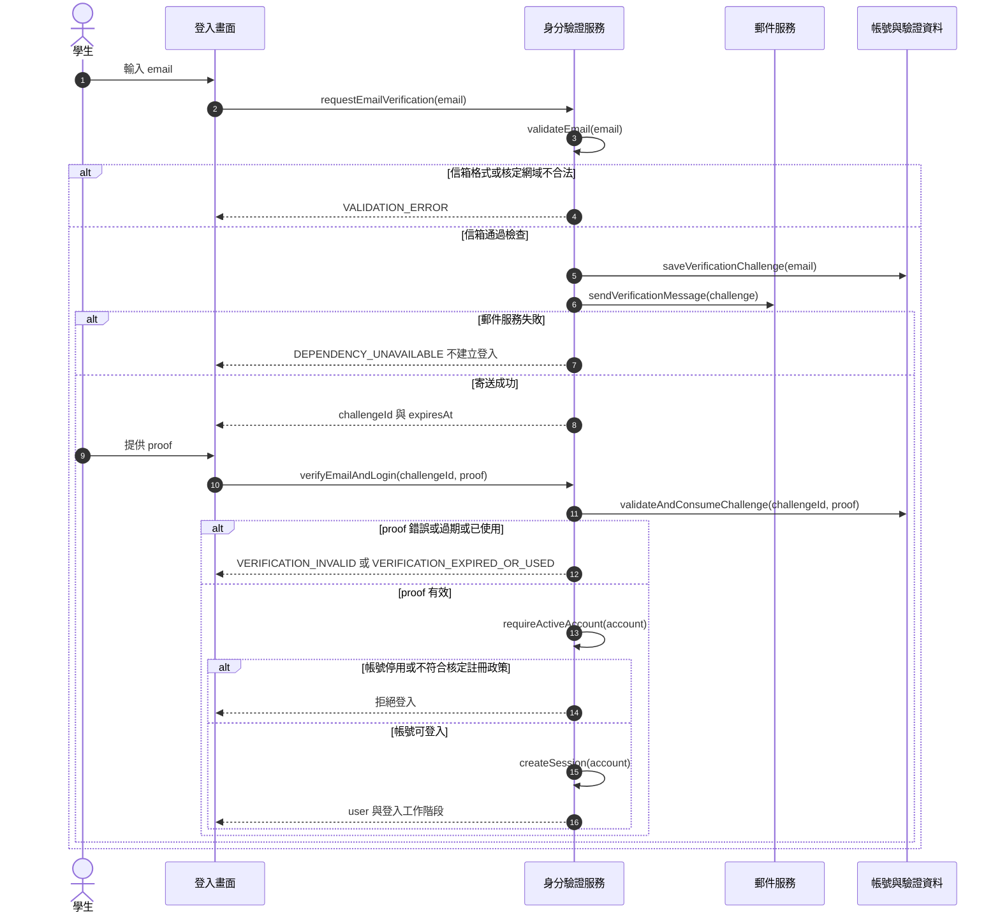

**圖解說明：**`requestEmailVerification()` 只核發並寄送驗證挑戰，不代表已登入。`verifyEmailAndLogin()` 才負責驗證 proof 與建立工作階段。`validateAndConsumeChallenge()` 是內部函式，驗證成功與標記已使用須原子處理，因此同一 proof 不能同時登入兩次；未註冊帳號如何建立仍依 B-01。每次存取訂單或管理功能都需再次執行身分有效性及 `authorize()`，不能因曾經登入就略過停用檢查。

## 6.2 商家營業與菜單管理

**對應需求：**FR-004 至 FR-009。此類功能維護「之後可供下單的設定」，不修改已成立訂單的商品與價格快照。

| 主要 function | 管理資料 | 成功輸出 | 必要檢查 |
| --- | --- | --- | --- |
| `createMerchant()`、`updateMerchant()` | 商家名稱、位置、聯絡、取餐說明及啟停 | 商家資料與版本 | 管理範圍、欄位格式與版本 |
| `updateBusinessSchedule()`、`canAcceptOrders()` | 營業時間、休息日、接單開關 | 新設定或當下可否接單 | 使用伺服器時間及校園時區 |
| `savePickupSlot()`、`listBookableSlots()` | 當日取餐時段與容量 | 時段設定或可預訂清單 | 日期、起迄、容量及已占用量 |
| `createProduct()`、`updateProduct()` | 商品、圖片、價格、上下架 | 商品資料與版本 | 商家歸屬、格式與可售條件 |
| `configureOptions()`、`validateSelections()` | 選項群組與加價 | 選項設定或有效選擇 | 必選／可選及商品歸屬 |
| `adjustInventory()`、`checkAvailability()` | 有限／不限量、可用量、售完 | 庫存設定或供應判斷 | 不得負值；模式切換依 B-05 |

### 圖 6 2 管理設定的共通更新流程

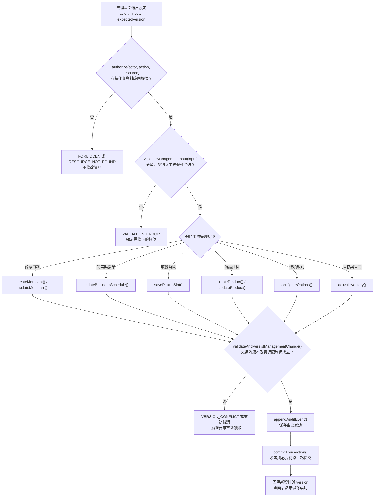

**圖解說明：**這是多個管理 function 共用的檢查模式，不表示一次呼叫會同時修改六種設定。每次只走一條功能分支；新增資料不要求舊版本，修改資料才檢查 `expectedVersion`。`validateManagementInput()` 與 `validateAndPersistManagementChange()` 為內部協作函式，仍需在各功能中檢查特有條件，例如時段容量不可低於核定規則下的占用量、有限庫存不可負值。重要紀錄或提交失敗時，不得顯示成功；無法確認提交結果時先重新讀取，不能假設變更未生效。

### 圖 6 3 帳號商家與商品類別圖

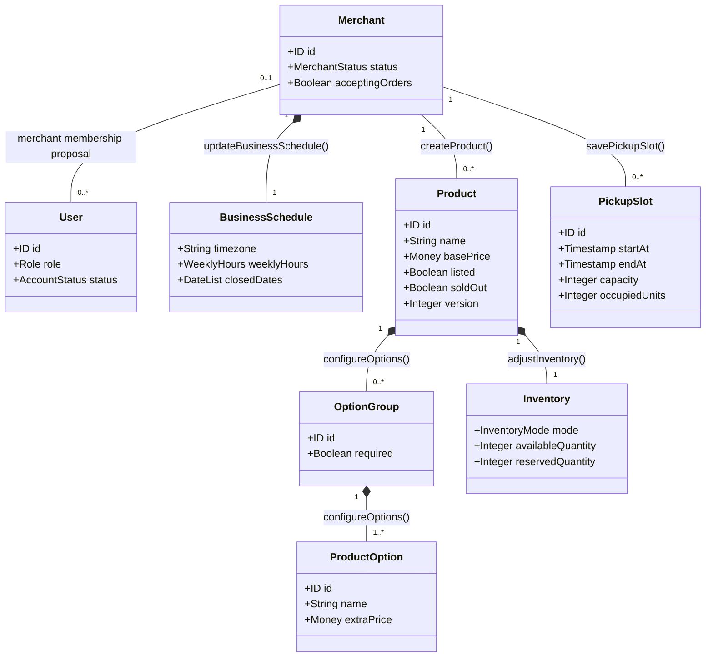

**圖解說明：**線旁的 function 表示哪個功能建立或維護此關聯，不是類別之間執行順序。`1` 表示恰一個，`0..*` 表示零到多個；沒有選項的商品可以沒有 OptionGroup。組合關係表示邏輯所有權，不授權刪除歷史訂單。商家帳號可否管理多店仍待 B-02；庫存不限量時數量可為 null，售完仍不可送單。

## 6.3 購物車與價格確認

**對應需求：**FR-010 至 FR-013；快照由正式送單呼叫建立，購物車及報價階段不保留資源。

| 主要 function | 做什麼 | 結果 |
| --- | --- | --- |
| `addCartItem()`、`updateCartItem()`、`removeCartItem()` | 維護同店的餐點、數量、選項與備註 | 更新後購物車 |
| `switchCartMerchant()` | 跨商家前取得確認 | 確認才清除舊內容；拒絕則維持原購物車 |
| `calculatePrice()` | 以有效單價、加價與數量計算 | 每行小計與訂單合計 |
| `quoteOrder()` | 重新檢查明細並提供報價 | quoteId、明細、差異提示 |
| `validateAcceptedQuote()` | 送單時確認報價仍對應同一內容與價格 | 通過或 QUOTE_CHANGED |
| `buildOrderSnapshot()` | 成立訂單時固定名稱、選項、數量及價格 | 不隨菜單改動的訂單快照 |

### 圖 6 4 購物車至確認報價的函式流程

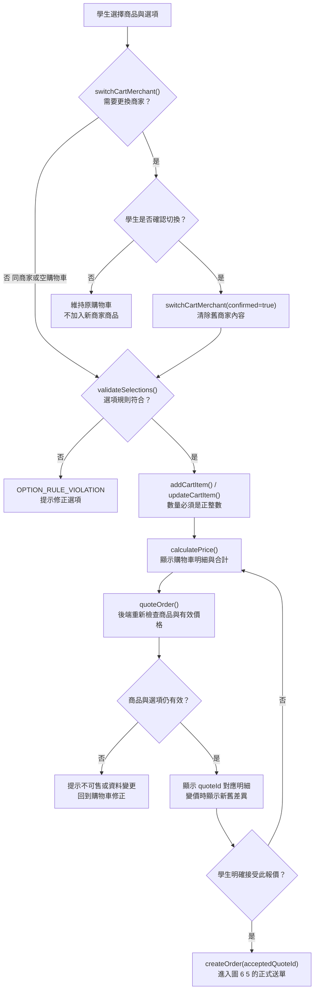

**圖解說明：**`calculatePrice()` 的前端顯示不是正式成交依據，後端仍需重新計算。學生接受 quoteId 後，若正式送單時價格又改變，`validateAcceptedQuote()` 應拒絕並要求再次確認；不能只比較總額，也要確認品項、選項與數量。`removeCartItem()` 可在購物車階段刪除明細後重新計算，本圖以新增與修改為主要路徑。`buildOrderSnapshot()` 只在送單成功交易內執行，避免把尚未確認的價格寫成歷史訂單。

## 6.4 送單去重與資源保留

**對應需求：**FR-014、FR-015、FR-018、NFR-002。將原 `createOrder()` 偽程式碼拆成「辨識同一次操作」「建立訂單交易」「保留資源」三張圖，避免單圖同時擠入所有例外。

| function | 角色 | 輸入與結果 |
| --- | --- | --- |
| `createOrder()` | 主要入口 | actor、key、商家、時段、items、acceptedQuoteId → 訂單或明確結果 |
| `executeIdempotently()` | 操作去重協作函式 | actor、key、requestHash、command → 原結果、處理中或執行一次 |
| `buildOrderSnapshot()` | 快照建立 | 通過驗證的報價與品項 → 訂單明細快照 |
| `reserveFiniteInventoryConditionally()` | 內部資源函式 | 按商品彙總的需求 → 庫存保留成功或不足 |
| `occupySlotConditionally()` | 內部資源函式 | slot、核定單位的 units → 容量占用成功或額滿 |
| `applyCancellationResources()` | 取消時的內部函式 | 訂單、原狀態、核定政策 → 原保留釋回或維持已耗用 |

### 圖 6 5 createOrder 與同一次送單辨識

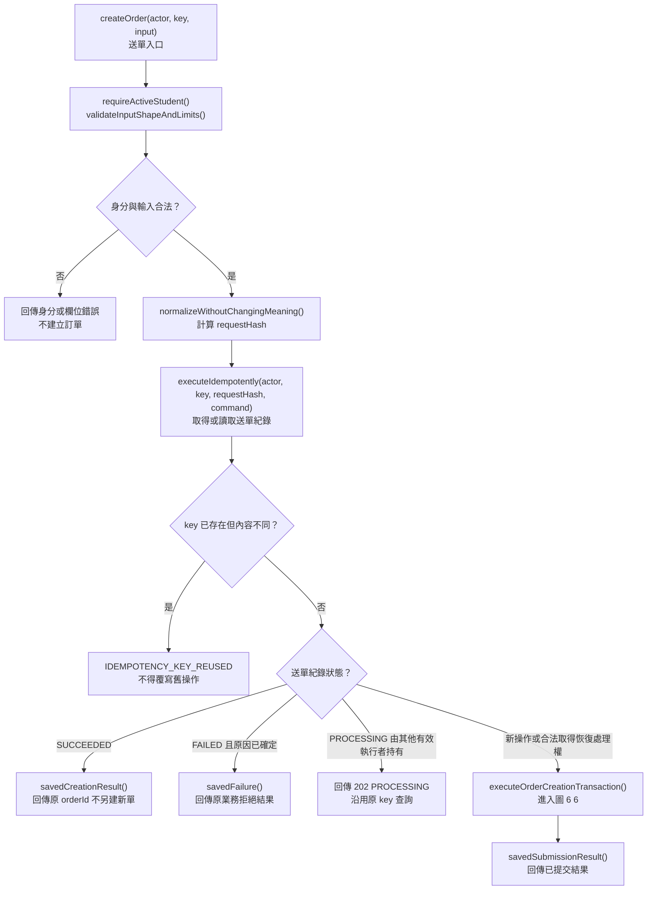

**圖解說明：**`key` 識別「這一次送單」，`requestHash` 識別「這次送單的內容」。雙擊或網路重送必須使用同 key 與同內容，才可拿回原結果。已確定失敗後，學生修改草稿並重新確認，才建立新操作與新 key。結果未知或執行者當機時，先查持久紀錄並取得恢復處理權，不能只因等太久就另建訂單。`executeOrderCreationTransaction()` 是內部函式，對應下一張圖。

### 圖 6 6 executeOrderCreationTransaction 建立訂單交易

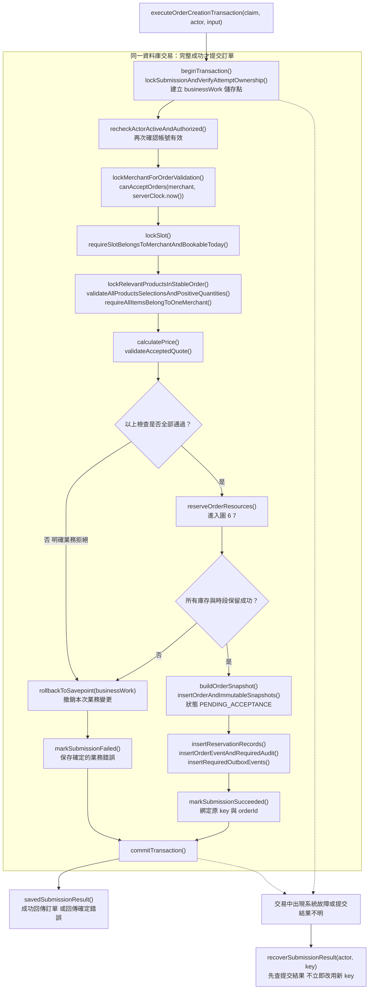

**圖解說明：**由上往下依序檢查帳號、商家、時段、商品、選項與價格；每個驗證函式一旦拒絕，就直接走回滾分支，不再執行後續寫入。圖中的集中菱形用來簡化呈現，並非等所有驗證都執行完才處理已發現的錯誤。

`reserveOrderResources()` 成功後，才建立訂單快照與事件；它仍在同一交易內，若後續任何必要寫入失敗，資源保留也必須回滾。`markSubmissionFailed()` 僅適用於庫存不足、額滿、報價變更等已知業務拒絕；資料庫斷線或 commit 回覆遺失，不等於已知失敗。

虛線代表整個交易期間都可能發生的系統故障，不只起點或提交兩處。`recoverSubmissionResult()` 是內部恢復函式：能確定尚未提交時回滾；無法確定時保留同 key 查核，禁止直接重建。寄信及推送由已提交事件驅動，不放進此交易等待完成。

### 圖 6 7 reserveOrderResources 庫存與容量一起保留

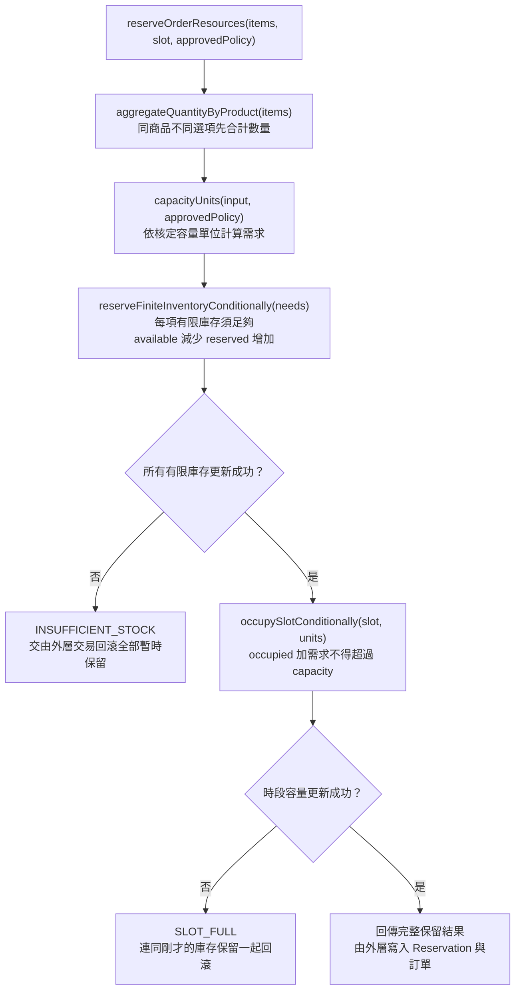

**圖解說明：**例如同商品分成兩行、各兩份，須按四份檢查，不能各自通過兩份檢查就超賣。商品保留成功而時段失敗時，前面的商品保留也要撤銷。不限量商品不扣有限數字，但仍需通過上架、供應及售完檢查。時段需求不得直接假設「每單一份」，須依 B-04。

這張圖取代原 SQL 範例，重點是條件更新及整單回滾，不限定資料庫語法。`reserveOrderResources()` 為內部協作函式，不提供前端直接占庫存或占容量的 API。

### 圖 6 8 訂單快照保留與事件類別圖

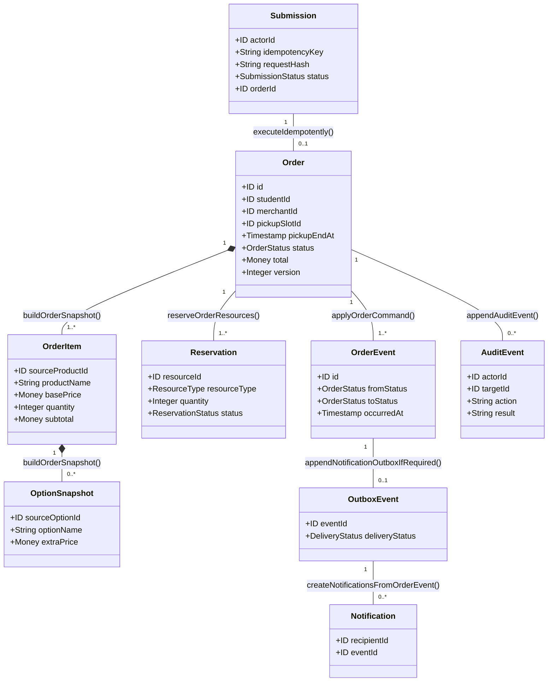

**圖解說明：**Submission 對 Order 的 `0..1` 表示同次送單可以尚未成立、失敗，或最多成立一單。OrderEvent 的第一筆由 `createOrder()` 建立，後續由 `applyOrderCommand()` 追加；線旁函式是主要維護者，不排除建立階段。OrderItem 與 OptionSnapshot 是快照，不從新菜單重算歷史訂單。Reservation 記錄「原本保留多少」，取消時以它釋回，不能看目前購物車推算。

通知與 AuditEvent 均是可追溯資料；通知失敗不重跑訂單變更。庫存保留的 RESERVED、CONSUMED、RELEASED 與時段占用的處理需分清，接單後時段政策仍待 B-09。

## 6.5 商家接單備餐與取消

**對應需求：**FR-016 至 FR-018。`acceptOrder()`、`markOrderReady()`、`cancelStudentOrder()`、`rejectOrCancelMerchantOrder()` 是用途明確的入口，內部共用 `applyOrderCommand()`，但各入口有不同角色與狀態限制。

### 圖 6 9 訂單狀態與 function 對照

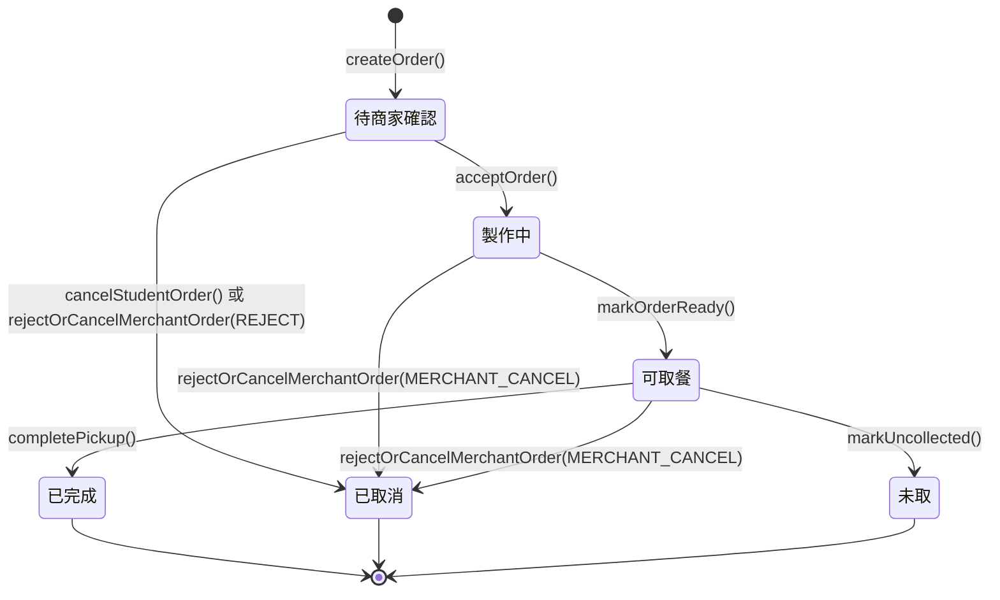

| function 與動作 | 必要條件 | 成功狀態與資源效果 |
| --- | --- | --- |
| `acceptOrder()` | 所屬商家；待確認 | PREPARING；原有限庫存保留轉耗用，不再扣一次可用量 |
| `markOrderReady()` | 所屬商家；製作中且已備妥 | READY_FOR_PICKUP；保存 readyAt |
| `cancelStudentOrder()` | 本人；仍待確認 | CANCELLED；釋回原有限庫存與時段保留一次 |
| `rejectOrCancelMerchantOrder(REJECT)` | 所屬商家；待確認；有原因 | CANCELLED；釋回原保留一次 |
| `rejectOrCancelMerchantOrder(MERCHANT_CANCEL)` | 所屬商家；製作中或可取餐；無法供應且有原因 | CANCELLED；不補回已耗用庫存，時段依 B-09 |
| `completePickup()` | 所屬商家；可取餐；核對碼且確認交付 | COMPLETED；保存 completedAt |
| `markUncollected()` | 所屬商家；可取餐；嚴格超過時段且未交付 | UNCOLLECTED；保存 uncollectedAt 並保留 readyAt |

**圖解說明：**線上顯示的是觸發轉換的 function，不能把箭頭當作無條件允許。必須同時滿足表中的身分、狀態、時間與資料條件。最後三個狀態都是終止狀態，沒有新操作可以把它們改回前面；同一已成功 commandId 的重試只取回原結果，不算新轉換。

### 圖 6 10 applyOrderCommand 共用命令檢查與提交

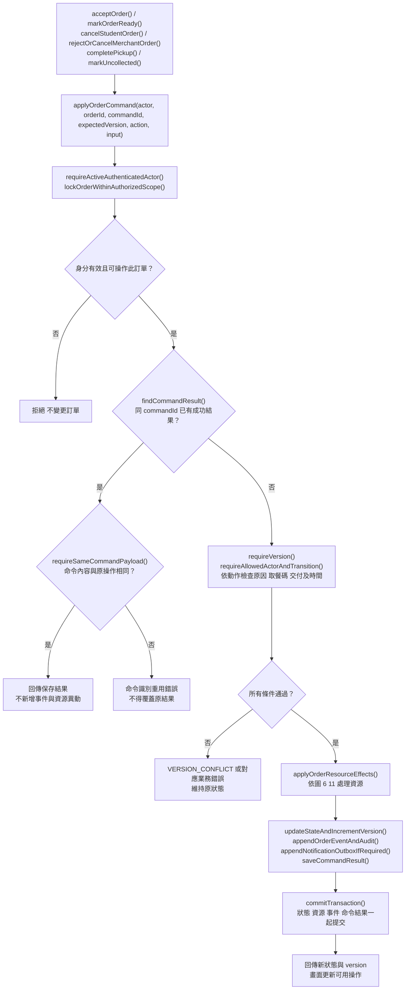

**圖解說明：**先查既有 commandId 的成功結果，再檢查新操作的 expectedVersion，才能讓成功操作的重播正常取回結果。否則原操作已把版本從 1 改成 2，重送版本 1 就會被誤報成失敗。即使重播也須先驗證當前帳號及資料權限。

取得命令處理權、訂單鎖與後續寫入應在一致交易策略內。圖中任何失敗都須結束或回滾尚未完成的交易；`applyOrderResourceEffects()` 或事件寫入失敗時，不能保留部分狀態變更。提交結果不明仍沿用原 commandId 查核，不直接發出新的狀態命令。

### 圖 6 11 applyOrderResourceEffects 依動作處理原保留

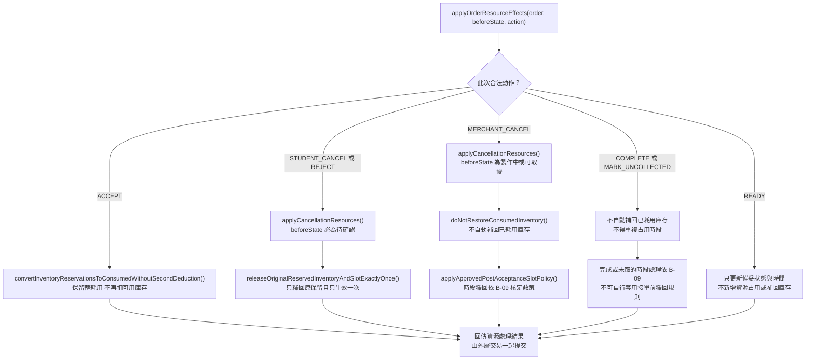

**圖解說明：**`beforeState` 是變更前狀態，必須先保存；不能先把訂單改為 CANCELLED，再猜測有沒有接單。接單前取消與拒單釋回原保留；接單後取消維持耗用，不自動補庫存。`applyCancellationResources()` 為 FR-018 的內部 function，具體釋回使用原 Reservation 紀錄和條件更新，防止重試補回兩次。

本圖假設角色與狀態已通過圖 6 10 檢查，不能單獨暴露為前端資源操作 API。B-09 尚未決議的分支須在正式實作前定案，不以「預設全部釋回」或「預設全部不釋回」取代核定。

### 圖 6 12 acceptOrder 與 cancelStudentOrder 的競爭

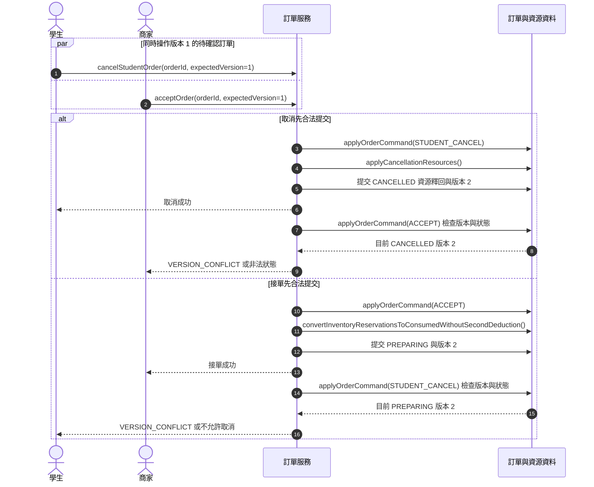

**圖解說明：**哪個請求先抵達畫面或按鈕先被點，不等於哪個先成立；以實際合法提交順序為準。後者不能覆寫前者，學生與商家畫面都應重新取得最新狀態。圖中向 DB 的箭頭表示 function 所需的交易讀寫，不表示資料庫直接執行應用程式 function。

## 6.6 取餐核對與未取處理

**對應需求：**FR-019、FR-020。兩個 function 都只能由所屬商家對可取餐訂單執行，但判斷條件不同。

### 圖 6 13 completePickup 與 markUncollected 的分流

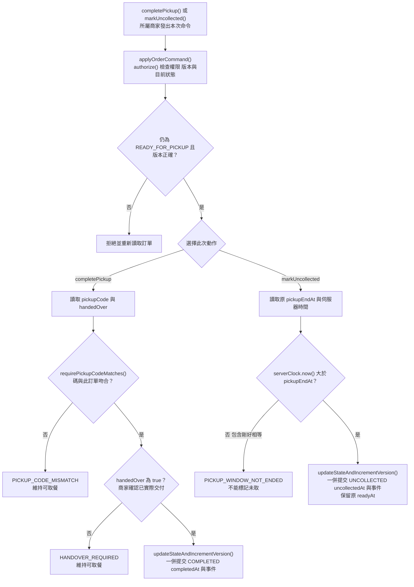

**圖解說明：**本圖只展開尚未成功執行的新命令；相同 commandId 的成功重播，先依圖 6 10 回傳原結果，不再要求訂單仍是可取餐。本圖中的檢查與修改屬同一次 `applyOrderCommand()`，不表示先檢查一次、離開交易後才另外修改。最後提交時仍需保證狀態與版本符合，避免核碼期間另一請求已取消或標記未取。

`completePickup()` 必須同時核對碼及收到商家交付確認，系統不能感測實際交付；`markUncollected()` 則使用伺服器時間，嚴格「超過」時段才可成立。例如結束時間為 12:30:00，剛好 12:30:00 不可標記，12:30:01 才符合時間條件。完成與未取若競爭同一版本，只有一個終止狀態可成功。

## 6.7 訂單查詢與站內通知

**對應需求：**FR-021 至 FR-023。查詢與通知分開：通知提醒發生了什麼，訂單查詢提供目前權威狀態。

| 主要 function | 用途 | 成功輸出 |
| --- | --- | --- |
| `listMyOrders()`、`getOrderDetail()` | 學生查本人、商家查所屬訂單 | 訂單列表或快照與目前狀態 |
| `createNotificationsFromOrderEvent()` | 已提交事件轉成授權收件通知 | 去重後的站內通知 |
| `listNotifications()` | 查目前使用者可讀通知 | 通知列表與分頁資訊 |
| `loadMerchantOrderBoard()` | 載入商家未處理訂單及提示 | pendingCount、orders、asOf |
| `refreshOrderBoard()` | 重新同步或取得增量更新 | 最新狀態；失敗顯示 stale、offline 或 error |

### 圖 6 14 已提交事件與畫面更新循序圖

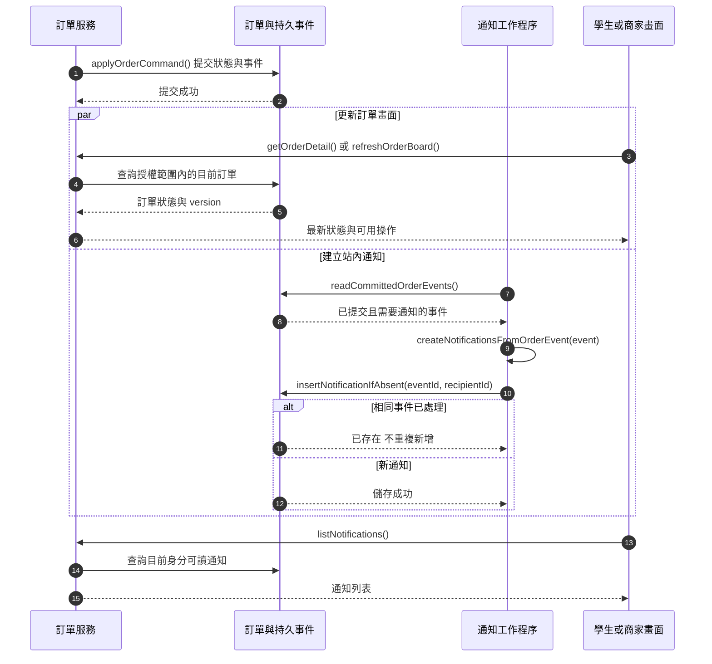

**圖解說明：**`readCommittedOrderEvents()` 與 `insertNotificationIfAbsent()` 為內部函式。工作程序重試時以 eventId 與 recipientId 去重，不能因重試再接單、再取消或再占庫存。通知派送失敗可重試，但訂單查詢應仍顯示已提交狀態。新單提示可由商家訂單列表取得，不因此強制新增學生的新單通知；收件角色依 B-10。

網路中斷時，`refreshOrderBoard()` 不可把讀取失敗顯示成「沒有訂單」，也不可宣告狀態操作成功。畫面收到較舊 version 時不得覆蓋較新狀態；恢復連線後重新同步。正常更新速度仍依 NFR-003 的核定目標。

## 6.8 管理查詢統計與稽核

**對應需求：**FR-024 至 FR-026。此類功能依既有資料查詢、計算及追查，不授予修改歷史價格或任意改寫終止狀態的能力。

| 主要 function | 輸入 | 輸出與限制 |
| --- | --- | --- |
| `searchOrders()` | actor、商家、日期、狀態及分頁 | 管理範圍內的訂單紀錄；無資料為空列表 |
| `getOperationalStatistics()` | actor、期間與核定計數定義 | 訂單量、取消量、未取量與商品備餐數量；無財務報表 |
| `appendAuditEvent()` | 系統辨識的操作者、動作、目標及結果 | 重要異動紀錄；不接受前端假造成功事件 |
| `searchAuditEvents()` | actor、時間及對象等條件 | 授權可讀的異動紀錄；不回傳秘密資訊 |

### 圖 6 15 管理查詢的共通處理

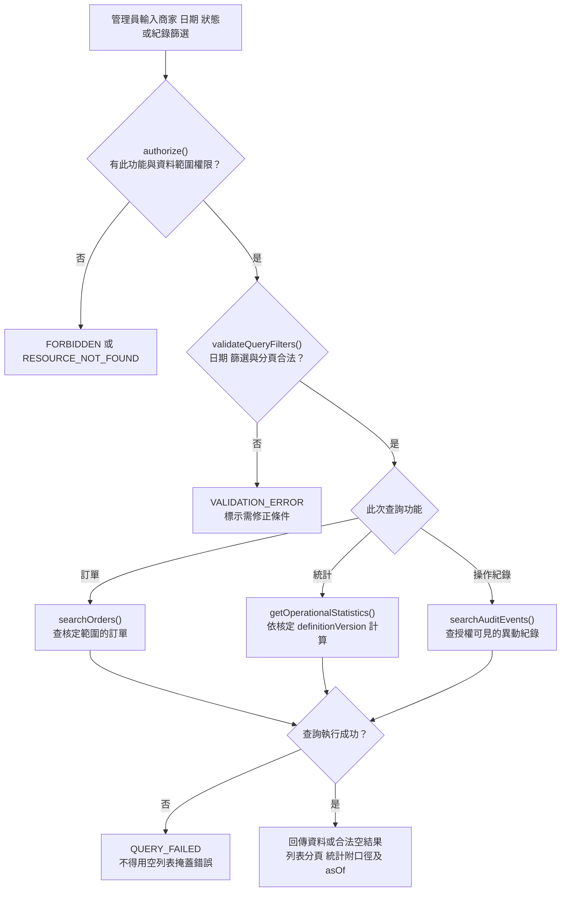

**圖解說明：**`validateQueryFilters()` 是內部函式，查詢中的 merchantId 不能擴大管理員本來的範圍。統計仍需 B-11 確認日期與狀態計數口徑；範例 function 不代表口徑已核定。`appendAuditEvent()` 不在查詢分支中，它由帳號、商家、菜單、訂單的重要異動流程寫入，再由 `searchAuditEvents()` 查閱。

成功業務異動與必要稽核應一致提交；失敗請求紀錄另行標示失敗，不假造成功。稽核更正以追加事件表達，保存與清除依 B-12。功能圖未增加付款、退款、收款狀態或財務對帳功能。

# 7 函式契約與實作設計建議

本章及各 FR 的「函式規格與實作方向」將需求細化成可討論的程式介面。所有 API 路徑、英文欄位名、HTTP 狀態、commandId、版本欄位、分頁與資料表安排均屬設計提案，須隨 SRS 審查及設計定版；業務規則仍以原 FR、NFR 與核定決議為準。函式名稱不表示已有程式碼或已完成整合測試。

## 7.1 輸入與輸出共同契約

| 類型 | 定義與合法值 | 非法值或處理原則 |
| --- | --- | --- |
| ID | 伺服器核發的穩定識別，外部視為不透明字串 | 格式不符、查無或越權；不可僅以「存在」判定有權使用 |
| String | 明確規定必填性及長度，必填文字去除前後空白後非空 | 不把 null、缺漏、空字串混為同義；長度上限需核定 |
| Integer | 數學上的整數；數量通常大於 0，容量與可用庫存不小於 0 | 負數、小數、溢位及非數值不得隱式轉換後接受 |
| Boolean | JSON true 或 false | 不接受字串 "true" 或數值 1 自動當作 true 的模糊契約 |
| Money | 固定精度十進位字串或經核定的最小貨幣單位整數 | 禁用會改變金額的隱式浮點進位；精度及零元政策見 B-06 |
| Date 與 Time | ISO 格式日期與時間；以核定校園時區解釋 | 不存在的日期、時分值及未定義跨日區間須拒絕 |
| Timestamp | 含時區偏移的時間點；伺服器產生權威事件時間 | 不使用手機時間決定未取、營業或權限有效性 |
| Enum | 本契約列出的固定值 | 未知值直接拒絕，不默認成第一個狀態 |
| Array | 元素逐一驗證，明定是否可空及是否允許重複 | 不得因只驗證第一項而放過混店、重複選項或無效數量 |
| AuthContext | 後端由登入狀態解析的使用者、角色與範圍 | 不採信 body 中的 role、studentId、管理權限或任意 merchantId |

建立與修改只接受該介面的欄位白名單。PATCH 的缺漏欄位代表不修改；null 是否代表清除必須逐欄明定，不能清除必填內容。所有文字在輸出時按顯示情境編碼；備註、商品名及拒單原因不得直接當 HTML 執行。

建議成功回應採 `{data,requestId}`，列表資料以 `{items,nextCursor}` 表達；空查詢為成功空列表，不等同錯誤。成功送單的 response 與目前訂單狀態可能因後續接單而不同，重試應先識別原 orderId，再查目前狀態，不重建訂單。

建議錯誤回應如下。欄位錯誤可以包含可修正欄位；正式回應不得含資料庫 SQL、堆疊、驗證 proof、完整取餐碼或其他使用者資料。

```json
{
  "error": {
    "code": "INSUFFICIENT_STOCK",
    "message": "部分餐點庫存不足，請調整數量後重新確認。",
    "fields": [{"path": "items[0].quantity", "reason": "available quantity exceeded"}],
    "retryable": false
  },
  "requestId": "req_example_01"
}
```

`retryable` 表示可否重試同一次請求，不是要求自動建立新訂單。業務資料已修正並重新確認後應建立新操作；結果未知則沿用原 key 查詢。請求 ID、操作 ID、訂單 ID 各有不同用途，不以單一欄位混用。

## 7.2 錯誤分類與畫面處理

各函式已列出對應業務錯誤，以下統一 HTTP 與 UI 的處理方向。同一種語意錯誤應採一致契約；實際代碼命名由 API 設計定版。

| 類別 | 建議 HTTP | 代表代碼 | 畫面與後續行為 |
| --- | --- | --- | --- |
| 格式或欄位不合法 | 400 或統一採 422 | VALIDATION_ERROR、OPTION_RULE_VIOLATION | 標示欄位並保留可修正輸入，不變更持久業務狀態 |
| 未登入或驗證失敗 | 401 | UNAUTHENTICATED、VERIFICATION_INVALID | 引導登入或重新驗證；不回傳受保護內容 |
| 帳號停用或動作無權限 | 403 | ACCOUNT_DISABLED、FORBIDDEN | 停止操作，不以隱藏按鈕代替後端拒絕 |
| 資源不存在或資源越界 | 404 | RESOURCE_NOT_FOUND | 使用一致訊息避免揭露其他人的訂單是否存在 |
| 業務條件改變或競爭衝突 | 409 | QUOTE_CHANGED、SLOT_FULL、INSUFFICIENT_STOCK、VERSION_CONFLICT | 顯示最新可授權資訊，讓使用者重新確認；不得靜默改單 |
| 不合法狀態操作 | 409 | INVALID_ORDER_TRANSITION、CANCELLATION_NOT_ALLOWED、PICKUP_WINDOW_NOT_ENDED | 更新畫面狀態與可用操作，不直接重送變更 |
| 核對條件未完成 | 422 | PICKUP_CODE_MISMATCH、HANDOVER_REQUIRED | 提示重新核對或確認交付，維持原狀態 |
| 同 key 不同內容 | 409 | IDEMPOTENCY_KEY_REUSED | 不執行；修正操作識別邏輯，不能覆蓋原紀錄 |
| 尚在處理 | 202 | PROCESSING | 非錯誤；保持待確認並用原 key 查詢 |
| 請求頻率限制 | 429 | RATE_LIMITED | 依伺服器允許時間再試，不規避限制 |
| 相依或暫時不可用 | 503 | DEPENDENCY_UNAVAILABLE | 提示服務暫時不可用；若可能已送單，先查同 key |
| 未預期錯誤或一致性故障 | 500 | INTERNAL_ERROR、RESOURCE_INTEGRITY_ERROR、QUERY_FAILED | 顯示失敗或結果待確認，記錄 requestId 供查核，不宣稱操作成功 |

不合法輸入的拒絕只保證業務狀態不改變，仍可留下安全或失敗稽核紀錄。讀取介面應區分「無資料」與「讀取失敗」；修改介面的未知結果不能直接等同交易已回滾。

## 7.3 建議模組責任

MVP 可先以單一應用程式內的模組分工實作，讓訂單、庫存與時段能使用同一交易邊界；此為可行設計方向，不指定部署為多服務。

| 模組 | 責任 | 不應承擔的工作 |
| --- | --- | --- |
| 身分與授權 | 電子郵件驗證、登入、停用檢查、角色與資料範圍 | 不直接決定訂單可否從製作中變成已完成 |
| 商家與菜單 | 商家狀態、營業、商品、選項、價格版本及圖片資產 | 不回寫歷史訂單品名與價格 |
| 報價 | 驗證選項、計價、差異提示、綁定確認內容 | 不在加入購物車或報價時保留庫存 |
| 訂單應用服務 | 編排送單、狀態命令、交易、操作去重與回應 | 不接受任意目標狀態或信任前端合計 |
| 資源管理 | 有限庫存保留／耗用／釋回、時段容量及並行控制 | 不自行取消訂單或決定未核定時段政策 |
| 通知 | 從已提交事件建立站內通知、派送重試與去重 | 不因通知派送失敗重建訂單或重跑接單 |
| 查詢與統計 | 角色範圍、分頁、狀態查詢及核定統計 | 不提供財務對帳或直接修改訂單資料 |
| 稽核與運維 | 重要異動紀錄、監控、備份及恢復驗證 | 不儲存驗證憑證或超出必要範圍的個資 |

## 7.4 資料限制與索引建議

| 資料 | 建議限制 | 保護的需求 |
| --- | --- | --- |
| 送單識別 | UNIQUE(actorId, operationType, key)；payload hash 不可在同 key 下改寫 | 同一次操作不重複建單 |
| 訂單與送單關聯 | 已成立訂單對 submissionId 唯一 | 送單處理者失敗恢復時不重複成立 |
| 狀態命令 | UNIQUE(actorId, orderId, commandId)，保存輸入雜湊與結果 | 接單、取消、完成等重試只生效一次 |
| 訂單明細 | quantity > 0；金額符合核定精度；不得經一般更新改寫快照 | 合法數量與歷史一致性 |
| 有限庫存 | availableQuantity >= 0；reservedQuantity >= 0；模式對應欄位完整性 | 防止負庫存及錯誤釋回 |
| 取餐時段 | capacity >= 0；0 <= occupiedUnits <= capacity；endAt > startAt | 防止超額與無效區間 |
| 資源保留 | 依訂單與資源建立唯一紀錄或唯一保留識別；狀態轉換條件更新 | 相同保留不重複耗用或釋回 |
| 通知 | UNIQUE(eventId, recipientId) | 背景重送不產生重複通知 |
| 取餐碼 | 依 B-07 核定的範圍設定唯一性與碰撞重試 | 不核對到錯誤訂單 |
| 訂單查詢 | 依實際查詢評估 studentId／merchantId、createdAt、status、id 組合索引 | 本人列表、商家接單與管理查詢效能 |

資料庫限制作為最後防線，仍需應用程式把違反限制轉成可理解的業務錯誤。索引數量應依查詢計畫與負載量測決定，不無差別為每個欄位建索引。不得對取餐碼設定未經 B-07 核定的全系統永久唯一限制。

## 7.5 邊界與競爭測試補充

以下測試資料僅用於說明驗證方法，不擴充正式容量與效能要求。AC-xxx 是需求驗收情境，TC-xxx 是本版新增的測試設計範例，尚未執行。

| 案例 | 輸入與情境 | 預期輸出及資料結果 | 追溯 |
| --- | --- | --- | --- |
| TC-001 | 數量依序為 -1、0、1.5、1 | 前三者拒絕；1 在其他條件符合時通過；拒絕不占用資源 | FR-011、FR-014 |
| TC-002 | 同一商品兩行，數量各 2，可用庫存 3 | 彙總需求 4 後整單失敗，不得分行各自通過 | FR-009、FR-014 |
| TC-003 | 兩位學生競爭最後 1 份有限庫存 | 僅一筆成功，另一筆庫存不足；可用量不為負 | FR-015、NFR-002 |
| TC-004 | 兩筆訂單各需 1 容量，時段只剩 1 | 僅一筆成功；失敗筆不能留下庫存保留 | FR-006、FR-015 |
| TC-005 | 同 key、同 payload 並行 10 次 | 最多一張訂單；處理中結果可查回同一 orderId | FR-015 |
| TC-006 | 同 key，第二次更改數量 | 409 IDEMPOTENCY_KEY_REUSED；不覆蓋第一次的結果 | FR-015 |
| TC-007 | 成立已提交但模擬 HTTP 回應遺失 | 沿用原 key 查回訂單，庫存與容量只占一次 | FR-014、FR-015 |
| TC-008 | 第二項庫存保留失敗，第一項已暫時扣除 | 整筆交易回滾，第一項可用量恢復且沒有訂單 | FR-014、NFR-002 |
| TC-009 | 報價後商品價格改變，甚至總額剛好不變 | 明細或價格版本不符即重新提示確認，不靜默成立 | FR-010、FR-013 |
| TC-010 | 學生取消與商家接單使用同版本同時提交 | 僅合法先提交者成功；無已取消卻耗用或製作中卻已釋回的矛盾 | FR-016 至 FR-018 |
| TC-011 | 接單前取消後重播相同 commandId | 回原成功；庫存及時段只釋回一次 | FR-017、FR-018 |
| TC-012 | 時段 endAt 前一秒、相等、後一秒標記未取 | 前兩者拒絕；後者在已備妥且未交付時成功 | FR-020 |
| TC-013 | 正確碼但 handedOver=false；錯誤碼但 true | 兩者皆不可完成；無完成事件與狀態變更 | FR-019 |
| TC-014 | 已登入帳號被停用後再查訂單或接單 | 下一次受保護請求拒絕；不可只等待 token 過期 | FR-003、NFR-001 |
| TC-015 | 換成另一學生或商家的訂單 ID／通知 ID | 查無可讀資源，不回傳品項、取餐碼或個資 | FR-021、FR-022、NFR-007 |
| TC-016 | 成立後商品改名、改價、選項下架 | 歷史快照及合計完全不變，新訂單依新資料確認 | FR-010 |
| TC-017 | 通知工作程序於處理後確認前當機，再處理同事件 | 訂單狀態不重跑，同收件人只一筆通知 | FR-022 |
| TC-018 | 查詢連線失敗、完全無資料兩種情境 | 前者顯示失敗；後者顯示空結果；不得互相混淆 | FR-023、FR-024、NFR-006 |
| TC-019 | 商家停用與學生送單競爭 | 按交易生效順序處理；停用提交後新驗證不得成立 | FR-004、FR-014 |
| TC-020 | 商品手動調庫存與送單競爭 | 依最新版本處理，不能覆蓋已保留數或產生負庫存 | FR-009、NFR-002 |
| TC-021 | 未取與完成交付對同一版本同時提交 | 只有一個終止狀態成立，另一方取得衝突；事件不矛盾 | FR-019、FR-020 |

對 B-04 容量單位、B-09 接單後容量釋回、B-11 統計口徑等未決事項，測試案例須待核定後填入確切期望值；不得以實作目前碰巧產生的值當驗收答案。

## 7.6 送單輸入輸出範例

以下為介面契約示例，假設示範 ID 均存在且屬同一商家、商品仍可售、選項合法、報價經本人確認及資源足夠。範例 ID、取餐碼、金額、日期與時間均是測試資料；正式編碼、幣別與時區設定仍依附錄 B。只複製 JSON 格式並不保證實際業務條件成立。

合法請求範例，標頭使用 `Idempotency-Key: submit_demo_001`，身分由登入工作階段提供：

```json
{
  "merchantId": "merchant_demo_01",
  "pickupSlotId": "slot_demo_01",
  "acceptedQuoteId": "quote_demo_01",
  "items": [
    {
      "productId": "product_demo_01",
      "quantity": 2,
      "selectedOptionIds": ["option_demo_egg"],
      "note": "不要香菜"
    }
  ]
}
```

首次成立回傳 `201`。以下節錄主要欄位，完整回應另含金額幣別、選項明細與時段資訊；示例每份基價 80、加蛋 10，共兩份，合計 180。

```json
{
  "data": {
    "id": "order_demo_01",
    "status": "PENDING_ACCEPTANCE",
    "total": "180",
    "pickupCode": "DEMO47",
    "version": 1,
    "createdAt": "2026-10-24T11:30:00+08:00"
  },
  "requestId": "req_demo_001"
}
```

非法數量範例：其餘欄位沿用上方請求，但將 quantity 改為 -1。這是新的無效操作示例，不能使用已成功的 submit_demo_001，否則首先得到同 key 不同內容衝突。

```json
{
  "error": {
    "code": "VALIDATION_ERROR",
    "message": "餐點數量必須為正整數。",
    "fields": [{"path": "items[0].quantity", "reason": "positive integer required"}],
    "retryable": false
  },
  "requestId": "req_demo_002"
}
```

其他業務非法情境，即使欄位格式正確也必須拒絕：引用另一家商家的取餐時段、借用其他學生的報價、商品已下架、必選選項被移除、庫存不足或時段已額滿。回覆應對應 FR-013 至 FR-015 的語意錯誤；所有案例均不留下新的訂單或資源占用。

---

## 附錄 A 功能與品質驗收

本附錄直接列出驗證方式與通過條件，供驗收時逐項檢查。下列內容是驗收標準，尚不代表測試已執行或通過。執行時應記錄測試環境、輸入資料、實際結果及必要佐證，例如操作畫面、訂單紀錄、資源數量變化或量測報告。

### A.1 功能驗收

| 驗收項目 | 驗證方式 | 通過條件 |
| --- | --- | --- |
| 電子郵件驗證與登入 | 分別使用有效、錯誤、過期及已使用的驗證資料登入，並測試未完成驗證就存取私人訂單。 | 有效驗證可登入；其餘情況不得取得有效登入或受保護資料，並顯示可理解的提示。 |
| 帳號建立與角色授權 | 由授權管理人員建立商家與管理員帳號，再以學生或無授權帳號嘗試相同操作及提升權限。 | 僅授權人員可建立對應帳號及授予其可授予的權限；角色及商家歸屬正確，越權請求被拒絕。 |
| 帳號停用與恢復 | 使用者保持登入時停用其帳號，立即再次查詢或修改受保護資料，之後恢復帳號並依登入流程操作。 | 停用後下一次受保護請求即遭拒；恢復後依核定權限使用功能，歷史訂單關聯仍存在。 |
| 商家資料維護 | 建立商家、修改名稱與位置等資料，再停用商家並嘗試建立新訂單。 | 合法資料可儲存並顯示；不合法必填資料被拒絕；停用後不得成立新訂單，既有訂單紀錄仍保留。 |
| 營業與接單設定 | 在正常營業、非營業時間、例外休息日及暫停接單期間送單，包含從先前開啟的購物車送出。 | 僅在當下接單條件全部符合時成立；舊畫面不能繞過最新接單設定。 |
| 當日取餐時段與容量 | 選擇可用、額滿、失效及跨日的時段送單，並讓兩個請求競爭最後一份可用容量。 | 僅當日可預訂且容量足夠的時段可成立訂單；並行請求不超額，容量以已核定單位計算。 |
| 商品新增修改與上下架 | 新增、編輯、上架及下架商品；使用舊購物車提交已下架商品，並嘗試修改其他商家的商品。 | 合法商品資料可維護；下架商品不可新送單；跨商家修改被拒絕；無效欄位不被儲存。 |
| 客製化選項與加價 | 測試合法選項、漏選必選項、重複選項、選入其他商品選項，以及送單前選項失效。 | 只有符合當前選項規則的組合可成立；合法加價正確顯示及計算，其餘情況提示修正。 |
| 有限庫存不限量與售完 | 分別測試庫存充足、不足、不限量及售完；同商品以不同選項分行並同時送單。 | 有限庫存按同商品總需求檢查且不為負；不限量仍受上下架與售完限制；不足時整單不成立。 |
| 歷史訂單快照 | 成立訂單後修改商品名稱、單價、選項與供應狀態，再重新查看原訂單。 | 原訂單品名、選項、數量、單價、小計及合計不變；後續訂單依新資料重新確認。 |
| 單商家購物車 | 新增、調整及刪除餐點、選項、數量與備註，再加入其他商家商品，分別拒絕及接受切換。 | 購物車始終只有一家商家；拒絕切換時保留原內容；確認後才切換；零、負數及小數數量被拒絕。 |
| 價格明細與合計 | 以多商品、多選項與不同數量計算小計及合計，並竄改用戶端傳入的價格或合計。 | 各項計算符合核定金額精度；訂單採系統端有效價格，不能因用戶端竄改而降低金額。 |
| 送單前變價確認 | 將商品加入購物車後改價，送單時分別拒絕及接受更新後報價；再測試確認後價格又改變。 | 每次影響已確認內容的變更都須再次確認；未確認前不成立訂單、不保留庫存或容量。 |
| 整單建立與失敗回復 | 以完整合法資料送單，再分別製造一項商品不足、選項失效、混店或時段不符的情況。 | 合法資料建立完整訂單；任一條件不符時，沒有部分訂單、殘留明細或資源占用。 |
| 重複送單與結果查詢 | 模擬重複點擊、同一次操作並行重送，以及成立成功但回應遺失後重試或查詢。 | 同一次送單最多成立一張訂單，只占用一次資源；可取得原結果；相同操作識別換成不同內容時被拒絕。 |
| 商家接單與備妥 | 依序執行待確認訂單接單、製作中標記備妥，再測試跳過接單、倒退狀態及其他角色操作。 | 合法流程依序變為製作中及可取餐，保留事件與時間；非法跳轉、過期狀態及越權操作被拒絕。 |
| 學生取消與商家拒單取消 | 學生在接單前及接單後取消；商家以有原因及空白原因拒單或取消；同時執行接單與學生取消。 | 學生僅可在待確認時取消；商家拒單或取消須有原因且符合狀態；競爭時只有符合實際提交順序的一方成功。 |
| 取消後資源處理 | 記錄接單前保留量，取消或拒單後檢查數量並重送相同取消；另測試接單後取消。 | 接單前取消或拒單只釋回原庫存與時段保留一次；接單後取消不自動補回已耗用庫存，時段依核定政策處理。 |
| 取餐核對與交付 | 對可取餐訂單使用正確碼、錯誤碼，以及未確認實際交付的請求；另以學生或其他商家嘗試完成。 | 僅所屬商家核對正確取餐碼且確認實際交付後可完成；錯碼、未交付、無權限及非可取餐狀態均被拒絕。 |
| 超時未取 | 對已備妥訂單在取餐時段結束前、結束當下及結束後標記未取，另測試尚未備妥或已交付訂單。 | 僅所屬商家可對已備妥、嚴格超過時段且未交付的訂單標記未取；保留原備妥時間與未取時間，不補回已耗用庫存。 |
| 本人與所屬商家訂單查詢 | 以不同學生及商家帳號查詢列表與明細，並直接更換請求中的訂單識別。 | 學生僅讀本人訂單，商家僅讀所屬商家訂單；未授權請求不洩露明細或取餐碼；合法查詢正確顯示快照與狀態。 |
| 站內通知 | 分別觸發接單、拒單、備妥、取消及未取，重新開啟通知清單，再模擬同一事件重送。 | 核定收件人可查詢正確事件、訂單及時間；通知不重複、不洩露他人資料；通知重試不重新執行訂單變更。 |
| 商家新單提示與連線失敗 | 新增訂單後查看接單頁，並模擬斷線、載入失敗與恢復連線。 | 顯示新單及未處理訂單；失敗不冒充空列表或操作成功；連線恢復後可同步真實狀態。 |
| 管理訂單查詢 | 以商家、日期、狀態及其組合查詢；測試無資料、錯誤日期及超出管理範圍的條件。 | 結果符合核定日期口徑、所有篩選條件與權限；空結果與查詢失敗可區分；非法條件遭拒。 |
| 基本營運統計 | 使用可手動核對的正常、取消、拒單及未取訂單資料，計算訂單量、取消量、未取量與商品備餐數量。 | 各數值符合核定期間及計數口徑，可由原始資料重算一致；不提供收款或財務對帳資訊。 |
| 重要異動操作紀錄 | 執行帳號停用、商家資料修改、商品改價與訂單狀態變更，再以有權及無權角色查詢紀錄。 | 重要異動可辨識操作者、時間、對象、動作與結果；必要紀錄不遺失，失敗不誤記為成功，未授權者不可查閱。 |

### A.2 品質與範圍驗收

| 驗收項目 | 驗證方式 | 通過條件 |
| --- | --- | --- |
| 加密連線與資料權限 | 檢查使用者通訊是否採 HTTPS，直接對受保護介面執行未登入、停用、跨學生及跨商家請求。 | 通訊使用 HTTPS；伺服器端確實拒絕未授權存取，不僅由畫面隱藏功能。 |
| 訂單與資源一致性 | 模擬最後庫存爭用、最後時段爭用、交易中斷、取消重試，以及完成交付與未取同時操作。 | 無負庫存、超額容量、重複訂單或重複釋回；訂單狀態、資源與事件相符，終止狀態不被新操作回改。 |
| 使用規模與商品容量 | 以約 3000 位學生、30 家商家及每家 100 項商品建立測試資料，執行管理、瀏覽、查詢與送單。 | 依核定規模正常處理各項操作，不因資料量出現遺漏或錯誤；這些數字沿用暫定規模，不視為強制資料上限。 |
| 尖峰回應速度 | 在核定環境、網路與操作比例下模擬 500 人同時在線，量測主要頁面及一般操作的端到端時間。 | 暫定目標為 3 秒內；正式判定須先核定量測對象、統計口徑與測試期間，再依核定標準評估。 |
| 訂單狀態更新速度 | 在正常連線下記錄訂單狀態提交時間及學生、商家畫面顯示新狀態的時間。 | 暫定目標為狀態改變後 10 秒內可見；正式目標與量測方式須先核定，並檢查畫面不被較舊狀態覆蓋。 |
| 裝置與瀏覽器相容 | 在核定手機及桌面瀏覽器清單上，執行登入、購物車、送單、查詢及主要管理流程。 | 所有核定環境均可完成對應角色操作；重要資訊與必要按鈕可讀、可點擊且不被遮擋。 |
| 備份監控與故障恢復 | 檢查備份成果、觸發核定監控情境，並從備份執行恢復演練。 | 備份可用、異常可被監控發現、服務與資料可恢復；恢復時間及可接受資料遺失符合核定標準。 |
| 易用性與異常提示 | 檢查載入中、空資料、成功、失敗、網路中斷、變價確認及跨店切換確認等畫面。 | 使用者可理解目前結果及下一步；未經確認不切換購物車或以新價格成立訂單；未收到系統成功確認不宣告完成。 |
| 個資保存與清除 | 核對各角色可見欄位，依核定政策執行保存期限、清除或去識別流程，並檢查歷史與稽核關聯。 | 僅必要角色可讀必要資料；保存與清除符合核定政策，且不產生不一致或錯誤歸屬的歷史紀錄。 |
| 現場付款與系統範圍 | 檢查學生、商家與管理端畫面及可呼叫介面，並確認訂單完成後的顯示內容。 | 系統無付款、退款、收款狀態或財務對帳功能；價格合計不被當作實收金額，完成訂單不表示已付款。 |

### A.3 驗收紀錄與通過判定

每項驗收應記錄「未執行、通過、未通過或待決議」之一，並附實際結果及可查核的佐證。發現缺陷時記錄影響與修正後重測結果，不能只填寫通過而沒有驗證過程。

涉及尚未核定政策或數值的項目，應先記錄待決議內容，待決議完成後補上明確期望結果並執行驗證；不得把暫定數值或尚無決議的行為當作已通過。實際核定資訊隨驗收紀錄保存，不在此預先指定負責人。

正式上線前，首版必要功能與必要品質要求均須有測試結果，並由業務與驗收窗口核准；仍有未通過或待決議項目時，應記錄處理決議及核准範圍，不能自動視為可上線。

## 附錄 B 需求審查決議清單

本清單列出仍須確認的參數與政策，以及它們對驗收的影響。目前各項均為待決議；未決內容不擴充既有產品範圍，也不視為已核准的實作規則。

| 編號 | 待決議事項 | 對驗收的影響 |
| --- | --- | --- |
| B-01 | 信箱註冊流程、驗證碼或連結、效期、重寄規則、允許網域及郵件服務 | 登入與驗證；須先確定可註冊信箱、驗證成功與失效條件、重寄行為及郵件服務失敗時的處理。 |
| B-02 | 帳號建立授權人、管理權限細分、商家帳號歸屬、管理員自我停用及最後管理員保護政策 | 帳號與管理授權；須先確定誰能建立或授權帳號、商家歸屬範圍，以及管理員停用的允許條件。 |
| B-03 | 停用商家時既有未完成訂單及商家後續操作的處理 | 商家停用後的訂單處理；須確定原有未完成訂單能否接單、備妥、取消或交付，以及哪些角色可操作。 |
| B-04 | 業務時區、跨午夜營業、時段邊界、預訂截止、容量單位、零容量、重疊時段及已占用設定修改規則 | 營業與時段；須確定哪些時間可預訂、每筆訂單占用多少容量、邊界時刻如何判定，以及已占用時段可否修改。 |
| B-05 | 庫存設定是總量或剩餘量、可用保留耗用的轉換、手動調整互動及模式切換限制 | 庫存與取消；須確定設定數量的含義、保留與耗用的轉換，以及人工調整或模式切換後應得到的數量。 |
| B-06 | 商品必填欄位、選項模型、圖片限制、各欄位長度、單筆數量上限、零元與加價規則、幣別與價格精度 | 商品與購物車輸入；須核定必要欄位、合法值、長度與數量界限，以及金額精度與進位後的預期結果。 |
| B-07 | 訂單編號與取餐碼格式、唯一性範圍及核對方式 | 訂單識別與交付核對；須確定碼的格式、不可重複的範圍、碰撞處理及核對成功或失敗的條件。 |
| B-08 | 同一次送單的識別、保留及晚到重試政策、報價有效期間、結果查詢、狀態命令重播及恢復契約 | 送單及狀態操作重試；須確定同一次操作的辨識與保存期限、報價有效性、晚到重試及當機恢復的預期結果。 |
| B-09 | 接單後取消、完成及未取的時段容量釋回政策 | 接單後的時段容量；須分別決定取消、完成及未取是否釋回、釋回多少，以及重試時如何避免重複變更。 |
| B-10 | 各通知事件的收件角色、保存期間、是否需要已讀功能 | 站內通知；須確定每種事件誰能收到與查閱、保存多久，以及是否需要已讀操作及其驗收條件。 |
| B-11 | 查詢日期欄位、統計期間、拒單計數方式、商品備餐數量所含狀態 | 訂單查詢與統計；須確定依成立日或取餐日篩選、期間邊界、拒單如何計數，以及哪些訂單列入備餐數量。 |
| B-12 | 重要異動範圍、個資與操作紀錄保存期限、可見欄位、清除與去識別政策 | 操作紀錄與個資；須確定哪些異動必須記錄、哪些欄位可見、保存多久及如何清除或去識別，才可判定驗收。 |
| B-13 | 支援瀏覽器與版本、裝置、作業系統及最小畫面尺寸 | 相容性與畫面；須核定實際測試的瀏覽器版本、裝置、作業系統與畫面尺寸，避免以未定義環境判定通過。 |
| B-14 | 500 人操作比例、測試環境與網路、測試長度、3 秒統計口徑及 10 秒更新正式目標 | 效能與更新速度；須核定負載操作比例、量測環境、期間與統計方式，並確認 3 秒及 10 秒是否作為正式門檻。 |
| B-15 | 可用率、監控項目、備份頻率與保存、恢復目標及演練驗收條件 | 營運與恢復；須核定監控、備份保存及恢復時間與資料遺失容許範圍，才能判斷演練結果是否通過。 |

每項決議完成後，應保存決議內容、核定日期及實際核准紀錄，將受影響功能的期望結果寫明，再安排驗收。若有條件仍未確認，驗收狀態應維持待決議，不得以目前程式恰好產生的結果取代需求決定。

新增的實作保護、欄位限制、介面與資料結構提案仍須經設計審查，不自動成為產品承諾。已核定內容若再變更，須更新相應規格及驗收條件並記錄版本。
