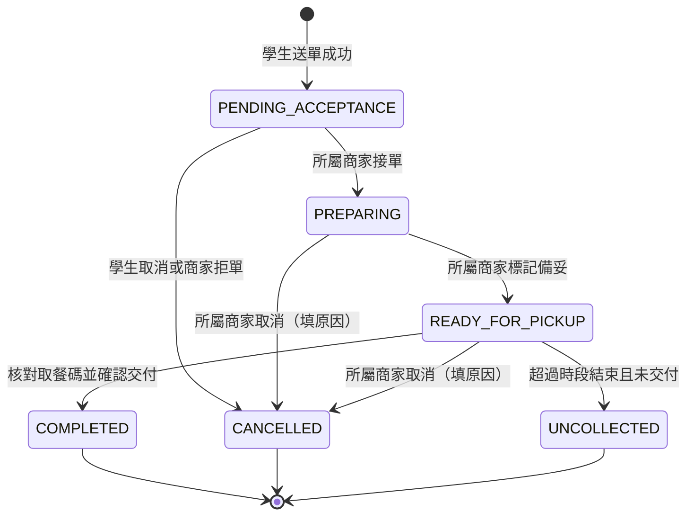

# 校園點餐系統軟體需求規格書

Software Requirements Specification

| 項目 | 內容 |
| --- | --- |
| 專案名稱 | 校園點餐系統 MVP |
| 文件版本 | v0.5 |
| 文件日期 | 2026-10-24 |
| 文件狀態 | 待審查 |
| 需求依據 | 校園點餐系統 Waterfall PRD v0.5（2026-10-23） |

## 文件修訂紀錄

| 版本 | 日期 | 修訂內容 |
| --- | --- | --- |
| v0.1 | 2026-10-23 | 依 PRD v0.5 建立 SRS 初稿，細化功能、狀態、介面及驗證條件 |
| v0.2 | 2026-10-24 | 加入 5 張 UML 圖、26 項函式輸入輸出與合法非法條件、介面契約、交易偽程式碼及邊界測試設計 |
| v0.3 | 2026-10-24 | 保留人工修改；依八類功能整理 function 索引及 15 張圖；將送單、資源與狀態命令的偽程式碼改為附說明的函式流程圖 |
| v0.4 | 2026-10-24 | 附錄 A 改為直接敘述驗證方式與通過條件；附錄 B 移除預設確認窗口，改列待決議事項對驗收的影響 |
| v0.5 | 2026-10-24 | 改寫為純需求規格：重排章節；每個 FR 以「需求」加「條件」表達，AC 與 FR 一對一；移出設計內容；統一用語並將模糊用詞改為可驗證的寫法；補齊驗證方法對照；以〔衍〕〔新〕標示超出 PRD 的內容 |

---

# 目錄

1 簡介　2 參考文件　3 具體需求　4 驗證　5 需求追溯　附錄 A 假設與相依　附錄 B 待決議事項（TBD）　附錄 C 範圍界線

---

# 1 簡介

## 1.1 文件目的

本文件定義校園點餐系統首版（MVP）的功能、介面、資料、效能與品質需求，作為需求審查、設計、開發、測試及驗收的共同基準。

## 1.2 產品範圍

**產品名稱**：校園點餐系統。

**範圍內**：單一校園的繁體中文響應式網站，供學生、商家及管理員使用。含電子郵件驗證登入、帳號與權限管理、商家資料與營業設定、菜單與庫存、單商家購物車、當日取餐時段、訂單處理與交付、站內通知、後台訂單查詢與基本統計、重要異動操作紀錄。

**範圍外**：付款、退款、收款狀態、財務對帳與財務報表。學生於取餐時在現場付款，訂單金額僅表示餐點價格合計。多校園、校務 SSO、POS、配送整合、訂單的電子郵件通知亦不在本版範圍。

## 1.3 產品概觀

### 1.3.1 產品觀點

系統為獨立的網站型產品，不依賴既有校務系統。學生以手機瀏覽器預訂餐點，商家與管理員以桌面瀏覽器操作。外部相依僅有電子郵件驗證服務與使用者端網路及瀏覽器（見附錄 A）。

### 1.3.2 產品功能摘要

| 類別 | 功能 | 需求 |
| --- | --- | --- |
| A 帳號登入與權限 | 電子郵件登入、角色授權、帳號停用與恢復 | FR-001～003 |
| B 商家營業與菜單 | 商家資料、營業與接單、取餐時段、商品、客製化選項、庫存 | FR-004～009 |
| C 訂單快照與購物車 | 訂單快照、單商家購物車、價格明細、送單前價格再確認 | FR-010～013 |
| D 送單 | 整單驗證與建立、重複送單與並行一致性 | FR-014～015 |
| E 接單備餐與取消 | 狀態推進、取消與拒單、資源釋回 | FR-016～018 |
| F 取餐與未取 | 取餐核對與交付、未取標記 | FR-019～020 |
| G 查詢與通知 | 訂單查詢、站內通知、商家新單提示 | FR-021～023 |
| H 管理 | 訂單查詢、基本統計、操作紀錄 | FR-024～026 |

### 1.3.3 使用者特性

| 角色 | 可執行事項 | 資料存取邊界 |
| --- | --- | --- |
| 學生 | 瀏覽菜單、維護購物車、送單、查詢訂單、接單前取消 | 僅本人受保護資料及訂單 |
| 商家 | 維護所屬商家的菜單、庫存、營業與時段；接單、拒單、取消、備妥、交付、標記未取 | 僅所屬商家的非公開資料及訂單 |
| 管理員 | 管理帳號與商家；查詢訂單、統計與操作紀錄；協助處理異常 | 僅限管理範圍；不得改寫歷史品項與價格 |

## 1.4 定義與縮寫

| 名詞 | 定義 |
| --- | --- |
| 授權人員 | 經校方核定、可建立商家與管理員帳號的人員，名單依 B-02 |
| 管理範圍 | 管理員可存取的商家與功能範圍，依 B-02 核定 |
| 待處理訂單 | 狀態為待商家確認的訂單 |
| 同一次送單 | 學生對同一份已確認內容所發出的一次送單意圖。重複點擊、網路重試及回應遺失後的重新提交，皆屬同一次送單；修改內容後須重新確認，並視為新的送單 |
| 送單識別 | 使用者端為同一次送單所附、可讓系統判斷多次提交是否屬於同一次送單的資訊 |
| 同一次狀態操作 | 使用者對同一訂單、同一意圖所發出的一次狀態變更（如接單、取消、完成）。重複點擊、網路重試及回應遺失後的重新提交，皆屬同一次狀態操作 |
| 訂單快照 | 訂單成立時保存的商品名稱、單價、選項、加價、數量、小計與取餐時段，不隨菜單異動 |
| 保留 | 訂單成立時，為該訂單預先占用的有限庫存與取餐時段容量 |
| 耗用 | 商家接單後，該訂單所保留的有限庫存視為已實際使用，不再屬於可用庫存 |
| 釋回 | 將原保留的庫存或時段容量退還為可用 |
| 取餐時段 | 學生選擇的當日取餐時間區間，受容量限制 |
| 取餐碼 | 商家交付前用於核對訂單的識別資訊，不代表付款狀態 |
| 受保護操作 | 需已登入且通過角色與資料範圍檢查才可執行的操作 |
| 終止狀態 | 已完成、已取消、未取；進入後不再轉換 |
| 運作紀錄 | 供維運與除錯用的系統日誌，不同於 FR-026 的操作紀錄 |
| 校園業務時區 | 用於判斷營業、當日與時段的單一時區，由 B-04 核定 |
| FR／NFR／CAP | 功能需求／非功能需求／容量與效能指標 |
| AC | 驗收準則，與同編號的 FR 一對一 |
| TBD | 待決議事項，編號 B-01～B-15，見附錄 B |
| RPO／RTO | 可容許資料遺失範圍／故障後恢復服務時間目標 |

訂單狀態：待商家確認 `PENDING_ACCEPTANCE`、製作中 `PREPARING`、可取餐 `READY_FOR_PICKUP`、已完成 `COMPLETED`、已取消 `CANCELLED`（含學生取消、商家拒單、商家取消）、未取 `UNCOLLECTED`。

## 1.5 需求撰寫慣例

- **編號**：`FR-xxx`、`NFR-xxx`、`CAP-xxx`、`EI-xxx`（外部介面）、`DR-xxx`（資料）、`DC-xxx`（設計限制）、`MNT-xxx`（可維護性）。編號由本文件自行管理。
- **編號穩定**：編號於基準版本確定後不得重排或重用；撤銷的需求保留編號並標示「已廢止」，新增需求接續最大編號。
- **需求與條件**：每個編號為一條需求，以「需求」敘述；「條件」是該需求成立所須滿足的細項，一併由該需求的 AC 驗證。「應」表示必要，「不得」表示禁止，需求陳述不含實作手段。
- **來源標記**：未標記者直接承接 PRD 明文；〔衍〕為細化 PRD 意圖，須經審查確認；〔新〕為超出 PRD 明文的安全或品質防護，須經審查核准才成為正式需求。
- **驗證**：功能需求以 AC 驗證（測試）；其他需求的驗證方法見 §4.1。
- **待決議**：需求下方標示「待決議」者，其參數或政策尚待 B-xx 決議；決議前不得作為最終驗收門檻，也不得以暫定值視為已通過。

---

# 2 參考文件

| 文件 | 版本 | 用途 |
| --- | --- | --- |
| 校園點餐系統 Waterfall PRD | v0.5（2026-10-23） | 需求來源 |

---

# 3 具體需求

## 3.1 外部介面需求

### EI-001 使用者介面

**需求**：系統應以繁體中文呈現所有使用者介面，依裝置寬度調整版面，並提供下表七類畫面。

**條件**：
- 系統不得提供付款、退款、已付款、已收款或財務對帳的操作或標示；訂單金額以「價格合計」描述。

| 畫面 | 主要內容 | 相關需求 |
| --- | --- | --- |
| 登入 | 電子郵件驗證、登入狀態、驗證失敗提示 | FR-001～003 |
| 商家與菜單 | 店家資訊、營業與接單狀態、商品分類、圖片、單價、供應狀態、選項 | FR-004～009 |
| 購物車／送單 | 單店餐點、數量、選項、備註、價格明細、當日時段、變價提示、送單確認 | FR-011～015 |
| 學生訂單 | 訂單編號、快照明細、價格、時段、取餐碼、進度、允許的取消操作、通知 | FR-010、016～022 |
| 商家接單／備餐 | 新單提示、待確認、製作中、可取餐、未取訂單；拒單與取消原因；交付核對 | FR-016～023 |
| 商家管理 | 商品、選項、庫存、營業時間、休息日、接單開關、取餐時段 | FR-005～009 |
| 管理後台 | 帳號、商家、訂單篩選、基本統計、操作紀錄 | FR-002～004、024～026 |

### EI-002 畫面狀態與操作結果

**需求**：系統應清楚區分並呈現資料與操作的各種情境。

**條件**：
- 每個資料畫面應分別呈現載入中、資料為空、載入失敗與網路中斷，且提示互不相同。
- 操作結果應分別呈現成功、失敗與狀態衝突；失敗與衝突時應提供下一步操作（重試或重新整理）。
- 系統不得在系統端確認前，顯示送單或狀態修改成功。
- 操作結果不確定時，應顯示「結果待確認」，並提供重新查詢該次操作結果的途徑。〔衍〕
- 失敗訊息應可區分：驗證不符、無權限、供應不足、容量額滿、價格變更、狀態已變更。〔衍〕

### EI-003 外部服務與硬體

**需求**：系統應使用電子郵件驗證服務完成學生身分驗證（服務與規則見 B-01）。

**條件**：
- 驗證服務不可用時，系統不得判定驗證成功，也不得建立未驗證的登入。
- 系統不得以專用讀卡機、出單機、POS、條碼掃描器或相機掃描作為必要條件。〔衍〕
- 系統不得以校務 SSO、POS 或外部配送服務作為相依。

### EI-004 通訊

**需求**：使用者與系統之間的通訊應使用 HTTPS。

**條件**：
- 電子郵件僅用於身分驗證，系統不得以電子郵件發送訂單通知。

## 3.2 功能需求

### 3.2.1 A 帳號登入與權限

#### FR-001 學生電子郵件驗證與登入（Must）

**需求**：系統應允許學生以電子郵件完成驗證後登入。

**條件**：
- 系統不得讓未完成必要驗證者，以已登入身分執行受保護操作。
- 驗證失敗、逾期或已使用時，系統不得建立登入狀態，並應告知原因或重新操作指引。
- 每次驗證憑證只能成功使用一次；並行使用同一憑證時，至多一次成功。〔衍〕

**待決議**：B-01（驗證效期、信箱網域限制、未註冊信箱的處理、重寄規則）。

**AC-001**：(1) 完成有效驗證後可使用學生受保護功能。(2) 錯誤、逾期或已使用的驗證不產生登入狀態。(3) 未登入無法送單或查詢私人訂單。(4) 同一憑證並行兌換兩次，僅一次成功。

#### FR-002 帳號建立與角色授權（Must）

**需求**：系統應僅允許授權人員建立商家與管理員帳號，並依角色與資料範圍，限制各使用者可執行的操作與可查看的資料。

**條件**：
- 建立帳號時應指定角色；商家帳號應指定所屬商家，管理員帳號應指定管理範圍。〔衍〕
- 學生不得透過介面或直接請求，建立高權限帳號或提升自身或他人權限；授予的權限不得超過授予者本身擁有的權限。〔衍〕
- 系統應於每次受保護操作檢查角色與資料範圍；未登入、角色不符或資料不在授權範圍時，應拒絕操作，且不得回傳受保護資料。
- 系統應以已驗證的身分決定操作者，不得採信使用者自行提供的身分、角色、商家歸屬或管理範圍。〔衍〕

**待決議**：B-02（授權人員名單、管理權限細分、商家帳號歸屬模型）。

**AC-002**：以學生、商家、管理員分別操作，各角色僅能執行其允許範圍；修改請求中的使用者或商家識別，不能取得他人資料或權限；學生無法建立商家或管理員帳號。

#### FR-003 帳號停用與恢復（Must）

**需求**：管理員應可停用及恢復帳號；停用後，該帳號不得繼續存取受保護功能。

**條件**：
- 停用生效後，已登入者的後續受保護請求亦應被拒絕。
- 恢復後，系統應依該帳號原核定權限允許其存取。
- 停用期間已失效的登入狀態，不得因帳號恢復而自動重新有效；使用者應重新完成登入驗證。〔衍〕

**待決議**：B-02（是否禁止停用自己或最後一位管理員）。

**AC-003**：帳號保持登入時被停用，其下一次受保護操作被拒絕；恢復後可依權限操作；停用後歷史訂單與紀錄仍存在（DR-003）。

### 3.2.2 B 商家營業與菜單

#### FR-004 商家基本資料管理（Must）

**需求**：管理員應可建立、編輯及停用商家，維護名稱、位置、聯絡方式與取餐說明；被停用的商家不得接受新訂單。

**條件**：
- 必要欄位缺漏或格式不符時，系統不得儲存，並應指出需修正的欄位。〔衍〕

**待決議**：B-03（商家停用後既有未完成訂單的後續處理、商家是否可恢復）。

**AC-004**：建立及編輯後可讀到正確資料；停用後新送單被拒；停用與送單同時發生時，停用生效後才開始驗證的送單不成立；原訂單紀錄仍存在。

#### FR-005 營業時間與接單控制（Must）

**需求**：商家應可設定營業時間、暫停接單及例外休息日；在非營業時間、例外休息日或暫停接單期間，系統不得成立新訂單。

**條件**：
- 系統應於建立訂單時，以當時有效的設定判斷商家可否接單，即使學生先前已開啟菜單或購物車亦同；失敗時應告知商家目前不可接單。
- 不合法的營業設定（不存在的日期或星期、時間格式錯誤）不得被儲存。〔衍〕

**待決議**：B-04（營業時間邊界、跨午夜、重疊區段）。

**AC-005**：在正常營業、非營業、例外休息、暫停接單及營業邊界時刻分別送單，僅符合接單條件者成功；開啟接單開關仍不能於休息日送單。

#### FR-006 取餐時段與容量（Must）

**需求**：商家應可設定當日取餐時段及各時段可接單容量；已額滿、跨日或不可預訂的時段，不得用於成立新訂單。

**條件**：
- 學生僅可選擇當日、可預訂且尚有剩餘容量的時段。
- 並行送單時，各時段的占用總量不得超過其容量。
- 時段結束時間應晚於開始時間，容量不得為負數，剩餘容量不得顯示為負值。〔衍〕
- 已有訂單的時段，不得以修改設定的方式變動該訂單的取餐時間。〔衍〕

**待決議**：B-04（時段長度、截止時間、容量單位、零容量，以及已有訂單的時段調降容量至低於已占用量等細部調整規則）。

**AC-006**：可用時段可選；跨日、額滿及失效時段送單失敗；兩筆請求爭用最後一份容量時，僅一筆成功；修改已有訂單的時段設定後，該訂單的取餐時間不變。

#### FR-007 商品維護與上下架（Must）

**需求**：商家應可新增、編輯、上架及下架所屬商品，維護名稱、分類、圖片、售價及供應狀態；下架或不可供應的商品，不得成立新訂單。

**條件**：
- 上述限制包含由舊購物車送出的情況。
- 必要欄位或格式不符時，系統不得儲存該次更新，並應指出需修正欄位。
- 商家不得新增、修改、上架或下架其他商家的商品。
- 系統應檢查圖片的實際內容是否為允許格式，不符者不得發布。〔衍〕
- 售價不得為負值。〔衍〕

**待決議**：B-06（零元商品可否販售、價格範圍與圖片限制）。

**AC-007**：完成商品新增與修改；下架後以舊購物車送出該商品仍被拒絕；無法修改其他商家商品；偽裝副檔名的檔案被拒絕。

#### FR-008 客製化選項與加價（Must）

**需求**：商家應可為商品設定客製化選項、加價及必選或可選規則；學生須符合規則才能加入購物車。

**條件**：
- 漏選必選項者，不得加入購物車。
- 系統應於送單時重新驗證選項；規則已變更或選項已失效時，應拒絕並提示重新選擇。〔衍〕
- 系統不得接受不存在、已失效、重複選取或不屬於該商品的選項。〔衍〕

**待決議**：B-06（多選的最少與最多數量等進一步選項模型）。

**AC-008**：必選未填不可加入；合法選項可加入並正確計價；送單前選項規則變更時，送單被拒並要求重選。

#### FR-009 庫存模式與供應控制（Must）

**需求**：商家應可將商品設定為有限庫存、不限量或售完；售完或可用庫存不足的商品，不得成立新訂單。

**條件**：
- 不限量商品仍應符合上架、可售及未售完條件，才可成立訂單。
- 同一商品在同一訂單中出現於多筆明細（如不同選項）時，應合併計算所需庫存後再檢查。〔衍〕
- 任何操作（含並行送單與手動調整庫存）下，可用庫存不得為負值。
- 手動調整庫存時，不得影響已為既有訂單保留的數量。〔衍〕

**待決議**：B-05（庫存設定為總量或剩餘量、可用／保留／耗用的轉換、有保留時切換庫存模式的限制）。

**AC-009**：有限庫存不足被拒；不限量在其他條件符合時可送單；售完不可送單；同商品兩行各 2 份而庫存為 3 時整單失敗；並行送單與管理調整後無負庫存。

### 3.2.3 C 訂單快照與購物車

#### FR-010 訂單商品與價格快照（Must）

**需求**：訂單成立時，系統應保存商品名稱、單價、選項與加價、數量及價格明細；後續菜單變動不得影響既有訂單。

**條件**：
- 系統應一併保存所選取餐時段的日期與起迄時間。〔衍〕
- 學生、商家與管理後台查詢同一訂單時，應呈現成立時的明細。
- 任何角色（含管理員）不得修改歷史訂單的品項與價格。
- 訂單合計應等於其全部明細小計之和。〔衍〕

**AC-010**：成立訂單後修改菜單（改名、改價、選項下架），既有訂單的名稱、選項、數量、價格與合計保持不變；新訂單採用經確認的新資訊；管理後台無修改歷史明細的功能。

#### FR-011 單一商家購物車（Must）

**需求**：學生應可新增、調整及刪除購物車中的餐點，並維護數量、選項與備註；購物車內的餐點限同一商家。

**條件**：
- 加入其他商家的餐點前，系統應取得學生明確確認（不得預設同意）；確認後購物車僅含新商家餐點；不確認時，應保留原商家及原購物車內容。
- 餐點數量應為正整數；同一商品的不同選項組合，應可成為各自獨立的明細。〔衍〕
- 加入購物車及價格確認的過程，不得保留庫存或時段容量。〔衍〕

**待決議**：B-06（備註長度與單筆數量上限）。

**AC-011**：可完成新增、調整、刪除；跨店切換有確認；拒絕切換後原購物車不變；送單時含多商家餐點的訂單被拒；數量 -1、0、1.5 被拒絕，1 通過。

#### FR-012 價格明細與合計（Must）

**需求**：系統應於購物車與訂單中顯示商品單價、選項加價、數量、各項小計及價格合計。

**條件**：
- 單項小計為「商品單價加所選選項加價總和」乘以數量；訂單合計為各項小計之和。
- 系統應依系統端的有效價格計算金額，不得採信使用者端提供的合計。
- 系統不得加入本規格未定義的稅費、折扣或運費。〔衍〕
- 系統不得將價格合計呈現為已收款金額。

**待決議**：B-06（幣別、金額精度與進位規則）。

**AC-012**：多商品、多選項、不同數量的計算與手算一致（例：單價 80、加價 10、數量 2，加另一份 50 的商品，合計 230）；竄改使用者端金額不影響系統端計價。

#### FR-013 提交時商品與價格再確認（Must）

**需求**：系統應於送單時重新檢查商品與價格；與學生先前確認的內容不同時，應提示變動內容及更新後明細，並於學生再次確認後才可繼續。

**條件**：
- 變動包含商品、選項、數量、單價或加價；即使合計相同，只要明細不同仍視為變動。〔衍〕
- 系統不得以學生未確認的新價格成立訂單；學生確認後資料再次變動時，應再次檢查。
- 商品已無法供應時，應提示修正購物車，不得以價格確認取代供應檢查。

**待決議**：B-08（價格確認的有效期間）。

**AC-013**：購物車加入後改價，送單會提示且未建立訂單；取消確認則無訂單；再次確認且其他條件符合時才成立；總額不變但明細不同仍需重新確認。

### 3.2.4 D 送單

#### FR-014 整單驗證與建立（Must）

**需求**：系統應於建立訂單前驗證所有送單條件，全部通過才建立訂單；任一條件不符時，不得建立部分訂單。

**條件**：
- 驗證項目：學生帳號有效（FR-003）；商家可接單（FR-004、FR-005）；取餐時段可用且容量足夠（FR-006）；商品可售且選項有效（FR-007、FR-008）；庫存足夠（FR-009）；單一商家與正整數數量（FR-011）；價格已確認（FR-013）。
- 任一條件不符時，不得留下部分訂單、明細或資源占用。
- 全部通過時，應建立一張完整訂單及其明細，狀態為待商家確認，同時保留所需的有限庫存與時段容量（§3.2.9 表 3-2），並提供訂單編號與供核對的取餐碼。
- 訂單、庫存保留、容量占用與事件紀錄應一致成立或一致不成立，不得留下與訂單狀態矛盾的資源紀錄。
- 失敗時，應指出未通過的條件，並指引使用者回到可修正的畫面（購物車、時段選擇或價格確認）。〔衍〕

**待決議**：B-07（訂單編號與取餐碼的格式、唯一性範圍）。

**AC-014**：一項商品不足、數量無效或時段失效時整單失敗，且無殘留明細與資源占用；多項保留中第二項失敗時，第一項的保留一併撤銷；全部有效時才建立完整訂單。

#### FR-015 重複送單與並行一致性（Must）

**需求**：同一次送單被多次提交時，系統應只建立一張訂單，且庫存與時段容量只保留一次；不同學生並行爭用有限庫存或時段容量時，成立訂單的總占用量不得超過可用量。

**條件**：
- 使用者無法判斷送單結果時，應依 EI-002 顯示結果待確認，並可重新取得該次送單結果；不得要求使用者直接以全新操作重建。
- 同一次送單仍在處理時，再次提交不得建立另一張訂單，且應告知仍在處理。〔衍〕
- 以同一送單識別重送、但內容與原送單不一致時，系統應拒絕，且不得覆蓋原送單結果；送單被確定拒絕後，學生修改內容並重新確認，視為新的送單。〔衍〕
- 送單處理因系統中斷而未完成時，系統應能將其恢復為明確結果（成立或失敗），不得永久停留於處理中，也不得僅因等待逾時而另建訂單。〔衍〕
- 僅提出該次送單的學生可查詢其結果。〔衍〕

**待決議**：B-08（同一次送單結果的保存期間、期滿後的晚到重試處理）。

**AC-015**：同一次送單並行重送多次，只產生一張訂單；成功後回應遺失再重試，只得到原訂單；以同一送單識別改數量重送被拒絕且原訂單不變；多筆不同送單競爭最後庫存及容量時不超額；處理中斷後可查回明確結果。

### 3.2.5 E 接單備餐與取消

#### FR-016 正常備餐狀態推進（Must）

**需求**：訂單成立時為待商家確認；所屬商家接單後，系統應將其轉為製作中；商家標記備妥後，轉為可取餐。每次狀態變更前，系統應檢查目前狀態與操作者權限，並記錄事件與時間。

**條件**：
- 系統不得允許跳過接單直接備妥、倒退狀態，或因重複操作再次產生狀態變更。
- 同一訂單被並行操作時，系統應以實際成功的狀態為準，僅讓符合最新狀態的合法操作成功；失敗者應取得衝突提示或最新狀態（例：接單與學生取消、完成與標記未取同時發生時，僅一方成功）。
- 接單時，該訂單保留的有限庫存應視為已耗用，系統不得再次扣減可用庫存。〔衍〕
- 對同一次狀態操作重複提交時，系統應回覆原結果，不得重複產生狀態變更或事件。〔衍〕
- 學生不得接單。
- 管理員不得任意變更訂單狀態，或代替商家宣告交付。〔衍〕

**待決議**：B-05（庫存可用／保留／耗用的轉換細節）、B-08（狀態操作結果的保存與晚到重試）。

**AC-016**：待確認接單、製作中備妥的正常路徑成功；學生不得接單；待確認直接備妥、已取消後接單、對過期狀態提交的操作皆被拒絕；同一成功操作重送只回覆原結果。並行案例見 AC-017、AC-020。

#### FR-017 學生取消及商家拒單或取消（Must）

**需求**：學生僅可取消本人仍為待商家確認的訂單；所屬商家可拒絕待確認訂單，或在製作中、可取餐時因無法供應而取消，且須記錄原因。

**條件**：
- 商家拒單與取消時，應填寫原因，原因去除前後空白後不得為空。
- 合法的取消或拒單應使訂單轉為已取消，並保留操作者、時間與原因。
- 商家接單後，學生不得取消；已完成、已取消、未取的訂單，不得再接受取消。

**AC-017**：學生接單前可取消、接單後被拒；商家拒單或取消缺少原因不成立；學生取消與商家接單同時提交時，只有先合法成立者生效，且無「已取消卻已耗用」的矛盾（FR-016）；對終止狀態訂單取消被拒。

#### FR-018 取消時的資源處理（Must）

**需求**：接單前的學生取消或商家拒單，系統應釋回該訂單原保留的有限庫存與原占用的時段容量，且每份保留只能釋回一次。

**條件**：
- 重複取消或重試，不得重複釋回。
- 接單後取消、訂單完成或標記未取時，系統不得自動補回已耗用的庫存。
- 資源釋回與訂單取消應一致成立，不得出現已取消但仍占用，或已釋回但未取消的狀況。〔衍〕

**待決議**：B-09（接單後取消、完成及未取時的時段容量是否釋回；決議前不得自行預設）。

**AC-018**：接單前取消或拒單後可用資源恢復；重複取消或重試不重複釋回；接單後取消、完成及未取皆不增加有限庫存。

### 3.2.6 F 取餐與未取

#### FR-019 取餐核對與完成交付（Must）

**需求**：系統應僅允許所屬商家對可取餐訂單核對取餐碼；取餐碼與該訂單相符，且商家確認餐點已實際交付後，才可將訂單轉為已完成。

**條件**：
- 系統不得僅憑取餐碼的顯示或輸入而自動完成訂單。
- 取餐碼不符時，不得完成訂單，訂單應維持可取餐。
- 訂單不屬於該商家，或尚非可取餐狀態時，不得完成訂單。
- 訂單完成後再次提交完成操作，不得再次執行交付變更。

**待決議**：B-07（取餐碼格式、唯一性範圍、核對方式、錯碼嘗試限制，以及除訂單所屬學生外是否對其他角色顯示）。

**AC-019**：正確訂單、正確取餐碼、交付確認齊備時可完成；錯碼、未確認交付、其他商家、製作中訂單及學生請求皆不能完成；完成後無任何收款欄位或狀態（DC-002）。

#### FR-020 未取標記（Must）

**需求**：系統應僅允許所屬商家，將已備妥、系統端時間晚於所選取餐時段結束時間、且尚未交付的訂單，標記為未取。

**條件**：
- 等於結束時間不算晚於。〔衍〕
- 標記時，系統應保留原始備妥時間並記錄未取標記時間。
- 超時判斷應以訂單成立時保存的時段結束時間為準，不受事後時段設定變更影響。〔衍〕
- 未取為終止狀態；後續領取由商家線下協調，系統不得回改狀態。
- 系統不得自動將訂單標記為未取。〔衍〕

**AC-020**：時段結束時間 12:30:00 時，12:29:59 與 12:30:00 標記被拒，12:30:01 且已備妥未交付時成功；兩個時間均被保留；不補回庫存；未取訂單不可再轉換；完成與標記未取同時提交時，只有一個終止狀態成立（FR-016）。

### 3.2.7 G 訂單查詢與通知

#### FR-021 訂單查詢（Must）

**需求**：系統應允許學生查閱本人訂單、商家查閱所屬商家的訂單與狀態，明細並依角色顯示可用操作。

**條件**：
- 明細應包含編號、商品與選項快照、數量、價格、取餐時段、狀態；學生訂單頁應顯示取餐碼。
- 商家訂單清單應可依訂單狀態分別檢視（待確認、製作中、可取餐、未取）。
- 使用者改動訂單識別時，不得讀取非授權訂單；資料不存在與無權限的回應應一致，不得洩露他人訂單內容。〔衍〕

**AC-021**：合法角色可查詢自己範圍內的訂單；交換學生或商家帳號後讀取同一訂單，未授權者無法取得任何內容；無資料時顯示空結果。

#### FR-022 可查詢的站內通知（Must）

**需求**：訂單被接單、拒單、備妥、取消或標記未取時，系統應提供可查詢的站內通知，並對應訂單、事件類型與發生時間。

**條件**：
- 系統應僅讓目前有權查看該訂單的使用者讀取其通知；存取權被撤銷後，不得再從歷史通知讀到該訂單內容。
- 同一事件對同一收件者不得產生重複通知；未成功成立的訂單變更，不得產生通知。〔衍〕
- 通知產生失敗不得影響已成立的訂單狀態。〔衍〕
- 通知顯示不得取代實際訂單狀態，使用者仍應能從訂單頁確認結果。

**待決議**：B-10（各事件的收件角色、通知保存期間、是否提供已讀功能）。

**AC-022**：逐項觸發五類事件，均產生對應通知並可重新查閱；非授權使用者讀不到通知；同一事件重複處理後仍只有一則通知。

#### FR-023 商家新單與待處理提示（Must）

**需求**：商家接單頁應顯示新訂單提示，並列出待處理訂單。

**條件**：
- 系統應顯示待處理訂單的總數，不得因僅顯示部分清單而低估。〔衍〕
- 離線或載入失敗時，應依 EI-002 呈現；連線恢復後，應重新取得實際訂單狀態。
- 過期的畫面不得導致對同一訂單重複接單或錯誤覆寫。
- 離線或最近一次更新失敗時，應顯示資料可能過期的提示。〔衍〕

**AC-023**：學生送單後，商家可見提示與待處理訂單；模擬斷線與請求失敗時顯示正確提示，且載入失敗不顯示為「沒有訂單」；恢復後取得實際結果；以過期畫面重複接單被拒或回覆最新狀態。

### 3.2.8 H 管理查詢統計與稽核

#### FR-024 管理後台訂單查詢（Must）

**需求**：管理員應可依商家、日期及訂單狀態（單獨或組合）查詢訂單紀錄。

**條件**：
- 查詢結果應僅含符合全部條件且在管理範圍內的訂單；管理員並可在管理範圍內查看訂單明細。〔衍〕
- 無符合條件的資料時，應顯示空結果；查詢失敗時，不得以空結果呈現。
- 日期區間不合法（例如起日晚於迄日）時，系統應拒絕並提示。〔衍〕

**待決議**：B-11（日期篩選依成立日或取餐日及其時區）、B-02（管理範圍）。

**AC-024**：以商家、日期、狀態及其組合查詢，結果皆符合條件與權限；空結果不顯示為錯誤；查詢失敗顯示錯誤而非空列表。

#### FR-025 基本營運統計（Must）

**需求**：系統應提供訂單量、取消量、未取量及各商品備餐數量的基本統計，呈現範圍受角色與資料權限限制，且不得提供收款或財務報表。

**條件**：
- 每張訂單在各項計數中應只被計算一次，不得因明細行數而重複計算。〔衍〕
- 備餐數量應依訂單快照中的品項數量計算。〔衍〕
- 統計結果應標示統計期間，並可與訂單明細相互核對。〔衍〕

**待決議**：B-11（統計期間、計數日期、備餐數量所含狀態、拒單的計數方式、取消訂單的扣除方式）。拒單的終止狀態為已取消（見 §3.2.9），其是否計入取消量待 B-11 決議。

**AC-025**：依核定口徑建立含正常、取消與未取的已知資料集，各統計值與手算相同；畫面沒有收款或對帳資訊。口徑未核定前，統計僅為試算，不得作為正式驗收結果。

#### FR-026 重要異動操作紀錄（Must）

**需求**：系統應為帳號、商家、菜單與訂單的重要異動保留操作紀錄，供具查閱權限的管理員查詢。

**條件**：
- 每筆紀錄應可辨識操作者、時間、對象、動作與結果，並含足以辨識變更內容的摘要。
- 拒單、取消與未取，應可由操作紀錄追查到對應事件。
- 學生與未授權商家不得查閱操作紀錄。
- 使用者不得修改或刪除操作紀錄；更正應以追加紀錄表示。〔衍〕
- 重要異動成功後，其操作紀錄不得靜默遺失；失敗或衝突的操作如被記錄，不得被標示為成功。〔衍〕

**待決議**：B-12（重要異動清單、保存期限、可記錄的個資範圍）。

**AC-026**：執行帳號停用、商家修改、商品改價與訂單狀態變更後，皆可查到對應紀錄；學生與未授權商家無法查閱；紀錄中不含秘密資訊（NFR-001）。

### 3.2.9 訂單狀態與業務規則

本節為 FR-016～020 的彙整；兩者不一致時，以 §3.2.5、§3.2.6 的 FR 為準。未列出的轉換一律不允許。訂單狀態僅表示備餐與交付進度，不代表學生已付款或商家已收款。

**表 3-1　狀態轉換**

| 原狀態 | 事件與操作者 | 必要條件 | 目標狀態 |
| --- | --- | --- | --- |
| 尚無訂單 | 學生送單 | 整單驗證與資源保留成功 | 待商家確認 |
| 待商家確認 | 所屬商家接單 | 仍為待確認 | 製作中 |
| 待商家確認 | 本人學生取消 | 尚未被商家接單 | 已取消 |
| 待商家確認 | 所屬商家拒單 | 填寫原因 | 已取消 |
| 製作中 | 所屬商家標記備妥 | 已完成備餐 | 可取餐 |
| 製作中或可取餐 | 所屬商家取消 | 無法供應並填寫原因 | 已取消 |
| 可取餐 | 所屬商家完成交付 | 取餐碼核對成功且確認交付 | 已完成 |
| 可取餐 | 所屬商家標記未取 | 超過取餐時段且未交付 | 未取 |
| 已完成、已取消、未取 | 任何人 | 終止狀態 | 不允許再轉換 |

**表 3-2　資源處理**

| 事件 | 有限庫存 | 取餐時段容量 |
| --- | --- | --- |
| 訂單成立 | 保留所需數量一次 | 占用所需容量一次 |
| 成立失敗 | 不留下保留 | 不留下占用 |
| 接單 | 保留轉為耗用，不再次扣減可用量 | 維持占用 |
| 接單前取消或拒單 | 釋回原保留一次 | 釋回原占用一次 |
| 接單後取消 | 不自動補回已耗用庫存 | 待 B-09 |
| 完成或未取 | 不自動補回已耗用庫存 | 不得重複占用；其他釋回政策待 B-09 |

## 3.3 使用性需求

### NFR-006 易用性

**需求**：系統的主要操作應具明確標籤、錯誤提示及操作結果；手機版不得遮擋必要按鈕。

**條件**：
- 主要操作暫定為：登入、加入購物車、送單、取消、接單、拒單、備妥、交付、標記未取（範圍依 B-13 核定）。每個主要操作應有文字標籤，且完成後應顯示成功或失敗結果。
- 手機版畫面不得遮擋送單、確認、取消等必要按鈕。
- 本版未訂定操作完成秒數或滿意度的量化門檻。

載入、空資料、失敗、斷線與衝突各情境的提示，見 EI-002。驗證應在核定的裝置矩陣（B-13）上，執行完整的學生與商家流程。

## 3.4 效能需求

| ID | 需求 |
| --- | --- |
| CAP-001 | 系統應支援初期約 3,000 位學生使用（暫定，B-14）；該數字不得解讀為同時送單量。 |
| CAP-002 | 系統應支援尖峰時段 500 人同時在線（暫定，B-14）。 |
| CAP-003 | 500 人同時在線時，主要頁面與一般操作應於 3 秒內回應（暫定，B-14）。主要頁面與一般操作暫定為：學生的登入、菜單瀏覽、購物車、送單、訂單查詢，以及商家的接單頁與狀態操作，範圍依 B-14 核定。 |
| CAP-004 | 系統應可管理並開放 30 家商家接單（暫定，B-14）。 |
| CAP-005 | 系統應支援每家商家 100 項商品，合計約 3,000 項（暫定，B-14）。 |

### NFR-003 狀態更新

**需求**：正常連線且頁面在前景時，學生與商家應於訂單狀態變更後 10 秒內看到更新（暫定，B-14）。

**條件**：
- 量測起點為系統端狀態變更成功，終點為使用者畫面顯示新狀態。〔衍〕

CAP 數值為首版容量基準，不是帳號、商家或商品的硬性上限，也不表示每秒 500 筆交易。**待決議**：B-14（操作比例、測試環境與網路、測試長度、3 秒統計口徑、10 秒正式目標）。效能測試須同時檢查資料正確性，不得以略過庫存或權限檢查取得較快回應。

## 3.5 邏輯資料需求

下列為業務可觀察的資料與規則，不是資料庫設計。欄位型別、鍵、索引與儲存產品由 SAD／SDD 定義。

| 資料實體 | 必要資訊 | 規則 |
| --- | --- | --- |
| 帳號與授權 | 帳號識別、電子郵件、角色、啟停狀態、商家歸屬或管理範圍 | 停用後拒絕受保護存取；不破壞歷史關聯 |
| 商家 | 名稱、位置、聯絡方式、取餐說明、營業設定、例外休息日、接單狀態 | 商品、時段及訂單皆有商家歸屬 |
| 商品與選項 | 名稱、分類、圖片、單價、供應狀態、選項規則與加價、庫存模式與可用量 | 有限庫存不得為負；下架及售完不得新送單 |
| 取餐時段 | 所屬商家、日期、起迄時間、容量、占用資訊 | 限當日可預訂；占用不得超過容量 |
| 購物車 | 學生、商家、餐點明細、數量、選項、備註 | 單一商家；不保留資源 |
| 訂單主檔 | 訂單識別、學生、商家、取餐時段、取餐碼、合計、目前狀態、成立時間 | 每單一位學生、一個商家、一個時段；不含收款狀態 |
| 訂單明細快照 | 商品名稱、單價、選項、加價、數量、小計、備註 | 成立後不隨菜單更動；合計可由快照重算 |
| 送單結果 | 學生、該次送單內容摘要、處理結果、對應訂單 | 同一次送單至多對應一張訂單（FR-015） |
| 資源保留 | 訂單、庫存或時段、保留數量、處置狀態（保留、耗用、釋回） | 每份保留至多釋回一次（FR-018） |
| 訂單事件 | 訂單、原狀態、新狀態、操作者、時間、原因 | 備妥與未取時間分別保留；終止事件不回改 |
| 站內通知 | 對應訂單、事件、時間、授權可讀對象 | 與訂單事件相符；不洩露他人資料 |
| 操作紀錄 | 操作者、時間、動作、對象、結果、變更摘要 | 具查閱權限的管理員可查詢；保存規則由政策決定 |

| ID | 需求 |
| --- | --- |
| DR-001 | 金額應以可精確表示的方式保存與計算，不得產生累積誤差（精度與幣別見 B-06）。 |
| DR-002 | 時間點應含時區資訊；業務日期應依校園業務時區（B-04）解釋；營業、當日、時段與超時判斷應以系統端時間為準，不得採用使用者裝置時間。 |
| DR-003 | 系統不得因帳號停用、商家停用或商品下架／停用，而刪除資料或使歷史訂單失去可讀性。 |

個人資料、訂單快照、識別資料與操作紀錄的保存、去識別與清除期限，見 NFR-007 與 B-12。

## 3.6 設計限制

| ID | 限制 |
| --- | --- |
| DC-001 | 系統僅服務單一校園。 |
| DC-002 | 系統不得包含付款、退款、收款狀態、財務對帳與財務報表功能，亦不得以支付閘道或退款服務為相依。 |

## 3.7 軟體系統屬性

### NFR-001 安全

**需求**：系統應在系統端執行身分、角色與資料歸屬檢查，並以 HTTPS 通訊（EI-004）。

**條件**：
- 權限檢查不得僅依賴畫面隱藏（授權規則見 FR-002）。
- 學生不得查看或修改他人訂單；商家不得讀取其他商家的非公開訂單。
- 系統應防止由使用者瀏覽器發起、但非使用者本意的修改請求。〔新〕
- 系統應限制登入申請與驗證、取餐碼核對、圖片上傳及管理後台查詢的請求頻率，限制值於安全設定中核定。〔新〕
- 使用者輸入的備註、商品名與原因，應以純文字顯示，不得被當作可執行內容。〔新〕
- 系統不得在運作紀錄、操作紀錄或錯誤訊息中，暴露驗證碼、驗證憑證、登入憑證或完整取餐碼。〔新〕

驗證方式：通訊設定檢查；三角色的直接請求、跨帳號、跨商家與停用帳號測試。

### NFR-007 隱私

**需求**：個人資料應僅供必要角色查看，並依校方核定政策保存及清除。

**條件**：
- 商家不得取得非必要的學生個資。
- 資料還原或回復後，已依政策清除的個資不得重新對外可見。〔衍〕

**待決議**：B-12（資料保留期限、清除或去識別方式，及與歷史紀錄、稽核的協調；不得自行填入未經校方確認的年限）。

### NFR-002 可靠性與資料一致性

**需求**：任何合法或競爭的請求，均不得造成負庫存、超額的取餐容量，或同一次送單的重複訂單。

**條件**：
- 作業中斷後，系統不得留下與訂單狀態矛盾的庫存或容量紀錄。〔衍〕

驗證應涵蓋最後庫存與時段爭用、送單重試、中斷處理、接單與取消競爭，以及重複資源釋回。

### NFR-005 可用性

**需求**：系統應具備資料備份、基本監控與故障恢復機制，監控應能反映服務異常，恢復機制應以恢復演練驗證。

**待決議**：B-15（可用率、備份頻率與保留份數、RPO、RTO、監控項目、演練驗收條件；不得預填未經同意的 SLA）。

### NFR-004 相容性

**需求**：學生端應支援主要手機瀏覽器；商家與管理端應可於桌面瀏覽器操作。

**待決議**：B-13（瀏覽器與版本、裝置、作業系統、最小畫面尺寸）。驗證須涵蓋登入、菜單、購物車、送單、訂單查詢與主要管理流程，不能僅以首頁可開啟視為通過。

### MNT-001 可維護性與可追溯性

**需求**：每項功能需求應可追溯至設計、測試案例與驗收結果；設計與測試文件應保留本文件的需求編號；需求變更應記錄版本與受影響項目。

---

# 4 驗證

## 4.1 驗證策略

| 項目 | 規定 |
| --- | --- |
| 驗證方法 | **T** 測試、**D** 展示、**I** 檢查（文件或設定）、**A** 分析（量測後推算） |
| 功能需求 | FR-001～FR-026 全部以測試（T）驗證，並以各自的 AC 為準 |
| 其他需求 | 見下方對照 |
| 測試案例 | 由獨立的測試文件展開並保留本文件編號；本文件不含測試案例 |
| 驗證環境 | 使用合成帳號與餐點資料，不使用未去識別的正式訂單 |
| 並行與一致性 | FR-015、NFR-002 須以並行與中斷情境驗證，方法由測試文件定義 |
| 驗收紀錄 | 應包含環境、資料集、版本、步驟、預期與實際結果、缺陷與核准人 |
| 未決參數 | 標有「待決議」的需求，決議前不得作為最終驗收門檻 |

本文件的 AC 為驗收情境摘要，**不代表已執行測試**。

### 驗證方法對照（FR 以外的需求）

| 需求 | 方法 | 驗證依據 |
| --- | --- | --- |
| EI-001 | D | 展示七類畫面；檢查無付款相關操作或標示 |
| EI-002 | T | 模擬載入、空資料、失敗、斷線、衝突各情境 |
| EI-003 | T、I | 模擬驗證服務不可用；檢查無專用硬體與未列相依 |
| EI-004 | I | 通訊設定檢查；檢查無訂單電子郵件通知 |
| CAP-001 | A | 以核定資料規模建立測試環境 |
| CAP-002～005 | T | 依核定操作比例的負載測試 |
| NFR-001 | T、I | 三角色越權、跨帳號、跨商家、停用帳號測試；通訊設定檢查 |
| NFR-002 | T | 並行與中斷測試 |
| NFR-003 | T、A | 量測狀態變更至畫面更新的時間 |
| NFR-004 | T | 核定裝置矩陣上的主要流程 |
| NFR-005 | D、I | 備份與恢復演練；檢查監控設定 |
| NFR-006 | T | 核定裝置矩陣上的完整流程 |
| NFR-007 | T、I | 欄位可見性測試；檢查保存與清除政策 |
| DR-001～003 | T | 金額計算、時區與時間判斷、停用後歷史資料可讀性 |
| DC-001、DC-002 | I | 檢查範圍與功能清單 |
| MNT-001 | I | 檢查設計與測試文件的追溯 |

## 4.2 產品驗收項

| 驗收項 | 對應需求 | 通過依據 |
| --- | --- | --- |
| 1 學生完整流程 | FR-001、006～015、021 | 可完成登入、瀏覽、購物車、選時段、送單及查詢 |
| 2 商家完整流程 | FR-007、009、016～020 | 可管理供應、接單、備妥、交付及標記未取 |
| 3 價格與快照 | FR-010、012、013 | 成立明細與確認金額一致；菜單異動不回寫 |
| 4 超賣與重複控制 | FR-006、009、014、015、NFR-002 | 庫存不足、時段額滿與重複送單不造成超額或重複訂單 |
| 5 角色隔離 | FR-002、003、021、NFR-001、NFR-007 | 三角色均無越權操作或資訊洩露 |
| 6 取消及交付規則 | FR-016～020、§3.2.9 | 狀態與資源處理符合核定規則 |
| 7 付款排除 | EI-001、DC-002、FR-025 | 無付款、退款、收款狀態及財務對帳功能 |
| 8 上線核准 | 全部 Must 及必要 NFR | 有測試結果，並經業務與驗收窗口核准 |

---

# 5 需求追溯

FR-001～FR-026 與 PRD 同編號需求一一對應，並對應同編號的 AC（分類見 §1.3.2）。其餘需求的追溯如下：

| PRD 來源 | 本文件需求 |
| --- | --- |
| PRD §3 範圍 | DC-001、DC-002、EI-003、EI-004 |
| PRD §4 角色與權限 | FR-002、FR-010、FR-016、NFR-001 |
| PRD §7 狀態與規則 | §3.2.9 |
| PRD §7.2 規則 1～7 | 單商家 → FR-011；價格一致 → FR-010；容量不超額 → FR-014；取消資源處理 → FR-018；交付核對 → FR-019；狀態歷程 → FR-016、§3.2.9；付款獨立 → §3.2.9、DC-002 |
| PRD §8 畫面需求 | EI-001、EI-002 |
| NFR-001～007 | 同編號 NFR-001～007 |
| PRD §2.3 | CAP-001～005 |
| PRD §1 需求追溯 | MNT-001 |

後續設計（SAD／SDD）與測試文件須以本文件的需求編號建立追溯，作為設計與測試的輸入。

---

# 附錄 A 假設與相依

| 編號 | 項目 | 說明 |
| --- | --- | --- |
| A-01 | 假設 | 學生擁有可收信的電子郵件，並使用主要手機瀏覽器 |
| A-02 | 假設 | 商家與管理員使用桌面瀏覽器 |
| A-03 | 假設 | 付款由商家與學生於取餐時在現場處理，與系統無關 |
| A-04 | 相依 | 電子郵件驗證服務可用（B-01） |
| A-05 | 相依 | 校方核定個資保存與清除政策（B-12）、管理權限（B-02）與正式服務品質目標（B-15） |
| A-06 | 假設 | 使用者端具備可用的網路連線 |
| A-07 | 假設 | 商家以人工確認實際交付；系統無法感測實體交付 |

---

# 附錄 B 待決議事項（TBD）

本清單管理仍需決議的參數與政策，不擴充 PRD 的功能範圍。目前全部為待決議；責任人與決議日期於審查時填入。決議後應記錄內容、核准人與日期，更新相關需求、設計與測試，並提升文件版本。

| 編號 | 待決議事項 | 影響需求 |
| --- | --- | --- |
| B-01 | 信箱註冊流程、驗證方式、效期、重寄規則、允許網域、郵件服務 | FR-001、EI-003 |
| B-02 | 帳號建立授權人、管理權限細分、管理範圍、商家帳號歸屬、管理員自我停用與最後管理員保護 | FR-002、003、024 |
| B-03 | 停用商家時既有未完成訂單的處理；商家是否可恢復 | FR-004 |
| B-04 | 校園時區、營業時間邊界、跨午夜、時段長度、預訂截止、容量單位、零容量、重疊時段、已有訂單的時段調整容量或起迄時間的細部規則 | FR-005、006、DR-002 |
| B-05 | 庫存為總量或剩餘量、可用／保留／耗用的轉換、手動調整與模式切換限制 | FR-009、016、018 |
| B-06 | 欄位必填與長度、選項模型、圖片限制、單筆數量上限、零元與加價、幣別與精度 | FR-007、008、011、012、DR-001 |
| B-07 | 訂單編號與取餐碼格式、唯一性範圍、核對方式、錯碼嘗試限制、商家端可見性 | FR-014、019 |
| B-08 | 價格確認有效期、同一次送單結果與狀態操作的保存及晚到重試政策 | FR-013、015、016 |
| B-09 | 接單後取消、完成及未取的時段容量釋回 | FR-018、§3.2.9 表 3-2 |
| B-10 | 通知事件的收件角色、保存期間、是否需已讀功能 | FR-022 |
| B-11 | 查詢日期欄位、統計期間、拒單計數方式、備餐數量所含狀態、取消訂單的扣除方式 | FR-024、025 |
| B-12 | 重要異動範圍、個資與紀錄保存期限、可見欄位、清除與去識別政策 | FR-026、NFR-007 |
| B-13 | 支援瀏覽器與版本、裝置、作業系統、最小畫面尺寸、主要操作清單 | NFR-004、006 |
| B-14 | 500 人操作比例、測試環境與網路、測試長度、3 秒統計口徑與主要頁面清單、10 秒更新正式目標 | CAP-001～005、NFR-003 |
| B-15 | 可用率、監控項目、備份頻率與保存、RPO、RTO、演練驗收條件 | NFR-005 |

---

# 附錄 C 範圍界線

下列內容不屬於本文件，由後續文件定義：

- 架構與詳細設計（SAD／SDD）：API 與介面欄位、錯誤代碼、資料表與索引、交易與鎖定、模組劃分、背景工作、技術選型、部署與監控實作、內部函式流程。
- 測試文件：測試案例（含並行與邊界情境）、測試資料與環境。

標有〔新〕的需求（NFR-001 的四項條件）超出 PRD 明文，須於審查時決定是否採納。
