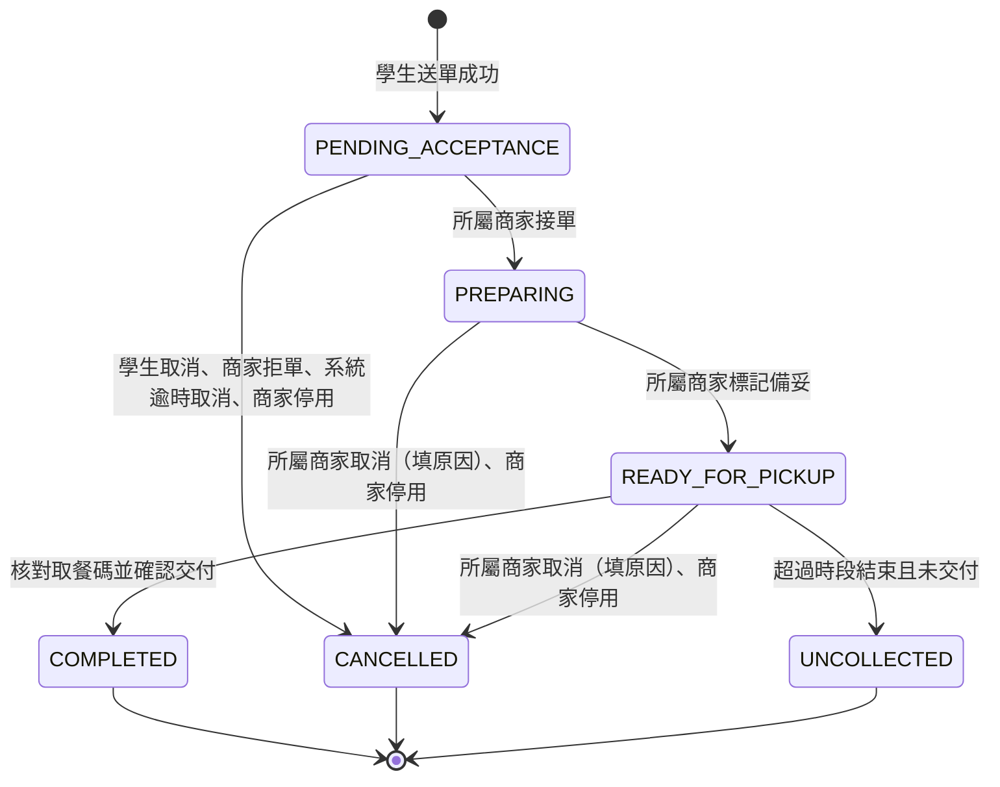

# 校園點餐系統軟體需求規格書

Software Requirements Specification

| 項目 | 內容 |
| --- | --- |
| 專案名稱 | 校園點餐系統 MVP |
| 文件版本 | v0.6 |
| 文件日期 | 2026-10-24 |
| 文件狀態 | 待審查 |
| 需求依據 | 校園點餐系統 Waterfall PRD v0.5（2026-10-23） |

## 文件修訂紀錄

| 版本 | 日期 | 修訂內容 |
| --- | --- | --- |
| v0.1 | 2026-10-23 | 依 PRD v0.5 建立 SRS 初稿，細化功能、狀態、介面及驗證條件 |
| v0.2 | 2026-10-24 | 加入 5 張 UML 圖、26 項函式輸入輸出與合法非法條件、介面契約、交易偽程式碼及邊界測試設計 |
| v0.3 | 2026-10-24 | 保留人工修改；依八類功能整理 function 索引及 15 張圖；將送單、資源與狀態命令的偽程式碼改為附說明的函式流程圖 |
| v0.4 | 2026-10-24 | 附錄 A 改為直接敘述驗證方式與通過條件；附錄 B 移除預設確認窗口，改列待決議事項對驗收的影響 |
| v0.5 | 2026-10-24 | 改寫為純需求規格：重排章節；每個 FR 以「需求」加「條件」表達，AC 與 FR 一對一；移出設計內容；統一用語並將模糊用詞改為可驗證的寫法；補齊驗證方法對照；以〔衍〕〔新〕標示超出 PRD 的內容 |
| v0.6 | 2026-10-24 | 處理附錄 B 待決議事項 B-01～B-15 並新增 B-16、B-17：全部決議併入需求與條件，附錄 B 改為決議紀錄；新增 FR-027（系統自動取消）、FR-028（學生個人資料刪除）；FR-004 加入商家恢復；狀態表新增兩條系統取消轉換；時段容量改以餐點份數計；庫存改為可用量並每日重置；移除「授權人員」與「管理範圍」概念；商家改為一商家一帳號；補充 CAP／NFR 驗收口徑 |

---

# 目錄

1 簡介　2 參考文件　3 具體需求　4 驗證　5 需求追溯　附錄 A 假設與相依　附錄 B 範圍界線

---

# 1 簡介

## 1.1 文件目的

本文件定義校園點餐系統首版（MVP）的功能、介面、資料、效能與品質需求，作為需求審查、設計、開發、測試及驗收的共同基準。

## 1.2 產品範圍

**產品名稱**：校園點餐系統。

**範圍內**：單一校園的繁體中文響應式網站，供學生、商家及管理員使用。含電子郵件驗證登入、帳號與權限管理、商家資料與營業設定、菜單與庫存、單商家購物車、當日取餐時段、訂單處理與交付、站內通知、後台訂單查詢與基本統計、重要異動操作紀錄、學生個人資料刪除。

**範圍外**：付款、退款、收款狀態、財務對帳與財務報表。學生於取餐時在現場付款，訂單金額僅表示餐點價格合計。多校園、校務 SSO、POS、配送整合、訂單的電子郵件通知、校內身分驗證亦不在本版範圍。

## 1.3 產品概觀

### 1.3.1 產品觀點

系統為獨立的網站型產品，不依賴既有校務系統。學生以手機瀏覽器預訂餐點，商家與管理員以桌面瀏覽器操作。外部相依僅有電子郵件驗證服務與使用者端網路及瀏覽器（見附錄 A）。

### 1.3.2 產品功能摘要

| 類別 | 功能 | 需求 |
| --- | --- | --- |
| A 帳號登入與權限 | 電子郵件登入、角色授權、帳號停用與恢復、學生個人資料刪除 | FR-001～003、028 |
| B 商家營業與菜單 | 商家資料、營業與接單、取餐時段、商品、客製化選項、庫存 | FR-004～009 |
| C 訂單快照與購物車 | 訂單快照、單商家購物車、價格明細、送單前價格再確認 | FR-010～013 |
| D 送單 | 整單驗證與建立、重複送單與並行一致性 | FR-014～015 |
| E 接單備餐與取消 | 狀態推進、取消與拒單、資源釋回、系統自動取消 | FR-016～018、027 |
| F 取餐與未取 | 取餐核對與交付、未取標記 | FR-019～020 |
| G 查詢與通知 | 訂單查詢、站內通知、商家新單提示 | FR-021～023 |
| H 管理 | 訂單查詢、基本統計、操作紀錄 | FR-024～026 |

### 1.3.3 使用者特性

| 角色 | 可執行事項 | 資料存取邊界 |
| --- | --- | --- |
| 學生 | 瀏覽菜單、維護購物車、送單、查詢訂單、接單前取消、刪除個人資料 | 僅本人受保護資料及訂單 |
| 商家 | 維護所屬商家的菜單、庫存、營業與時段；接單、拒單、取消、備妥、交付、標記未取 | 僅所屬商家的非公開資料及訂單；不得取得學生識別資訊 |
| 管理員 | 管理帳號與商家；查詢訂單、統計與操作紀錄；協助處理異常 | 單一角色，涵蓋全部商家與全部管理功能；不得改寫歷史品項與價格 |

「學生」僅指已完成電子郵件驗證的使用者，不代表其具有校內身分。

## 1.4 定義與縮寫

| 名詞 | 定義 |
| --- | --- |
| 營業日 | 校園業務時區的一個日曆日（當日 00:00:00 起至次日 00:00:00 前）。訂單、庫存保留與取餐碼皆歸屬於訂單成立當天的營業日 |
| 進行中訂單 | 狀態為待商家確認、製作中或可取餐的訂單 |
| 待處理訂單 | 狀態為待商家確認的訂單 |
| 同一次送單 | 學生對同一份已確認內容所發出的一次送單意圖。重複點擊、網路重試及回應遺失後的重新提交，皆屬同一次送單；修改內容後須重新確認，並視為新的送單 |
| 送單識別 | 使用者端為同一次送單所附、可讓系統判斷多次提交是否屬於同一次送單的資訊 |
| 同一次狀態操作 | 使用者對同一訂單、同一意圖所發出的一次狀態變更（如接單、取消、完成）。重複點擊、網路重試及回應遺失後的重新提交，皆屬同一次狀態操作 |
| 訂單快照 | 訂單成立時保存的商品名稱、單價、選項、加價、數量、小計與取餐時段，不隨菜單異動 |
| 可用量 | 有限庫存商品當日尚可被新訂單保留的數量，為商家設定與調整的數字 |
| 每日預設量 | 有限庫存商品於每個營業日開始時，可用量重置的數值 |
| 保留 | 訂單成立時，為該訂單預先占用的有限庫存（自可用量扣除）與取餐時段容量（以餐點份數計） |
| 耗用 | 商家接單後，該訂單所保留的有限庫存視為已實際使用，不再屬於可用量 |
| 釋回 | 將原保留的庫存或時段容量退還為可用 |
| 取餐時段 | 學生選擇的當日取餐時間區間，受容量限制 |
| 取餐碼 | 商家交付前用於核對訂單的識別資訊，不代表付款狀態 |
| 受保護操作 | 需已登入且通過角色與資料範圍檢查才可執行的操作 |
| 終止狀態 | 已完成、已取消、未取；進入後不再轉換 |
| 運作紀錄 | 供維運與除錯用的系統日誌，不同於 FR-026 的操作紀錄 |
| 校園業務時區 | 用於判斷營業、營業日與時段的單一時區，為 `Asia/Taipei` |
| 系統（操作者） | 由系統依本文件規則自動執行的操作，於訂單事件與操作紀錄中以「系統」記錄 |
| FR／NFR／CAP | 功能需求／非功能需求／容量與效能指標 |
| AC | 驗收準則，與同編號的 FR 一對一 |
| TBD | 待決議事項。所有已決議事項見 SRS_決議紀錄.md |
| RPO／RTO | 可容許資料遺失範圍／故障後恢復服務時間目標 |

訂單狀態：待商家確認 `PENDING_ACCEPTANCE`、製作中 `PREPARING`、可取餐 `READY_FOR_PICKUP`、已完成 `COMPLETED`、已取消 `CANCELLED`（含學生取消、商家拒單、商家取消、系統自動取消）、未取 `UNCOLLECTED`。

## 1.5 需求撰寫慣例

- **編號**：`FR-xxx`、`NFR-xxx`、`CAP-xxx`、`EI-xxx`（外部介面）、`DR-xxx`（資料）、`DC-xxx`（設計限制）、`MNT-xxx`（可維護性）。編號由本文件自行管理。
- **編號穩定**：編號於基準版本確定後不得重排或重用；撤銷的需求保留編號並標示「已廢止」，新增需求接續最大編號。
- **需求與條件**：每個編號為一條需求，以「需求」敘述；「條件」是該需求成立所須滿足的細項，一併由該需求的 AC 驗證。「應」表示必要，「不得」表示禁止，需求陳述不含實作手段。
- **來源標記**：未標記者直接承接 PRD 明文，或為 SRS_決議紀錄.md 已核准之決議；〔衍〕為細化 PRD 意圖，須經審查確認；〔新〕為超出 PRD 明文的安全、品質或政策防護，須經審查核准才成為正式需求。
- **驗證**：功能需求以 AC 驗證（測試）；其他需求的驗證方法見 §4.1。
- **待決議**：日後如新增需求標示「待決議」，表示其參數或政策尚待決議；決議前不得作為最終驗收門檻，也不得以暫定值視為已通過。本版無待決議事項。

---

# 2 參考文件

| 文件 | 版本 | 用途 |
| --- | --- | --- |
| 校園點餐系統 Waterfall PRD | v0.5（2026-10-23） | 需求來源 |

---

# 3 具體需求

## 3.1 外部介面需求

### EI-001 使用者介面

**需求**：系統應以繁體中文呈現所有使用者介面，依裝置寬度調整版面，並提供下表七類畫面。

**條件**：
- 系統不得提供付款、退款、已付款、已收款或財務對帳的操作或標示；訂單金額以「價格合計」描述。

| 畫面 | 主要內容 | 相關需求 |
| --- | --- | --- |
| 登入 | 電子郵件驗證、登入狀態、驗證失敗提示 | FR-001～003 |
| 商家與菜單 | 店家資訊、營業與接單狀態、商品分類、圖片、單價、供應狀態、選項 | FR-004～009 |
| 購物車／送單 | 單店餐點、數量、選項、備註、價格明細、當日時段、變價提示、送單確認 | FR-011～015 |
| 學生訂單 | 訂單編號、快照明細、價格、時段、取餐碼、進度、允許的取消操作、通知、個人資料刪除 | FR-010、016～022、027、028 |
| 商家接單／備餐 | 新單提示、待確認、製作中、可取餐、未取訂單；拒單與取消原因；交付核對 | FR-016～023 |
| 商家管理 | 商品、選項、庫存、營業時間、休息日、接單開關、取餐時段 | FR-005～009 |
| 管理後台 | 帳號、商家、訂單篩選、基本統計、操作紀錄 | FR-002～004、024～026 |

### EI-002 畫面狀態與操作結果

**需求**：系統應清楚區分並呈現資料與操作的各種情境。

**條件**：
- 每個資料畫面應分別呈現載入中、資料為空、載入失敗與網路中斷，且提示互不相同。
- 操作結果應分別呈現成功、失敗與狀態衝突；失敗與衝突時應提供下一步操作（重試或重新整理）。
- 系統不得在系統端確認前，顯示送單或狀態修改成功。
- 操作結果不確定時，應顯示「結果待確認」，並提供重新查詢該次操作結果的途徑。〔衍〕
- 失敗訊息應可區分：驗證不符、無權限、供應不足、容量額滿、時段已截止、價格變更、狀態已變更、進行中訂單已達上限、結果已過期、取餐碼核對已鎖定。〔衍〕

### EI-003 外部服務與硬體

**需求**：系統應使用電子郵件驗證服務完成電子郵件所有權驗證（規則見 FR-001）。

**條件**：
- 驗證服務不可用時，系統不得判定驗證成功，也不得建立未驗證的登入。
- 商家與管理員亦使用同一電子郵件驗證服務登入（FR-002）。
- 系統不得以專用讀卡機、出單機、POS、條碼掃描器或相機掃描作為必要條件。〔衍〕
- 系統不得以校務 SSO、POS 或外部配送服務作為相依。

### EI-004 通訊

**需求**：使用者與系統之間的通訊應使用 HTTPS。

**條件**：
- 電子郵件僅用於身分驗證，系統不得以電子郵件發送訂單通知。

## 3.2 功能需求

### 3.2.1 A 帳號登入與權限

#### FR-001 電子郵件驗證與登入（Must）

**需求**：系統應允許任何擁有可收信電子郵件的使用者，以一次性驗證碼完成驗證後登入為學生；商家與管理員亦以其登記信箱，依本需求的驗證碼規則登入（FR-002）。

**條件**：
- 系統不得限制電子郵件網域。學生首次驗證成功時，系統應自動建立學生帳號，無須另行註冊。
- 驗證碼為 6 位數字，寄至使用者輸入的信箱，效期 10 分鐘。同一信箱重寄後，舊驗證碼應立即作廢，僅最新一組有效。
- 同一信箱於 60 秒內不得重寄；同一信箱每小時最多寄送 5 封。
- 單組驗證碼錯誤輸入達 5 次即作廢，須重新寄送。
- 系統不得讓未完成必要驗證者，以已登入身分執行受保護操作。
- 驗證失敗、逾期、作廢或已使用時，系統不得建立登入狀態，並應告知原因或重新操作指引。
- 每次驗證憑證只能成功使用一次；並行使用同一憑證時，至多一次成功。〔衍〕
- 已停用的帳號（FR-003）即使驗證碼正確，亦不得建立登入狀態。〔衍〕

**AC-001**：(1) 以任一網域的信箱完成有效驗證後，首次自動建立學生帳號並可使用學生受保護功能。(2) 錯誤、逾期、作廢或已使用的驗證碼不產生登入狀態。(3) 驗證碼於 10 分鐘後失效；重寄後舊碼失效；60 秒內重寄被拒；第 6 封（同一小時）寄送被拒；同一組驗證碼錯誤第 5 次後作廢。(4) 未登入無法送單或查詢私人訂單。(5) 同一憑證並行兌換兩次，僅一次成功。(6) 已停用帳號驗證碼正確仍不能登入。

#### FR-002 帳號建立與角色授權（Must）

**需求**：系統應僅允許管理員建立商家與管理員帳號，並依角色與資料範圍，限制各使用者可執行的操作與可查看的資料。

**條件**：
- 系統僅有學生、商家、管理員三種角色。管理員為單一角色，擁有全部管理功能，範圍涵蓋全部商家，不分等級或商家範圍。
- 建立商家帳號時應指定所屬商家與登記信箱；一個商家僅有一個帳號，該帳號供全店共用，一個帳號亦僅屬於一個商家。登記信箱應為全店店員皆可收信的共用信箱，由建立帳號的管理員確認（系統無法驗證）。〔衍〕
- 建立管理員帳號時應指定登記信箱。第一位管理員由校方指定，於部署時預先建立（A-08）。
- 商家與管理員以其登記信箱，依 FR-001 的驗證碼規則登入。
- 學生不得透過介面或直接請求，建立高權限帳號或提升自身或他人權限；授予的權限不得超過授予者本身擁有的權限。〔衍〕
- 系統應於每次受保護操作檢查角色與資料範圍；未登入、角色不符或資料不在授權範圍時，應拒絕操作，且不得回傳受保護資料。
- 系統應以已驗證的身分決定操作者，不得採信使用者自行提供的身分、角色或商家歸屬。〔衍〕
- 商家帳號由全店共用，操作紀錄僅能追蹤到商家帳號，不能識別店內操作人員。

**AC-002**：以學生、商家、管理員分別操作，各角色僅能執行其允許範圍；修改請求中的使用者或商家識別，不能取得他人資料或權限；學生無法建立商家或管理員帳號；管理員可建立商家與管理員帳號；一個商家無法建立第二個帳號；商家與管理員以登記信箱的驗證碼登入。

#### FR-003 帳號停用與恢復（Must）

**需求**：管理員應可停用及恢復學生與管理員帳號；停用後，該帳號不得繼續存取受保護功能。商家帳號的停用與恢復隨商家的停用與恢復（FR-004），不得單獨操作。

**條件**：
- 停用生效後，已登入者的後續受保護請求亦應被拒絕。
- 恢復後，系統應依該帳號原核定權限允許其存取。
- 停用期間已失效的登入狀態，不得因帳號恢復而自動重新有效；使用者應重新完成登入驗證。〔衍〕
- 管理員不得停用自己的帳號，也不得使啟用中的管理員數量變為 0；兩位管理員並行停用對方時，亦不得使啟用中的管理員數量變為 0。

**AC-003**：帳號保持登入時被停用，其下一次受保護操作被拒絕；恢復後可依權限操作；停用後歷史訂單與紀錄仍存在（DR-003）；管理員停用自己被拒；僅剩一位啟用中管理員時停用該管理員被拒；兩位管理員同時停用對方，至少一位維持啟用；無法單獨停用商家帳號。

#### FR-028 學生個人資料刪除（Must）〔新〕

**需求**：系統應允許學生本人要求刪除自己的個人資料，包含其帳號與其全部訂單。

**條件**：
- 學生應於系統內提出刪除，經學生明確確認後立即生效，不需管理員核准。
- 學生有任一進行中訂單時，系統應拒絕刪除並告知原因；僅當全部訂單皆為終止狀態，才可刪除。
- 刪除後，系統不得再保有該學生的電子郵件、登入資料、訂單、訂單明細快照、送單結果與通知；刪除不可復原。
- 操作紀錄（FR-026）不隨之刪除；紀錄中不含學生個資，被刪除訂單的對象顯示為「已刪除的訂單」。
- 刪除後，與被刪除訂單相關的統計（FR-025）會隨之變動；同一營業日在不同時間查詢，數字可能不同。
- 同一信箱於刪除後再次驗證，視為新學生，與已刪除的資料無關。〔衍〕
- 資料還原後，已刪除的資料不得重新對外可見（NFR-007）。

**AC-028**：無進行中訂單的學生確認刪除後，其帳號與全部訂單不可再被任何角色查詢；有進行中訂單時刪除被拒；刪除後操作紀錄仍存在且不含學生個資；刪除後統計扣除該學生訂單；同一信箱再次登入得到全新帳號，看不到舊訂單。

### 3.2.2 B 商家營業與菜單

#### FR-004 商家基本資料管理（Must）

**需求**：管理員應可建立、編輯、停用及恢復商家，維護名稱、位置、聯絡方式與取餐說明；被停用的商家不得接受新訂單。

**條件**：
- 必要欄位缺漏或格式不符時，系統不得儲存，並應指出需修正的欄位。〔衍〕
- 商家的狀態與其唯一帳號（FR-002）一致：停用商家時，其帳號一併停用；恢復商家時，其帳號一併恢復。
- 停用商家時，該商家全部進行中訂單應依 FR-027 自動取消。管理員確認停用前，畫面應顯示受影響的進行中訂單數量，並取得管理員的二次確認（不得預設同意）。
- 停用與同一訂單的狀態操作並行時，沿用 FR-016 的衝突規則，僅先成立的一方生效。
- 恢復後，商家原有的菜單、庫存設定、營業設定與取餐時段設定應保留；接單狀態應為「暫停接單」，須由商家自行開啟。已取消的訂單不得因恢復而復原。

**AC-004**：建立及編輯後可讀到正確資料；停用後新送單被拒；停用時畫面顯示受影響訂單數並需二次確認；確認後該商家全部進行中訂單轉為已取消，且帳號同時無法使用；停用與送單同時發生時，停用生效後才開始驗證的送單不成立；恢復後商家帳號可登入、接單狀態為暫停接單、已取消訂單未復原；原訂單紀錄仍存在。

#### FR-005 營業時間與接單控制（Must）

**需求**：商家應可設定營業時間、暫停接單及例外休息日；在非營業時間、例外休息日或暫停接單期間，系統不得成立新訂單。

**條件**：
- 營業時間以校園業務時區（`Asia/Taipei`）的日曆日設定；每日可設定多個營業區段。
- 營業區段為「起始含、結束不含」；區段不得重疊，亦不得跨越午夜（結束時間最晚為 24:00）。
- 系統應於建立訂單時，以當時有效的設定判斷商家可否接單，即使學生先前已開啟菜單或購物車亦同；失敗時應告知商家目前不可接單。
- 不合法的營業設定（不存在的日期或星期、時間格式錯誤、區段重疊、跨越午夜）不得被儲存。〔衍〕

**AC-005**：在正常營業、非營業、例外休息、暫停接單及營業邊界時刻分別送單，僅符合接單條件者成功（例：營業區段 11:00–14:00，11:00:00 可送單，14:00:00 不可）；開啟接單開關仍不能於休息日送單；重疊區段與跨午夜設定被拒絕。

#### FR-006 取餐時段與容量（Must）

**需求**：商家應可設定當日取餐時段及各時段可接單容量（以餐點份數計）；已額滿、剩餘容量不足、已截止、跨日或不可預訂的時段，不得用於成立新訂單。

**條件**：
- 容量單位為餐點份數：每張訂單占用其全部明細數量的總和，選項不另計。訂單總份數大於剩餘容量時，整張訂單不成立，不得拆單。
- 時段起迄以分鐘為單位，長度至少 10 分鐘、不另設上限；結束時間應晚於開始時間；同一商家的時段不得重疊；時段應完整落在某一營業區段內。
- 容量為 0 以上的整數；容量為 0 代表該時段不開放。剩餘容量不得顯示為負值。
- 商家應可設定「預訂截止分鐘數」N，預設為 10，合法範圍為 0 至 120 的整數分鐘；N 以外的值（負數、小數、超出範圍）不得儲存。時段開始時間減 N 分鐘（含該時刻）起，該時段不可預訂。修改 N 僅影響之後的送單判斷，不影響已成立的訂單。
- 學生僅可選擇當日、可預訂，且剩餘容量不小於購物車總份數的時段。剩餘容量不足的時段應顯示並標示不可選，註明「剩餘 N 份，不足」；已額滿與已截止應分別標示。
- 並行送單時，各時段的占用總量不得超過其容量。
- 已有進行中訂單占用的時段，不得修改起迄時間或刪除；容量仍可調整，包含調低至低於已占用份數：既有訂單全部保留不受影響，剩餘容量顯示為 0，新訂單無法成立。被拒絕時，應指出原因及替代做法（將容量調為 0）。
- 已有訂單的時段，不得以修改設定的方式變動該訂單的取餐時間。〔衍〕
- 預訂截止與可選性的判斷，以系統端時間為準；送單時系統仍應重新檢查。

**AC-006**：可用時段可選；跨日、額滿、已截止、剩餘容量不足及失效時段送單失敗；購物車 4 份而剩餘 3 份的時段顯示不可選並註明剩餘份數；兩筆請求爭用最後一份容量時，僅一筆成功；N = 10 時時段 12:00 開始，11:50:00 起不可預訂，11:49:59 可預訂；N 設為 -1、121、1.5 被拒絕；10 分鐘以下、重疊或不在營業區段內的時段被拒絕；有進行中訂單的時段改起迄或刪除被拒；容量調低至低於已占用時，既有訂單不變、剩餘顯示 0。

#### FR-007 商品維護與上下架（Must）

**需求**：商家應可新增、編輯、上架及下架所屬商品，維護名稱、分類、圖片、售價及供應狀態；下架或不可供應的商品，不得成立新訂單。

**條件**：
- 上述限制包含由舊購物車送出的情況。
- 必要欄位或格式不符時，系統不得儲存該次更新，並應指出需修正欄位。
- 商家不得新增、修改、上架或下架其他商家的商品。
- 商品名稱為 1 至 50 字；分類為商家自訂文字，1 至 20 字，每家商家最多 20 個分類。
- 售價為 1 至 9,999 的整數（新台幣元）；不得為零元、負值或含小數。
- 商品圖片每商品最多 1 張，選填，無圖片時顯示預設圖。系統應檢查圖片實際內容是否為允許格式（JPEG、PNG、WebP），單檔不超過 5 MB，解碼後每邊不超過 4096 像素；不符者不得發布。〔衍〕

**AC-007**：完成商品新增與修改；下架後以舊購物車送出該商品仍被拒絕；無法修改其他商家商品；偽裝副檔名的檔案、超過 5 MB 或 4096 像素的圖片被拒絕；售價 0、-1、10000、1.5 被拒絕，1 與 9999 通過；名稱 51 字被拒絕。

#### FR-008 客製化選項與加價（Must）

**需求**：商家應可為商品設定客製化選項群組、加價與最少／最多選取數；學生須符合規則才能加入購物車。

**條件**：
- 每個選項群組設定最少與最多選取數：單選必選為最少 1、最多 1；必選為最少 ≥ 1；可選為最少 0。設定須符合 0 ≤ 最少 ≤ 最多 ≤ 群組內選項數，不符不得儲存。
- 每個商品最多 10 個群組，每群組最多 20 個選項；群組與選項名稱各為 1 至 30 字；選項加價為 0 至 999 的整數（新台幣元），不得為負值。選項不單獨管理庫存。
- 商家可單獨下架選項；已下架選項不得被選取。群組可選項目數若因下架而小於其最少選取數，該商品應暫時無法加入購物車，並於商家管理畫面提示修正。
- 學生未達最少選取數或超過最多選取數者，不得加入購物車。
- 系統應於送單時重新驗證選項；規則已變更或選項已失效時，應拒絕並提示重新選擇。〔衍〕
- 系統不得接受不存在、已失效、重複選取或不屬於該商品的選項。〔衍〕

**AC-008**：必選未填不可加入；超過最多不可加入；合法選項可加入並正確計價；送單前選項規則變更時，送單被拒並要求重選；下架選項導致可選數量小於最少時，商品無法加入購物車；最少大於最多、第 11 個群組、第 21 個選項、加價 -1 或 1000 被拒絕。

#### FR-009 庫存模式與供應控制（Must）

**需求**：商家應可將商品設定為有限庫存、不限量或售完；售完或可用量不足的商品，不得成立新訂單。

**條件**：
- 有限庫存商品以「可用量」管理：商家設定與調整的是當日尚可被新訂單保留的數量（0 以上的整數）。送單成立時可用量減少（轉為保留）；接單前取消或拒單時加回；接單後保留轉為耗用，不再扣減可用量。保留與耗用數量供商家參考，不可直接編輯。
- 有限庫存商品應設定「每日預設量」（0 以上的整數）。每個營業日開始（00:00:00）時，可用量重置為每日預設量，售完設定重置為未售完；每日預設量為 0 者維持售完。每日預設量的修改自下一次重置起生效；手動調整僅影響當日可用量，不改變每日預設量。
- 庫存按營業日分開計算：保留與耗用歸屬於訂單成立當天的營業日。釋回僅回到該營業日；前一營業日的訂單於今日被取消或拒單時，不得加回今日可用量。
- 模式切換規則如下表。切換被拒時，應指出原因與下一步。
- 不限量商品仍應符合上架、可售及未售完條件，才可成立訂單。
- 同一商品在同一訂單中出現於多筆明細（如不同選項）時，應合併計算所需庫存後再檢查。〔衍〕
- 任何操作（含並行送單與手動調整庫存）下，可用量不得為負值。
- 手動調整庫存時，不得影響已為既有訂單保留的數量。〔衍〕

| 切換動作 | 規則 |
| --- | --- |
| 有限 → 不限量 | 商品有待商家確認的訂單時禁止；否則允許 |
| 不限量 → 有限 | 允許，但須同時填入可用量與每日預設量 |
| 設為售完 | 隨時可以；不改變可用量、保留與耗用 |
| 售完期間待確認訂單被取消或拒單 | 釋回數量照常加回可用量，商品維持售完，直到商家取消售完 |
| 取消售完 | 有限商品的可用量為 0 時不得取消售完；不限量商品直接恢復 |

**AC-009**：有限庫存不足被拒；不限量在其他條件符合時可送單；售完不可送單；同商品兩行各 2 份而可用量為 3 時整單失敗；並行送單與管理調整後無負庫存；每日 00:00:00 後可用量等於每日預設量且售完旗標重置；昨日訂單於今日取消，今日可用量不變；有待確認訂單時有限切不限量被拒；可用量為 0 時取消售完被拒；不限量切有限未填可用量或每日預設量被拒。

### 3.2.3 C 訂單快照與購物車

#### FR-010 訂單商品與價格快照（Must）

**需求**：訂單成立時，系統應保存商品名稱、單價、選項與加價、數量及價格明細；後續菜單變動不得影響既有訂單。

**條件**：
- 系統應一併保存所選取餐時段的日期與起迄時間。〔衍〕
- 學生、商家與管理後台查詢同一訂單時，應呈現成立時的明細。
- 任何角色（含管理員）不得修改歷史訂單的品項與價格。歷史訂單僅得因學生依 FR-028 刪除個人資料而被移除。
- 訂單合計應等於其全部明細小計之和。〔衍〕

**AC-010**：成立訂單後修改菜單（改名、改價、選項下架），既有訂單的名稱、選項、數量、價格與合計保持不變；新訂單採用經確認的新資訊；管理後台無修改歷史明細的功能。

#### FR-011 單一商家購物車（Must）

**需求**：學生應可新增、調整及刪除購物車中的餐點，並維護數量、選項與備註；購物車內的餐點限同一商家。

**條件**：
- 加入其他商家的餐點前，系統應取得學生明確確認（不得預設同意）；確認後購物車僅含新商家餐點；不確認時，應保留原商家及原購物車內容。
- 單筆餐點明細的數量為 1 至 20 的整數；單張訂單的總份數不得超過 50 份；同一商品的不同選項組合，應可成為各自獨立的明細。〔衍〕
- 每筆明細的備註為 0 至 100 字的純文字；備註欄應提示學生請勿輸入個人敏感資料。
- 加入購物車及價格確認的過程，不得保留庫存或時段容量。〔衍〕

**AC-011**：可完成新增、調整、刪除；跨店切換有確認；拒絕切換後原購物車不變；送單時含多商家餐點的訂單被拒；單筆數量 -1、0、1.5、21 被拒絕，1 與 20 通過；總份數 51 被拒絕；備註 101 字被拒絕。

#### FR-012 價格明細與合計（Must）

**需求**：系統應於購物車與訂單中顯示商品單價、選項加價、數量、各項小計及價格合計。

**條件**：
- 幣別為新台幣；所有金額為整數元，無小數亦無進位規則。
- 單項小計為「商品單價加所選選項加價總和」乘以數量；訂單合計為各項小計之和，必然大於 0。
- 系統應依系統端的有效價格計算金額，不得採信使用者端提供的合計。
- 系統不得加入本規格未定義的稅費、折扣或運費。〔衍〕
- 系統不得將價格合計呈現為已收款金額。

**AC-012**：多商品、多選項、不同數量的計算與手算一致（例：單價 80、加價 10、數量 2，加另一份 50 的商品，合計 230）；竄改使用者端金額不影響系統端計價。

#### FR-013 提交時商品與價格再確認（Must）

**需求**：系統應於送單時重新檢查商品與價格；與學生先前確認的內容不同時，應提示變動內容及更新後明細，並於學生再次確認後才可繼續。

**條件**：
- 變動包含商品、選項、數量、單價或加價；即使合計相同，只要明細不同仍視為變動。〔衍〕
- 價格確認不設有效期間：只要送單時的商品、選項、數量、單價與加價，和學生確認過的內容完全相同，確認即有效。
- 系統不得以學生未確認的新價格成立訂單；學生確認後資料再次變動時，應再次檢查。
- 商品已無法供應時，應提示修正購物車，不得以價格確認取代供應檢查。

**AC-013**：購物車加入後改價，送單會提示且未建立訂單；取消確認則無訂單；再次確認且其他條件符合時才成立；總額不變但明細不同仍需重新確認；確認後放置任意長時間，內容未變時仍可直接送單。

### 3.2.4 D 送單

#### FR-014 整單驗證與建立（Must）

**需求**：系統應於建立訂單前驗證所有送單條件，全部通過才建立訂單；任一條件不符時，不得建立部分訂單。

**條件**：
- 驗證項目：學生帳號有效（FR-003）；學生的進行中訂單未達 3 張（所有商家合計）〔新〕；商家可接單（FR-004、FR-005）；取餐時段可用且剩餘容量不小於訂單總份數（FR-006）；商品可售且選項有效（FR-007、FR-008）；庫存足夠（FR-009）；單一商家、單筆數量 1 至 20 與總份數不超過 50（FR-011）；價格已確認（FR-013）。
- 進行中訂單進入終止狀態後，學生的額度自動恢復；並行送單時，不得使同一學生的進行中訂單超過 3 張。〔新〕
- 任一條件不符時，不得留下部分訂單、明細或資源占用。
- 全部通過時，應建立一張完整訂單及其明細，狀態為待商家確認，同時保留所需的有限庫存與時段容量（§3.2.9 表 3-2），並提供訂單編號與供核對的取餐碼。
- 訂單編號格式為營業日（`YYYYMMDD`）加連字號加 6 位大寫英數隨機碼，隨機碼不使用易混淆字元（0 與 O、1 與 I）；全系統永久唯一。訂單編號不是機密，取得編號不代表可讀取訂單。
- 取餐碼為 4 位隨機數字，不可由訂單順序推算；同一商家同一營業日內，不得有兩張訂單使用相同取餐碼（含已終止的訂單）。
- 訂單、庫存保留、容量占用與事件紀錄應一致成立或一致不成立，不得留下與訂單狀態矛盾的資源紀錄。
- 失敗時，應指出未通過的條件，並指引使用者回到可修正的畫面（購物車、時段選擇或價格確認）。〔衍〕

**AC-014**：一項商品不足、數量無效或時段失效時整單失敗，且無殘留明細與資源占用；多項保留中第二項失敗時，第一項的保留一併撤銷；學生已有 3 張進行中訂單時第 4 張被拒，其中一張完成後可再送；同一學生並行送出多張單，進行中訂單不超過 3 張；全部有效時才建立完整訂單；訂單編號符合格式且不重複；同一商家同一營業日的取餐碼不重複。

#### FR-015 重複送單與並行一致性（Must）

**需求**：同一次送單被多次提交時，系統應只建立一張訂單，且庫存與時段容量只保留一次；不同學生並行爭用有限庫存或時段容量時，成立訂單的總占用量不得超過可用量。

**條件**：
- 使用者無法判斷送單結果時，應依 EI-002 顯示結果待確認，並可重新取得該次送單結果；不得要求使用者直接以全新操作重建。
- 同一次送單仍在處理時，再次提交不得建立另一張訂單，且應告知仍在處理。〔衍〕
- 以同一送單識別重送、但內容與原送單不一致時，系統應拒絕，且不得覆蓋原送單結果；送單被確定拒絕後，學生修改內容並重新確認，視為新的送單。〔衍〕
- 送單結果（成功與失敗皆是）自結果確定起保存 24 小時，期間以同一送單識別重送，回覆同一結果；處理中的結果不計入 24 小時。期滿後以舊送單識別重送，系統應回覆「已過期」，不得建立新訂單，並指引學生至訂單頁查看實際結果。訂單本身不因結果保存期滿而移除。
- 送單處理因系統中斷而未完成時，系統應能將其恢復為明確結果（成立或失敗），不得永久停留於處理中，也不得僅因等待逾時而另建訂單。〔衍〕
- 僅提出該次送單的學生可查詢其結果。〔衍〕

**AC-015**：同一次送單並行重送多次，只產生一張訂單；成功後回應遺失再重試，只得到原訂單；以同一送單識別改數量重送被拒絕且原訂單不變；失敗的送單於 24 小時內重送得到同一失敗結果；超過 24 小時以舊識別重送得到「已過期」且無新訂單；多筆不同送單競爭最後庫存及容量時不超額；處理中斷後可查回明確結果。

### 3.2.5 E 接單備餐與取消

#### FR-016 正常備餐狀態推進（Must）

**需求**：訂單成立時為待商家確認；所屬商家接單後，系統應將其轉為製作中；商家標記備妥後，轉為可取餐。每次狀態變更前，系統應檢查目前狀態與操作者權限，並記錄事件與時間。

**條件**：
- 系統不得允許跳過接單直接備妥、倒退狀態，或因重複操作再次產生狀態變更。
- 同一訂單被並行操作時，系統應以實際成功的狀態為準，僅讓符合最新狀態的合法操作成功；失敗者應取得衝突提示或最新狀態（例：接單與學生取消、完成與標記未取同時發生時，僅一方成功）。
- 接單時，該訂單保留的有限庫存應視為已耗用，系統不得再次扣減可用量。〔衍〕
- 對同一次狀態操作重複提交時，系統應回覆原結果，不得重複產生狀態變更或事件；結果保存 24 小時，期滿後以舊操作重送應回覆「已過期」，不得再次變更狀態。〔衍〕
- 學生不得接單。
- 管理員不得任意變更訂單狀態，或代替商家宣告交付。系統依 FR-027 的自動取消為唯一例外，且操作者記為「系統」。〔衍〕

**AC-016**：待確認接單、製作中備妥的正常路徑成功；學生不得接單；待確認直接備妥、已取消後接單、對過期狀態提交的操作皆被拒絕；同一成功操作重送只回覆原結果，超過 24 小時重送回覆「已過期」；管理員無法變更訂單狀態。並行案例見 AC-017、AC-020。

#### FR-017 學生取消及商家拒單或取消（Must）

**需求**：學生僅可取消本人仍為待商家確認的訂單；所屬商家可拒絕待確認訂單，或在製作中、可取餐時因無法供應而取消，且須記錄原因。

**條件**：
- 商家拒單與取消時，應填寫原因，原因去除前後空白後須為 1 至 200 字。
- 合法的取消或拒單應使訂單轉為已取消，並保留操作者、時間與原因。
- 商家接單後，學生不得取消；已完成、已取消、未取的訂單，不得再接受取消。

**AC-017**：學生接單前可取消、接單後被拒；商家拒單或取消缺少原因或原因超過 200 字不成立；學生取消與商家接單同時提交時，只有先合法成立者生效，且無「已取消卻已耗用」的矛盾（FR-016）；對終止狀態訂單取消被拒。

#### FR-018 取消時的資源處理（Must）

**需求**：訂單取消時，系統應依下列規則處理該訂單原保留的庫存與占用的時段容量，且每份保留只能釋回一次。

**條件**：
- 接單前的取消（學生取消、商家拒單、系統自動取消）：釋回有限庫存（回到訂單成立當天的營業日，見 FR-009）與時段容量。
- 接單後的商家取消（含系統因商家停用而自動取消）：釋回時段容量；不自動補回已耗用的庫存。
- 訂單完成或標記未取時：不釋回時段容量，亦不自動補回已耗用的庫存。
- 重複取消或重試，不得重複釋回。
- 資源釋回與訂單取消應一致成立，不得出現已取消但仍占用，或已釋回但未取消的狀況。〔衍〕

**AC-018**：接單前取消或拒單後，庫存與容量恢復；接單後商家取消後容量恢復、庫存不增加；完成與未取後容量與庫存皆不增加；重複取消或重試不重複釋回。

#### FR-027 系統自動取消（Must）〔新〕

**需求**：系統應於下列兩種情形自動取消進行中訂單：(a) 商家被停用；(b) 待商家確認的訂單於取餐時段結束時仍未被接單。

**條件**：
- (a) 商家被停用時，該商家全部進行中訂單（待確認、製作中、可取餐）轉為已取消，取消原因固定為「商家停用」。
- (b) 待商家確認的訂單，於系統端時間達到訂單成立時保存的取餐時段結束時間時，轉為已取消，取消原因固定為「商家未在取餐時段結束前接單」。時段結束時間不受事後時段設定變更影響。
- 操作者記為「系統」；應記入訂單事件、通知學生（FR-022）及操作紀錄（FR-026）；資源釋回依 FR-018。
- 與商家或學生的同時操作並行時，沿用 FR-016 的衝突規則，僅先成立的一方生效。
- 重複觸發或重試，不得重複取消、重複釋回或重複通知。
- 系統中斷期間錯過的逾時取消，應於恢復後補行。〔衍〕
- 系統不得自動將訂單標記為未取（FR-020）。

**AC-027**：停用商家後，其待確認、製作中、可取餐訂單皆轉為已取消，原因為「商家停用」，操作者為「系統」，學生收到通知，接單前取消的庫存與容量釋回、接單後取消只釋回容量；待確認訂單於時段結束時間仍未接，轉為已取消，原因為「商家未在取餐時段結束前接單」，資源全數釋回；時段結束時間前一刻訂單仍可被接單；製作中與可取餐訂單不因時段結束而自動取消；重複觸發不產生第二筆事件、通知或釋回。

### 3.2.6 F 取餐與未取

#### FR-019 取餐核對與完成交付（Must）

**需求**：系統應僅允許所屬商家對可取餐訂單核對取餐碼；取餐碼與該訂單相符，且商家確認餐點已實際交付後，才可將訂單轉為已完成。

**條件**：
- 核對流程為：商家於可取餐訂單清單中選定一張訂單，輸入學生出示的取餐碼，系統比對該訂單的取餐碼。
- 系統不得僅憑取餐碼的顯示或輸入而自動完成訂單。
- 取餐碼不符時，不得完成訂單，訂單應維持可取餐；提示僅告知「取餐碼不符」，不得提示正確取餐碼的任何部分。
- 同一張訂單連續輸入錯誤 5 次後，系統應鎖定該訂單的核對 5 分鐘；鎖定期間任何輸入（含正確取餐碼）皆拒絕；鎖定結束後，錯誤計數重置。鎖定事件應記入操作紀錄。
- 取餐碼僅下單的學生本人可見；商家與管理員的畫面不得顯示取餐碼，商家端僅提供輸入欄位與「相符／不符」結果。
- 取餐碼於其營業日結束後不再可用於核對；營業日結束後仍未終止的訂單，僅能由商家取消或標記未取。
- 訂單不屬於該商家，或尚非可取餐狀態時，不得完成訂單。
- 訂單完成後再次提交完成操作，不得再次執行交付變更。

**AC-019**：正確訂單、正確取餐碼、交付確認齊備時可完成；錯碼、未確認交付、其他商家、製作中訂單及學生請求皆不能完成；連續錯 5 次後第 6 次（含正確碼）被拒，5 分鐘後可再試且計數歸零；商家與管理員任何畫面與回應均無取餐碼；錯誤訊息不含正確碼的任何部分；完成後無任何收款欄位或狀態（DC-002）。

#### FR-020 未取標記（Must）

**需求**：系統應僅允許所屬商家，將已備妥、系統端時間晚於所選取餐時段結束時間、且尚未交付的訂單，標記為未取。

**條件**：
- 等於結束時間不算晚於。〔衍〕
- 標記時，系統應保留原始備妥時間並記錄未取標記時間。
- 超時判斷應以訂單成立時保存的時段結束時間為準，不受事後時段設定變更影響。〔衍〕
- 未取為終止狀態；後續領取由商家線下協調，系統不得回改狀態。
- 系統不得自動將訂單標記為未取。〔衍〕

**AC-020**：時段結束時間 12:30:00 時，12:29:59 與 12:30:00 標記被拒，12:30:01 且已備妥未交付時成功；兩個時間均被保留；不補回庫存、不釋回容量；未取訂單不可再轉換；完成與標記未取同時提交時，只有一個終止狀態成立（FR-016）。

### 3.2.7 G 訂單查詢與通知

#### FR-021 訂單查詢（Must）

**需求**：系統應允許學生查閱本人訂單、商家查閱所屬商家的訂單與狀態，明細並依角色顯示可用操作。

**條件**：
- 明細應包含編號、商品與選項快照、數量、價格、取餐時段、狀態；學生訂單頁應顯示取餐碼。
- 商家訂單清單應可依訂單狀態分別檢視（待確認、製作中、可取餐、未取）。
- 商家查詢的訂單不得顯示學生的電子郵件或其他可識別學生身分的資訊（NFR-007）。
- 使用者改動訂單識別時，不得讀取非授權訂單；資料不存在與無權限的回應應一致，不得洩露他人訂單內容。〔衍〕

**AC-021**：合法角色可查詢自己範圍內的訂單；交換學生或商家帳號後讀取同一訂單，未授權者無法取得任何內容；商家看不到學生電子郵件；無資料時顯示空結果。

#### FR-022 可查詢的站內通知（Must）

**需求**：訂單被接單、拒單、備妥、取消或標記未取時，系統應提供可查詢的站內通知，並對應訂單、事件類型與發生時間。

**條件**：
- 收件者：學生收到接單、拒單、備妥、取消（含商家取消與系統自動取消）、未取共五類事件的通知；學生自行取消不通知該學生；商家收到學生接單前取消的通知；管理員不收訂單通知。新訂單提示由 FR-023 處理，不屬於通知。
- 通知內容為訂單編號、事件類型與發生時間；拒單與取消另附原因；通知不得含電子郵件或取餐碼。
- 通知保存 30 天，期滿後刪除，訂單本身不受影響。系統不提供已讀功能，通知清單依時間由新到舊排列。
- 系統應僅讓目前有權查看該訂單的使用者讀取其通知；存取權被撤銷後，不得再從歷史通知讀到該訂單內容。
- 同一事件對同一收件者不得產生重複通知；未成功成立的訂單變更，不得產生通知。〔衍〕
- 通知產生失敗不得影響已成立的訂單狀態。〔衍〕
- 通知顯示不得取代實際訂單狀態，使用者仍應能從訂單頁確認結果。

**AC-022**：逐項觸發五類事件，學生均收到對應通知並可重新查閱；學生取消時商家收到通知而該學生不收；管理員無任何訂單通知；通知不含電子郵件與取餐碼；30 天後通知被刪除而訂單仍在；非授權使用者讀不到通知；同一事件重複處理後仍只有一則通知。

#### FR-023 商家新單與待處理提示（Must）

**需求**：商家接單頁應顯示新訂單提示，並列出待處理訂單。

**條件**：
- 系統應顯示待處理訂單的總數，不得因僅顯示部分清單而低估。〔衍〕
- 離線或載入失敗時，應依 EI-002 呈現；連線恢復後，應重新取得實際訂單狀態。
- 過期的畫面不得導致對同一訂單重複接單或錯誤覆寫。
- 離線或最近一次更新失敗時，應顯示資料可能過期的提示。〔衍〕

**AC-023**：學生送單後，商家可見提示與待處理訂單；模擬斷線與請求失敗時顯示正確提示，且載入失敗不顯示為「沒有訂單」；恢復後取得實際結果；以過期畫面重複接單被拒或回覆最新狀態。

### 3.2.8 H 管理查詢統計與稽核

#### FR-024 管理後台訂單查詢（Must）

**需求**：管理員應可依商家、日期及訂單狀態（單獨或組合）查詢訂單紀錄。

**條件**：
- 日期為營業日（訂單成立日，校園業務時區）；起日與迄日皆含，可只填單日；範圍最長 92 天，超過時系統應提示縮小範圍。
- 查詢結果應僅含符合全部條件的訂單；管理員並可查看訂單明細及該訂單對應的學生帳號（含電子郵件）。〔衍〕
- 無符合條件的資料時，應顯示空結果；查詢失敗時，不得以空結果呈現。
- 日期區間不合法（例如起日晚於迄日）時，系統應拒絕並提示。〔衍〕

**AC-024**：以商家、日期、狀態及其組合查詢，結果皆符合條件；空結果不顯示為錯誤；查詢失敗顯示錯誤而非空列表；起日晚於迄日被拒；93 天範圍被拒、92 天通過；起迄日當天的訂單皆被包含。

#### FR-025 基本營運統計（Must）

**需求**：系統應提供訂單量、取消量、未取量及各商品備餐數量的基本統計，呈現範圍受角色與資料權限限制，且不得提供收款或財務報表。

**條件**：
- 統計期間預設為當日，可選單日或自訂範圍，規則同 FR-024（營業日、起迄皆含、最長 92 天）。每張訂單僅歸屬於其成立日，狀態變化不改變歸屬。
- 訂單量：期間內成立的訂單總數，不論之後狀態。
- 取消量：狀態為已取消的訂單數，含學生取消、商家拒單、商家取消、系統自動取消；並應分列此四類。
- 未取量：狀態為未取的訂單數。
- 完成量：狀態為已完成的訂單數。〔衍〕
- 進行中：待確認、製作中、可取餐的訂單數。〔衍〕
- 各商品備餐數量：期間內「已接單且未被取消」的訂單（製作中、可取餐、已完成、未取）中，該商品的份數總和；選項不單獨計算，同一商品不同選項組合合併；待確認與已取消的訂單不計入。〔衍〕
- 核對關係：訂單量 = 完成量 + 取消量 + 未取量 + 進行中。〔衍〕
- 每張訂單在各項計數中應只被計算一次，不得因明細行數而重複計算。〔衍〕
- 商家僅能看到自己商家的統計；管理員可看全部商家，並可依商家篩選。
- 統計結果應標示統計期間，並可與訂單明細相互核對。〔衍〕
- 統計由現有訂單計算；學生依 FR-028 刪除資料後，過去期間的統計會隨之變動。

**AC-025**：建立含正常、取消（四類）、未取、進行中的已知資料集，各統計值與手算相同，且滿足核對關係；接單後取消的訂單同時計入取消量並從備餐數量扣除；待確認訂單不計入備餐數量；畫面沒有收款或對帳資訊；商家只看到自己商家的統計。

#### FR-026 重要異動操作紀錄（Must）

**需求**：系統應為帳號、商家、菜單與訂單的重要異動保留操作紀錄，供具查閱權限的管理員查詢。

**條件**：
- 應記錄的操作：
  - 帳號：建立管理員或商家帳號、停用、恢復（含因商家停用或恢復而連動者）。
  - 商家：建立、編輯基本資料、停用、恢復；營業時間、例外休息日、接單開關、取餐時段與容量、預訂截止分鐘數的變更。
  - 菜單：商品新增、編輯（含改價）、上架、下架；選項群組與選項的新增、修改、下架；庫存模式切換、可用量手動調整、每日預設量修改、售完設定。
  - 訂單：每一次狀態變更（接單、拒單、取消、備妥、完成、標記未取，含系統自動取消）；取餐碼連續錯誤造成的鎖定。
- 不記錄：瀏覽、購物車變動、登入成功、學生查詢；學生的送單以訂單紀錄本身代表。
- 失敗或衝突的操作，僅記錄訂單狀態與取餐碼核對相關者（例如已過期的狀態操作、取餐碼錯誤）；其餘失敗（例如欄位格式不符）不記錄。
- 每筆紀錄應可辨識操作者（含「系統」；商家僅能辨識到商家帳號）、時間、對象、動作與結果（成功、失敗、衝突），並含變更前後的摘要；改價應同時記錄新舊價格。
- 紀錄中的對象僅顯示訂單編號與帳號識別，不得顯示電子郵件。
- 拒單、取消與未取，應可由操作紀錄追查到對應事件。
- 管理員可依操作者、對象、動作與時間範圍篩選；日期範圍規則同 FR-024。
- 學生與未授權商家不得查閱操作紀錄。
- 使用者不得修改或刪除操作紀錄；更正應以追加紀錄表示。〔衍〕
- 重要異動成功後，其操作紀錄不得靜默遺失；失敗或衝突的操作如被記錄，不得被標示為成功。〔衍〕
- 操作紀錄不設自動到期（NFR-007）。

**AC-026**：執行帳號停用、商家修改、商品改價、庫存調整與訂單狀態變更後，皆可查到對應紀錄且改價含新舊價格；系統自動取消的紀錄操作者為「系統」；取餐碼連續錯誤鎖定可查到；紀錄不含電子郵件、取餐碼與秘密資訊（NFR-001）；欄位格式錯誤的失敗操作不產生紀錄；學生與未授權商家無法查閱。

### 3.2.9 訂單狀態與業務規則

本節為 FR-016～020、027 的彙整；兩者不一致時，以 §3.2.5、§3.2.6 的 FR 為準。未列出的轉換一律不允許。訂單狀態僅表示備餐與交付進度，不代表學生已付款或商家已收款。

**表 3-1　狀態轉換**

| 原狀態 | 事件與操作者 | 必要條件 | 目標狀態 |
| --- | --- | --- | --- |
| 尚無訂單 | 學生送單 | 整單驗證與資源保留成功 | 待商家確認 |
| 待商家確認 | 所屬商家接單 | 仍為待確認 | 製作中 |
| 待商家確認 | 本人學生取消 | 尚未被商家接單 | 已取消 |
| 待商家確認 | 所屬商家拒單 | 填寫原因 | 已取消 |
| 待商家確認 | 系統逾時取消 | 系統端時間達到訂單保存的時段結束時間仍未接單 | 已取消 |
| 待商家確認、製作中、可取餐 | 系統因商家停用而取消 | 商家被管理員停用 | 已取消 |
| 製作中 | 所屬商家標記備妥 | 已完成備餐 | 可取餐 |
| 製作中或可取餐 | 所屬商家取消 | 無法供應並填寫原因 | 已取消 |
| 可取餐 | 所屬商家完成交付 | 取餐碼核對成功且確認交付 | 已完成 |
| 可取餐 | 所屬商家標記未取 | 超過取餐時段且未交付 | 未取 |
| 已完成、已取消、未取 | 任何人 | 終止狀態 | 不允許再轉換 |

**表 3-2　資源處理**

| 事件 | 有限庫存 | 取餐時段容量 |
| --- | --- | --- |
| 訂單成立 | 自可用量扣除，保留所需數量一次 | 占用所需份數一次 |
| 成立失敗 | 不留下保留 | 不留下占用 |
| 接單 | 保留轉為耗用，不再次扣減可用量 | 維持占用 |
| 接單前取消、拒單或系統逾時取消 | 釋回原保留一次（回到成立當天的營業日） | 釋回原占用一次 |
| 接單後取消（含商家停用而自動取消） | 不自動補回已耗用庫存 | 釋回原占用一次 |
| 完成或未取 | 不自動補回已耗用庫存 | 不釋回 |

## 3.3 使用性需求

### NFR-006 易用性

**需求**：系統的主要操作應具明確標籤、錯誤提示及操作結果；手機版不得遮擋必要按鈕。

**條件**：
- 主要操作為：登入、加入購物車、送單、取消、接單、拒單、備妥、交付（取餐碼核對）、標記未取，以及管理端的停用或恢復帳號、停用或恢復商家。每個主要操作應有文字標籤，且完成後應顯示成功或失敗結果；停用商家與帳號須有清楚的確認。
- 手機版畫面不得遮擋送單、確認、取消等必要按鈕。
- 本版未訂定操作完成秒數或滿意度的量化門檻。

載入、空資料、失敗、斷線與衝突各情境的提示，見 EI-002。驗證應在 NFR-004 規定的裝置矩陣上，執行完整的學生與商家流程。

## 3.4 效能需求

| ID | 需求 |
| --- | --- |
| CAP-001 | 系統應支援初期約 3,000 位學生使用；該數字不得解讀為同時送單量。 |
| CAP-002 | 系統應支援尖峰時段 500 人同時在線。 |
| CAP-003 | 500 人同時在線時，主要頁面與一般操作應於 3 秒內完成，以第 95 百分位計算，且錯誤率低於 1%；不以平均值判定。主要頁面與一般操作為：學生的登入、菜單瀏覽、購物車、送單、訂單查詢，以及商家的接單頁與狀態操作。管理後台的查詢與統計不列入 3 秒要求，但不得因此逾時失敗。 |
| CAP-004 | 系統應可管理並開放 30 家商家接單。 |
| CAP-005 | 系統應支援每家商家 100 項商品，合計約 3,000 項。 |

### NFR-003 狀態更新

**需求**：正常連線且頁面在前景時，學生與商家應於訂單狀態變更後 10 秒內看到更新，以 95% 的狀態變更達成為目標。

**條件**：
- 量測起點為系統端狀態變更成功，終點為使用者畫面顯示新狀態。〔衍〕

**效能驗收口徑**（適用 CAP-001～005 與 NFR-003）：
- 量測起迄：從使用者端送出請求至收到完整回應；頁面量測至可操作。學生端以模擬 4G 行動網路（單向延遲約 50 ms、約 10 Mbps）量測；商家與管理端以校園一般有線網路量測。
- 測試環境：規格與正式環境相同的預備環境，使用合成資料：30 家商家、每家 100 項商品、3,000 個學生帳號。
- 500 人組成：學生 470、商家 30。學生操作比例：瀏覽菜單 55%、購物車與價格確認 20%、送單 10%、訂單查詢 15%；商家持續開啟接單頁（自動更新）並對進來的訂單執行接單與備妥。
- 流量形態：兩種皆須測試：(1) 均勻分散至 30 家商家；(2) 集中至單一熱門商家與單一熱門時段。
- 測試長度：5 分鐘逐步升載，之後維持 30 分鐘穩定負載。
- 正確性：測試期間同時檢查訂單唯一、庫存不為負、容量不超額、狀態事件與通知一致；不得以略過庫存或權限檢查取得較快回應。
- CAP 數值為首版容量基準，不是帳號、商家或商品的硬性上限，也不表示每秒 500 筆交易。

## 3.5 邏輯資料需求

下列為業務可觀察的資料與規則，不是資料庫設計。欄位型別、鍵、索引與儲存產品由 SAD／SDD 定義。

| 資料實體 | 必要資訊 | 規則 |
| --- | --- | --- |
| 帳號與授權 | 帳號識別、電子郵件、角色、啟停狀態、商家歸屬（僅商家帳號） | 停用後拒絕受保護存取；不破壞歷史關聯；商家帳號與商家一對一 |
| 商家 | 名稱、位置、聯絡方式、取餐說明、營業設定、例外休息日、接單狀態、預訂截止分鐘數 | 商品、時段及訂單皆有商家歸屬 |
| 商品與選項 | 名稱、分類、圖片、單價、供應狀態、選項群組（最少／最多選取數）與加價、庫存模式、每日預設量、各營業日的可用量 | 有限庫存不得為負；下架及售完不得新送單；庫存按營業日分開 |
| 取餐時段 | 所屬商家、日期、起迄時間、容量（份數）、占用資訊 | 限當日可預訂；占用不得超過容量 |
| 購物車 | 學生、商家、餐點明細、數量、選項、備註 | 單一商家；不保留資源 |
| 訂單主檔 | 訂單編號、學生、商家、取餐時段、取餐碼、合計、目前狀態、營業日、成立時間 | 每單一位學生、一個商家、一個時段；不含收款狀態 |
| 訂單明細快照 | 商品名稱、單價、選項、加價、數量、小計、備註 | 成立後不隨菜單更動；合計可由快照重算 |
| 送單結果 | 學生、該次送單內容摘要、處理結果、對應訂單 | 同一次送單至多對應一張訂單（FR-015）；結果保存 24 小時 |
| 資源保留 | 訂單、庫存或時段、保留數量、處置狀態（保留、耗用、釋回） | 每份保留至多釋回一次（FR-018） |
| 訂單事件 | 訂單、原狀態、新狀態、操作者（含「系統」）、時間、原因 | 備妥與未取時間分別保留；終止事件不回改 |
| 站內通知 | 對應訂單、事件、時間、授權可讀對象 | 與訂單事件相符；不洩露他人資料；保存 30 天 |
| 操作紀錄 | 操作者、時間、動作、對象、結果、變更摘要 | 具查閱權限的管理員可查詢；不含電子郵件；不設自動到期 |

| ID | 需求 |
| --- | --- |
| DR-001 | 金額應以可精確表示的方式保存與計算，不得產生累積誤差；幣別為新台幣，金額為整數元（FR-012）。 |
| DR-002 | 時間點應含時區資訊；營業日依校園業務時區（`Asia/Taipei`）解釋；營業、營業日、時段與超時判斷應以系統端時間為準，不得採用使用者裝置時間。 |
| DR-003 | 系統不得因帳號停用、商家停用或商品下架／停用，而刪除資料或使歷史訂單失去可讀性。學生依 FR-028 刪除個人資料為唯一例外。 |

個人資料的保存與刪除規則，見 NFR-007 與 FR-028。

## 3.6 設計限制

| ID | 限制 |
| --- | --- |
| DC-001 | 系統僅服務單一校園。 |
| DC-002 | 系統不得包含付款、退款、收款狀態、財務對帳與財務報表功能，亦不得以支付閘道或退款服務為相依。 |

## 3.7 軟體系統屬性

### NFR-001 安全

**需求**：系統應在系統端執行身分、角色與資料歸屬檢查，並以 HTTPS 通訊（EI-004）。

**條件**：
- 權限檢查不得僅依賴畫面隱藏（授權規則見 FR-002）。
- 學生不得查看或修改他人訂單；商家不得讀取其他商家的非公開訂單。
- 系統應防止由使用者瀏覽器發起、但非使用者本意的修改請求。〔新〕
- 系統應限制登入申請與驗證、取餐碼核對、圖片上傳及管理後台查詢的請求頻率（驗證碼寄送與錯誤次數的限制見 FR-001，取餐碼核對的限制見 FR-019），其餘限制值由設計文件訂定。〔新〕
- 使用者輸入的備註、商品名與原因，應以純文字顯示，不得被當作可執行內容。〔新〕
- 系統不得在運作紀錄、操作紀錄或錯誤訊息中，暴露驗證碼、驗證憑證、登入憑證或完整取餐碼。〔新〕

驗證方式：通訊設定檢查；三角色的直接請求、跨帳號、跨商家與停用帳號測試。

### NFR-007 隱私

**需求**：個人資料應僅供必要角色查看；系統不設個人資料的自動到期，學生可依 FR-028 要求刪除。

**條件**：
- 商家不得取得學生的電子郵件或其他可識別學生身分的資訊，僅能看到訂單編號、餐點明細、取餐時段與備註。
- 管理員可查看學生電子郵件，以及訂單與其對應的學生帳號。
- 操作紀錄與通知不得含學生電子郵件。
- 系統不得提供訂單或學生資料的匯出功能。
- 資料還原或回復後，已依 FR-028 刪除的個人資料不得重新對外可見。〔衍〕
- 具有功能性保存期限的資料依其需求自動到期：驗證碼 10 分鐘（FR-001）、送單與狀態操作結果 24 小時（FR-015、FR-016）、站內通知 30 天（FR-022）。此為功能設計，不是個資保存政策。

### NFR-002 可靠性與資料一致性

**需求**：任何合法或競爭的請求，均不得造成負庫存、超額的取餐容量，或同一次送單的重複訂單。

**條件**：
- 作業中斷後，系統不得留下與訂單狀態矛盾的庫存或容量紀錄。〔衍〕

驗證應涵蓋最後庫存與時段爭用、送單重試、中斷處理、接單與取消競爭，以及重複資源釋回。

### NFR-005 可用性

**需求**：系統應具備資料備份、基本監控與故障恢復機制，監控應能反映服務異常，恢復機制應以恢復演練驗證。

**條件**：
- 可用率目標為每月 99.0%（以營業時段計）；計畫性維護應排在所有商家的營業時間之外。
- RPO 為 15 分鐘；RTO 為 4 小時。
- 資料庫每日全量備份，並持續保存變更紀錄以支援 RPO；圖片與設定每日備份。每日備份保存 30 天；備份與線上服務使用不同權限。
- 資料還原後，必須重新套用學生的個人資料刪除（NFR-007）。
- 監控項目：服務可用性探測、錯誤率、回應時間、資料庫狀態與磁碟空間、備份是否成功、驗證郵件寄送失敗率。任一項異常，應通知指定的維運聯絡人（A-05）。
- 恢復演練：上線前至少完整還原一次，實測 RPO 與 RTO 須達標並留下紀錄；之後每 6 個月一次。演練驗收條件：還原後訂單、庫存、容量、狀態事件互相一致，且已刪除的學生資料沒有重新出現。

### NFR-004 相容性

**需求**：學生端應支援主要手機瀏覽器；商家與管理端應可於桌面瀏覽器操作。

**條件**：
- 學生端：iOS Safari 與 Android Chrome，各取最新兩個主要版本；作業系統為 iOS 與 Android，各取最新兩個主要版本及其前一個版本；最小畫面寬度 360 px，以直向使用為主，橫向不要求最佳化但不得無法操作。
- 商家與管理端：桌面 Chrome、Edge、Firefox，各取最新兩個主要版本；最小畫面寬度 1024 px，不要求平板與手機版面。
- 不支援 Internet Explorer 與已停止更新的舊版本；桌面 Safari 為盡力支援，不列為驗收條件。
- 驗證須涵蓋登入、菜單、購物車、送單、訂單查詢與主要管理流程，且上述每一組瀏覽器與裝置皆需完整執行，不能僅以首頁可開啟視為通過。

### MNT-001 可維護性與可追溯性

**需求**：每項功能需求應可追溯至設計、測試案例與驗收結果；設計與測試文件應保留本文件的需求編號；需求變更應記錄版本與受影響項目。

---

# 4 驗證

## 4.1 驗證策略

| 項目 | 規定 |
| --- | --- |
| 驗證方法 | **T** 測試、**D** 展示、**I** 檢查（文件或設定）、**A** 分析（量測後推算） |
| 功能需求 | FR-001～FR-028 全部以測試（T）驗證，並以各自的 AC 為準 |
| 其他需求 | 見下方對照 |
| 測試案例 | 由獨立的測試文件展開並保留本文件編號；本文件不含測試案例 |
| 驗證環境 | 使用合成帳號與餐點資料，不使用未去識別的正式訂單 |
| 並行與一致性 | FR-015、NFR-002 須以並行與中斷情境驗證，方法由測試文件定義 |
| 驗收紀錄 | 應包含環境、資料集、版本、步驟、預期與實際結果、缺陷與核准人 |
| 未決參數 | 本版無待決議事項；日後新增的待決議需求，決議前不得作為最終驗收門檻 |

本文件的 AC 為驗收情境摘要，**不代表已執行測試**。

### 驗證方法對照（FR 以外的需求）

| 需求 | 方法 | 驗證依據 |
| --- | --- | --- |
| EI-001 | D | 展示七類畫面；檢查無付款相關操作或標示 |
| EI-002 | T | 模擬載入、空資料、失敗、斷線、衝突各情境 |
| EI-003 | T、I | 模擬驗證服務不可用；檢查無專用硬體與未列相依 |
| EI-004 | I | 通訊設定檢查；檢查無訂單電子郵件通知 |
| CAP-001 | A | 以核定資料規模建立測試環境 |
| CAP-002～005 | T | 依 §3.4 驗收口徑的負載測試 |
| NFR-001 | T、I | 三角色越權、跨帳號、跨商家、停用帳號測試；通訊設定檢查 |
| NFR-002 | T | 並行與中斷測試 |
| NFR-003 | T、A | 量測狀態變更至畫面更新的時間 |
| NFR-004 | T | 裝置矩陣上的主要流程 |
| NFR-005 | D、I | 備份與恢復演練；檢查監控設定 |
| NFR-006 | T | 裝置矩陣上的完整流程 |
| NFR-007 | T、I | 欄位可見性測試；刪除與還原後重新套用刪除的測試；檢查無匯出功能 |
| DR-001～003 | T | 金額計算、時區與時間判斷、停用後歷史資料可讀性 |
| DC-001、DC-002 | I | 檢查範圍與功能清單 |
| MNT-001 | I | 檢查設計與測試文件的追溯 |

## 4.2 產品驗收項

| 驗收項 | 對應需求 | 通過依據 |
| --- | --- | --- |
| 1 學生完整流程 | FR-001、006～015、021 | 可完成登入、瀏覽、購物車、選時段、送單及查詢 |
| 2 商家完整流程 | FR-007、009、016～020、027 | 可管理供應、接單、備妥、交付及標記未取；逾時與停用的自動取消符合規則 |
| 3 價格與快照 | FR-010、012、013 | 成立明細與確認金額一致；菜單異動不回寫 |
| 4 超賣與重複控制 | FR-006、009、014、015、NFR-002 | 庫存不足、時段額滿與重複送單不造成超額或重複訂單 |
| 5 角色隔離 | FR-002、003、021、NFR-001、NFR-007 | 三角色均無越權操作或資訊洩露 |
| 6 取消及交付規則 | FR-016～020、027、§3.2.9 | 狀態與資源處理符合核定規則 |
| 7 付款排除 | EI-001、DC-002、FR-025 | 無付款、退款、收款狀態及財務對帳功能 |
| 8 個資刪除 | FR-028、NFR-007 | 學生刪除後資料不可再被查詢；還原後不重現 |
| 9 上線核准 | 全部 Must 及必要 NFR | 有測試結果，並經業務與驗收窗口核准 |

---

# 5 需求追溯

FR-001～FR-026 與 PRD 同編號需求一一對應，並對應同編號的 AC（分類見 §1.3.2）。FR-027、FR-028 為本文件新增的需求，PRD 無對應，標示〔新〕，須於審查時核准。其餘需求的追溯如下：

| PRD 來源 | 本文件需求 |
| --- | --- |
| PRD §3 範圍 | DC-001、DC-002、EI-003、EI-004 |
| PRD §4 角色與權限 | FR-002、FR-010、FR-016、NFR-001 |
| PRD §7 狀態與規則 | §3.2.9 |
| PRD §7.2 規則 1～7 | 單商家 → FR-011；價格一致 → FR-010；容量不超額 → FR-014；取消資源處理 → FR-018；交付核對 → FR-019；狀態歷程 → FR-016、§3.2.9；付款獨立 → §3.2.9、DC-002 |
| PRD §8 畫面需求 | EI-001、EI-002 |
| NFR-001～007 | 同編號 NFR-001～007 |
| PRD §2.3 | CAP-001～005 |
| PRD §1 需求追溯 | MNT-001 |
| 無（本文件新增） | FR-027、FR-028；FR-014 的進行中訂單上限 |

後續設計（SAD／SDD）與測試文件須以本文件的需求編號建立追溯，作為設計與測試的輸入。

---

# 附錄 A 假設與相依

| 編號 | 項目 | 說明 |
| --- | --- | --- |
| A-01 | 假設 | 學生擁有可收信的電子郵件，並使用主要手機瀏覽器；系統僅驗證信箱所有權，不驗證校內身分 |
| A-02 | 假設 | 商家與管理員使用桌面瀏覽器 |
| A-03 | 假設 | 付款由商家與學生於取餐時在現場處理，與系統無關 |
| A-04 | 相依 | 電子郵件驗證服務可用；供應商由 SAD 決定 |
| A-05 | 相依 | 上線前須指定維運聯絡人，以接收 NFR-005 的異常通知 |
| A-06 | 假設 | 使用者端具備可用的網路連線 |
| A-07 | 假設 | 商家以人工確認實際交付；系統無法感測實體交付 |
| A-08 | 相依 | 校方於上線前指定第一位管理員的信箱，由部署時預先建立 |
| A-09 | 假設 | 商家提供全店店員皆可收信的共用信箱，並自行管理；系統無法驗證其是否為共用 |
| A-10 | 假設 | 商家帳號全店共用，操作紀錄僅能追蹤到商家帳號 |
| A-11 | 相依 | 校方法務或個資窗口於上線前確認：個人資料不設自動到期，並以 FR-028 的學生刪除機制處理當事人請求，符合適用的個資規範。此項為假設，不作為系統驗收依據 |

---

# 附錄 B 範圍界線

下列內容不屬於本文件，由後續文件定義：

- 架構與詳細設計（SAD／SDD）：API 與介面欄位、錯誤代碼、資料表與索引、交易與鎖定、模組劃分、背景工作、技術選型、郵件服務供應商、部署與監控實作、內部函式流程。
- 測試文件：測試案例（含並行與邊界情境）、測試資料與環境。

標有〔新〕的需求超出 PRD 明文，須於審查時決定是否採納：NFR-001 的四項條件、FR-014 的進行中訂單上限（B-17）、FR-027、FR-028。

**已知且刻意不處理的風險：** 不限制電子郵件網域（B-01）使任何人都能以多個信箱建立多個學生帳號。FR-014 的 3 張進行中訂單上限只限制單一帳號，不能防止以多個信箱分身占用庫存與時段容量；要防範需要更強的身分驗證，不在 MVP 範圍。
